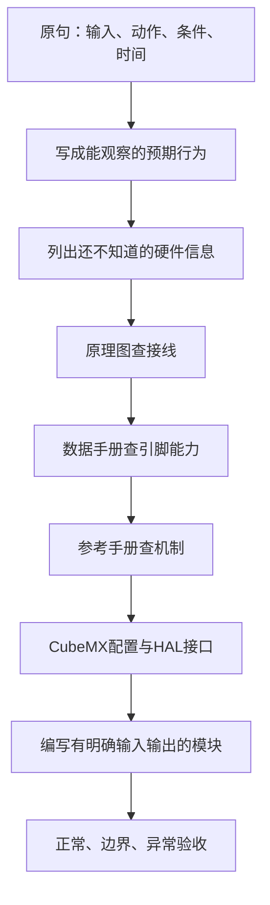

# 第十七届蓝桥杯管路监控：从题目开始读

> **平台与版本**：CT117E-M4 V1.1，STM32G431RBT6；开发基线STM32CubeMX 6.17.0、STM32CubeG4 V1.6.3、Keil ARM Compiler 5.06 update 7。后续配套工程使用24MHz外部晶振产生80MHz系统时钟。
>
> **最终效果**：用R37模拟压力、R39模拟流量，在PA1输出10kHz PWM，完成三页面、手动/自动控制、计量、校准和LED预警。
>
> **适合读者**：只会C语言，尚不熟悉外设配置、硬件接线和调试。无需先掌握ADC、定时器或中断，相关机制在对应模块首次使用前解释。
>
> **硬件条件**：可以通过Keil下载到实物；目前没有示波器和逻辑分析仪。
>
> **当前交付：第四阶段（完整功能与验收准备）。** 第17～22篇与页面设置、手动/自动控制、累计、报警、显示、最终App已交付。LQB17_Final及两个阶段目标均0错误0警告，三组主机测试通过；真实开发板/波形验收尚待执行。已准备41个C/H与最终HEX的提交清单，准考证号命名的正式压缩包待填写真实号码后生成。
>
> **第二阶段入口**：[08资源与原理图](08-资源包与原理图查找-精讲博客版.md) → [09配置与下载](09-CubeMX工程、80MHz时钟与Keil下载-精讲博客版.md) → [10 LED](10-GPIO、LED与573锁存器-精讲博客版.md) → [11 LCD](11-LCD驱动接入与字符更新-精讲博客版.md) → [12时间与集成](12-时间基准与非阻塞任务安排-精讲博客版.md)。实际操作看[第二阶段实操与验证记录](../Tests/第二阶段实操与验证记录.md)。

> **第三阶段入口**：[13按键](13-按键输入、防抖与松开后长按事件-精讲博客版.md) → [14压力](14-ADC采样、压力换算与零点校准-精讲博客版.md) → [15流量](15-输入捕获、频率测量与瞬时流量-精讲博客版.md) → [16 PWM与集成](16-PA1的10kHz PWM与第三阶段集成-精讲博客版.md)。上板前先看[第三阶段实操与验证记录](../Tests/第三阶段实操与验证记录.md)。

> **第四阶段入口**：[17页面与提交](17-页面状态、参数预设与退出后生效-精讲博客版.md) → [18控制](18-手动渐变、自动压力控制与目标跟踪-精讲博客版.md) → [19累计](19-100ms累计流量、余量保存与大数计量-精讲博客版.md) → [20报警](20-连续故障计时、恢复清除与LED报警-精讲博客版.md) → [21整机](21-三页面显示、主程序调度与最终工程集成-精讲博客版.md) → [22验收与提交](22-整机验收、故障定位与竞赛提交-精讲博客版.md)。[第四阶段验证记录](../Tests/第四阶段实操与验证记录.md)提供软件证据和板上待填表。

## 一、先学会把一句要求变成一个可验证的行为

拿到题目时，不从某个HAL函数开始猜。先确认输入是什么，输出是什么，什么时候触发，使用什么单位，有没有历史状态，有没有严格的边界。

例如“长按B3两秒后松开”决定：需要识别按下与释放、需要记录时间、不能满两秒就执行、动作必须在正确页面发生。“退出设置界面才生效”决定：正在编辑的数据和控制正在使用的数据必须分开。

第一阶段完成原句到行为及资料入口的映射。第二阶段沿同一条链实现基础外设；阶段验证入口调用与最终应用共用的BSP源码。

**知识小结**：结论：先确定可观察的行为，再决定代码。原因：函数选择解决不了遗漏需求的问题。关键参数：每条记录输入、输出、时间、单位和边界。常见误区：只记公式，不读“不生效”“松开后”“超过”等限定语。

## 二、第一阶段：六页需求的阅读顺序

每条分析都有七个步骤：原句、白话含义、确定条件、需要保存的数据、缺失信息、资料查找、实现与验收。图中文字按位置转写，数学下标与排版空格做了便于阅读的规整；有疑问时可点击各篇顶部原图核对。

| 顺序 | 文件 | 这一步完成什么 |
|---|---|---|
| 01 | [第1页：先确定平台、交付物和系统边界](01-第1页-先确定平台、交付物和系统边界-精讲博客版.md) | 确认交什么、用什么、整机有哪些输入输出 |
| 02 | [第2页：从信号和时间要求推导采集与计算](02-第2页-从信号和时间要求推导采集与计算-精讲博客版.md) | 推导压力/流量换算、累计公式及任务时间限制 |
| 03 | [第3页：把控制目标、实际输出与显示分开](03-第3页-把控制目标、实际输出与显示分开-精讲博客版.md) | 分清目标与实际值，列出控制分支和MAIN字段 |
| 04 | [第4页：把界面图变成布局与页面状态](04-第4页-把界面图变成布局与页面状态-精讲博客版.md) | 固定界面布局、参数含义和B1页面转换 |
| 05 | [第5页：把按键动作写成明确的事件规则](05-第5页-把按键动作写成明确的事件规则-精讲博客版.md) | 建立按键行为表，确定预设与提交的区别 |
| 06 | [第6页：用边界、持续时间和默认值完成需求闭环](06-第6页-用边界、持续时间和默认值完成需求闭环-精讲博客版.md) | 核对全部边界、报警持续时间和初始化 |
| 07 | [需求追踪表与工程约定](07-需求追踪表与工程约定-精讲博客版.md) | 由编号找到规划模块、资料入口和待执行验收 |

建议先只读第1页。能说清“为什么查原理图而非直接选ADC”之后，再读第2页。每篇末尾有自测问题与折叠答案，先用自己的话回答，再展开核对。遇到不熟悉的术语，先利用同篇白话解释和下表，不要求一次记住所有寄存器名字。

| 名词 | 在本项目里先理解到什么程度 |
|---|---|
| GPIO | MCU与外部电路连接的数字引脚，可读高低电平或输出高低电平 |
| ADC | 将连续电压转换成整数码的硬件，码再经计算成为压力 |
| 定时器 | 按一定节拍递增计数的硬件，不是软件循环延时 |
| 输入捕获 | 边沿到来时硬件保存计数值，两个时刻的差用于计算周期 |
| PWM | 周期性高低电平波形；占空比是高电平时间占总周期的比例 |
| HAL | ST提供的C接口，用函数和结构体配置或操作硬件 |
| 中断/回调 | 硬件事件让CPU进入处理入口；HAL处理后调用指定回调交给应用 |
| 状态 | 程序必须记住的当前情况，例如页面、模式、是否正在计时 |
| 非阻塞 | 检查并记录后及时返回，让其它任务继续执行 |

**知识小结**：结论：按页读齐要求，再按依赖学习模块。原因：同一功能的完整规则分散在多页。关键参数：六页原图、逐条编号、七步分析。常见误区：看到第3页图例就确定默认值，没有继续读第6页。

## 三、第二阶段与后续模块顺序

第08～22篇均已交付，可点击阅读；接下来结合开发板操作结果继续验收和定位问题。每个模块先解释需求和机制，再给配置、源码、验证与排错，结合实板操作反馈继续。

| 编号 | 主题 | 必须先具备的基础 | 对应的最终模块/内容 |
|---|---|---|---|
| 08 | [资源包与原理图查找](08-资源包与原理图查找-精讲博客版.md)（已交付） | 六页需求分析 | 接线、引脚能力、资料索引 |
| 09 | [CubeMX工程、80MHz时钟与Keil下载](09-CubeMX工程、80MHz时钟与Keil下载-精讲博客版.md)（已交付） | 已确认板卡和接线 | .ioc、Core初始化、80MHz、SWD |
| 10 | [GPIO、LED与573锁存器](10-GPIO、LED与573锁存器-精讲博客版.md)（已交付） | 时钟、GPIO基本概念 | bsp_led |
| 11 | [LCD驱动接入与字符更新](11-LCD驱动接入与字符更新-精讲博客版.md)（已交付） | GPIO与共用总线 | 官方lcd/fonts、bsp_lcd |
| 12 | [时间基准与非阻塞任务安排](12-时间基准与非阻塞任务安排-精讲博客版.md)（已交付） | main循环和函数调用 | bsp_time、稳定App接口与阶段验证入口 |
| 13 | [按键输入、防抖与松开后长按事件](13-按键输入、防抖与松开后长按事件-精讲博客版.md)（已交付） | GPIO、时间戳 | bsp_keys |
| 14 | [ADC采样、压力换算与零点校准](14-ADC采样、压力换算与零点校准-精讲博客版.md)（已交付） | 时钟、模拟输入 | bsp_adc、measurement压力部分 |
| 15 | [输入捕获、频率测量与瞬时流量](15-输入捕获、频率测量与瞬时流量-精讲博客版.md)（已交付） | 定时器计数、中断机制 | bsp_capture、measurement流量部分 |
| 16 | [PA1的10kHz PWM与第三阶段集成](16-PA1的10kHz PWM与第三阶段集成-精讲博客版.md)（已交付） | 时钟、计数器 | bsp_pwm |
| 17 | [页面状态、参数预设与退出后生效](17-页面状态、参数预设与退出后生效-精讲博客版.md)（已交付） | 按键事件和需求表 | settings |
| 18 | [手动渐变、自动压力控制与目标跟踪](18-手动渐变、自动压力控制与目标跟踪-精讲博客版.md)（已交付） | 测量、目标、PWM | control |
| 19 | [100ms累计流量、余量保存与大数计量](19-100ms累计流量、余量保存与大数计量-精讲博客版.md)（已交付） | 流量、100ms调度 | totalizer |
| 20 | [连续故障计时、恢复清除与LED报警](20-连续故障计时、恢复清除与LED报警-精讲博客版.md)（已交付） | 测量、实际D、参数与时间 | alarms |
| 21 | [三页面显示、主程序调度与最终工程集成](21-三页面显示、主程序调度与最终工程集成-精讲博客版.md)（已交付） | 所有模块接口 | display、app、main |
| 22 | [整机验收、故障定位与竞赛提交](22-整机验收、故障定位与竞赛提交-精讲博客版.md)（已交付） | 集成构建完成 | 主机测试、实物记录、源码与HEX清单 |

核心代码片段必须从对应最终模块摘取；随后给出该模块完整.h/.c。共同的数据类型、单位和接口先统一，代码只有一个来源。measurement会在压力篇给完整文件、在流量篇解释同一文件的另一部分，不另生成第二份同名实现。

自编头文件进入Firmware/BSP_Drivers/Inc，源文件进入Firmware/BSP_Drivers/Src。磁盘上真实存在这两个目录；Keil中把它们的文件统一加入BSP_Drivers组。Keil分组与磁盘目录不是同一个机制，不要求创建其不支持的任意嵌套分组。

CubeMX管理的外设使用其生成句柄和初始化。官方LCD驱动保留自身的GPIO初始化流程，单独解释共用总线的初始化先后；不在另一个BSP文件再建一套ADC/TIM句柄。需要修改Core文件时只在正确的USER CODE区域接入，并记录不能由CubeMX覆盖的边界。

**知识小结**：结论：教学片段和最终工程共用一份源码。原因：多套简化版本会造成接口、单位和时序衔接错误。关键参数：Inc放.h、Src放.c，工程搜索路径指向Inc。常见误区：把头文件加入工程树就以为编译器已经能搜索到它。

## 四、怎样验证，以及本阶段实际完成了什么

后续每个功能都按“操作→观察位置→预期→不符合时的定位步骤”验证。你的开发板可以验证LCD、按键、模式、参数提交和灯；Keil可观察寄存器与变量；PC测试可覆盖精确的数值边界、长时间累计和时间戳回绕。

观察变量不等于完整证明实际硬件：ADC码正确不自动证明实际电压精度，CCR正确不自动证明引脚PWM精度。暂停CPU的单步调试也会改变运行时序，不能用断点停留时间判断是否满足100ms响应。有仪器后再测PWM和真实响应时序。

第二阶段已实际用CubeMX生成独立Firmware工程，接入资源包LCD驱动，编写bsp_led、bsp_lcd、bsp_time，完成Keil构建与主机测试。结果和日志在[验证记录](../Tests/第二阶段实操与验证记录.md)。未连接开发板进行下载、显示或时序验收，不能把编译结果扩展成硬件通过。

第三阶段实现按键、测量和PWM，第四阶段已连接页面提交、控制、累计、报警与最终显示。最终固件为LQB17_Final；实板行为、精度和严格响应时间仍待验证。基础模块的局部测试不等于97条整机要求全部通过；追踪表保留最终验收条件，并单列已完成的基础工作。

读不通时可以先这样定位：

| 不清楚的地方 | 回到哪里 | 先回答的问题 |
|---|---|---|
| 不懂变量为什么存在 | 相应需求的第4步 | 下次事件发生时，程序必须记住什么历史信息？ |
| 不懂引脚为什么这样选 | 相应需求第5、6步 | 是板上接线固定，还是芯片允许的复用选择？ |
| 不懂数值怎么算 | 第2、3、5页的单位推导 | 当前量的单位是什么，时间单位是否一致？ |
| 不懂某个if条件 | 第5、6页原句 | 比较符、且/或、持续时间、触发边沿是什么？ |

**知识小结**：结论：计算、构建、实物观察和仪器测量分别记录。原因：它们能证明的范围不同。关键参数：软件边界可精确注入，真实波形需实测。常见误区：用旧工程日志或模拟预期代替新工程验收。

## 一页纸总结

- 第一阶段先完成需求分析，不急于拼凑外设代码。
- 每句话问清输入、输出、状态、单位、边界、时间和触发时机。
- 每个硬件结论沿原理图→数据手册→参考手册→库源码查证。
- 每条需求都有唯一编号，后续代码和测试继续引用。
- 文档分模块保存，源码保持统一，阶段验证代码与提交固件明确区分。
- 读完六页后，再开始第08篇的资源包与原理图实操。

## 关键参数表

| 项目 | 当前约定 |
|---|---|
| 平台 | CT117E-M4 V1.1 / STM32G431RBT6 |
| 路线 | CubeMX配置 + HAL + Keil |
| 时钟 | 24MHz HSE→PLL→80MHz |
| 输入 | R37压力、R39流量、B1～B4 |
| 输出 | PA1 PWM、LCD、LD1～LD4；LD5～LD8灭 |
| 当前成果 | Docs共23篇：目录、6页分析、追踪表、15篇模块与验收文章；Tests保留三个阶段验证记录 |
| 当前固件状态 | 三个目标均已构建；最终软件功能已实现，实际开发板与波形待验收 |

## 自测问题

1. 一句“长按两秒后松开”至少引出哪些状态？
2. 原理图、数据手册、参考手册分别回答什么问题？
3. 为什么不从一个完整Keys_Scan函数开始讲？
4. 为何必须保留原始频率和限幅后流量？
5. 当前没有示波器，可以验证什么，不能直接证明什么？

展开参考答案

1. 按下/释放状态、按下时刻、页面资格、持续时间及已处理事件；需要避免重复触发。
2. 原理图回答板上怎样连，数据手册回答芯片该引脚能做什么，参考手册回答外设如何工作、寄存器怎样控制。
3. 不先知道要识别哪些事件、记住哪些历史信息，就容易只能逐行背代码而不能自己设计。
4. 高于8000Hz的流量被限成40，但LD1仍需原始频率判断是否超限。
5. 可核对配置、寄存器、变量和用户操作现象；不能直接证明真实PWM频率、占空比误差和严格响应时延。

