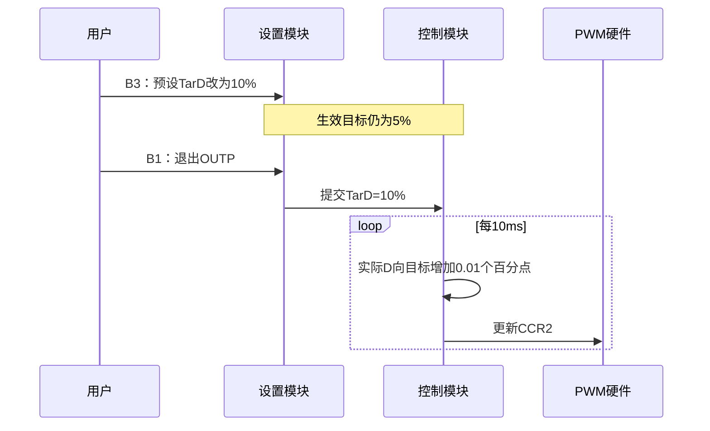

# 第3页逐句分析：把控制目标、实际输出与显示分开

> **适用平台**：CT117E-M4 V1.1 / STM32G431RBT6。
> **开发版本基线**：STM32CubeMX 6.17.0、STM32CubeG4 V1.6.3、Keil ARM Compiler 5.06 update 7。
> **适合读者**：会 C 语言，尚未独立配置和调试 STM32 外设。
> **本篇阶段**：第一阶段的读题与设计分析。文中实现位置用于规划；配套工程的当前进度与验证结果见[阅读目录](00-阅读路线与交付状态-精讲博客版.md)和[需求追踪表](07-需求追踪表与工程约定-精讲博客版.md)。整题及实板验收尚未完成。

[返回阅读目录](00-阅读路线与交付状态-精讲博客版.md) · [对照第3页原图](<D:/蓝桥杯嵌入式资源包/17届真题/3_6.png>) · [需求追踪表](07-需求追踪表与工程约定-精讲博客版.md)

本页要建立一个关键区别：用户设置的目标，不等于这一刻的实际输出。把这两个量混在一起，手动渐变、动态指示灯和MAIN中的D都会出错。

3.6描述控制行为，3.7描述如何把运行状态呈现给用户。图2里的AUTO、1.2、20.8、2089、80%、0.2V都是布局示例；上电值要继续读第6页。

阅读标记：**题目规定**来自原图；**资料确认**来自原理图、数据手册或驱动源码；**实现选择**是本工程采用的方法。文中的验收均是待执行步骤，示例计算不代表已上板测量。

## 一、先固定模式、范围与PWM周期

### P03-01｜3.6 模式选择

**1．题目原句**

> 支持通过按键切换手动、自动两种运行模式，控制PWM信号输出占空比。

**2．白话含义**：两种模式使用同一路PWM，只是决定占空比的规则不同。

**3．能确定的条件**：必须有MAN和AUTO两种模式，并能用按键切换。

**4．程序需要记住什么**：当前模式，以及两种模式各自的目标。

**5．还缺什么信息**：哪个键、在哪个页面切换。

**6．去哪里查、怎样核对**：第5页3.8的B2定义：MAIN页面切换；OUTP和PARA中的B2只是选择参数。

**7．落实到实现与验收**：settings处理模式事件，control按当前模式计算输出，bsp_pwm只执行输出。

**待执行验收**：后续在MAIN按B2切换两次返回原模式；设置页按B2不改变工作模式。

### P03-02｜3.6 占空比范围

**1．题目原句**

> 占空比可调范围限制在5%—95%。

**2．白话含义**：无论手动目标还是自动调节，实际输出都不能越过这两个边界。

**3．能确定的条件**：5%与95%端点允许；0%和100%不在范围内。

**4．程序需要记住什么**：当前占空比和统一的上下限。

**5．还缺什么信息**：百分比与计数器数值如何转换。

**6．去哪里查、怎样核对**：参考手册TIM章节查PWM mode，结合ARR和CCR定义；后文计算一次周期的总计数。

**7．落实到实现与验收**：目标编辑和输出驱动两处守住范围，避免自动控制绕过编辑限制。

**待执行验收**：后续自动持续要求增大/减小时，输出分别停在95%/5%，不能回绕。

### P03-03｜3.6 固定频率

**1．题目原句**

> 输出频率固定为10kHz。

**2．白话含义**：调节的是高电平比例，重复周期不变。10kHz即每秒10000个周期。

**3．能确定的条件**：周期=1/10000秒=100μs。

**4．程序需要记住什么**：定时器固定PSC和ARR，运行时更新CCR。

**5．还缺什么信息**：实际定时器时钟是否80MHz。

**6．去哪里查、怎样核对**：CubeMX时钟树核对APB1 timer clock；HAL生成代码查TIM2的PSC、Period和CH2。

**7．落实到实现与验收**：采用边沿对齐向上计数、PWM1、高有效；PSC=0，ARR=7999，5%对应CCR2=400。

**待执行验收**：后续改变占空比时检查PSC和ARR保持不变；用仪器确认周期约100μs。

以一周期100μs为例，5%意味着高电平约5μs、低电平约95μs；80%意味着高电平约80μs、低电平约20μs。变化的是高低时间分配，总周期都是100μs。

这里先知道三个名字的职责：PSC分频，ARR确定一个周期数多少次，CCR决定周期内何时改变输出。具体寄存器机制和CubeMX参数将在PWM模块中逐项展开。

**知识小结**：结论：两种模式共用固定频率PWM，并统一限制实际占空比。 原因：控制策略不同不意味着需要两路输出。 关键参数：10kHz、100μs、5%～95%；本方案PSC=0、ARR=7999。 常见误区：为了调整占空比去改ARR，导致频率也改变。

## 二、手动控制：为什么需要目标值和当前值

### P03-04｜3.6（1）手动模式

**1．题目原句**

> 支持通过按键直接配置PWM输出信号的占空比；配置生效后，占空比需从当前值以±1%/秒的速率平滑过渡至目标设定值。

**2．白话含义**：用户直接设的是目标占空比。生效后，实际输出一点点接近目标，并非立即跳过去。

**3．能确定的条件**：从当前值起步；每秒改变1个百分点；方向取决于目标比当前大还是小。

**4．程序需要记住什么**：TarD目标、实际D、控制任务的时间基准。

**5．还缺什么信息**：配置何时生效，采用多小的控制步长。

**6．去哪里查、怎样核对**：第5页规定退出设置页才生效；把1个百分点/秒换算为每10ms变化0.01个百分点。

**7．落实到实现与验收**：选择实际D用0.01%为单位保存，每10ms向目标移动1个单位，到目标停止；按键每次±5%只改变预设目标。

**待执行验收**：5%设到10%后退出：约1秒到6%、约5秒到10%；10%设到5%按同样速率下降；编辑期间实际输出继续追踪旧目标。

假设实际D=5%，你在OUTP按B3把TarD从5%改到10%。这时屏幕里的TarD已经是10%，但它还是预设值。按B1离开OUTP，目标才提交，随后实际D从5%向10%移动。

“±1%/秒”在本控制方案中表示每秒增减一个占空比百分点，例如50%到51%。不是每秒乘1.01，也不是每秒增加目标值的1%。

**知识小结**：结论：手动模式至少区分预设目标、生效目标和实际输出。 原因：编辑提交与平滑过渡发生在不同阶段。 关键参数：按键步长5个百分点，实际过渡1个百分点/秒，控制步长选10ms。 常见误区：B3按一下直接把CCR增加5%，或每次改目标都把实际输出重置5%。

## 三、自动控制：把三种互斥情况写完整

### P03-05｜3.6（2）目标压力

**1．题目原句**

> 允许用户设定一个目标压力值P_target。

**2．白话含义**：用户选择希望保持的压力，程序根据测量压力决定占空比往哪边调。

**3．能确定的条件**：TarP是压力目标，与TarD的单位和作用不同。

**4．程序需要记住什么**：生效目标压力TarP和当前压力P。

**5．还缺什么信息**：目标范围、步长和提交时机。

**6．去哪里查、怎样核对**：第5～6页查1.0～9.5BAR、±0.5BAR、退出设置页提交；与OUTP的TarP对应。

**7．落实到实现与验收**：参数按0.1BAR单位保存，进入计算时换到BAR；AUTO使用生效TarP。

**待执行验收**：后续编辑TarP期间控制仍按旧目标；退出OUTP后改用新目标。

### P03-06｜3.6（2）压力偏低

**1．题目原句**

> 当前压力P<P_target−0.5，占空比每秒增1%。

**2．白话含义**：低于目标区间下沿才增加输出，期望实际系统压力随之上升。

**3．能确定的条件**：严格小于下边界；变化速率1个百分点/秒。

**4．程序需要记住什么**：当前压力、目标压力和实际D。

**5．还缺什么信息**：怎样持续按该速率变化。

**6．去哪里查、怎样核对**：与手动模式共用10ms控制任务；不要把每秒增1%误写成每轮主循环增1%。

**7．落实到实现与验收**：P<TarP−0.5时选择增加方向，同时执行95%上限保护。

**待执行验收**：目标5.0BAR，输入4.4应增加，输入恰为4.5不应增加。

### P03-07｜3.6（2）压力偏高

**1．题目原句**

> 当前压力P>P_target+0.5，占空比每秒减1%。

**2．白话含义**：高于目标区间上沿才减少输出。

**3．能确定的条件**：严格大于上边界，按同一速率减小。

**4．程序需要记住什么**：实际D必须允许减小，不能让无符号减法下溢。

**5．还缺什么信息**：最低输出与减法的执行顺序。

**6．去哪里查、怎样核对**：合读本节末尾5%下限；检查减法前是否已到下限。

**7．落实到实现与验收**：P>TarP+0.5时选择减小方向，在5%处停止。

**待执行验收**：目标5.0BAR，5.6应下降，5.5应保持；D=5%时不得减到4.99%。

### P03-08｜3.6（2）目标区间

**1．题目原句**

> 当前压力P在[P_target−0.5，P_target+0.5]区间内，目标达成占空比保持不变。

**2．白话含义**：允许压力在目标附近波动，这一段内保持当前输出，避免一直来回调。

**3．能确定的条件**：方括号代表包含两端；不要求P必须精确等于TarP。

**4．程序需要记住什么**：保留当前D，同时供动态指示判断是否到达目标。

**5．还缺什么信息**：区间边界是否包含，以及显示舍入会不会影响判断。

**6．去哪里查、怎样核对**：按原式闭区间判断；控制使用未按显示小数位舍入的压力。

**7．落实到实现与验收**：低、正常、高三种条件互斥；区间内不把D设置成TarD，也不清零输出。

**待执行验收**：目标5.0时4.5、5.0、5.5均保持；显示4.5不一定代表内部值刚好4.5，应观察未舍入值。

### P03-09｜3.6（2）自动限幅

**1．题目原句**

> 自动模式下：若占空比已增加到95%，不再增加；已经降低至5%，不再减少。

**2．白话含义**：控制希望继续变化，也不能超过硬件输出范围。

**3．能确定的条件**：饱和限幅与达到压力目标是不同状态。

**4．程序需要记住什么**：实际D和压力区间判断分别保留。

**5．还缺什么信息**：限位时动态灯是否视为目标完成。

**6．去哪里查、怎样核对**：第6页LD4说到达目标后灭；此处只说停止越界，没有说压力已经达标。

**7．落实到实现与验收**：将输出夹在5%～95%；如果压力仍在目标区间外，不把限位误判为压力目标完成。

**待执行验收**：P持续偏低且D=95%时D保持95%；当前存在的目标调整指示不能仅因限位而误灭。

**知识小结**：结论：自动控制先比较压力，再决定增加、保持或减少。 原因：题目给出了带容许区间的三段规则。 关键参数：TarP±0.5BAR、闭区间保持、每秒1个百分点、5%～95%。 常见误区：只判断P与TarP大小，没有±0.5；或用显示舍入后的压力做控制。

## 四、MAIN界面：每一行应该读取什么数据

### P03-10｜3.7（1）字段清单

**1．题目原句**

> 监控界面显示系统运行关键数据，包括：界面名称（MAIN）、工作模式（M）、实时压力（P）、瞬时流量（F）、累计流量（Q）、PWM输出状态（D）和零点偏置电压（V）。

**2．白话含义**：MAIN用于查看运行结果，不是把所有设置项都摆上屏幕。

**3．能确定的条件**：字段名固定MAIN、M、P、F、Q、D、V。

**4．程序需要记住什么**：这些数据由各模块产生，显示模块只读取，不另造一套状态。

**5．还缺什么信息**：每项的单位、精度与具体位置。

**6．去哪里查、怎样核对**：继续读图2和图后的逐项说明；标题与信息项大小写按原图核对。

**7．落实到实现与验收**：display从运行状态构造MAIN文本；显示时不改变采样或控制值。

**待执行验收**：后续检查七类内容齐全，模式变化、校准、累计都能反映在相应位置。

### P03-11｜图2 监控界面

**1．题目原句**

> 图2 监控界面：第2行MAIN；第4～9行依次为M、P、F、Q、D、V。

**2．白话含义**：这是图中文字位置的转写。图上的格子提供布局坐标，并非要求额外画坐标轴。

**3．能确定的条件**：1起算：标题第2行第8列起；数据第4～9行第4列起；20列、10行。

**4．程序需要记住什么**：保存页面布局常量和要显示的字符。

**5．还缺什么信息**：官方字体如何把字符行列转换成像素。

**6．去哪里查、怎样核对**：lcd.h查Line0等行定义；lcd.c查LCD_DisplayStringLine与LCD_DisplayChar，字库采用16×24像素字符。

**7．落实到实现与验收**：内部可用0起算，标题行1列7、数据行3～8列3；明确库的横坐标方向，不把第2行写成Line2。

**待执行验收**：后续逐行对照原图，特别检查第2行标题和第4行M；不要把图中80%设为初值。

### P03-12｜3.7（1）M

**1．题目原句**

> 工作模式（M）：自动模式（AUTO）、手动模式（MAN）。

**2．白话含义**：用指定英文缩写显示当前模式。

**3．能确定的条件**：必须是AUTO或MAN，且反映真正运行模式。

**4．程序需要记住什么**：只读当前模式；无需额外保存一个可能不同步的显示模式。

**5．还缺什么信息**：由长字符串改成短字符串如何清除旧字符。

**6．去哪里查、怎样核对**：检查LCD字符串函数是否自动擦除行尾，结合本地lcd.c实现。

**7．落实到实现与验收**：输出固定宽度内容或补空格；AUTO变MAN时清掉最后的O。

**待执行验收**：后续来回切模式，不能出现MANO。

### P03-13｜3.7（1）P

**1．题目原句**

> 实时压力值（P）：保留小数点后1位有效数字，单位为BAR。

**2．白话含义**：这里按一位小数显示，例如0.0、1.2、10.0BAR。

**3．能确定的条件**：显示一位小数，单位BAR大写。

**4．程序需要记住什么**：完整计算压力与显示格式分开。

**5．还缺什么信息**：如何舍入和防止旧长数字残留。

**6．去哪里查、怎样核对**：查C格式化函数用法及LCD字符覆盖行为；把显示精度与ADC分辨率分开理解。

**7．落实到实现与验收**：仅在输出文本时保留一位小数，控制计算仍使用原测量精度。

**待执行验收**：后续从10.0变到0.0时无多余字符；内部4.49与显示4.5不应被混为同一精确值。

### P03-14｜3.7（1）F

**1．题目原句**

> 瞬时流量（F）：保留小数点后1位有效数字，单位为升/分钟。

**2．白话含义**：显示经过分段规则处理后的瞬时流量。

**3．能确定的条件**：一位小数，图中单位写L/M。

**4．程序需要记住什么**：使用计算好的F，不直接显示原始f。

**5．还缺什么信息**：图中文字单位与数值宽度。

**6．去哪里查、怎样核对**：图2对照F行；第2页复核低频0和高频40的规则。

**7．落实到实现与验收**：显示0.0L/M或40.0L/M等，清除数字缩短后的残留。

**待执行验收**：后续低于800Hz显示0.0L/M；超8000Hz显示40.0L/M而非更大值。

### P03-15｜3.7（1）Q

**1．题目原句**

> 累计流量（Q）：整数，单位为升，至少可累加至9999999升。

**2．白话含义**：累计值不能只设计到三位或四位数；至少能表示七位十进制升数。

**3．能确定的条件**：整数显示、单位L，容量至少9999999。

**4．程序需要记住什么**：uint32_t整升量及独立余量；不用uint16_t保存总升数。

**5．还缺什么信息**：整数范围及显示缓冲区长度。

**6．去哪里查、怎样核对**：stdint.h查uint32_t；无符号32位上限4294967295，uint16_t上限65535。结合20列布局计算文本宽度。

**7．落实到实现与验收**：整升量采用uint32_t，格式化时匹配参数类型；至少完整显示9999999L。

**待执行验收**：主机测试从9999999附近继续累计；不等待实物流过百万升，也不只测Q=0。

### P03-16｜3.7（1）D

**1．题目原句**

> PWM输出状态（D）：PWM输出信号占空比的实时值。

**2．白话含义**：显示这一刻实际送往PWM的占空比，而不是用户设置的目标。

**3．能确定的条件**：渐变期间MAIN中的D与OUTP中的TarD允许不同。

**4．程序需要记住什么**：实际输出D，必要时从CCR/周期计数核对。

**5．还缺什么信息**：实际计算值到整数百分比显示的处理。

**6．去哪里查、怎样核对**：图2的D行不带小数；结合渐变过程与PWM寄存器核对显示来源。

**7．落实到实现与验收**：本方案按整数百分比呈现实际输出，内部仍保留细分精度；不因显示为整数而把输出每秒跳1%。

**待执行验收**：5%向10%过渡中MAIN应逐步变化，不能一提交就显示10%。

### P03-17｜3.7（1）V

**1．题目原句**

> 零点偏置电压V_offset（V）：保留小数点后1位有效数字，单位为伏特。

**2．白话含义**：V行表示已经保存的零点，不是R37现在的实时电压。

**3．能确定的条件**：一位小数、单位V。

**4．程序需要记住什么**：读取offset；当前采样voltage另存。

**5．还缺什么信息**：校准后哪一个变量应改变。

**6．去哪里查、怎样核对**：回看3.4和第5页B3长按操作，把校准零点与实时输入分开画。

**7．落实到实现与验收**：校准时改变offset；以后转R37，P变化但V行保持该次校准零点。

**待执行验收**：后续校准到约0.3V后转R37，V仍显示0.3V而非跟随旋钮。

**知识小结**：结论：MAIN显示各模块的真实运行状态，格式化只影响呈现。 原因：目标、实际值和校准记录分别有不同意义。 关键参数：P/F/V一位小数，Q整数且至少9999999L；标题与字段位置固定。 常见误区：D显示TarD，V显示当前电压，或把舍入后的显示数重新用于控制。

## 五、OUTP的入口：先给两种目标命名

### P03-18｜3.7（2）输出配置界面

**1．题目原句**

> 输出配置界面下可以设置系统输出状态，包括：输出信号占空比（TarD）和目标压力值（TarP）。

**2．白话含义**：同一页面保存两种目标：手动用TarD，自动用TarP。

**3．能确定的条件**：字段名TarD和TarP区分大小写；该句不表示实时输出立即改变。

**4．程序需要记住什么**：预设TarD/TarP和已经生效的TarD/TarP。

**5．还缺什么信息**：布局、适用模式和生效规则。

**6．去哪里查、怎样核对**：第4页图3与说明确认目标含义，第5页确认选择、步长及退出提交。

**7．落实到实现与验收**：先建立两份参数记录；后续OUTP只编辑预设值，离开时提交。

**待执行验收**：后续在OUTP修改一个目标时，另一个目标保持；运行控制仍使用生效值。

**知识小结**：结论：OUTP配置的是控制目标。 原因：两种模式使用不同物理量作为目标，且设置要经过提交。 关键参数：TarD单位%，TarP单位BAR。 常见误区：只保存一份参数，导致编辑时已经影响控制。

## 本页验证与排错

| 现象 | 可能原因 | 确认与处理 |
|---|---|---|
| 一改目标输出立刻跳变 | 目标直接写CCR | 观察预设、生效目标、实际D，恢复渐变计算 |
| 自动模式边界持续抖动 | 比较符或显示舍入参与控制 | 检查闭区间和未舍入压力 |
| 低于5%或大于95% | 自动路径没限幅 | 在控制和PWM驱动两层核对范围 |
| MAN后面残留O | 没清除旧字符串尾部 | 固定宽度或补空格 |
| V跟随电位器变化 | 显示读取了实时voltage | 改读校准offset |

## 一页纸总结

- 固定10kHz，只调占空比；5%～95%是实际输出的边界。
- 手动：从当前D向生效TarD渐变，每秒一个百分点。
- 自动：P低于下沿增加，高于上沿减少，闭区间内保持；达到输出限位不代表压力达标。
- MAIN字段来自运行状态；D不是TarD，V不是实时电压。
- 按原图行列排版，容量至少覆盖9999999L；示例数值不作为默认值。

## 关键参数表

| 项目 | 要求或本方案选择 | 性质 |
|---|---|---|
| PWM频率/周期 | 10kHz / 100μs | 规定 / 推导 |
| 输出范围 | 5%～95% | 题目规定 |
| 渐变速率 | 1个百分点/秒 | 控制规则解释 |
| 控制步长 | 10ms、0.01个百分点/步 | 实现选择 |
| 自动保持区 | [TarP−0.5，TarP+0.5]BAR | 题目规定 |
| MAIN布局 | 标题(2,8)，字段从(4,4)起 | 图2，坐标1起算 |
| 总量容量 | 至少9999999L | 题目规定 |

## 自测问题

1. TarD=10%，D=7%是否一定出错？
2. TarP=5.0，P=4.5、5.5时怎样调？
3. D达到95%但压力不足，能否说目标达成？
4. 为什么Q不能用uint16_t？
5. 校准后旋钮变化，V行跟着变化正常吗？
6. 怎样判断MAIN显示的D不是目标值？

展开参考答案

1. 不一定；手动输出可能正从原值平滑接近10%。

2. 两端都属于保持区间，D保持。

3. 不能，输出限位只是禁止继续增加，压力是否达标需单独比较。

4. 其最大值65535，达不到至少9999999L的要求。

5. 不正常，V行应显示保存的零点电压，实时电压用于计算P。

6. 设置一个较远的TarD并提交，在渐变期间比较D、TarD和CCR2，D应对应当前输出。

[返回阅读目录](00-阅读路线与交付状态-精讲博客版.md) · [核对需求追踪表](07-需求追踪表与工程约定-精讲博客版.md)
