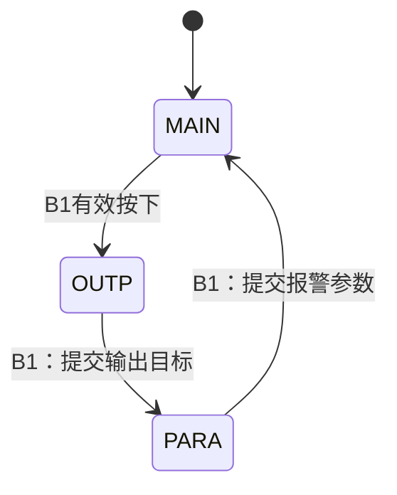

# 第4页逐句分析：把界面图变成布局与页面状态

> **适用平台**：CT117E-M4 V1.1 / STM32G431RBT6。
> **开发版本基线**：STM32CubeMX 6.17.0、STM32CubeG4 V1.6.3、Keil ARM Compiler 5.06 update 7。
> **适合读者**：会 C 语言，尚未独立配置和调试 STM32 外设。
> **本篇阶段**：第一阶段的读题与设计分析。文中实现位置用于规划；配套工程的当前进度与验证结果见[阅读目录](00-阅读路线与交付状态-精讲博客版.md)和[需求追踪表](07-需求追踪表与工程约定-精讲博客版.md)。整题及实板验收尚未完成。

[返回阅读目录](00-阅读路线与交付状态-精讲博客版.md) · [对照第4页原图](<D:/蓝桥杯嵌入式资源包/17届真题/4_6.png>) · [需求追踪表](07-需求追踪表与工程约定-精讲博客版.md)

本页最终得到三页的布局、参数含义和B1的切页顺序。这里第一次需要把“页面”作为程序中的一个状态来保存：用户在哪一页，会决定下一次按键有什么作用。

图3和图4同时规定了名称与位置。图中参数只是展示用数值，实际默认值仍以第6页为准。本页主要讲四件事：目标含义、报警参数、统一显示规则、页面切换。

阅读标记：**题目规定**来自原图；**资料确认**来自原理图、数据手册或驱动源码；**实现选择**是本工程采用的方法。文中的验收均是待执行步骤，示例计算不代表已上板测量。

## 一、OUTP：目标属于模式，页面只是编辑入口

### P04-01｜图3 输出配置界面

**1．题目原句**

> 图3 输出配置界面：OUTP，TarD=80%，TarP=5.5BAR。

**2．白话含义**：这里转写图中文字；图例说明目标占空比和目标压力怎样排列。

**3．能确定的条件**：1起算：OUTP从第2行第8列起，TarD从第4行第4列起，TarP从第5行第4列起。

**4．程序需要记住什么**：当前页面和两项预设值；布局是常量。

**5．还缺什么信息**：图中80%和5.5是否为默认值。

**6．去哪里查、怎样核对**：对照第6页初始状态：TarD=5%、TarP=5.0BAR。因此图例只决定布局，不能复制成默认配置。

**7．落实到实现与验收**：display按规定行列显示OUTP和两项预设参数；其余行保持黑色背景。

**待执行验收**：后续第一次进入OUTP应看到5%、5.0BAR，位置与图3相同。

### P04-02｜3.7（2）目标语义

**1．题目原句**

> 在系统运行过程中，TarD定义手动模式下输出信号的占空比调节目标，TarP定义自动模式下的压力调节目标。

**2．白话含义**：TarD回答“希望输出多少百分比”，TarP回答“希望压力达到多少BAR”。它们不是互相换算得到的两个显示值。

**3．能确定的条件**：MAN追踪TarD，AUTO根据P和TarP调节实际D。

**4．程序需要记住什么**：分别保存两个目标；切模式不能把其中一个当成另一个。

**5．还缺什么信息**：不处于对应模式时，修改目标应怎样处理。

**6．去哪里查、怎样核对**：结合第5页退出设置才生效：两个目标都可以保存，但只有对应模式读取它。

**7．落实到实现与验收**：配置提交保存两项值，控制模块根据模式选择有效目标。

**待执行验收**：后续MAN中只改TarP不应让D跳变；切到AUTO才按该TarP参与压力控制。

**知识小结**：结论：OUTP保存两种不同单位的目标，当前模式决定使用哪一个。 原因：页面组织与控制逻辑是两个维度。 关键参数：TarD为%，TarP为BAR；标题(2,8)，参数(4,4)/(5,4)。 常见误区：把图例80%当成初值，或让AUTO也直接追踪TarD。

## 二、PARA：先理解参数代表什么，再决定怎么存

### P04-03｜3.7（3）四个安全参数

**1．题目原句**

> 系统支持4个核心安全参数的设定功能，包括FH、FL、PL和DH，这些参数作为管路泄露、堵塞等异常情况的判定依据。

**2．白话含义**：用户可以调整报警条件中的门槛。门槛只是判断标准，不等于当前测到的流量或压力。

**3．能确定的条件**：必须有FH、FL、PL、DH四项设置；用于报警判断。

**4．程序需要记住什么**：四项预设阈值和四项已经生效的阈值。

**5．还缺什么信息**：哪项用于堵塞、哪项用于泄漏，比较符是什么。

**6．去哪里查、怎样核对**：到第6页3.9：堵塞用F<FL且D>DH；泄漏用F>FH且P<PL，并均要求持续超过两秒。

**7．落实到实现与验收**：参数放settings，alarms只读取生效阈值；命名与单位写进注释。

**待执行验收**：后续只修改FH不应直接改变堵塞阈值；只改DH不应改变压力映射。

### P04-04｜图4 运行参数界面

**1．题目原句**

> 图4 运行参数界面：PARA，FH=30.0L/M，FL=5.0L/M，PL=1.0BAR，DH=75%。

**2．白话含义**：这里转写图例。四行对应四个可选参数，不需要额外增加“选中”文字。

**3．能确定的条件**：1起算：标题第2行第8列起；FH、FL、PL、DH依次第4～7行第4列起。

**4．程序需要记住什么**：当前选中项和参数预设值，页面文本按固定位置生成。

**5．还缺什么信息**：实际初值以及选中项如何重置。

**6．去哪里查、怎样核对**：第6页给默认FH=20.0、FL=10.0、PL=1.0、DH=65%；第5页规定每次进入PARA默认选FH。

**7．落实到实现与验收**：布局照图，数据来自预设参数；进入页面时复位选择下标。

**待执行验收**：后续首次进入应显示20.0/10.0/1.0/65，而不是照搬图例30.0/5.0/1.0/75。

### P04-05｜3.7（3）FH、FL单位

**1．题目原句**

> 其中FH、FL代表两个瞬时流量参数，单位为升/分钟，保留小数点后1位有效数字。

**2．白话含义**：两个门槛都与F比较，因此单位必须与F一致；显示格式是一位小数。

**3．能确定的条件**：FH、FL用L/min，图中缩写L/M。

**4．程序需要记住什么**：参数可以用0.1L/min为单位的整数保存，例如20.0存200。

**5．还缺什么信息**：取值范围、步长、两者是否必须有大小关系。

**6．去哪里查、怎样核对**：第5页步长1L/min，第6页各自4～40；题目未规定FH必须大于FL。

**7．落实到实现与验收**：分别限幅，不自行加入FH>FL等联动限制；运算前统一单位。

**待执行验收**：后续检查20.0加一次显示21.0；FH、FL相等时也应按各自比较规则运行。

### P04-06｜3.7（3）PL单位

**1．题目原句**

> PL为压力参数，单位为BAR，保留小数点后1位有效数字。

**2．白话含义**：PL是泄漏判断所用的低压力门槛，与自动控制目标TarP不是同一个参数。

**3．能确定的条件**：单位BAR，一位小数；需要与当前P比较。

**4．程序需要记住什么**：独立保存PL，不能与TarP共用一个变量。

**5．还缺什么信息**：范围、步长以及报警使用方式。

**6．去哪里查、怎样核对**：第5～6页查±0.5BAR和1.0～9.5BAR；3.9查P<PL。

**7．落实到实现与验收**：采用0.1BAR单位保存PL，例如1.0存10；报警换算到与P一致的单位。

**待执行验收**：后续修改PL不能改变AUTO的目标压力；相等P=PL不满足严格小于。

### P04-07｜3.7（3）DH单位

**1．题目原句**

> DH为输出信号占空比参数。

**2．白话含义**：DH是堵塞判断里的占空比门槛，不是要立刻输出的占空比。

**3．能确定的条件**：以百分比表示，报警比较实际D>DH。

**4．程序需要记住什么**：独立保存DH，实际D和手动目标TarD另存。

**5．还缺什么信息**：DH的取值范围和调整步长。

**6．去哪里查、怎样核对**：第5页查±10%，第6页查5%～95%；报警句中明确“当前PWM输出占空比”。

**7．落实到实现与验收**：DH可用整数百分比保存，与细分单位D比较时先统一量纲。

**待执行验收**：后续修改DH只改变报警门槛，不直接改变CCR或TarD。

容易混淆的三个百分比量：

| 名称 | 回答的问题 | 谁会改变它 |
|---|---|---|
| TarD | 手动模式想达到多少 | 用户编辑并提交 |
| D | 这一刻实际输出多少 | 控制算法逐步改变 |
| DH | 超过多少且低流量时可能堵塞 | 用户编辑并提交 |

再看两种压力：TarP是控制目标，PL是报警门槛。它们可以不同；不能因为单位都是BAR就共用一个变量。

**知识小结**：结论：参数要按物理意义区分，而不能只看数值或单位。 原因：同为百分比的目标、实际量和报警阈值参与不同运算。 关键参数：FH/FL为L/min，PL为BAR，DH为%。 常见误区：把阈值写到输出，或自行添加题目没有规定的FH/FL大小限制。

## 三、统一显示规则：驱动和布局都要符合要求

### P04-08｜3.7（4）背景

**1．题目原句**

> 显示背景色（BackColor）：黑色。

**2．白话含义**：字符周围以及被擦除的区域都应该是黑色。

**3．能确定的条件**：背景颜色固定黑。

**4．程序需要记住什么**：LCD驱动保存背景色；应用不需要为每个页面再设一种颜色。

**5．还缺什么信息**：资源库的颜色常量和设置函数。

**6．去哪里查、怎样核对**：MDK5_LCD_HAL/Inc/lcd.h查Black，Src/lcd.c查LCD_SetBackColor与LCD_Clear。

**7．落实到实现与验收**：初始化设置黑色背景并清屏；运行中擦除旧文字也使用黑底。

**待执行验收**：后续切换三页，空白区均为黑色，无上页文字残影。

### P04-09｜3.7（4）前景

**1．题目原句**

> 显示前景色（TextColor）：白色。

**2．白话含义**：文字用白色画出；不能靠变红、变绿表示选中参数。

**3．能确定的条件**：字体前景固定白。

**4．程序需要记住什么**：LCD驱动中的前景色状态。

**5．还缺什么信息**：设置函数和按键操作是否修改了颜色。

**6．去哪里查、怎样核对**：lcd.h查White、LCD_SetTextColor；第6页明确按键不改变字体前景色与背景色。

**7．落实到实现与验收**：初始化统一白字；参数选择只修改内部索引，不采用变色或反色选择框。

**待执行验收**：后续每次按B1～B4观察颜色保持；白底黑字也不符合要求。

### P04-10｜3.7（4）分隔符

**1．题目原句**

> 数据项与对应的数据之间使用“=”间隔开。

**2．白话含义**：字段名和数值之间按要求用等号。

**3．能确定的条件**：例如P=1.2BAR，不能自行改成P:1.2BAR。

**4．程序需要记住什么**：格式字符串或字符布局中包含等号。

**5．还缺什么信息**：各字段是否还有大小写和位置要求。

**6．去哪里查、怎样核对**：逐项对照图2、图3、图4，不把普通文本排版习惯代替题图。

**7．落实到实现与验收**：在页面格式中固定等号，并预留数值变化需要的宽度。

**待执行验收**：后续检查M、P、F、Q、D、V、TarD、TarP、FH、FL、PL、DH均用等号。

### P04-11｜3.7（4）驱动、字库、布局

**1．题目原句**

> 使用资源数据包中提供的驱动和字库文件，严格按照图示2、3、4要求设计各个信息项的名称（区分字母大小写）和行列位置。

**2．白话含义**：使用指定显示基础文件，在其上组织页面；名称和行列也属于验收内容。

**3．能确定的条件**：不能用任意字体重排，也不能把TarD写成TARD或tard。

**4．程序需要记住什么**：统一页面布局表和字符缓存，不重复保存业务状态。

**5．还缺什么信息**：资源包中哪个驱动适用于本工程，坐标参数是字符还是像素。

**6．去哪里查、怎样核对**：选择BSP/LCD_Driver/MDK5_LCD_HAL内lcd.c、lcd.h、fonts.h；读函数实现，确认字符16×24像素以及显示横坐标方向。

**7．落实到实现与验收**：按既定行列转成库接口坐标；标题写连续字符串MAIN/OUTP/PARA，不把印刷字符间距机械转成额外空格。

**待执行验收**：后续分别对照三张图核对名称、大小写、位置；查询驱动来源，避免混用LL版初始化。

**知识小结**：结论：显示不仅要有数值，还要符合指定颜色、名称和位置。 原因：固定布局是功能要求的一部分。 关键参数：黑底白字、等号、20列10行、资源包字库。 常见误区：用变色显示选中参数，或把像素坐标当作第几行第几列直接传入。

## 四、B1切页：一个按键为什么需要知道当前页面

### P04-12｜3.8（1）B1及图5

**1．题目原句**

> B1：定义为“界面”按键。按下B1按键可以往复切换监控、输出配置和运行参数三个界面，切换模式如图5所示。

**2．白话含义**：每次有效按下一次，走到下一页；图5末尾的回路表示PARA之后回MAIN。

**3．能确定的条件**：顺序固定MAIN→OUTP→PARA→MAIN；不是任意切换。图5标题印在第5页顶部，属于同一张图。

**4．程序需要记住什么**：当前页面，进入页面时的选中项；离开页面时还需要提交参数。

**5．还缺什么信息**：按键的硬件引脚，以及换页前后需要执行哪些附加动作。

**6．去哪里查、怎样核对**：原理图B1接PB0、低有效；第5页规定退出提交、进入默认选项。先读齐再实现完整切页操作。

**7．落实到实现与验收**：消抖后一次按下只切一页；先提交离开的设置页，再切到下一页并准备该页预设值。

**待执行验收**：后续从MAIN连续按3次回MAIN；按住不连跳；离开OUTP后目标生效，离开PARA后阈值生效。

可以把“当前页面”理解为程序记住你现在站在哪个房间。同一个B2在不同房间有不同功能，所以换页需要更新状态变量，不能只在屏幕上换一行标题。

**知识小结**：结论：切页改变程序状态，也连接参数提交和选项初始化。 原因：按键语义和显示内容都依赖当前页面。 关键参数：MAIN→OUTP→PARA→MAIN，B1一次有效按下走一步。 常见误区：只改标题不改页面状态，或先进入下一页再把错误的一组预设提交。

## 本页验证与排错

| 现象 | 可能原因 | 确认与处理 |
|---|---|---|
| 换页后B2作用仍旧 | 只更新了文字 | 观察page变量和按键分支 |
| 显示跑到错误行 | 1起算与0起算混用 | 用原图行列核对，再转换成库坐标 |
| 修改DH导致D跳变 | 阈值与输出混用 | 检查各字段来源与单位 |
| 默认数值与要求不符 | 复制了图例 | 按第6页初始状态重新核对 |
| 按键后变色或反色 | 自加了选中样式 | 恢复统一白字黑底 |

## 一页纸总结

- OUTP显示手动目标TarD与自动目标TarP。
- PARA显示报警阈值FH、FL、PL、DH；阈值不是实时测量或输出目标。
- 用原图固定布局，用第6页确定初值，两个来源各管一件事。
- LCD黑底白字，名称大小写和等号都要核对。
- B1换页同时触发离页提交和新页面准备；具体B2/B3/B4操作继续读第5页。

## 关键参数表

| 项目 | 要求或本方案选择 | 性质 |
|---|---|---|
| OUTP标题/字段 | (2,8)，(4,4)/(5,4) | 图3，坐标1起算 |
| PARA标题/字段 | (2,8)，第4～7行第4列 | 图4，坐标1起算 |
| 字体颜色 | 白字黑底 | 题目规定 |
| 参数单位 | FH/FL：L/min；PL：BAR；DH：% | 题目规定 |
| B1顺序 | MAIN→OUTP→PARA→MAIN | 图5规定 |
| 预设参数保存 | 与生效参数分开 | 由退出提交要求推导 |

## 自测问题

1. 为什么TarD、D、DH不能共用一个变量？
2. 首次进入PARA应显示FH=30.0吗？
3. 只把MAIN标题改成OUTP算不算切页？
4. FH和FL相等是否应被程序强制改回？
5. 为什么不使用反色表示选中参数？

展开参考答案

1. 它们分别是目标、实时输出、报警门槛，会在不同条件下独立变化。

2. 不应。30.0是图例，第6页规定默认20.0L/min。

3. 不算；还要更新页面状态，使按键解释、显示内容和参数提交对应新页面。

4. 题目没有规定两者大小关系，只要求各自在允许范围内，因此不擅自添加联动限制。

5. 前景白、背景黑以及按键不改颜色都是明确要求，选中状态应由内部索引保存。

[返回阅读目录](00-阅读路线与交付状态-精讲博客版.md) · [核对需求追踪表](07-需求追踪表与工程约定-精讲博客版.md)
