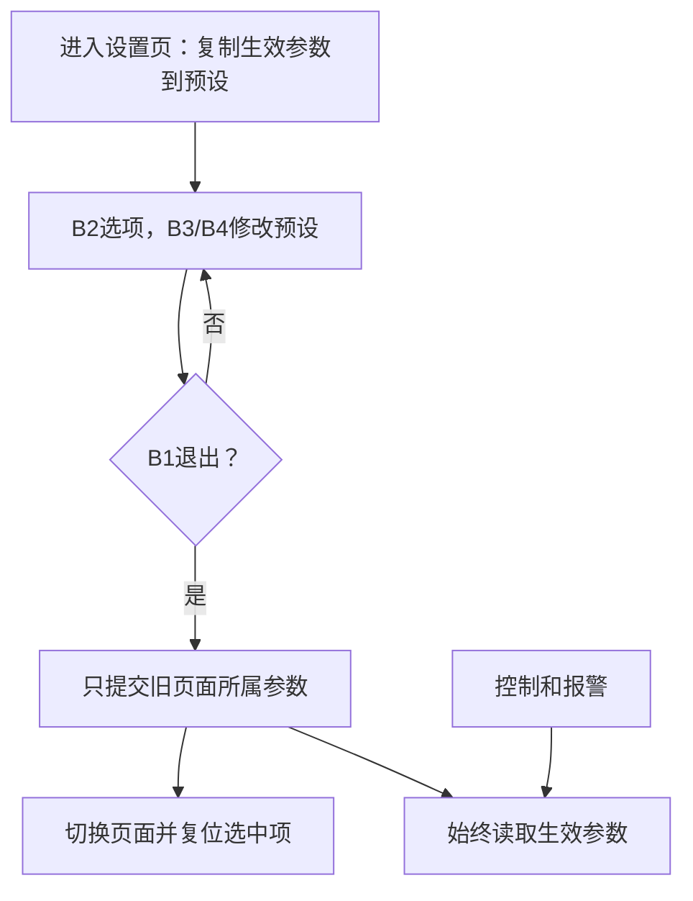

# 第5页逐句分析：把按键动作写成明确的事件规则

> **适用平台**：CT117E-M4 V1.1 / STM32G431RBT6。
> **开发版本基线**：STM32CubeMX 6.17.0、STM32CubeG4 V1.6.3、Keil ARM Compiler 5.06 update 7。
> **适合读者**：会 C 语言，尚未独立配置和调试 STM32 外设。
> **本篇阶段**：第一阶段的读题与设计分析。文中实现位置用于规划；配套工程的当前进度与验证结果见[阅读目录](00-阅读路线与交付状态-精讲博客版.md)和[需求追踪表](07-需求追踪表与工程约定-精讲博客版.md)。整题及实板验收尚未完成。

[返回阅读目录](00-阅读路线与交付状态-精讲博客版.md) · [对照第5页原图](<D:/蓝桥杯嵌入式资源包/17届真题/5_6.png>) · [需求追踪表](07-需求追踪表与工程约定-精讲博客版.md)

本页最终要形成按键行为表，而不是马上写一个很长的按键函数。先逐项问：在哪个页面、哪一个键、按下还是松开、持续多久、改变预设还是生效值？这六个问题决定后面需要的状态和判断。

页首“图5 LCD界面切换模式”是上一页图5的标题。本页接着讲B2、B3、B4及参数提交，不能把页首标题误认为新增一种按键功能。

阅读标记：**题目规定**来自原图；**资料确认**来自原理图、数据手册或驱动源码；**实现选择**是本工程采用的方法。文中的验收均是待执行步骤，示例计算不代表已上板测量。

## 一、B2：相同按键在三个页面做三种事情

### P05-01｜3.8（2）B2定义

**1．题目原句**

> B2：定义为“功能”按键。

**2．白话含义**：“功能”是角色名称，具体动作取决于当前页面。

**3．能确定的条件**：B2不是全局固定的模式切换键。

**4．程序需要记住什么**：当前页面和该页选中项。

**5．还缺什么信息**：对应引脚，以及每页具体行为。

**6．去哪里查、怎样核对**：原理图B2接PB1、低有效；继续阅读本条①②③。

**7．落实到实现与验收**：按键模块只输出B2有效按下事件，页面模块决定如何处理。

**待执行验收**：后续在三页分别按B2，观察各自状态变化而不是同一动作。

### P05-02｜3.8（2）①及图6

**1．题目原句**

> 在监控界面下，按下B2按键，切换选择手动或自动工作模式。

**2．白话含义**：MAIN中每按一次B2就在MAN和AUTO之间切换，图6两条箭头表示双向切换。

**3．能确定的条件**：只有MAIN的B2负责模式切换。

**4．程序需要记住什么**：当前模式；实际D保持作为新控制过程的起点。

**5．还缺什么信息**：模式变化后是否把输出重新设置成初值。

**6．去哪里查、怎样核对**：第3页手动要求从当前值过渡，自动要求按速率增减，均没有要求切模式重置D。

**7．落实到实现与验收**：切换模式后使用该模式生效目标，从当前D继续控制，不突然重置到5%。

**待执行验收**：后续在D明显不等于5%时切模式，确认输出没有无依据跳变。

### P05-03｜3.8（2）②及图7

**1．题目原句**

> 在输出配置界面下，按下B2按键，切换当前选择的输出配置，切换模式如图7所示。

**2．白话含义**：OUTP里B2决定下次加减修改TarD还是TarP；图7表示TarD↔TarP。

**3．能确定的条件**：选择顺序两项循环；不改变MAN/AUTO模式。

**4．程序需要记住什么**：OUTP选中项，例如0代表TarD、1代表TarP。

**5．还缺什么信息**：如何知道当前选择不必靠颜色变化。

**6．去哪里查、怎样核对**：第6页禁止按键改变前景背景色；按规定初始项和循环次数即可知道选中项。

**7．落实到实现与验收**：只改变选择索引，B3/B4根据索引修改对应预设值。

**待执行验收**：后续进入OUTP按一次B2再按B3，应只增加TarP；再按B2和B3应增加TarD。

### P05-04｜3.8（2）②进入默认项

**1．题目原句**

> 每次从监控界面进入输出配置界面，默认当前可调整的参数为TarD。

**2．白话含义**：即使上次离开时选的是TarP，下次进入也从TarD开始。

**3．能确定的条件**：“每次”表示进入动作要复位选择项，不只上电初始化一次。

**4．程序需要记住什么**：进入OUTP时把选择索引置为TarD。

**5．还缺什么信息**：在哪里识别进入页面的瞬间。

**6．去哪里查、怎样核对**：查看B1页面转换：MAIN→OUTP这一条就是进入点。

**7．落实到实现与验收**：在切页处理里初始化选中项，并从生效配置准备预设副本。

**待执行验收**：后续先选TarP离开，再绕一圈回OUTP，直接按B3应该改TarD。

### P05-05｜3.8（2）③及图8

**1．题目原句**

> 在运行参数界面下，按下B2按键，切换当前选择的运行参数，切换模式如图8所示。

**2．白话含义**：PARA中B2按FH→FL→PL→DH→FH循环，不跳过任何参数。

**3．能确定的条件**：四项循环，顺序来自图8。

**4．程序需要记住什么**：PARA的选中项，可用0～3表示。

**5．还缺什么信息**：每个索引对应哪个参数。

**6．去哪里查、怎样核对**：逐箭头读图8并和图4的显示顺序核对，两者顺序一致。

**7．落实到实现与验收**：建立固定映射，最后一项后回首项；显示和加减使用同一映射。

**待执行验收**：后续每按一次B2后按B3，依次只改变FL、PL、DH、FH。

### P05-06｜3.8（2）③进入默认项

**1．题目原句**

> 每次从输出配置界面进入运行参数界面，默认当前可调整的参数为FH。

**2．白话含义**：进入PARA时第一项可调的是FH，不记住上次选择。

**3．能确定的条件**：每次OUTP→PARA均重置选中项。

**4．程序需要记住什么**：页面状态和选择索引。

**5．还缺什么信息**：进入PARA与提交OUTP参数的先后关系。

**6．去哪里查、怎样核对**：合读本页末尾退出才生效：先完成OUTP目标提交，再准备PARA。

**7．落实到实现与验收**：换页时先处理旧页，再令PARA选择FH并建立该页编辑副本。

**待执行验收**：后续从OUTP进入PARA，直接B3应增加FH；同时刚修改的输出目标已生效。

**知识小结**：结论：B2的意义由当前页面决定，进入设置页要复位选中项。 原因：没有页面状态就无法正确解释同一个事件。 关键参数：MAIN切模式；OUTP两项；PARA四项，分别默认TarD和FH。 常见误区：B2在所有页面都切模式，或第二次进入还停在旧选项。

## 二、B3/B4编辑：一次有效按下只修改选中参数

### P05-07｜3.8（3）B3及加法范围

**1．题目原句**

> B3：定义为“加”按键。在输出配置或运行参数界面下，加按键对当前选择的参数有效，参数调节规则如下：TarD：+5%；TarP：+0.5BAR；FH：+1L/MIN；FL：+1L/MIN；PL：+0.5BAR；DH：+10%。

**2．白话含义**：设置页按B3，只增加当前选中项；六个参数的步长不同。

**3．能确定的条件**：TarD加5个百分点，TarP/PL加0.5BAR，FH/FL加1L/min，DH加10个百分点。

**4．程序需要记住什么**：选择索引、预设参数以及各参数步长。

**5．还缺什么信息**：各自上限，以及按住时是否连发。

**6．去哪里查、怎样核对**：本页末尾与第6页给范围；题目没有要求连发，本方案只响应一次消抖后的按下。

**7．落实到实现与验收**：按参数选择步长，计算新值后限幅；只有一次有效按下才修改，按住不重复增加。

**待执行验收**：后续TarD 5→10、TarP 5.0→5.5、FH20.0→21.0、DH65→75；长按设置页B3也不连续加。

### P05-08｜3.8（4）B4及减法范围

**1．题目原句**

> B4：定义为“减”按键。在输出配置或运行参数界面下，减按键对当前选择的参数有效，参数调节规则如下：TarD：−5%；TarP：−0.5BAR；FH：−1L/MIN；FL：−1L/MIN；PL：−0.5BAR；DH：−10%。

**2．白话含义**：与加法对应，但要避免减到下限以下。

**3．能确定的条件**：六个减法步长分别与加法相同；只影响当前选择的预设参数。

**4．程序需要记住什么**：当前预设值、下限；中间计算要能表达负数。

**5．还缺什么信息**：无符号类型减法下溢的风险。

**6．去哪里查、怎样核对**：复习C整数运算：先用足够范围的有符号中间值算减法，再夹在上下限内；不能先下溢再检查是否小于0。

**7．落实到实现与验收**：将加减统一为“当前值加带符号步长，再限幅”，不把B4在设置页解释成清累计。

**待执行验收**：后续DH=5再减仍5，而非变成很大的数；PL=1.0再减仍1.0。

参数保存方式先约定清楚，后面就能解释为什么代码里的增量有时不是屏幕上看到的数字：

| 参数 | 保存单位 | 默认值的内部表示 | 一次B3增量 |
|---|---|---|---|
| TarD | 1个百分点 | 5 | 5 |
| TarP | 0.1BAR | 50 | 5 |
| FH | 0.1L/min | 200 | 10 |
| FL | 0.1L/min | 100 | 10 |
| PL | 0.1BAR | 10 | 5 |
| DH | 1个百分点 | 65 | 10 |

这是本工程的数据表示选择。以TarP为例，50代表5.0BAR，加5之后55代表5.5BAR，避免每次编辑都依赖浮点步进。实际PWM占空比另用0.01个百分点细分保存，不能和TarD/DH的整数单位直接比较。

**知识小结**：结论：加减操作同时依赖页面、选中项、单位和步长。 原因：同一个键会编辑不同物理量。 关键参数：5%、0.5BAR、1L/min、10%分别对应不同参数。 常见误区：所有参数统一加1，或在无符号变量上直接减到下限以下。

## 三、MAIN长按：为什么必须分别处理按下和松开

### P05-09｜3.8（3）②B3校准

**1．题目原句**

> 在监控界面下，长按B3按键2秒后松开按键，触发零点校准功能，即时将当前电压值更新为零点偏置电压。

**2．白话含义**：先按住至少两秒，再松开，校准发生在松开的有效事件上；当前电压取释放触发时的有效采样。

**3．能确定的条件**：页面MAIN，键B3，持续时间达到2s，释放触发，一次动作只校准一次。

**4．程序需要记住什么**：按下时刻、按键有效性和按下所在页面；还要有当前电压与保存零点。

**5．还缺什么信息**：怎样消抖、怎样取当前电压、跨页后释放是否误触发。

**6．去哪里查、怎样核对**：原理图B3接PB2；第6页要求防抖；第2页3.4规定校准后的斜率和下限。

**7．落实到实现与验收**：消抖按下时开始计时；释放后计算持续时间再校准。实现选择：按住期间切过页就取消本次长按资格，释放前取新ADC有效读数。

**待执行验收**：后续MAIN短按不校准；按满2s仍未松开不校准；保持2.1s后松开才更新。按下与释放电压不同，应采用释放时电压。

### P05-10｜3.8（4）②B4清零

**1．题目原句**

> 在监控界面下，长按B4按键2秒后松开按键，触发累计流量清零功能。

**2．白话含义**：同样等待有效释放，只是操作对象变成累计流量。

**3．能确定的条件**：MAIN、B4、长按达到2s、释放后执行。

**4．程序需要记住什么**：B4独立的按下时刻，累计整升和余量。

**5．还缺什么信息**：清零是否包含屏幕看不到的小数部分。

**6．去哪里查、怎样核对**：回看3.5累计规则：小数余量属于累计历史，因此必须一同清除。

**7．落实到实现与验收**：清零总升数与余量；不改变模式、参数、零点或当前瞬时流量。

**待执行验收**：后续将余量积到接近1L再清零，应重新积满1L才显示1；长按期间数据采集继续。

先用一条操作时间线理解，不必先背“状态机”这个词：

| 时刻 | 你做了什么 | 程序需要做什么 |
|---|---|---|
| 有效按下被确认 | 按住B3 | 记住开始时间和是否在MAIN |
| 持续约1秒 | 继续按住 | 继续采样、显示；不校准 |
| 持续超过2秒 | 仍然按住 | 仍不校准，等待释放 |
| 释放被消抖确认 | 松开B3 | 判断持续时间与页面资格，符合才校准 |
| 再过一次扫描 | 已经松开 | 没有新的释放事件，不重复校准 |

实现时用毫秒时间戳相减判断持续时间。扫描一次不代表固定经过了某个精确时长，所以不用简单累计循环次数替代时间。跨页取消也是额外防误触设计：即使按着B3绕一圈返回MAIN，本次长按仍已取消，需重新按下。

**知识小结**：结论：长按动作由按下记录和松开判断共同完成。 原因：原文明确写了“2秒后松开”，并要求采集显示不受影响。 关键参数：MAIN、B3/B4、≥2000ms、有效释放；两键各自计时。 常见误区：满两秒立即触发、阻塞等待两秒、或只清整数不清余量。

## 四、参数提交：为什么需要预设和生效两份数据

### P05-11｜按键功能设计要求：提交时机

**1．题目原句**

> 输出配置、运行参数在对应界面下的调整均为预设状态（不生效），仅在退出该设置界面时触发全局更新，配置或参数生效。

**2．白话含义**：设置页是编辑草稿的地方，运行控制继续使用旧参数；离开正在编辑的页面才把这页参数提交。

**3．能确定的条件**：OUTP退出提交TarD/TarP；PARA退出提交FH/FL/PL/DH。不是必须等回MAIN才统一生效。

**4．程序需要记住什么**：生效配置active、编辑副本draft、离开的页面。

**5．还缺什么信息**：先提交还是先切页，是否误覆盖另一页参数。

**6．去哪里查、怎样核对**：画B1转换：OUTP→PARA已离开OUTP，所以输出目标此时生效；PARA→MAIN时报警阈值生效。

**7．落实到实现与验收**：处理B1先按旧页面提交所属字段，再切页并准备新页面副本；只改显示值却不提交或全局一直读draft都错误。

**待执行验收**：后续OUTP编辑目标时实际控制不变，切到PARA即开始新目标跟踪；PARA编辑阈值时报警继续使用旧阈值。

可以把draft看作正在填写的表单，把active看作正在执行的设置。退出页面相当于提交这张表单。

“全局更新”在这里指新参数开始影响系统各使用者，不等于必须把所有变量声明成C全局变量。一个保存于应用状态结构体的参数，也能通过接口供控制和报警共同使用。

**知识小结**：结论：先编辑副本，再按离开的页面提交。 原因：原文明确编辑期间不生效，且两个设置页分别生效。 关键参数：OUTP两项、PARA四项；提交发生在切到下一页之前。 常见误区：回MAIN才提交OUTP，或控制直接读取draft。

## 五、范围与步长一起读，才能确定边界动作

### P05-12｜按键功能设计要求：有效范围

**1．题目原句**

> 输出配置、运行参数范围如下，调节时应确保取值合理有效。

**2．白话含义**：每次编辑都要检查范围，不能等退出后再让无效值短暂进入系统。

**3．能确定的条件**：范围跨本页与第6页，必须读齐六个参数。

**4．程序需要记住什么**：参数上下限与步长；限幅后的预设值。

**5．还缺什么信息**：超过边界时停住还是从另一端循环。

**6．去哪里查、怎样核对**：题目要求合理有效但未要求数值回环；本方案选择夹到最近边界，不循环。

**7．落实到实现与验收**：用统一限幅方法，保证任何加减结果都落在允许区间内。

**待执行验收**：后续在每个上限连续加、下限连续减，数值保持边界，不跳另一端。

### P05-13｜范围：TarD

**1．题目原句**

> TarD：5%—95%。

**2．白话含义**：手动目标占空比最低5%，最高95%。

**3．能确定的条件**：闭区间5～95，编辑步长5个百分点。

**4．程序需要记住什么**：整数百分比目标，不是渐变过程中的细分实际D。

**5．还缺什么信息**：范围和步长是否能到达端点。

**6．去哪里查、怎样核对**：从默认5开始按5递增，5、10……95均可达。

**7．落实到实现与验收**：TarD=95再加保持95，TarD=5再减保持5。

**待执行验收**：后续从5加18次到95，再加不越界；减少同理。

### P05-14｜范围：TarP

**1．题目原句**

> TarP：1.0—9.5BAR。

**2．白话含义**：目标压力限制在压力量程内部，为±0.5BAR控制区间保留边界。

**3．能确定的条件**：1.0～9.5BAR，步长0.5BAR；实际测量压力仍允许0～10BAR。

**4．程序需要记住什么**：0.1BAR单位的整数目标，内部范围10～95。

**5．还缺什么信息**：不要把目标范围误用成传感器测量范围。

**6．去哪里查、怎样核对**：对照3.4的0～10BAR测量范围和3.6的目标区间。

**7．落实到实现与验收**：只对目标编辑限幅；压力测量另按0～10处理。

**待执行验收**：后续目标1.0再减仍1.0、9.5再加仍9.5；输入电压最低仍可显示0BAR。

**知识小结**：结论：范围限制参数的合法值，步长决定一次操作改变多少。 原因：两者合用才能覆盖端点并避免越界。 关键参数：TarD 5～95%，TarP 1.0～9.5BAR；其余四项继续第6页。 常见误区：把目标压力范围用于裁剪实际压力，或参数越界后才在显示时隐藏。

## 本页验证与排错

| 现象 | 可能原因 | 确认与处理 |
|---|---|---|
| 长按尚未松开已校准 | 在按住分支执行了动作 | 将动作放到有效释放事件处理 |
| 设置时PWM已变化 | 控制读取draft或按键直接改active | 观察两份参数及读取路径 |
| 回MAIN后才开始追目标 | 提交时机太晚 | 在OUTP→PARA处提交输出参数 |
| 参数减一下变成大数 | 无符号下溢 | 用有符号中间值计算并限幅 |
| 切页后释放B3误校准 | 未记录/取消跨页资格 | 页面变化时取消正在按住的长按动作 |
| 清零后很快跳1L | 小数余量未清 | 同时清整升与余量 |

## 一页纸总结

- 先确定当前页面，再解释按键；B2在三个页面含义不同。
- 进入OUTP默认TarD，进入PARA默认FH，每次都要重置。
- 设置页B3/B4只改预设选中项，按对应步长并立即限幅。
- MAIN长按B3/B4在释放后触发，分别校准零点、清累计。
- active供控制与报警使用，draft供编辑显示；退出哪一页，就提交哪一页所属字段。
- 本方案不提供长按连发，跨页按住再释放不执行MAIN长按动作。

## 关键参数表

| 项目 | 要求或本方案选择 | 性质 |
|---|---|---|
| B2 MAIN/OUTP/PARA | 模式 / TarD与TarP / FH→FL→PL→DH | 题目规定 |
| TarD/TarP步长 | 5个百分点 / 0.5BAR | 题目规定 |
| FH/FL/PL/DH步长 | 1L/min / 1L/min / 0.5BAR / 10个百分点 | 题目规定 |
| MAIN长按 | B3校准、B4清零，达到2s后释放 | 题目规定 |
| 提交 | 退出对应设置页 | 题目规定 |
| 范围 | TarD 5～95%，TarP 1.0～9.5BAR | 题目规定 |
| 越界/按住/跨页 | 限幅 / 不连发 / 取消长按资格 | 实现选择 |

## 自测问题

1. OUTP里B2按一次再B3，会改什么？
2. 长按B3已经3秒但还没松开，应该校准了吗？
3. 为何校准不能采用刚按下时的电压？
4. OUTP切到PARA时TarD生效了吗？
5. 把参数做成全局变量是否就满足全局更新？
6. 累计清零只写Q=0为什么不够？

展开参考答案

1. 默认选TarD，B2后选TarP，B3增加0.5BAR预设值。

2. 不应，原文要求长按后松开才触发。

3. 原文要求触发时当前电压，按住期间电压可能已经变化。

4. 已生效，因为已经退出OUTP，不必等待回MAIN。

5. 不满足。关键是编辑和生效时机；全局变量也可能被错误地实时修改。

6. 旧小数余量仍会参与下一次累计，必须把整升和余量一起清掉。

[返回阅读目录](00-阅读路线与交付状态-精讲博客版.md) · [核对需求追踪表](07-需求追踪表与工程约定-精讲博客版.md)
