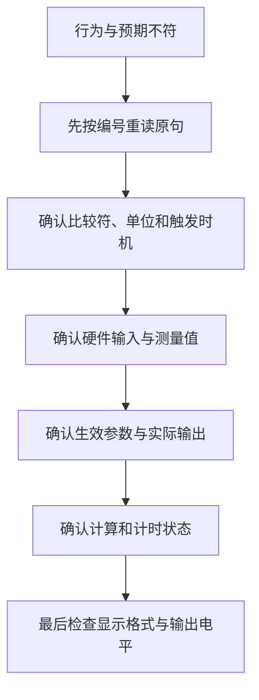

# 需求追踪表与工程约定

> **适用平台**：CT117E-M4 V1.1 / STM32G431RBT6；CubeMX 6.17.0、STM32CubeG4 V1.6.3、Keil ARM Compiler 5.06 update 7。
> **技术点**：需求分解、资料查找、硬件资源分配、接口单位与验收。
> **最终作用**：由任何一条原文追到负责模块和测试，避免漏实现、实现两套或误报完成。
> **读者**：会C语言，正在学习独立分析并实现嵌入式项目。
> **状态**：第四阶段已完成全部功能模块、最终App和第17～22篇。三个Keil目标与三组主机测试通过；真实开发板、波形、严格时序及现场提交仍待执行，不能将97条整机要求全标为实测通过。

[返回目录](00-阅读路线与交付状态-精讲博客版.md)

## 一、编号怎样用

P02-03表示第2页的第3条分析，不是题目原有条款号。点击编号可跳回原句和七步分析。复合句保留在同一条内，再在解释中分别列出条件；界面图、公式、初始值、提交规则都纳入记录。

实现阶段在负责模块的必要注释中引用编号，测试也引用相同编号。一次需求可能跨越采样、计算和显示，所以“负责位置”有时列出两个模块。

**知识小结**：结论：需求编号连接原文、实现与验收。原因：功能规则分布在多页，靠文件名记忆容易遗漏。关键参数：P页码-序号。常见误区：追踪表写了模块名就认为已经实现。

## 二、本地资料入口与查找顺序

所有页码均为这里实际核对的资源包PDF阅读器页码；版本不同页码可能变化，优先用搜索词和表名定位。硬件以V1.1为主，不能照搬V1.2的三针J11连接。

**S0｜版本对应**：[ES/ReadMe.txt](<D:/蓝桥杯嵌入式资源包/嵌入式数据资源包/ES/ReadMe.txt>)。先确认板卡版本对应哪张原理图。说明中写两版接口兼容，但跳线形态仍应按实物版本检查。

**S1｜硬件接线**：[SCH_CT117E_M4_V1.1.pdf](<D:/蓝桥杯嵌入式资源包/嵌入式数据资源包/ES/SCH_CT117E_M4_V1.1.pdf>)。PDF第1页为主控电路，第2页为下载器。搜索R37、R39、J11、J9、J17、U1、CN3、X1；看网络标签找到MCU引脚。主控X1标24MHz，不使用下载器晶振作为主控HSE。

**S2｜引脚能力**：[STM32G431RB数据手册.pdf](<D:/蓝桥杯嵌入式资源包/嵌入式数据资源包/ES/DataSheet/STM32G431RB数据手册.pdf>)，本地DS12589 Rev2。第55页PB15的模拟功能为ADC2_IN15；第61页PA1/AF1为TIM2_CH2；第62页PB4/AF2为TIM3_CH1。模拟通道查Pin definitions，数字复用查Alternate function表，不能把ADC通道号误当AF编号。

**S3｜外设机制与寄存器**：[STM32G4系列微控制器参考手册.pdf](<D:/蓝桥杯嵌入式资源包/嵌入式数据资源包/ES/DataSheet/STM32G4系列微控制器参考手册.pdf>)，本地RM0440 Rev5。按目录找RCC、GPIO、ADC、TIM2/TIM3；搜索PLL、analog mode、input capture、PWM mode、PSC、ARR、CCR。GPIOx_ODR在9.4.6、PDF第363页，偏移0x14；不能使用STM32F1的0x0C偏移。

**S4｜LCD资源**：[MDK5_LCD_HAL目录](<D:/蓝桥杯嵌入式资源包/嵌入式数据资源包/ES/BSP/LCD_Driver/MDK5_LCD_HAL>)。使用Src/lcd.c和Inc/lcd.h、fonts.h。搜LCD_Init、LCD_CtrlLinesConfig、LCD_DisplayChar、LCD_DisplayStringLine；看实际实现核对PC数据线和PB5/PB8/PB9/PA8控制线，不照抄旧注释里的其它系列引脚。

**S5｜HAL接口与时间基准**：[本机STM32CubeG4 V1.6.3 HAL目录](<D:/Tools/STM32_Repository/STM32Cube_FW_G4_V1.6.3/Drivers/STM32G4xx_HAL_Driver>)。Inc里查声明，Src里查同名函数实现。GPIO搜HAL_GPIO_Init；ADC搜HAL_ADC_Init、HAL_ADCEx_Calibration_Start、HAL_ADC_Start、HAL_ADC_GetValue；TIM搜HAL_TIM_IC_Start_IT、HAL_TIM_PWM_Start。时间查stm32g4xx_hal.c的HAL_InitTick、HAL_IncTick、HAL_GetTick，再到工程中断文件确认SysTick_Handler调用HAL_IncTick。不要在应用中重复定义一份HAL_IncTick。

**S6｜锁存器**：[74HC_HCT573.pdf](<D:/蓝桥杯嵌入式资源包/嵌入式数据资源包/ES/DataSheet/74HC_HCT573.pdf>)。查LE、OE及功能表：LE高时透明，LE低时保持；结合原理图确认OE接地、PD2控制LE。理解保持作用后，再解释为什么LCD改变PC数据线不应改变已锁存LED状态。

**S7｜学习阶段的在线核对**：已通过Context7查询ST官方库`/stmicroelectronics/stm32g4xx-hal-driver`，辅助核对HAL初始化与毫秒时基，并与本地S5源码对照。[ST官方HAL源码](https://github.com/STMicroelectronics/stm32g4xx-hal-driver/blob/master/Src/stm32g4xx_hal.c)。在线通用示例可能使用其它时钟或外设，不能替代本板原理图和本地版本核对；现场按题目资料使用限制执行。

### 一次完整查找示范：R37如何变成ADC2通道15

1. 在第2页找到固定对象“R37”，还没有足够信息直接填写ADC配置。
2. 打开S1主控页，找到R37的滑动端和J11，沿标签读到PB15；检查J11需要短接。
3. 打开S2搜索PB15，在Pin definitions找到ADC2_IN15，确认不是ADC1。
4. 打开S3的ADC章节，理解参考电压、12位转换和单端输入；原理图核对J17的VREF+连接。
5. 到CubeMX选择ADC2通道15，核对PB15为模拟模式、无上下拉；生成后查看adc.c和MSP中的GPIO配置。
6. 到S5查采样、等待转换结束、读取结果、校准接口；区分“ADC硬件校准”与用户长按设置压力零点，它们不是同一件事。
7. 后续先观察ADC原始码随R37变化，再检查电压和压力公式。原始码不变时先查接线与配置，不先修改压力公式。

**知识小结**：结论：查资料按问题类型逐层推进。原因：板上连接、芯片能力、硬件机制和软件接口来自不同文件。关键参数：R37→J11→PB15→ADC2_IN15。常见误区：找到一个HAL示例就把示例里的ADC1、PA0和时钟整段搬过来。

## 三、硬件与数据接口基线

以下是整机配置约定。第三阶段IOC已配置HSE/PLL、SWD、LED、四键输入、ADC2、TIM2 PWM和TIM3捕获；官方LCD驱动负责其总线初始化。各外设配置已生成并编译，尚未在实物验证。

| 功能 | 引脚/资源 | 配置方向及依据 |
|---|---|---|
| 时钟 | PF0/PF1，主控X1 24MHz | HSE晶体，PLL M=6/N=40/R=2，SYSCLK/HCLK=80MHz |
| 总线 | APB1/APB2 | 均不分频，TIM2/TIM3时钟为80MHz |
| SWD | PA13/PA14 | Serial Wire，保留下载调试 |
| 按键B1/B2/B3/B4 | PB0/PB1/PB2/PA0 | GPIO输入，上拉，按下低；板上已有10kΩ上拉 |
| 压力R37 | J11→PB15 | ADC2_IN15，模拟无上下拉；同步AHB/4=20MHz，247.5周期采样；J11/J17接通 |
| 流量R39 | J9→PB4 | AF2 TIM3_CH1，上升沿、下拉；PSC79、ARR65535，常规16周期平均；J9短接 |
| PWM | PA1，J3第4脚 | AF1 TIM2_CH2，高有效PWM1；PSC0、ARR7999、初始CCR400 |
| LED | PC8～PC15、PD2 | 低有效数据，经573锁存；PD2默认低，写入后恢复LCD数据口 |
| LCD数据 | PC0～PC15 | 官方驱动按读写操作切换数据方向 |
| LCD控制 | PB5/PB8/PB9/PA8 | 分别WR/RS/CS/RD，由官方驱动操作 |

### 模块输出什么，谁负责解释

| 层次/模块 | 输入 | 输出与职责 | 不应混入的职责 |
|---|---|---|---|
| bsp_adc | ADC2硬件 | 有效性、当前电压V | 不决定报警、不修改页面 |
| bsp_capture | TIM3捕获值、时间 | 原始频率Hz、有效性 | 不把超8000Hz的频率裁掉 |
| measurement | 电压、零点、原始频率 | 压力BAR、流量L/min | 不直接画LCD或写PWM |
| bsp_keys | GPIO键位、毫秒时间 | 去抖后的按下/释放、键号、持续时间 | 不决定当前页面的功能 |
| settings | 按键事件、当前页面 | 模式、选中项、预设/生效配置、操作请求 | 不直接操作ADC/PWM寄存器 |
| control | 模式、生效目标、压力、实际D | 下一个实际D、目标是否达成 | 不读取未提交的预设值 |
| totalizer | 每100ms的有效流量 | uint32_t整升与有界余量 | 不按主循环次数随意累计 |
| alarms | 测量、实际D、生效阈值、时间、调节状态 | LD1～LD4逻辑状态 | 不负责电平取反和锁存时序 |
| bsp_pwm / bsp_led | 实际D / 逻辑灯位 | 硬件输出 | 不判断用户当前在哪一页 |
| bsp_lcd / display | 字符 / 运行状态和预设值 | 官方驱动封装 / 三页文本 | 不修改业务状态 |
| bsp_time | 当前毫秒时间、周期、独立计时对象 | 判断到期并推进边界，支持tick回绕 | 不负责等待、不采集过去漏掉的数据 |
| app | 时间、事件及各模块接口 | 初始化顺序和任务调度 | 不另复制模块计算规则 |

已实现模块接口和完整源码见第10～21篇。稳定入口为App_Init/App_Run：Phase2/Phase3各链接对应selftest.c，LQB17_Final只链接BSP_Drivers/Src/app.c。三个目标共享文件树，非当前入口用Include in Target Build明确排除。

### 数值单位与初始状态

| 数据 | 表示约定 | 初始状态/来源 |
|---|---|---|
| 时间 | uint32_t毫秒，无符号差值计算经过时间 | 启动调度时建立基准 |
| 电压/零点/压力/频率/流量 | 分别V、V、BAR、Hz、L/min；计算值不先按显示精度舍入 | 零点0；其余由采样计算 |
| TarD、DH | uint16_t，整数百分比 | 5、65 |
| TarP、PL | uint16_t，0.1BAR | 50、10 |
| FH、FL | uint16_t，0.1L/min | 200、100 |
| 实际D | uint16_t，0.01个百分点 | 500，即5% |
| Q | uint32_t整升，另存有界余量 | 整升与余量均0 |
| 页面/模式 | 枚举，意义由公共定义统一 | MAIN / MAN |
| 预设配置 | 与生效配置相同的结构 | 初始化时复制生效配置 |
| 故障时间 | 堵塞和泄漏分别有标记与开始时间 | 标记清零 |

**知识小结**：结论：先统一单位和模块边界，再编写函数。原因：数值相同并不代表物理量相同，单位不一致会让比较错100倍。关键参数：目标整数%、实际D的0.01%、压力设置0.1BAR。常见误区：把ADC硬件校准、压力零点校准和显示舍入混为一谈。

## 四、题目未指定部分的实现选择

这些是工程约定，不能改写成竞赛原文要求。后续若因实际验证需要调整，必须同时更新这里、源码、对应章节和测试。

| 编号 | 原文未完全指定的部分 | 本方案处理 |
|---|---|---|
| A01 | 数据是否掉电保存 | 运行状态存RAM；复位按第6页默认值，不加入EEPROM功能 |
| A02 | 扫描、防抖、无信号等待 | 按键5ms扫描、20ms防抖；50ms无边沿清除旧测频；这些周期要参与响应预算 |
| A03 | V_offset等于3.3V | 拒绝本次满量程零点校准并保留原值，避免除零；其它有效输入按规定校准 |
| A04 | LD4非当前目标、切模式、达标后再偏离 | 非当前模式目标只保存；当前目标改变并提交才启动其过程；切模式重新评估跟踪；已达标则灭，随后仅受扰偏离不自行重亮；已经达标不制造闪灯 |
| A05 | 达到存储上限 | Q用uint32_t，饱和到上限不回绕；必须满足至少9999999L，不能用float保存大整数累计再叠加微小增量 |
| A06 | 参数越界和长按连发 | 加减后限幅、不回环；设置页一次有效按下只改一次，不连发 |
| A07 | 按住期间切页 | 取消该次MAIN长按资格，即使绕回MAIN仍需重新按下 |
| A08 | 控制细分步长 | 每10ms变化0.01个百分点，等价每秒1个百分点；PWM硬件计数就近取整 |
| A09 | FH与FL的关系 | 按各自4～40范围独立编辑，不强加FH>FL |
| A10 | 占空比偏差±1%的基准 | 保留原文；设计量化按更严格相对误差自检，最终实测按赛事验收口径，不声称原文已定义基准 |
| A11 | 开机已按住的键 | 初始化记录当前电平但不建立有效按下历史；先松开再重新按下才报告正常事件 |
| A12 | 测频窗口与异常 | 常规16周期平均；间隔>1250us快速发布低频；50ms无边沿失效；CC1OF或零差丢弃窗口 |
| A13 | ADC端点与硬件采样 | 12位raw/4095×3.3作端点归一化；20MHz、247.5周期；失败另标valid，不当真实0V |
| A14 | PWM细分与读回 | 0.01个百分点请求量化到8000计数；GetDuty读回CCR配置而非实测波形；控制保存自己的细分状态 |
| A15 | 运行测量失效 | ADC无效时AUTO保持、泄漏条件清除；无有效捕获时F=0，允许高D低流量持续触发堵塞；不另占用LD5～8 |
| A16 | 任务漏槽 | 正常5/10/100ms按节拍执行；落后多槽只处理当前一次并累计诊断，不能用当前样本补造历史；漏槽时速率/计量需排错 |
| A17 | 阈值提交后的持续时间 | FL/DH改变只重启堵塞，FH/PL改变只重启泄漏；草稿和无关阈值不影响该计时 |
| A18 | 累计余量及显示舍入 | Q用uint32整升，余量一升600000000单位；F量化到百万分之一L/min；D显示整数就近舍入，内部仍0.01% |

**知识小结**：结论：把实现选择写明，才能检查设计是否改变了题目。原因：原文不会规定全部边界和内部表示。关键参数：A01～A18单独编号。常见误区：把5ms扫描或某种LD4补充行为说成题目明确要求。

## 五、逐条需求与待执行验收

全表共同状态：**原图已核对，设计已分析；基础及采集输出已实现，完整业务已实现，实板验收待执行**。下表的“待执行验收”仍描述最终整机，不能用基础测试替代。提交规则在最终打包时核对。

### 第二阶段已实现部分与证据

| 需求关联 | 当前实际实现位置 | 已有证据 | 尚未覆盖 |
|---|---|---|---|
| P01-01、P01-08 | [IOC](../Firmware/LQB17_Tutorial.ioc)、[main.c](../Firmware/Core/Src/main.c) | CubeMX生成、24MHz→80MHz参数检查、Keil构建 | 真实下载、主频精度 |
| P06-08、P06-13输出基础 | [bsp_led.c](../Firmware/BSP_Drivers/Src/bsp_led.c) | 主机测极性、映射、锁存数据和端口恢复；测试App高4位为0 | 实物灯号与锁存时序；报警业务 |
| P04-08、P04-09、P04-11显示基础 | [bsp_lcd.c](../Firmware/BSP_Drivers/Src/bsp_lcd.c) | 官方资源哈希一致；主机测颜色调用、坐标、补空格、单字预算 | 实际颜色/无噪点、最终三页面布局 |
| P02-06、P02-07、P02-10、P02-21计时基础 | [bsp_time.c](../Firmware/BSP_Drivers/Src/bsp_time.c) | 主机测到期、独立周期、回绕；验证App安排5/10/100ms槽位 | 实际响应、整屏刷新耗时、真实采样积分 |

日志和上板待填表见[第二阶段实操与验证记录](../Tests/第二阶段实操与验证记录.md)。

### 第三阶段已实现部分与证据

| 需求关联 | 当前实现 | 软件证据 | 尚待实现/验证 |
|---|---|---|---|
| P05-01、P05-09、P05-10、P06-05 | [bsp_keys](../Firmware/BSP_Drivers/Src/bsp_keys.c) | 防抖/释放持续时间/回绕测试通过 | 页面动作、跨页取消、真实响应；Q清零未实现 |
| P02-11、P02-14～16、P06-18 | [bsp_adc](../Firmware/BSP_Drivers/Src/bsp_adc.c)、[measurement](../Firmware/BSP_Drivers/Src/measurement.c) | ADC配置构建；采样失败、端点、斜率与校准拒绝测试通过 | 实际电压与误差、最终MAIN显示 |
| P02-12、P02-17～20、P06-09输入依据 | [bsp_capture](../Firmware/BSP_Drivers/Src/bsp_capture.c)、measurement | 窗口、回绕、超时/恢复、覆盖和800/8000边界通过 | 实际捕获链、LD1报警业务 |
| P02-08、P02-09、P02-13、P03-01～03、P06-20输出基础 | [bsp_pwm](../Firmware/BSP_Drivers/Src/bsp_pwm.c) | 5%启动、限幅、全部9001细分请求量化测试；Keil通过 | 真实波形精度、渐变与自动控制 |

[第三阶段实操与验证记录](../Tests/第三阶段实操与验证记录.md)给出两个构建目标、测试日志和实物待执行表。通用模块具备相应能力，不等于这些需求的完整业务链全部通过。

### 第四阶段已实现部分与证据

| 需求组 | 最终实现 | 已执行的软件证据 | 尚待执行 |
|---|---|---|---|
| 第4/5/6页页面与按键 | settings、app、bsp_keys | 草稿/提交、六范围、模式/选项、释放与跨页取消 | 实际手感、响应与全场景操作 |
| 第3页控制、第6页LD4 | control、bsp_pwm | 10ms步进、死区端点、限幅、无效压力、目标过程 | 1个百分点/秒的真实时间和波形 |
| 第2页累计、第3/6页Q | totalizer、app | 100ms公式、余量进位、千万升、饱和与清零 | 实际采样节拍和累计观察 |
| 第6页报警 | alarms、bsp_led | 严格阈值、2000/2001ms、恢复、回绕、参数改变 | 真实LED响应和连续条件 |
| 第3/4页显示与整机 | display、app | 行列/单位/补空格，真实App的主机调用链 | LCD颜色、无噪点、整屏更新时间 |
| 第1页提交 | package_submission.py、Final HEX | 41个C/H清单、构建输入哈希、测试ZIP完整性 | 真实准考证号、实板验收、本人上传 |

[第四阶段验证记录](../Tests/第四阶段实操与验证记录.md)列出证据与待填表；[97条机器可读映射](../Tests/build/requirement_evidence.json)逐条记录实现文件、软件证据范围及原来的最终验收方法。它不把源码存在等同于实物合格。

### 第1页：先确定平台、交付物和系统边界（11条）

| 编号 / 原条款 | 实现位置与职责 | 待执行验收方法与预期 |
|---|---|---|
| [P01-01](01-第1页-先确定平台、交付物和系统边界-精讲博客版.md#p01-01) · 1.1 平台 | [IOC](../Firmware/LQB17_Tutorial.ioc)、[Core/main.c](../Firmware/Core/Src/main.c)：配置与初始化 | 检查工程器件、芯片丝印、原理图三者一致；用 Keil 下载到实物，再观察模块行为。 |
| [P01-02](01-第1页-先确定平台、交付物和系统边界-精讲博客版.md#p01-02) · 1.2 参考资料 | [IOC](../Firmware/LQB17_Tutorial.ioc)、[Core/main.c](../Firmware/Core/Src/main.c)：配置与初始化 | 不依靠联网搜索，尝试从 R37 独立找到 PB15，再确认 ADC2_IN15。 |
| [P01-03](01-第1页-先确定平台、交付物和系统边界-精讲博客版.md#p01-03) · 1.3 提交内容 | [打包脚本](../Tests/package_submission.py)与[Final HEX](../Firmware/MDK-ARM/LQB17_Final/LQB17_Final.hex) | 解压后能找到相应 .c/.h/.hex；核对 HEX 时间和最近构建记录，避免提交旧文件。 |
| [P01-04](01-第1页-先确定平台、交付物和系统边界-精讲博客版.md#p01-04) · 1.3 HEX 用途和名称 | [打包脚本](../Tests/package_submission.py)与[Final HEX](../Firmware/MDK-ARM/LQB17_Final/LQB17_Final.hex) | 显示文件扩展名，确认没有形成 .hex.hex 或仅更改快捷方式名称。 |
| [P01-05](01-第1页-先确定平台、交付物和系统边界-精讲博客版.md#p01-05) · 注意事项：源码范围 | [打包脚本](../Tests/package_submission.py)与[Final HEX](../Firmware/MDK-ARM/LQB17_Final/LQB17_Final.hex) | 按清单逐个核对；不要漏掉被包含的自编头文件，也不要把全部 Drivers 自动打包。 |
| [P01-06](01-第1页-先确定平台、交付物和系统边界-精讲博客版.md#p01-06) · 注意事项：HEX 的产生 | [打包脚本](../Tests/package_submission.py)与[Final HEX](../Firmware/MDK-ARM/LQB17_Final/LQB17_Final.hex) | 确认零编译错误且输出目录存在本次 HEX；“没有错误”与“已经实物验证”分别记录。 |
| [P01-07](01-第1页-先确定平台、交付物和系统边界-精讲博客版.md#p01-07) · 注意事项：格式与大小 | [打包脚本](../Tests/package_submission.py)与[Final HEX](../Firmware/MDK-ARM/LQB17_Final/LQB17_Final.hex) | 检查压缩格式、大小、内容和 HEX 名称；不把这套学习文档当成提交源码。 |
| [P01-08](01-第1页-先确定平台、交付物和系统边界-精讲博客版.md#p01-08) · 二、系统时钟 | [IOC](../Firmware/LQB17_Tutorial.ioc)、[Core/main.c](../Firmware/Core/Src/main.c)：配置与初始化 | 检查生成配置和 SystemCoreClock=80000000；这是配置核对，不能独立证明实际时钟误差。不要使用下载器页的晶振数值。 |
| [P01-09](01-第1页-先确定平台、交付物和系统边界-精讲博客版.md#p01-09) · 二、硬件资源范围 | [IOC](../Firmware/LQB17_Tutorial.ioc)、[Core/main.c](../Firmware/Core/Src/main.c)：配置与初始化 | 检查系统功能不依赖额外硬件；复位后按第6页默认值运行。 |
| [P01-10](01-第1页-先确定平台、交付物和系统边界-精讲博客版.md#p01-10) · 图1 系统框图 | [app.c](../Firmware/BSP_Drivers/Src/app.c)：初始化、调度与模块调用 | 用自己的话画出“R37→ADC→压力→显示/控制/报警”和“R39→捕获→频率→流量→累计/报警”。 |
| [P01-11](01-第1页-先确定平台、交付物和系统边界-精讲博客版.md#p01-11) · 三、功能要求的场景描述 | [app.c](../Firmware/BSP_Drivers/Src/app.c)：初始化、调度与模块调用 | 长按按键时转动 R37/R39，后续要能观察到采集仍更新；自动控制测试时手动调 R37，模拟压力变化。 |

### 第2页：从信号和时间要求推导采集与计算（22条）

| 编号 / 原条款 | 实现位置与职责 | 待执行验收方法与预期 |
|---|---|---|
| [P02-01](02-第2页-从信号和时间要求推导采集与计算-精讲博客版.md#p02-01) · 3.1（1）压力 | [bsp_adc.c](../Firmware/BSP_Drivers/Src/bsp_adc.c) + [measurement.c](../Firmware/BSP_Drivers/Src/measurement.c)：电压采样与压力换算 | 后续转 R37，观察电压和压力同步变化。 |
| [P02-02](02-第2页-从信号和时间要求推导采集与计算-精讲博客版.md#p02-02) · 3.1（2）流量 | [bsp_capture.c](../Firmware/BSP_Drivers/Src/bsp_capture.c) + [measurement.c](../Firmware/BSP_Drivers/Src/measurement.c)：测频与瞬时流量 | 后续转 R39，确认频率与流量随之改变。 |
| [P02-03](02-第2页-从信号和时间要求推导采集与计算-精讲博客版.md#p02-03) · 3.1（3）执行机构 | [bsp_pwm.c](../Firmware/BSP_Drivers/Src/bsp_pwm.c)：PWM 启动与占空比输出 | 后续核对 CCR 与实际目标变化；波形精度需仪器测量。 |
| [P02-04](02-第2页-从信号和时间要求推导采集与计算-精讲博客版.md#p02-04) · 3.1（4）存储与查询 | [settings.c](../Firmware/BSP_Drivers/Src/settings.c)：页面、选项、预设与提交 | 后续设置后切页查看；复位时检查按规定恢复默认值。 |
| [P02-05](02-第2页-从信号和时间要求推导采集与计算-精讲博客版.md#p02-05) · 3.1（5）人机操作 | [bsp_keys.c](../Firmware/BSP_Drivers/Src/bsp_keys.c)：采样、防抖和事件 | 后续对同一 B2 在不同页面分别测试，不能全局都切模式。 |
| [P02-06](02-第2页-从信号和时间要求推导采集与计算-精讲博客版.md#p02-06) · 3.2（1）按键响应 | [bsp_keys.c](../Firmware/BSP_Drivers/Src/bsp_keys.c)：采样、防抖和事件 | 后续测试按键时采样仍更新；模拟抖动只产生一次事件。严格100 ms响应需计时记录，肉眼不能证明。 |
| [P02-07](02-第2页-从信号和时间要求推导采集与计算-精讲博客版.md#p02-07) · 3.2（2）指示灯响应 | [alarms.c](../Firmware/BSP_Drivers/Src/alarms.c)：持续条件计时与灯状态 | 后续检查2000 ms时尚未满足“超过”，条件满足后及时亮，恢复后及时灭。 |
| [P02-08](02-第2页-从信号和时间要求推导采集与计算-精讲博客版.md#p02-08) · 3.2（3）输出频率误差 | [bsp_pwm.c](../Firmware/BSP_Drivers/Src/bsp_pwm.c)：PWM 启动与占空比输出 | 后续检查寄存器；有仪器时测 PA1。当前没有仪器，不能把计算结果记成实际频率已合格。 |
| [P02-09](02-第2页-从信号和时间要求推导采集与计算-精讲博客版.md#p02-09) · 3.2（4）占空比误差 | [bsp_pwm.c](../Firmware/BSP_Drivers/Src/bsp_pwm.c)：PWM 启动与占空比输出 | 后续用寄存器计算量化误差；仪器测得高电平时间/周期后，再按赛事口径判定实际误差。 |
| [P02-10](02-第2页-从信号和时间要求推导采集与计算-精讲博客版.md#p02-10) · 3.2（5）LCD性能 | [bsp_lcd.c](../Firmware/BSP_Drivers/Src/bsp_lcd.c) + [display.c](../Firmware/BSP_Drivers/Src/display.c)：LCD 接入与页面内容 | 后续观察AUTO变MAN、40.0变4.0时无残留；记录更新完成时间，不能只看定时变量。 |
| [P02-11](02-第2页-从信号和时间要求推导采集与计算-精讲博客版.md#p02-11) · 3.3（1）R37 | [bsp_adc.c](../Firmware/BSP_Drivers/Src/bsp_adc.c) + [measurement.c](../Firmware/BSP_Drivers/Src/measurement.c)：电压采样与压力换算 | 后续转R37应改变ADC2读数；不变先查跳线和通道，再查换算。 |
| [P02-12](02-第2页-从信号和时间要求推导采集与计算-精讲博客版.md#p02-12) · 3.3（2）R39 | [bsp_capture.c](../Firmware/BSP_Drivers/Src/bsp_capture.c) + [measurement.c](../Firmware/BSP_Drivers/Src/measurement.c)：测频与瞬时流量 | 后续转R39观察捕获间隔变化；不要误转接PA15的R40。 |
| [P02-13](02-第2页-从信号和时间要求推导采集与计算-精讲博客版.md#p02-13) · 3.3（3）PA1 | [bsp_pwm.c](../Firmware/BSP_Drivers/Src/bsp_pwm.c)：PWM 启动与占空比输出 | 后续核对PA1复用和TIM2 CCR2；仪器接PA1并与开发板共地。 |
| [P02-14](02-第2页-从信号和时间要求推导采集与计算-精讲博客版.md#p02-14) · 3.4 线性映射 | [bsp_adc.c](../Firmware/BSP_Drivers/Src/bsp_adc.c) + [measurement.c](../Firmware/BSP_Drivers/Src/measurement.c)：电压采样与压力换算 | 计算测试：零点0V时1.65V应为5BAR；零点0.3V时1.8V应为5BAR。 |
| [P02-15](02-第2页-从信号和时间要求推导采集与计算-精讲博客版.md#p02-15) · 3.4 零点校准 | [bsp_adc.c](../Firmware/BSP_Drivers/Src/bsp_adc.c) + [measurement.c](../Firmware/BSP_Drivers/Src/measurement.c)：电压采样与压力换算 | 测试校准后当前压力变0，再提高电压检查新斜率；满量程校准不得产生NaN或无穷值。 |
| [P02-16](02-第2页-从信号和时间要求推导采集与计算-精讲博客版.md#p02-16) · 3.4 下限 | [bsp_adc.c](../Firmware/BSP_Drivers/Src/bsp_adc.c) + [measurement.c](../Firmware/BSP_Drivers/Src/measurement.c)：电压采样与压力换算 | 零点0.3V，输入0.2V、0.3V均应0BAR；0.6V应1BAR。 |
| [P02-17](02-第2页-从信号和时间要求推导采集与计算-精讲博客版.md#p02-17) · 3.5（1）公式与单位 | [bsp_capture.c](../Firmware/BSP_Drivers/Src/bsp_capture.c) + [measurement.c](../Firmware/BSP_Drivers/Src/measurement.c)：测频与瞬时流量 | 计算测试：4000Hz→20.0L/min，2000Hz→10.0L/min。 |
| [P02-18](02-第2页-从信号和时间要求推导采集与计算-精讲博客版.md#p02-18) · 3.5（1）有效范围 | [bsp_capture.c](../Firmware/BSP_Drivers/Src/bsp_capture.c) + [measurement.c](../Firmware/BSP_Drivers/Src/measurement.c)：测频与瞬时流量 | 800Hz应4.0L/min；8000Hz应40.0L/min且不触发“超过8000”的报警。 |
| [P02-19](02-第2页-从信号和时间要求推导采集与计算-精讲博客版.md#p02-19) · 3.5（1）低频 | [bsp_capture.c](../Firmware/BSP_Drivers/Src/bsp_capture.c) + [measurement.c](../Firmware/BSP_Drivers/Src/measurement.c)：测频与瞬时流量 | 测试799Hz→0，800Hz→4；断开输入后不能永久显示先前流量。 |
| [P02-20](02-第2页-从信号和时间要求推导采集与计算-精讲博客版.md#p02-20) · 3.5（1）高频 | [bsp_capture.c](../Firmware/BSP_Drivers/Src/bsp_capture.c) + [measurement.c](../Firmware/BSP_Drivers/Src/measurement.c)：测频与瞬时流量 | 测试8000Hz：40且LD1灭；8001Hz：40且LD1亮。板上旋钮未必能精确到边界，纯逻辑测试需注入数值。 |
| [P02-21](02-第2页-从信号和时间要求推导采集与计算-精讲博客版.md#p02-21) · 3.5（2）积分周期 | [totalizer.c](../Firmware/BSP_Drivers/Src/totalizer.c)：累计整升和小数余量 | 30L/min持续20个采样周期应累计1L；40L/min持续15个周期应1L。 |
| [P02-22](02-第2页-从信号和时间要求推导采集与计算-精讲博客版.md#p02-22) · 3.5（2）整升更新 | [totalizer.c](../Firmware/BSP_Drivers/Src/totalizer.c)：累计整升和小数余量 | 40L/min前14次显示0L，第15次显示1L；从9999999L继续累加仍应正确进位。 |

### 第3页：把控制目标、实际输出与显示分开（18条）

| 编号 / 原条款 | 实现位置与职责 | 待执行验收方法与预期 |
|---|---|---|
| [P03-01](03-第3页-把控制目标、实际输出与显示分开-精讲博客版.md#p03-01) · 3.6 模式选择 | [control.c](../Firmware/BSP_Drivers/Src/control.c)：手动/自动目标跟踪 | 后续在MAIN按B2切换两次返回原模式；设置页按B2不改变工作模式。 |
| [P03-02](03-第3页-把控制目标、实际输出与显示分开-精讲博客版.md#p03-02) · 3.6 占空比范围 | [bsp_pwm.c](../Firmware/BSP_Drivers/Src/bsp_pwm.c)：PWM 启动与占空比输出 | 后续自动持续要求增大/减小时，输出分别停在95%/5%，不能回绕。 |
| [P03-03](03-第3页-把控制目标、实际输出与显示分开-精讲博客版.md#p03-03) · 3.6 固定频率 | [bsp_pwm.c](../Firmware/BSP_Drivers/Src/bsp_pwm.c)：PWM 启动与占空比输出 | 后续改变占空比时检查PSC和ARR保持不变；用仪器确认周期约100μs。 |
| [P03-04](03-第3页-把控制目标、实际输出与显示分开-精讲博客版.md#p03-04) · 3.6（1）手动模式 | [control.c](../Firmware/BSP_Drivers/Src/control.c)：手动/自动目标跟踪 | 5%设到10%后退出：约1秒到6%、约5秒到10%；10%设到5%按同样速率下降；编辑期间实际输出继续追踪旧目标。 |
| [P03-05](03-第3页-把控制目标、实际输出与显示分开-精讲博客版.md#p03-05) · 3.6（2）目标压力 | [control.c](../Firmware/BSP_Drivers/Src/control.c)：手动/自动目标跟踪 | 后续编辑TarP期间控制仍按旧目标；退出OUTP后改用新目标。 |
| [P03-06](03-第3页-把控制目标、实际输出与显示分开-精讲博客版.md#p03-06) · 3.6（2）压力偏低 | [control.c](../Firmware/BSP_Drivers/Src/control.c)：手动/自动目标跟踪 | 目标5.0BAR，输入4.4应增加，输入恰为4.5不应增加。 |
| [P03-07](03-第3页-把控制目标、实际输出与显示分开-精讲博客版.md#p03-07) · 3.6（2）压力偏高 | [control.c](../Firmware/BSP_Drivers/Src/control.c)：手动/自动目标跟踪 | 目标5.0BAR，5.6应下降，5.5应保持；D=5%时不得减到4.99%。 |
| [P03-08](03-第3页-把控制目标、实际输出与显示分开-精讲博客版.md#p03-08) · 3.6（2）目标区间 | [control.c](../Firmware/BSP_Drivers/Src/control.c)：手动/自动目标跟踪 | 目标5.0时4.5、5.0、5.5均保持；显示4.5不一定代表内部值刚好4.5，应观察未舍入值。 |
| [P03-09](03-第3页-把控制目标、实际输出与显示分开-精讲博客版.md#p03-09) · 3.6（2）自动限幅 | [control.c](../Firmware/BSP_Drivers/Src/control.c)：手动/自动目标跟踪 | P持续偏低且D=95%时D保持95%；当前存在的目标调整指示不能仅因限位而误灭。 |
| [P03-10](03-第3页-把控制目标、实际输出与显示分开-精讲博客版.md#p03-10) · 3.7（1）字段清单 | [bsp_lcd.c](../Firmware/BSP_Drivers/Src/bsp_lcd.c) + [display.c](../Firmware/BSP_Drivers/Src/display.c)：LCD 接入与页面内容 | 后续检查七类内容齐全，模式变化、校准、累计都能反映在相应位置。 |
| [P03-11](03-第3页-把控制目标、实际输出与显示分开-精讲博客版.md#p03-11) · 图2 监控界面 | [bsp_lcd.c](../Firmware/BSP_Drivers/Src/bsp_lcd.c) + [display.c](../Firmware/BSP_Drivers/Src/display.c)：LCD 接入与页面内容 | 后续逐行对照原图，特别检查第2行标题和第4行M；不要把图中80%设为初值。 |
| [P03-12](03-第3页-把控制目标、实际输出与显示分开-精讲博客版.md#p03-12) · 3.7（1）M | [bsp_lcd.c](../Firmware/BSP_Drivers/Src/bsp_lcd.c) + [display.c](../Firmware/BSP_Drivers/Src/display.c)：LCD 接入与页面内容 | 后续来回切模式，不能出现MANO。 |
| [P03-13](03-第3页-把控制目标、实际输出与显示分开-精讲博客版.md#p03-13) · 3.7（1）P | [bsp_lcd.c](../Firmware/BSP_Drivers/Src/bsp_lcd.c) + [display.c](../Firmware/BSP_Drivers/Src/display.c)：LCD 接入与页面内容 | 后续从10.0变到0.0时无多余字符；内部4.49与显示4.5不应被混为同一精确值。 |
| [P03-14](03-第3页-把控制目标、实际输出与显示分开-精讲博客版.md#p03-14) · 3.7（1）F | [bsp_lcd.c](../Firmware/BSP_Drivers/Src/bsp_lcd.c) + [display.c](../Firmware/BSP_Drivers/Src/display.c)：LCD 接入与页面内容 | 后续低于800Hz显示0.0L/M；超8000Hz显示40.0L/M而非更大值。 |
| [P03-15](03-第3页-把控制目标、实际输出与显示分开-精讲博客版.md#p03-15) · 3.7（1）Q | [totalizer.c](../Firmware/BSP_Drivers/Src/totalizer.c)：累计整升和小数余量 | 主机测试从9999999附近继续累计；不等待实物流过百万升，也不只测Q=0。 |
| [P03-16](03-第3页-把控制目标、实际输出与显示分开-精讲博客版.md#p03-16) · 3.7（1）D | [bsp_lcd.c](../Firmware/BSP_Drivers/Src/bsp_lcd.c) + [display.c](../Firmware/BSP_Drivers/Src/display.c)：LCD 接入与页面内容 | 5%向10%过渡中MAIN应逐步变化，不能一提交就显示10%。 |
| [P03-17](03-第3页-把控制目标、实际输出与显示分开-精讲博客版.md#p03-17) · 3.7（1）V | [bsp_lcd.c](../Firmware/BSP_Drivers/Src/bsp_lcd.c) + [display.c](../Firmware/BSP_Drivers/Src/display.c)：LCD 接入与页面内容 | 后续校准到约0.3V后转R37，V仍显示0.3V而非跟随旋钮。 |
| [P03-18](03-第3页-把控制目标、实际输出与显示分开-精讲博客版.md#p03-18) · 3.7（2）输出配置界面 | [settings.c](../Firmware/BSP_Drivers/Src/settings.c)：页面、选项、预设与提交 | 后续在OUTP修改一个目标时，另一个目标保持；运行控制仍使用生效值。 |

### 第4页：把界面图变成布局与页面状态（12条）

| 编号 / 原条款 | 实现位置与职责 | 待执行验收方法与预期 |
|---|---|---|
| [P04-01](04-第4页-把界面图变成布局与页面状态-精讲博客版.md#p04-01) · 图3 输出配置界面 | [bsp_lcd.c](../Firmware/BSP_Drivers/Src/bsp_lcd.c) + [display.c](../Firmware/BSP_Drivers/Src/display.c)：LCD 接入与页面内容 | 后续第一次进入OUTP应看到5%、5.0BAR，位置与图3相同。 |
| [P04-02](04-第4页-把界面图变成布局与页面状态-精讲博客版.md#p04-02) · 3.7（2）目标语义 | [settings.c](../Firmware/BSP_Drivers/Src/settings.c)：页面、选项、预设与提交 | 后续MAN中只改TarP不应让D跳变；切到AUTO才按该TarP参与压力控制。 |
| [P04-03](04-第4页-把界面图变成布局与页面状态-精讲博客版.md#p04-03) · 3.7（3）四个安全参数 | [settings.c](../Firmware/BSP_Drivers/Src/settings.c)：页面、选项、预设与提交 | 后续只修改FH不应直接改变堵塞阈值；只改DH不应改变压力映射。 |
| [P04-04](04-第4页-把界面图变成布局与页面状态-精讲博客版.md#p04-04) · 图4 运行参数界面 | [bsp_lcd.c](../Firmware/BSP_Drivers/Src/bsp_lcd.c) + [display.c](../Firmware/BSP_Drivers/Src/display.c)：LCD 接入与页面内容 | 后续首次进入应显示20.0/10.0/1.0/65，而不是照搬图例30.0/5.0/1.0/75。 |
| [P04-05](04-第4页-把界面图变成布局与页面状态-精讲博客版.md#p04-05) · 3.7（3）FH、FL单位 | [settings.c](../Firmware/BSP_Drivers/Src/settings.c)：页面、选项、预设与提交 | 后续检查20.0加一次显示21.0；FH、FL相等时也应按各自比较规则运行。 |
| [P04-06](04-第4页-把界面图变成布局与页面状态-精讲博客版.md#p04-06) · 3.7（3）PL单位 | [settings.c](../Firmware/BSP_Drivers/Src/settings.c)：页面、选项、预设与提交 | 后续修改PL不能改变AUTO的目标压力；相等P=PL不满足严格小于。 |
| [P04-07](04-第4页-把界面图变成布局与页面状态-精讲博客版.md#p04-07) · 3.7（3）DH单位 | [settings.c](../Firmware/BSP_Drivers/Src/settings.c)：页面、选项、预设与提交 | 后续修改DH只改变报警门槛，不直接改变CCR或TarD。 |
| [P04-08](04-第4页-把界面图变成布局与页面状态-精讲博客版.md#p04-08) · 3.7（4）背景 | [bsp_lcd.c](../Firmware/BSP_Drivers/Src/bsp_lcd.c) + [display.c](../Firmware/BSP_Drivers/Src/display.c)：LCD 接入与页面内容 | 后续切换三页，空白区均为黑色，无上页文字残影。 |
| [P04-09](04-第4页-把界面图变成布局与页面状态-精讲博客版.md#p04-09) · 3.7（4）前景 | [bsp_lcd.c](../Firmware/BSP_Drivers/Src/bsp_lcd.c) + [display.c](../Firmware/BSP_Drivers/Src/display.c)：LCD 接入与页面内容 | 后续每次按B1～B4观察颜色保持；白底黑字也不符合要求。 |
| [P04-10](04-第4页-把界面图变成布局与页面状态-精讲博客版.md#p04-10) · 3.7（4）分隔符 | [bsp_lcd.c](../Firmware/BSP_Drivers/Src/bsp_lcd.c) + [display.c](../Firmware/BSP_Drivers/Src/display.c)：LCD 接入与页面内容 | 后续检查M、P、F、Q、D、V、TarD、TarP、FH、FL、PL、DH均用等号。 |
| [P04-11](04-第4页-把界面图变成布局与页面状态-精讲博客版.md#p04-11) · 3.7（4）驱动、字库、布局 | [bsp_lcd.c](../Firmware/BSP_Drivers/Src/bsp_lcd.c) + [display.c](../Firmware/BSP_Drivers/Src/display.c)：LCD 接入与页面内容 | 后续分别对照三张图核对名称、大小写、位置；查询驱动来源，避免混用LL版初始化。 |
| [P04-12](04-第4页-把界面图变成布局与页面状态-精讲博客版.md#p04-12) · 3.8（1）B1及图5 | [settings.c](../Firmware/BSP_Drivers/Src/settings.c)：页面、选项、预设与提交 | 后续从MAIN连续按3次回MAIN；按住不连跳；离开OUTP后目标生效，离开PARA后阈值生效。 |

### 第5页：把按键动作写成明确的事件规则（14条）

| 编号 / 原条款 | 实现位置与职责 | 待执行验收方法与预期 |
|---|---|---|
| [P05-01](05-第5页-把按键动作写成明确的事件规则-精讲博客版.md#p05-01) · 3.8（2）B2定义 | [bsp_keys.c](../Firmware/BSP_Drivers/Src/bsp_keys.c)：采样、防抖和事件 | 后续在三页分别按B2，观察各自状态变化而不是同一动作。 |
| [P05-02](05-第5页-把按键动作写成明确的事件规则-精讲博客版.md#p05-02) · 3.8（2）①及图6 | [settings.c](../Firmware/BSP_Drivers/Src/settings.c)：页面、选项、预设与提交 | 后续在D明显不等于5%时切模式，确认输出没有无依据跳变。 |
| [P05-03](05-第5页-把按键动作写成明确的事件规则-精讲博客版.md#p05-03) · 3.8（2）②及图7 | [settings.c](../Firmware/BSP_Drivers/Src/settings.c)：页面、选项、预设与提交 | 后续进入OUTP按一次B2再按B3，应只增加TarP；再按B2和B3应增加TarD。 |
| [P05-04](05-第5页-把按键动作写成明确的事件规则-精讲博客版.md#p05-04) · 3.8（2）②进入默认项 | [settings.c](../Firmware/BSP_Drivers/Src/settings.c)：页面、选项、预设与提交 | 后续先选TarP离开，再绕一圈回OUTP，直接按B3应该改TarD。 |
| [P05-05](05-第5页-把按键动作写成明确的事件规则-精讲博客版.md#p05-05) · 3.8（2）③及图8 | [settings.c](../Firmware/BSP_Drivers/Src/settings.c)：页面、选项、预设与提交 | 后续每按一次B2后按B3，依次只改变FL、PL、DH、FH。 |
| [P05-06](05-第5页-把按键动作写成明确的事件规则-精讲博客版.md#p05-06) · 3.8（2）③进入默认项 | [settings.c](../Firmware/BSP_Drivers/Src/settings.c)：页面、选项、预设与提交 | 后续从OUTP进入PARA，直接B3应增加FH；同时刚修改的输出目标已生效。 |
| [P05-07](05-第5页-把按键动作写成明确的事件规则-精讲博客版.md#p05-07) · 3.8（3）B3及加法范围 | [settings.c](../Firmware/BSP_Drivers/Src/settings.c)：页面、选项、预设与提交 | 后续TarD 5→10、TarP 5.0→5.5、FH20.0→21.0、DH65→75；长按设置页B3也不连续加。 |
| [P05-08](05-第5页-把按键动作写成明确的事件规则-精讲博客版.md#p05-08) · 3.8（4）B4及减法范围 | [settings.c](../Firmware/BSP_Drivers/Src/settings.c)：页面、选项、预设与提交 | 后续DH=5再减仍5，而非变成很大的数；PL=1.0再减仍1.0。 |
| [P05-09](05-第5页-把按键动作写成明确的事件规则-精讲博客版.md#p05-09) · 3.8（3）②B3校准 | [bsp_keys.c](../Firmware/BSP_Drivers/Src/bsp_keys.c)：采样、防抖和事件 | 后续MAIN短按不校准；按满2s仍未松开不校准；保持2.1s后松开才更新。按下与释放电压不同，应采用释放时电压。 |
| [P05-10](05-第5页-把按键动作写成明确的事件规则-精讲博客版.md#p05-10) · 3.8（4）②B4清零 | [totalizer.c](../Firmware/BSP_Drivers/Src/totalizer.c)：累计整升和小数余量 | 后续将余量积到接近1L再清零，应重新积满1L才显示1；长按期间数据采集继续。 |
| [P05-11](05-第5页-把按键动作写成明确的事件规则-精讲博客版.md#p05-11) · 按键功能设计要求：提交时机 | [settings.c](../Firmware/BSP_Drivers/Src/settings.c)：页面、选项、预设与提交 | 后续OUTP编辑目标时实际控制不变，切到PARA即开始新目标跟踪；PARA编辑阈值时报警继续使用旧阈值。 |
| [P05-12](05-第5页-把按键动作写成明确的事件规则-精讲博客版.md#p05-12) · 按键功能设计要求：有效范围 | [settings.c](../Firmware/BSP_Drivers/Src/settings.c)：页面、选项、预设与提交 | 后续在每个上限连续加、下限连续减，数值保持边界，不跳另一端。 |
| [P05-13](05-第5页-把按键动作写成明确的事件规则-精讲博客版.md#p05-13) · 范围：TarD | [settings.c](../Firmware/BSP_Drivers/Src/settings.c)：页面、选项、预设与提交 | 后续从5加18次到95，再加不越界；减少同理。 |
| [P05-14](05-第5页-把按键动作写成明确的事件规则-精讲博客版.md#p05-14) · 范围：TarP | [settings.c](../Firmware/BSP_Drivers/Src/settings.c)：页面、选项、预设与提交 | 后续目标1.0再减仍1.0、9.5再加仍9.5；输入电压最低仍可显示0BAR。 |

### 第6页：用边界、持续时间和默认值完成需求闭环（20条）

| 编号 / 原条款 | 实现位置与职责 | 待执行验收方法与预期 |
|---|---|---|
| [P06-01](06-第6页-用边界、持续时间和默认值完成需求闭环-精讲博客版.md#p06-01) · 承接第5页：FH | [settings.c](../Firmware/BSP_Drivers/Src/settings.c)：页面、选项、预设与提交 | 后续4再减仍4，40再加仍40；F=FH时不满足F>FH。 |
| [P06-02](06-第6页-用边界、持续时间和默认值完成需求闭环-精讲博客版.md#p06-02) · 承接第5页：FL | [settings.c](../Firmware/BSP_Drivers/Src/settings.c)：页面、选项、预设与提交 | 后续F=0、D>DH持续超过2s可满足堵塞；F=FL时不能满足。 |
| [P06-03](06-第6页-用边界、持续时间和默认值完成需求闭环-精讲博客版.md#p06-03) · 承接第5页：PL | [settings.c](../Firmware/BSP_Drivers/Src/settings.c)：页面、选项、预设与提交 | 后续PL到1.0或9.5不越界；P=PL时泄漏条件不成立。 |
| [P06-04](06-第6页-用边界、持续时间和默认值完成需求闭环-精讲博客版.md#p06-04) · 承接第5页：DH | [settings.c](../Firmware/BSP_Drivers/Src/settings.c)：页面、选项、预设与提交 | 后续DH=65、实际D=65时不满足D>DH；若只有TarD=90而实际D=40，也不满足。 |
| [P06-05](06-第6页-用边界、持续时间和默认值完成需求闭环-精讲博客版.md#p06-05) · 按键设计：防抖 | [bsp_keys.c](../Firmware/BSP_Drivers/Src/bsp_keys.c)：采样、防抖和事件 | 主机注入0→1→0→1的短抖动应只确认一次按下；稳定按住多轮也只触发一次。 |
| [P06-06](06-第6页-用边界、持续时间和默认值完成需求闭环-精讲博客版.md#p06-06) · 按键设计：未定义操作 | [settings.c](../Firmware/BSP_Drivers/Src/settings.c)：页面、选项、预设与提交 | 后续MAIN短按B3/B4，零点和Q不因按键改变；当前流量继续按时间累计。 |
| [P06-07](06-第6页-用边界、持续时间和默认值完成需求闭环-精讲博客版.md#p06-07) · 按键设计：不中断正常工作 | [app.c](../Firmware/BSP_Drivers/Src/app.c)：初始化、调度与模块调用 | 后续长按同时转R37/R39，数据仍变化，屏幕白字黑底且无噪点；记录实际任务延迟。 |
| [P06-08](06-第6页-用边界、持续时间和默认值完成需求闭环-精讲博客版.md#p06-08) · 3.9 总体作用 | [bsp_led.c](../Firmware/BSP_Drivers/Src/bsp_led.c)：LED 锁存输出 | 后续分别点亮LD1～LD4，确认位与灯号对应，LCD内容不被扰乱。 |
| [P06-09](06-第6页-用边界、持续时间和默认值完成需求闭环-精讲博客版.md#p06-09) · 3.9（1）LD1 | [alarms.c](../Firmware/BSP_Drivers/Src/alarms.c)：持续条件计时与灯状态 | 测试7999/8000/8001Hz，对应灭/灭/亮；8001恢复到8000自动灭，不用按键复位。 |
| [P06-10](06-第6页-用边界、持续时间和默认值完成需求闭环-精讲博客版.md#p06-10) · 3.9（2）LD2 | [alarms.c](../Firmware/BSP_Drivers/Src/alarms.c)：持续条件计时与灯状态 | 默认FL=10、DH=65，F=5/D=70持续2000ms仍不亮，2001ms才满足；中间F回到10则重计，TarD大而D小不能触发。 |
| [P06-11](06-第6页-用边界、持续时间和默认值完成需求闭环-精讲博客版.md#p06-11) · 3.9（3）LD3 | [alarms.c](../Firmware/BSP_Drivers/Src/alarms.c)：持续条件计时与灯状态 | 默认FH=20、PL=1.0，F=25/P=0.5持续超2s亮；F=20或P=1.0时均恢复并重置计时。 |
| [P06-12](06-第6页-用边界、持续时间和默认值完成需求闭环-精讲博客版.md#p06-12) · 3.9（4）LD4 | [alarms.c](../Firmware/BSP_Drivers/Src/alarms.c)：持续条件计时与灯状态 | 后续编辑未退出时灯不因草稿亮；提交后未达标亮、达标灭；AUTO在95%限位但压力不达标时不能因限位误灭。 |
| [P06-13](06-第6页-用边界、持续时间和默认值完成需求闭环-精讲博客版.md#p06-13) · 3.9（5）LD5～LD8 | [bsp_led.c](../Firmware/BSP_Drivers/Src/bsp_led.c)：LED 锁存输出 | 后续所有页面、模式、报警组合下，LD5～LD8都不亮。 |
| [P06-14](06-第6页-用边界、持续时间和默认值完成需求闭环-精讲博客版.md#p06-14) · 四（1）初始页面 | [app.c](../Firmware/BSP_Drivers/Src/app.c)：初始化、调度与模块调用 | 后续复位观察MAIN，不进入OUTP或PARA。 |
| [P06-15](06-第6页-用边界、持续时间和默认值完成需求闭环-精讲博客版.md#p06-15) · 四（2）初始模式 | [app.c](../Firmware/BSP_Drivers/Src/app.c)：初始化、调度与模块调用 | 后续首屏M=MAN，尚未切模式时不因压力偏低自动增加D。 |
| [P06-16](06-第6页-用边界、持续时间和默认值完成需求闭环-精讲博客版.md#p06-16) · 四（3）运行参数默认值 | [settings.c](../Firmware/BSP_Drivers/Src/settings.c)：页面、选项、预设与提交 | 后续首次进PARA显示20.0/10.0/1.0/65；报警按同样的数值判断。 |
| [P06-17](06-第6页-用边界、持续时间和默认值完成需求闭环-精讲博客版.md#p06-17) · 四（4）输出配置默认值 | [settings.c](../Firmware/BSP_Drivers/Src/settings.c)：页面、选项、预设与提交 | 后续首次OUTP显示5%、5.0BAR；切AUTO后按5.0BAR目标控制。 |
| [P06-18](06-第6页-用边界、持续时间和默认值完成需求闭环-精讲博客版.md#p06-18) · 四（5）零点初值 | [bsp_adc.c](../Firmware/BSP_Drivers/Src/bsp_adc.c) + [measurement.c](../Firmware/BSP_Drivers/Src/measurement.c)：电压采样与压力换算 | 后续将R37调到非零再复位，V行仍0.0V，P可以非零。 |
| [P06-19](06-第6页-用边界、持续时间和默认值完成需求闭环-精讲博客版.md#p06-19) · 四（6）累计初值 | [totalizer.c](../Firmware/BSP_Drivers/Src/totalizer.c)：累计整升和小数余量 | 后续复位首屏Q=0；不能因旧余量在第一次采样立即跳1L。 |
| [P06-20](06-第6页-用边界、持续时间和默认值完成需求闭环-精讲博客版.md#p06-20) · 四（7）实际PWM初值 | [bsp_pwm.c](../Firmware/BSP_Drivers/Src/bsp_pwm.c)：PWM 启动与占空比输出 | 后续检查启动后ARR=7999、CCR2=400及M=MAN；实际波形初值留待仪器确认。 |

### 验证方式的分工

| 方法 | 能验证什么 | 不能替代什么 |
|---|---|---|
| 主机测试 | 800/8000边界、参数提交、长按事件、持续条件计时、大累计量、时戳回绕 | 真实接线、电平、ADC精度、引脚波形 |
| Keil编译 | 语法、符号、链接及镜像生成 | 业务全部正确或硬件一定工作 |
| 调试器观察 | GPIO/ADC/TIM寄存器、变量和调用路径 | 停机单步不能证明连续运行响应时间 |
| 实物按键、旋钮、LCD、LED | 页面、参数、可观察控制趋势、报警恢复 | 肉眼不能精确量出±2%或±1% |
| 示波器/逻辑分析仪及合适信号源 | PWM频率占空比、响应时间、可控频率输入 | 未配备时不得填写已实测通过 |

### 读题时的排错顺序

例如超频未亮LD1，先确认原始f确实大于8000，再查是否错误使用限幅后的F，最后查LED位和锁存电平；不要一开始就修改频率阈值来“试”。

## 一页纸总结

- 需求编号用于连接原图、解释、实现与测试。
- 接线按V1.1核对；PB15/ADC2_IN15、PB4/TIM3_CH1、PA1/TIM2_CH2已从本地原理图和数据手册确认。
- 底层负责采样和输出，功能层负责单位换算、状态和规则，app负责调度。
- 运行数据、预设配置、生效配置和显示格式各自有明确用途。
- 实现选择单独列出，所有未执行的测试保持待执行状态。
- 第四阶段已接入设置、控制、累计、报警和最终显示；下一步按第22篇开展实板验收，填写真实准考证号后打包。

## 关键参数表

| 项目 | 数值 |
|---|---|
| 主频 / PWM | 80MHz / 10kHz |
| 流量边界 | 800～8000Hz含端点，F=f/200 |
| 压力 | 0～10BAR，校准改变斜率 |
| 累计/LCD周期 | 100ms |
| 手动/自动变化速率 | 1个百分点/秒 |
| 长按/报警持续时间 | 长按达到2s后释放 / 故障连续超过2s |
| 参数提交 | 退出对应设置页 |

## 自测问题

1. 如果某条需求跨两个模块，怎样避免它被双方遗漏？
2. PB15是ADC2_IN15这一结论需要哪些证据？
3. 为什么要给实际D和TarD分别标单位？
4. A03等实现选择与P开头需求编号有什么区别？
5. 测试表写了8001Hz案例，能否说实物已经验证超频？
6. 调试器停在断点两秒，能否直接当作报警持续两秒？

展开参考答案

1. 在需求编号下列出负责位置、接口和验收方法，集成测试检查整条数据链。
2. 原理图确认R37经J11连接PB15，数据手册确认PB15的模拟功能是ADC2_IN15。
3. 实际D用0.01个百分点细分以实现平滑控制，TarD为整数百分比；比较前必须换算。
4. P编号追踪原文要求，A编号记录题目未完全指定部分的方案选择，不能混为原文规定。
5. 不能，当前只是待执行案例。主机数值注入通过也不能替代真实捕获和波形输入验证。
6. 不能，停机可能影响SysTick与外设运行关系，应在连续运行时验证，并区分软件时戳和真实时间。

