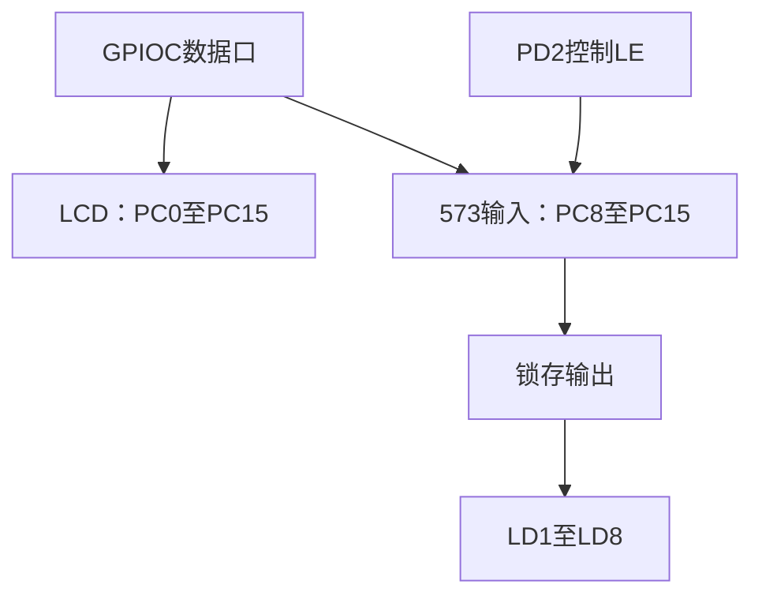

# 08｜资源包与原理图查找

> **完整工程进度**：本篇按第二阶段讲解；当前第17～22篇和LQB17_Final已完成。文中阶段测试的范围保持不变，最终业务见[第21篇](21-三页面显示、主程序调度与最终工程集成-精讲博客版.md)。

> **平台/版本**：CT117E-M4 V1.1 / STM32G431RBT6，STM32CubeMX 6.17.0、STM32CubeG4 V1.6.3、Keil ARM Compiler 5.06 update 7。
> **适合读者**：只会C语言，按本文步骤配置、观察和理解外设。
> **本篇技术点与效果**：学会从题目中的R37、R39、PA1和LED，追踪到接线、引脚与外设能力。
> **需求关联**：P01-01、P01-08～P01-10、P02-11～P02-13，可在[需求追踪表](07-需求追踪表与工程约定-精讲博客版.md)定位原句。
> **验证边界**：第二阶段工程已进行软件构建与主机测试；文中的接线、下载、屏幕和灯的现象是供你操作的预期，尚未代你上板验证。阶段目标是基础验证，不是完整竞赛固件。
> **版本衔接**：这些篇章保留第二阶段的学习范围；当前配套工程已扩展第三阶段，共用Core增加ADC/TIM初始化。Phase2_SelfTest仍保留基础验证行为，新增外设操作见第13～16篇；文中完整代码已同步到当前源码。

[阅读目录](00-阅读路线与交付状态-精讲博客版.md) · [第二阶段实操与验证记录](../Tests/第二阶段实操与验证记录.md)

## 一、先分清手里的四类资料

题目告诉你做什么，原理图告诉你板上怎样连，数据手册告诉你芯片引脚能做什么，参考手册告诉你内部硬件怎样工作。HAL源码则把“怎样工作”落实成可以调用的C函数。它们互相补充，不能拿其中一种代替其它全部。

最小练习只做一件事：在不看答案的情况下找出R37接到哪个MCU引脚，然后核对ADC通道。完成后再追踪其余模块。

在文件管理器打开 `D:\蓝桥杯嵌入式资源包\嵌入式数据资源包\ES`。先打开ReadMe.txt，确认你的V1.1对应 `SCH_CT117E_M4_V1.1.pdf`。PDF第1页是主控板，第2页是下载器；芯片型号和晶振要在主控页读。`._SCH...pdf`是伴随元数据文件，不作为电路正文。

| 文件 | 本题遇到什么问题时打开 | 搜索词 |
|---|---|---|
| [V1.1原理图](<D:/蓝桥杯嵌入式资源包/嵌入式数据资源包/ES/SCH_CT117E_M4_V1.1.pdf>) | 旋钮、灯、按键接到哪里 | R37、R39、U1、CN3、J11、J9 |
| [G431数据手册](<D:/蓝桥杯嵌入式资源包/嵌入式数据资源包/ES/DataSheet/STM32G431RB数据手册.pdf>) | 引脚支持哪个模拟通道或复用功能 | Pin definitions、Alternate function、PB15、PB4、PA1 |
| [G4参考手册](<D:/蓝桥杯嵌入式资源包/嵌入式数据资源包/ES/DataSheet/STM32G4系列微控制器参考手册.pdf>) | 计数器怎样计数，GPIO寄存器哪一位控制什么 | RCC、GPIO、ADC、TIM、ODR、ARR、CCR |
| [HAL目录](<D:/Tools/STM32_Repository/STM32Cube_FW_G4_V1.6.3/Drivers/STM32G4xx_HAL_Driver>) | 函数参数与实际操作 | Inc查声明、Src查实现 |
| [LCD示例目录](<D:/蓝桥杯嵌入式资源包/嵌入式数据资源包/ES/BSP/LCD_Driver/MDK5_LCD_HAL>) | 本板LCD控制线和字库 | lcd.c、lcd.h、fonts.h |

打开PDF后用Ctrl+F找元件或引脚名；如果搜不到，放大电路页观察文字和网络标签。PDF搜索命中只是入口，仍要看附近导线、连接点和表格列标题，不能只看一个搜索结果词。

**知识小结**：结论：先按问题类型选择资料。 原因：接线、引脚能力和寄存器机制是三个不同层次。 关键参数：V1.1原理图主控第1页，DS12589、RM0440。 常见误区：看到STM32F1的ODR说明就直接套到G431，或用下载器的晶振数值配置主控。

## 二、先认识电路图里的名字和线

R表示电阻类元件，R37在这里是电位器，三端中两端接电源与地，中间滑动端输出可调电压。J表示连接器或跳线。U表示集成电路，例如U4是STM32，U1是573锁存器。PC8、PB15这样的文字是信号网络或引脚名字，不是C变量。

同名网络标签表示电气连接，即使纸面上没有一条线画到另一端。导线交叉处是否有连接点要看符号；不能看到两根线相交就当成短接。GND是电压参考点，VDD是供电网络；本板逻辑与模拟参考按约3.3V系统理解，但实际电压精度仍需实测。

还要区分两种数字：PB15中的15是B口第15位，LQFP64封装中的物理脚号37是芯片引脚位置。两者不是同一个编号。CubeMX里选PB15，并不是选择芯片“第15脚”。

### 实操A：追踪R37

1. 在主控页找到R37，确认阻值标10kΩ，看到滑动端接J11。
2. J11另一侧标PB15，继续在U4周围找到PB15，确认连接到主控而非下载器。
3. V1.1的J11是两针跳线，使用R37时短接这两针；不要使用V1.2三针跳线的操作描述。
4. 数据手册第55页在Pin definitions表找PB15，读其模拟功能ADC2_IN15。
5. 将结论写成“R37→J11→PB15→ADC2_IN15”，而不是只记住一个数字15。
6. 查J17：它连接VREF+到VDDA。ADC换算依赖参考电压，不能只接信号却忽略参考端。

ADC是把电压变成数字的硬件，不需要把PB15选成普通数字输入，也不需要为ADC选择AF15。ADC通道编号与数字复用编号AF是两套概念。

**知识小结**：结论：沿元件、跳线、网络名和芯片引脚逐段追踪。 原因：每一段解决一个可能断开的连接。 关键参数：R37=10kΩ；J11→PB15；ADC2_IN15；J17→VREF+。 常见误区：把PB15的15、物理脚号37、ADC通道15和AF编号混用。

## 三、再追踪脉冲输入和PWM输出

### 实操B：R39为什么不用ADC读取

原理图中R39接在U7的555脉冲电路中。改变R39会改变电路输出脉冲的快慢；MCU接收到的是U7输出经J9送来的高低电平序列。沿J9可读到PB4。

数据手册第62页查PB4所在行，再沿表头找AF2列，得到TIM3_CH1。AF表示引脚内部的复用连接编号；选择AF2相当于把PB4内部连接到TIM3通道1。后续输入捕获会在边沿到来时保存定时器计数值，以两个时刻的差求周期。

实物准备：R39对应J9，J9应短接。R40/J10连接PA15，是另一套脉冲电路；转错旋钮时，再正确的TIM3代码也收不到你期待的变化。

### 实操C：PA1怎样输出PWM

题目已经固定PA1。数据手册第61页PA1行AF1列为TIM2_CH2，因此选择TIM2通道2。原理图J3第4脚引出PA1；以后测波形时测量端接PA1、参考端与板上GND相连。

这一阶段先登记分配，不启用ADC和TIM2/TIM3。第三阶段才逐个配置与实现，避免在基础验证中把尚未学习的输入行为误当故障。

| 功能 | 板上来源/去向 | 引脚 | 最终外设功能 |
|---|---|---|---|
| 压力 | R37经J11 | PB15 | ADC2_IN15，模拟模式 |
| 流量 | R39/555经J9 | PB4 | AF2、TIM3_CH1 |
| 执行机构模拟 | J3第4脚 | PA1 | AF1、TIM2_CH2 |
| 下载调试 | 板上下载器/SWD接口 | PA13、PA14 | SWDIO、SWCLK |

再看按键区域：B1、B2、B3、B4分别接PB0、PB1、PB2、PA0。每路有10kΩ上拉，松开时引脚为高，按下时通过按键接地变低。后续GPIO读到的0表示按下，按键驱动可以把它转换为逻辑pressed=1；不要让原始电平和逻辑按下状态混在同一个解释里。本阶段只登记这四个输入，尚未配置和扫描。

SWD用于下载与调试。后续CubeMX选择Serial Wire，保留PA13/PA14，并避免JTAG用途占用本题需要的PB4。

**知识小结**：结论：外部接线与内部复用必须同时正确。 原因：某个引脚支持定时器并不代表板上测试信号连接到了它。 关键参数：PB4/AF2/TIM3_CH1；PA1/AF1/TIM2_CH2；SWD保留PA13/PA14。 常见误区：只记TIM3不记通道，或把R40的PA15接线用于R39。

## 四、LED和LCD为什么要一起查

沿LD1～LD8反向追踪，可以看到它们由U1的输出驱动，U1输入连PC8～PC15，锁存使能LE连PD2。LED接法决定低电平时电流流过LED，所以“希望点亮”要转换为数据0。

再查LCD连接器CN3，数据线D0～D15连PC0～PC15。这说明PC8～PC15同时用于LCD和LED输入。573的作用就是保存LED状态：PD2为低时保持旧输出，LCD可以继续使用PC口；更新LED时短暂打开锁存，再关闭保持。

LCD控制线要从官方驱动实现核对：PB5是WR，PB8是RS，PB9是CS，PA8是RD。PB8默认也具有BOOT相关功能，但正常运行时此处由驱动配置为LCD控制输出；不要把别的板卡LCD例程中的PB10读使能照搬过来。

本阶段CubeMX配置PC8～PC15和PD2，先建立LED全灭状态；官方LCD_Init随后配置LCD控制线和整个PC数据口。PD2始终由LED模块控制，LCD初始化时必须保持低。

### 启动前的接线检查

- 确认主控丝印STM32G431RBT6、板卡版本V1.1。
- 找到B1～B4、R37、R39、J9、J11、J17，能对应到图上位置。
- 保持正常供电与SWD连接。调整跳线前先断电，避免带电碰接邻针。
- 不为了本阶段加入其它信号源；ADC和捕获在第三阶段再进行输入测试。

### 定位问题的顺序

| 现象 | 先查 | 再查 |
|---|---|---|
| 转R37预计无变化 | 是否识别正确元件、J11/J17 | 第三阶段ADC2通道与原始码 |
| 转R39预计无变化 | 是否误转R40、J9是否接通 | 第三阶段PB4复用与捕获中断 |
| LED跟着LCD乱闪 | PD2是否一直高 | 锁存时序、PC保存恢复、是否中断并发访问 |
| 准备配置的引脚在CubeMX找不到 | MCU型号/封装是否选对 | 原理图网络名是否属于主控 |

本篇的“验证”是你能够独立从图上找到完整连接链，并填好资源表；这不等于已经验证实际电路电压或波形。

**知识小结**：结论：共用总线要求明确保持和更新的时机。 原因：LCD与LED并非完全独立的GPIO。 关键参数：PC0～15为LCD数据，PC8～15兼作LED输入，PD2控制LE。 常见误区：看到LED就把PC8直接当成独立灯脚持续翻转。

## 一页纸总结

- 从题目点名的元件开始，逐段追踪到主控。
- 原理图找连接，数据手册找能力，参考手册找机制，HAL源码找接口。
- 本板主控晶振24MHz，不能读成下载器的晶振。
- 压力、流量、PWM三条通路分别登记，不急于混在一个初始化函数中。
- LED/LCD共用PC口，PD2低时保持灯状态；下一篇先建立时钟和GPIO基础工程。

## 关键参数表

| 项目 | 参数与作用 |
|---|---|
| R37 / J11 | PB15、ADC2_IN15 |
| R39 / J9 | PB4、AF2、TIM3_CH1 |
| PWM | PA1、AF1、TIM2_CH2 |
| LED | PC8～15、PD2，低有效 |
| LCD | PC0～15；PB5/PB8/PB9/PA8 |
| 主控时钟源 | X1，24MHz |

## 自测问题

1. 为什么找到PB15后还要查数据手册？
2. PB15是物理第15脚吗？
3. R39经过555电路之后应该测什么？
4. 为何LED更新完成后PD2要回到低？
5. GPIOC配置应该查F1还是G4参考手册？

展开参考答案

1. 接线只说明信号到了该引脚，还要确认它属于ADC2通道15。

2. 不是，PB15是端口位编号；本封装其物理脚号是37。

3. 测输出脉冲频率，通过定时器输入捕获获得周期信息。

4. 低电平使573保持输出，让LCD改变共用PC数据线时不影响灯。

5. 本芯片属于STM32G4，应查RM0440；不同系列寄存器布局不同。

[回到阅读目录](00-阅读路线与交付状态-精讲博客版.md)
