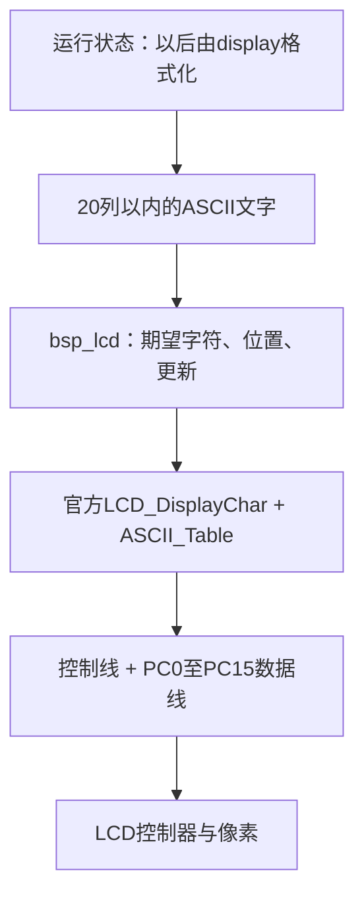

# 11｜LCD驱动接入与字符更新

> **完整工程进度**：本篇按第二阶段讲解；当前第17～22篇和LQB17_Final已完成。文中阶段测试的范围保持不变，最终业务见[第21篇](21-三页面显示、主程序调度与最终工程集成-精讲博客版.md)。

> **平台/版本**：CT117E-M4 V1.1 / STM32G431RBT6，STM32CubeMX 6.17.0、STM32CubeG4 V1.6.3、Keil ARM Compiler 5.06 update 7。
> **适合读者**：只会C语言，按本文步骤配置、观察和理解外设。
> **本篇技术点与效果**：接入资源包字库和驱动，建立黑底白字、固定行列、自动清除旧字符的bsp_lcd。
> **需求关联**：P02-10、P03-10～P03-17、P04-08～P04-11，可在[需求追踪表](07-需求追踪表与工程约定-精讲博客版.md)定位原句。
> **验证边界**：第二阶段工程已进行软件构建与主机测试；文中的接线、下载、屏幕和灯的现象是供你操作的预期，尚未代你上板验证。阶段目标是基础验证，不是完整竞赛固件。
> **版本衔接**：这些篇章保留第二阶段的学习范围；当前配套工程已扩展第三阶段，共用Core增加ADC/TIM初始化。Phase2_SelfTest仍保留基础验证行为，新增外设操作见第13～16篇；文中完整代码已同步到当前源码。

[阅读目录](00-阅读路线与交付状态-精讲博客版.md) · [第二阶段实操与验证记录](../Tests/第二阶段实操与验证记录.md)

## 一、从题目要求推导显示模块的职责

题目要求黑底白字、按图示行列显示、数据每0.1秒刷新，并指定使用资源包驱动和字库。后面MAIN、OUTP、PARA的字段不同，但“把一行文字可靠地画在固定位置”是共同基础。因此先写bsp_lcd负责字符位置和绘制，后续display负责把压力、流量、页面状态转换成文字。

屏幕上的字符不是一次GPIO写就能出现。LCD内部有控制器和显示存储器，MCU通过控制线指定操作，再在数据总线上发送命令、坐标、颜色数据。字库把一个字符描述成黑白点阵，驱动逐点把前景或背景颜色送入LCD。

本资源使用16×24点阵字符。横向320像素，每字符16像素，因此一行20字符；纵向240像素，每字符24像素，因此10行。题图的1～20列、1～10行正好对应这个网格。字号若换掉，就不能继续沿用同样的行列计算。



当前验证页写PHASE2 CHECK，故意与竞赛MAIN区分。它只是检验屏幕、计时和LED；最终三页面的标题、单位、列位置在第21篇统一接入，不能把验证页图样误当作竞赛图2。

**知识小结**：结论：先解决文字输出，再组合业务页面。 原因：坐标、覆盖和总线处理是所有页面共有的机制。 关键参数：320×240像素，16×24字库，20列×10行，黑底白字。 常见误区：换了字体却仍按题图的字符网格摆放内容。

## 二、资源包中的三个文件怎样接入

打开ES/BSP/LCD_Driver/MDK5_LCD_HAL，使用其中Src/lcd.c、Inc/lcd.h和Inc/fonts.h。配套工程已经将三者原样复制到BSP_Drivers对应目录，并加入Keil的BSP_Drivers组；本次核对了文件字节一致性。

| 资源文件 | 放入工程位置 | 作用 |
|---|---|---|
| Src/lcd.c | BSP_Drivers/Src/lcd.c | 控制器初始化、总线读写、绘图和字符输出 |
| Inc/lcd.h | BSP_Drivers/Inc/lcd.h | 接口、颜色和寄存器常量 |
| Inc/fonts.h | BSP_Drivers/Inc/fonts.h | 字符点阵数据，供lcd.c使用 |

头文件不单独生成机器指令；被.c包含后参与该.c的编译。fonts.h由官方驱动使用，不要为了“让所有文件都能看到字库”又在许多自编.c里重复包含它。不同资源示例可能采用HAL或LL，本工程选HAL版本，不能将LL版初始化和HAL版头文件随意混合。

官方文件原有注释编码保留不变；在编辑器中显示乱码时先以GBK/兼容中文编码查看，不要因为乱码就把整个文件错误转码。自编BSP文件使用UTF-8中文注释。

### 初始化到底由谁做

LCD_Init内部调用LCD_CtrlLinesConfig等流程，开启所需GPIO时钟，配置控制线并设置数据总线方向；读取控制器寄存器时需要把PC口切成输入，写入时再切回输出。这也是为什么不应把整个PC口永远当成只读输入或只写LED。

从官方实现核对连接：PB5是WR，PB8是RS，PB9是CS，PA8是RD，PC0～PC15是数据位。WR表示写选通，RD表示读选通，CS是片选，RS用于区分寄存器/命令相关操作和数据；具体脉冲顺序由官方底层函数完成。本阶段不重写控制器协议。

初始化顺序为MX_GPIO_Init→BSP_LED_Init→BSP_LCD_Init。先保证PD2低、LED全灭，再让LCD使用PC口；如果先让锁存器保持透明再初始化LCD，灯就会跟着初始化数据乱变。

官方LCD_Init完成后，封装层设置BackColor=Black、TextColor=White，再清一次黑屏。只有这次启动清屏真正调用LCD_Clear；正常运行不反复整屏清除。

### 最小显示练习：使用同一份最终接口

下面几句摘自实际阶段验证入口。row从0开始，所以1U是题图计数方式中的第2行；字符串前4个空格代表从第5列开始写标题。这里的参数服务于验证页，不是最终MAIN的布局参数。

```c
    BSP_LED_Init();                 /* 先关闭锁存器，再初始化共用总线的 LCD。 */
    BSP_LCD_Init();
    BSP_LCD_SetLine(1U, "    PHASE2 CHECK");
    BSP_LCD_SetLine(3U, "   SYS=80MHz");
    BSP_LCD_SetLine(8U, "   TEST ONLY");
```
初始化只把期望文字写入缓冲区。主循环中还要持续调用BSP_LCD_Service，屏上才会逐步出现文字；不是SetLine内部又延时等待屏幕刷新。这段代码已经在测试入口里，无需重复放入main。

如果想理解库如何使用字库，在lcd.c搜索LCD_DisplayChar：它先将ASCII码减32，再按每字符24个行数据定位ASCII_Table，最后调用LCD_DrawChar。查LCD_DisplayStringLine可以看到参考横坐标从319开始，每个字符减16。

**知识小结**：结论：官方驱动处理控制器，封装层统一颜色和文本规则。 原因：重复配置或混用不同资源版本会破坏初始化假设。 关键参数：lcd.c、lcd.h、fonts.h原样接入；LED先初始化；O0编译。 常见误区：只复制.c忘记字库，或初始化完没有持续调用显示服务。

## 三、为什么需要两个小字符缓冲区

假设原来显示AUTO，后来只画MAN三个字符，最后那个O没有被覆盖，就会出现MANO。这个问题与LCD坏没坏无关，是程序没有告诉屏幕第四格要变成空白。因此SetLine必须把不足20列的部分补空格。

另一个问题是闪烁：每0.1秒先清全屏再重画，屏幕会经历一段全黑状态；无变化的字也重复传输，浪费主循环时间。本模块保存两份字符：wanted表示希望显示什么，shown表示软件最后已经发送了什么。两者不同才画那一格。

每份10×20=200字节，共400字节。它们是字符表，不是像素帧缓冲；完整320×240×2字节的16位颜色帧需要153600字节，本工程没有这样分配RAM。shown也不是从LCD读回的结果，只是软件对自己已发送内容的记录，不能用于判断屏幕供电或连线是否正常。

注意wanted的一行恰好只有20格，**它不是带结尾0的C字符串**，所以内部按行列索引访问，不能对wanted[row]直接调用strlen或使用`%s`输出。调用者传进来的text才是C字符串，应用的line[21]因此比内部一行多1字节。输入字符串和固定宽度显示网格各有用途。

static让这两份数组在函数返回后仍存在，且只在bsp_lcd.c内部可见。模块管理的是板上的这一块LCD，不是每调用一次SetLine就新建一份显示状态。

`BSP_LCD_SetLine(uint8_t row, const char *text)`读取字符串内容并复制到wanted，不保存指针。因此应用可以用局部数组line格式化文字，调用返回后数组被覆盖也不会使屏幕文本变成悬空指针。

它最多处理20个字符，遇到字符串结尾就补空格；row≥10或空指针直接忽略。调用者仍必须传入有效可读的C字符串，函数无法替你验证任意非法地址。

官方字库按ASCII字符索引，所以封装层只接受0x20～0x7E。超出范围的字节变为问号，防止字符值造成字库越界。中文注释可以保存在源码里，但这套ASCII字库不能直接显示中文字符串；UTF-8中文包含多个非ASCII字节，会被替换成多个问号。

ClearBuffer只把wanted改为空格，下一轮Service逐步擦掉已有文字；它并不立刻操作LCD，也不会用一次大清屏堵住后面的按键任务。

**知识小结**：结论：一行文字必须包含清除旧字符的意图。 原因：屏幕不会自动知道短字符串后面的旧字符已无效。 关键参数：wanted/shown各200字节；不足20列补空格；ASCII 0x20～0x7E。 常见误区：把字符缓冲当整屏像素缓冲，或把shown当成真实LCD反馈。

## 四、把一次绘制工作限制为一个字符

题目要求按键和指示灯及时响应，后续还要按时采样。如果一次函数把整页很多字符都画完，就会延长其它任务等待的时间。因此Service每轮最多画一个变化字符，立即返回，下一轮主循环再接着画。

cursor记录下次从哪一格开始找。总共200格，用cursor/20得到行、cursor%20得到列；检查后cursor加1，达到200时取模回到0。即使前几行总在变化，下方行也能轮到，不会总从第0格重来而被长期忽略。

扫描200格是比较内存里的字符，不是绘制200个字符；没有变化就不写LCD。有变化则转换像素位置：

```text
row=0..9，col=0..19
官方Line参数   = row × 24
官方Column参数 = 319 - col × 16
例：row=1、col=4 → Line=24，Column=255
```

Column向下递减是这份驱动的坐标约定。不要凭“从左到右坐标应增加”的直觉改成col×16；应先顺着官方DisplayStringLine和底层窗口配置核对实际方向。

核心循环来自最终模块：

```c
void BSP_LCD_Service(void)
{
    uint16_t checked;
    uint8_t row;
    uint8_t col;

    for (checked = 0U; checked < BSP_LCD_ROWS * BSP_LCD_COLS; ++checked) {
        row = (uint8_t)(cursor / BSP_LCD_COLS);
        col = (uint8_t)(cursor % BSP_LCD_COLS);
        cursor = (uint16_t)((cursor + 1U) % (BSP_LCD_ROWS * BSP_LCD_COLS));

        if (wanted[row][col] != shown[row][col]) {
            /* 官方接口以像素定位，横坐标从 319 向左递减。 */
            LCD_DisplayChar((uint8_t)(row * 24U),
                            (uint16_t)(319U - col * 16U),
                            (uint8_t)wanted[row][col]);
            shown[row][col] = wanted[row][col];
            return;                /* 本轮到此为止，下轮主循环继续画。 */
        }
    }
}
```
`shown[row][col]`在发送字符后才更新，表示这格已经处理。这个官方接口没有成功/失败返回值，因此只能记录调用完成，不能推断屏幕已经正确响应。

Service必须每轮主循环都调用。每100ms执行的是“读取最新运行数据并组成文字”；若把Service也限制为每100ms一个字符，一页几十个字就需要数秒，明显偏离刷新要求。限制单次绘制量只改善任务交错，**并不能凭设计直接证明实际整页刷新已在100ms内完成**，后续集成仍要检查字符数量、单字符耗时和总体延迟。

这里没有DMA或后台绘图线程。LCD_DisplayChar仍会同步绘制一个16×24像素字符，完成后Service才返回。所谓分块更新，是把“一次画很多字”缩成“一次最多画一个字”，不是说画字不占CPU时间；中断可以正常进入，主循环里的下一个任务则仍需等这个字符画完。

缓存采用“显示最新值”的策略，也不是消息队列。如果某格尚未画完就收到新值，下一次处理该格时会显示最新值，不保证把每个中间数字都画出来；对实时监控显示这是合理选择。采样与累计数据必须由测量模块保留和处理，不能依赖屏幕是否曾显示过某个数字。

初始化后也不要绕过封装直接调用LCD_Clear或LCD_DisplayChar。否则真实屏幕变了，shown却没有同步变化，Service可能误以为不需要重画。需要换页时，通过ClearBuffer和SetLine设置新期望内容，再由Service统一绘制。

### 最终模块完整文件

### bsp_lcd.h 完整文件

[打开实际源码](../Firmware/BSP_Drivers/Inc/bsp_lcd.h)

```c
#ifndef BSP_LCD_H
#define BSP_LCD_H

#include <stdint.h>

#define BSP_LCD_ROWS 10U
#define BSP_LCD_COLS 20U

/* 调用前先初始化 LED 并让 PD2 保持低，避免 LCD 初始化改变灯状态。 */
void BSP_LCD_Init(void);

/* 清空“准备显示”的字符缓存，不立即整屏清屏。 */
void BSP_LCD_ClearBuffer(void);

/* row 从 0 开始；最多取 20 个字符，不足补空格。
 * 非可打印 ASCII 替换为 '?'；越界行或空指针被忽略。
 * 这里只改缓存，调用者的字符串可以是局部数组。 */
void BSP_LCD_SetLine(uint8_t row, const char *text);

/* 每次主循环最多绘制一个发生变化的字符，避免长期阻塞其它任务。
 * 本模块与 LED 均只在主循环使用，不允许中断中访问 LCD。 */
void BSP_LCD_Service(void);

#endif
```

### bsp_lcd.c 完整文件

[打开实际源码](../Firmware/BSP_Drivers/Src/bsp_lcd.c)

```c
#include "bsp_lcd.h"
#include "lcd.h"
#include <string.h>

static char wanted[BSP_LCD_ROWS][BSP_LCD_COLS];
static char shown[BSP_LCD_ROWS][BSP_LCD_COLS];
static uint16_t cursor;

void BSP_LCD_ClearBuffer(void)
{
    memset(wanted, ' ', sizeof(wanted));
}

void BSP_LCD_Init(void)
{
    LCD_Init();                    /* 官方驱动完成 LCD GPIO 和控制器初始化。 */
    LCD_SetBackColor(Black);
    LCD_SetTextColor(White);
    LCD_Clear(Black);              /* 只在初始化清整屏，运行时更新变化字符。 */
    BSP_LCD_ClearBuffer();
    memset(shown, ' ', sizeof(shown));
    cursor = 0U;
}

void BSP_LCD_SetLine(uint8_t row, const char *text)
{
    uint8_t col;
    uint8_t value;

    if (row >= BSP_LCD_ROWS || text == 0) {
        return;
    }

    for (col = 0U; col < BSP_LCD_COLS; ++col) {
        if (*text == '\0') {
            wanted[row][col] = ' '; /* AUTO 改为 MAN 时，旧的 O 也会被擦除。 */
        } else {
            value = (uint8_t)*text++;
            /* 官方字库只支持 0x20~0x7E，防止索引越出字库。 */
            wanted[row][col] = (value >= 0x20U && value <= 0x7EU)
                              ? (char)value : '?';
        }
    }
}

void BSP_LCD_Service(void)
{
    uint16_t checked;
    uint8_t row;
    uint8_t col;

    for (checked = 0U; checked < BSP_LCD_ROWS * BSP_LCD_COLS; ++checked) {
        row = (uint8_t)(cursor / BSP_LCD_COLS);
        col = (uint8_t)(cursor % BSP_LCD_COLS);
        cursor = (uint16_t)((cursor + 1U) % (BSP_LCD_ROWS * BSP_LCD_COLS));

        if (wanted[row][col] != shown[row][col]) {
            /* 官方接口以像素定位，横坐标从 319 向左递减。 */
            LCD_DisplayChar((uint8_t)(row * 24U),
                            (uint16_t)(319U - col * 16U),
                            (uint8_t)wanted[row][col]);
            shown[row][col] = wanted[row][col];
            return;                /* 本轮到此为止，下轮主循环继续画。 */
        }
    }
}
```

**知识小结**：结论：更新文本的周期与发送字符的节奏分别安排。 原因：每次工作短，主循环才能经常返回其它任务。 关键参数：100ms组成文字；每轮Service最多绘制1格；游标200格轮转。 常见误区：每100ms才画一个字，或认为单字符预算自动保证整机响应达标。

## 五、从主机验证走到开发板观察

本次主机测试替换了官方LCD函数，只记录绘制的行、列、字符和调用次数，同时编译真实bsp_lcd.c。已验证补空格、截断、局部字符串复制、非法ASCII替换、范围检查、无变化不绘制、每轮最多一字及轮转公平性。该方法验证封装逻辑，不验证LCD控制器、电气时序和实际颜色。

下载阶段HEX后全速运行，预期黑底白字；第2行出现PHASE2 CHECK，第4行SYS=80MHz，第5行T随时间变化，第6行LD显示当前灯号，第7行GAP显示观察到的最大主循环间隔，第9行TEST ONLY。行号按人读的1起始编号。

LD文字在100ms文本任务中更新，灯切换在1000ms任务中，切换瞬间可能先换灯、下一次文本更新再改数字；这是验证页任务顺序的结果。它不用于证明最终报警指示响应时间。

| 现象 | 如何确认 | 修复方向 |
|---|---|---|
| 一直白屏或黑屏 | 看程序是否走过LCD_Init、进入App_Run | 查实际供电、控制线、官方驱动版本和O0选项 |
| Init能返回但无文字 | 看wanted是否变化、Service是否被调用 | 主循环持续Service，不要只初始化 |
| AUTO变MANO | 检查是否绕过SetLine直接画短字符串 | 用整行覆盖和尾部补空格，清理直接画屏的第二条路径 |
| 出现问号 | 看传入字节是否在ASCII范围 | 使用题目要求的英文字段，中文不能靠ASCII字体输出 |
| 字符位置倒置或越界 | 查看row/col及生成的像素参数 | 恢复row×24、319-col×16，与原驱动一致 |
| 刷屏时灯乱闪 | 观察PD2控制、确认没有中断绘图 | 按第10篇检查共用总线访问顺序 |
| 屏幕闪黑 | 搜索运行路径中的LCD_Clear | 只在初始化整屏清，平时更新变化字符 |
| 后面几行长期不更新 | 观察cursor是否一直从0重置 | 保留轮转游标，不要每轮只检查最前几格 |

实际显示尚待你在板上确认。即使肉眼看到T不断变化，也只能说明功能趋势；要严格证明100ms最坏刷新延迟，还需可重复的延迟记录或仪器测量。

**知识小结**：结论：软件字符测试和真实屏幕测试各有范围。 原因：替身能看见调用参数，不能看见电气总线和像素。 关键参数：黑底白字；10行20列；阶段页面有TEST ONLY。 常见误区：因为主机测试通过，就把实物显示清晰、无噪点也记为已验收。


## 一页纸总结

- 题目固定官方驱动和字库，所以先接入三份资源文件，再封装文本规则。
- LED先锁定全灭，LCD再初始化共用PC数据口。
- SetLine复制字符串、限制长度、补空格并检查ASCII范围。
- wanted保存期望，shown保存已发送记录，只有变化字符才重画。
- 100ms更新文字内容；每轮主循环Service最多绘制一字。
- 所有LCD操作留在主循环，初始化后不随意绕过封装直接画屏。
- 最终业务页面在display模块组合，本阶段只交付通用显示基础。

## 关键参数表

| 项目 | 参数与作用 |
|---|---|
| 分辨率 / 字库 | 320×240 / 16×24 |
| 字符网格 | 10行×20列；API行号0～9 |
| 像素换算 | Line=row×24，Column=319-col×16 |
| 颜色 | BackColor=Black，TextColor=White |
| 字符内存 | 两份200字节，共400字节 |
| Service预算 | 每次最多发送1字符 |
| 字符范围 | ASCII 0x20～0x7E，越界替换为? |

## 自测问题

1. AUTO改成MAN为什么会留下O？
2. SetLine传局部数组为何可行？
3. 为什么只有400字节就能管理整屏文字？
4. 每100ms调用一次Service是否合适？
5. 一段中文字符串变成很多问号，先查什么？
6. shown与wanted相同，能否证明实际屏幕正确？

<details>
<summary>展开参考答案</summary>

1. 只覆盖三个字符没有清除第四格，因此需要补空格覆盖旧尾部。

2. 接口把内容复制进内部wanted数组，不长期保存传入指针。

3. 保存的是两份字符网格，不是每个像素的颜色；实际像素由字库和LCD控制器处理。

4. 不合适，一次最多一字，会导致整页很慢；每100ms组文本，Service每轮主循环调用。

5. 先查字体与字符编码，本驱动仅用ASCII字库，UTF-8中文不能直接显示。

6. 不能，只表示软件认为已发送完成，硬件仍需观察和验证。

</details>

[回到阅读目录](00-阅读路线与交付状态-精讲博客版.md)
