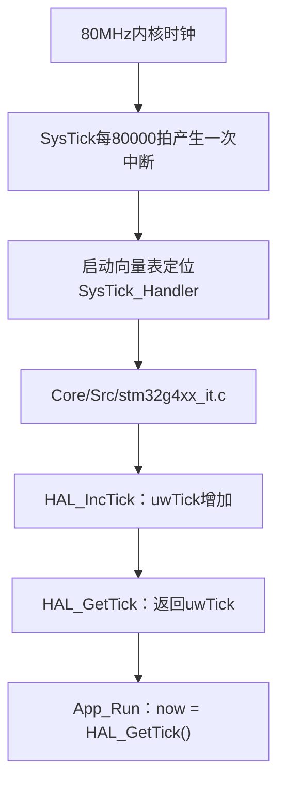
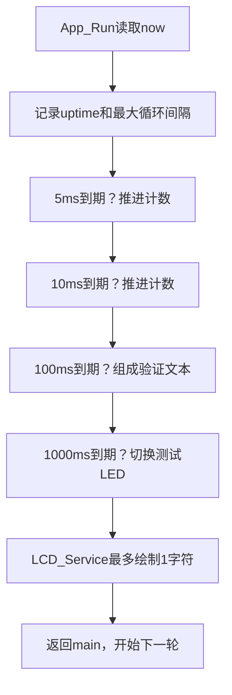
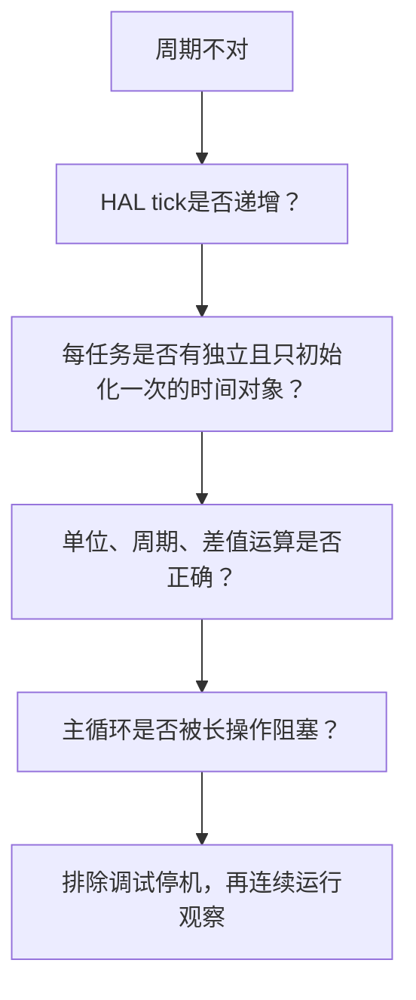

# 12｜时间基准与非阻塞任务安排

> **完整工程进度**：本篇按第二阶段讲解；当前第17～22篇和LQB17_Final已完成。文中阶段测试的范围保持不变，最终业务见[第21篇](21-三页面显示、主程序调度与最终工程集成-精讲博客版.md)。

> **平台/版本**：CT117E-M4 V1.1 / STM32G431RBT6，STM32CubeMX 6.17.0、STM32CubeG4 V1.6.3、Keil ARM Compiler 5.06 update 7。
> **适合读者**：只会C语言，按本文步骤配置、观察和理解外设。
> **本篇技术点与效果**：理解now从哪里来，使用无符号时间差安排多周期任务，并把基础模块接成可运行验证程序。
> **需求关联**：P02-06、P02-07、P02-10、P02-21；为P05-09、P05-10和P06-10、P06-11提供计时基础，可在[需求追踪表](07-需求追踪表与工程约定-精讲博客版.md)定位原句。
> **验证边界**：第二阶段工程已进行软件构建与主机测试；文中的接线、下载、屏幕和灯的现象是供你操作的预期，尚未代你上板验证。阶段目标是基础验证，不是完整竞赛固件。
> **版本衔接**：这些篇章保留第二阶段的学习范围；当前配套工程已扩展第三阶段，共用Core增加ADC/TIM初始化。Phase2_SelfTest仍保留基础验证行为，新增外设操作见第13～16篇；文中完整代码已同步到当前源码。

[阅读目录](00-阅读路线与交付状态-精讲博客版.md) · [第二阶段实操与验证记录](../Tests/第二阶段实操与验证记录.md)

## 一、先从时间要求问：程序必须同时做哪些事

题目给了多种时间：按键和指示灯响应不超过0.1秒、LCD数据0.1秒刷新、累计每100ms一次、长按2秒后松开、报警条件连续超过2秒、占空比每秒变1个百分点。这些事件重叠发生，所以不能“先等按键两秒，再去刷新屏幕”。

一种容易想到的写法是在循环里HAL_Delay(100)，醒来后做所有任务。问题是这100ms期间主循环其它工作都在等待；后来再加一个LCD操作，间隔还会更长。HAL_Delay不等于关中断，但它会阻塞调用它的主循环，后续函数只能等它返回。

我们选择周期检查：主循环不断运行，每轮读取当前时间；每个任务问自己“离上次约定时刻是否够一个周期”，够了做一次，不够就跳过。没有任务需要在原地等待其它任务到时。

| 时间 | 来自哪里 | 本阶段/后续安排 |
|---|---|---|
| 1ms | HAL默认时基 | 提供毫秒时间戳 |
| 5ms | 我们的实现选择 | 后续扫描按键；现在只统计任务次数 |
| 10ms | 我们的实现选择 | 后续调控制/报警等；现在只统计次数 |
| 100ms | 题目累计周期和显示刷新要求 | 当前更新验证文本；以后增加采样/累计 |
| 1000ms | 阶段验证选择 | 当前轮换LD1～LD4，最终不保留流水灯 |

5ms没有写在竞赛原句里。它比100ms响应上限短得多，为后续20ms防抖和任务延迟留出余量，又不必每个CPU循环都读取按键。选择5ms本身不保证系统必定满足要求，还要保证其它任务不会长时间挡住主循环。

**知识小结**：结论：多个计时任务通过不断检查时间共同推进。 原因：等待一个事件不应暂停其它采集和显示任务。 关键参数：1ms时基；5/10ms是设计选择；100ms来自题目。 常见误区：把任务检查周期、系统时基和CPU主频当成同一个频率。

## 二、now究竟是怎样得到的

SysTick是Cortex-M内核里的倒计时硬件。当前HAL默认配置让它每1ms到一次零并产生中断。中断是硬件通知CPU临时转去执行处理函数，执行完后回到原来的程序位置。

工程启动调用HAL_Init，内部建立默认时基；系统时钟改变后，HAL_RCC_ClockConfig会根据新时钟重新配置时基。在本工程默认HCLK作为SysTick时钟、HCLK=80MHz且tick=1kHz时，装载值为80000-1=79999。SysTick计满80000个时钟是1ms，不能把“减1”漏掉。



这条链要从三个地方核对：启动文件的SysTick向量、中断文件的SysTick_Handler、Drivers/STM32G4xx_HAL_Driver/Src/stm32g4xx_hal.c中的HAL_InitTick/HAL_IncTick/HAL_GetTick。本工程中断函数如下，不要在自己的BSP里再定义第二个同名中断入口。

```c
void SysTick_Handler(void)
{
  /* USER CODE BEGIN SysTick_IRQn 0 */

  /* USER CODE END SysTick_IRQn 0 */
  HAL_IncTick();
  /* USER CODE BEGIN SysTick_IRQn 1 */

  /* USER CODE END SysTick_IRQn 1 */
}
```
HAL_GetTick的接口是`uint32_t HAL_GetTick(void)`，返回无符号32位计数，当前单位是毫秒。HAL默认的uwTick由中断推进，调用HAL_GetTick本身不会让时间增加，也不必等满1ms才返回。

App_Run每轮执行`uint32_t now = HAL_GetTick();`，得到该轮开始时刻的快照。同一轮拿它检查多个任务，使各判断基于同一时间点；它不是不断自动更新的变量。下一轮会重新读取，变量值才可能变化。

例如先后很快读取三次，结果可以都是100；不是函数坏了，而是还没跨过下一个毫秒。now是时间戳，不能拿两次值都为100来断言CPU没有执行代码。

`volatile`用于让编译器保留相关内存访问，例如HAL的共享tick以及验证计数。它不自动提供线程同步、锁或任意复杂表达式的原子性。这里是单核MCU上主循环读取HAL提供的计数接口，不需要把所有变量都加volatile。

**知识小结**：结论：now是通过HAL_GetTick读取的当前毫秒时间快照。 原因：SysTick中断推进HAL计数，读取函数仅取值。 关键参数：默认1ms；80MHz时SysTick LOAD=79999。 常见误区：认为每调用一次HAL_GetTick时间就加1，或认为now定义后会自己增长。

## 三、怎样记住每个任务的时间，并处理计数回绕

要判断某个任务是否该做，需要当前时间now、一个周期period，以及程序记住的上次约定时刻last_ms。当前时间每轮能读到，周期由调用者指定，只有last_ms需要跨多次调用保存，因此定义BSP_Periodic结构体。

每个任务各有一个结构体。若按键和LCD共用同一个last_ms，按键更新时会不断改变LCD的起点，LCD可能永远等不到100ms；独立状态不是多余变量，而是需求要求两者各自运行。

接口约定如下：

| 接口 | 参数和返回 | 作用 |
|---|---|---|
| BSP_Periodic_Init(timer, now) | 有效结构体指针、当前毫秒时间；无返回 | 建立此任务的计时起点 |
| BSP_Periodic_Due(timer, now, period) | 相同结构体、当前时间、非零周期；返回0/1 | 到期返回1，并推进一次约定边界 |

为什么传指针？函数要修改调用者保存的last_ms。若按值传结构体，修改只发生在函数自己的副本里，下次调用又忘了。这与memset是否接受指针没有关系，是“要修改谁的状态”决定的。

### 1. 正常时间差

起点100ms、周期5ms：now=103，差3，不执行；now=105，差5，执行一次，last_ms推进到105；同一个now再检查，差0，不重复执行。

### 2. 无符号回绕

uint32_t的最大值为4294967295。每毫秒加1，大约49.7天后从最大值回到0。这里不比较`now >= last + period`，因为加法形成的将来时间可能提前溢出；用无符号减法求经过时间。

例如last=0xFFFFFFF0、now=0x00000004，跨过回绕后实际经过20ms。无符号差值按模2^32计算，结果仍是20。前提是任务没有整整错过一个完整32位计数周期；若关机或停查超过一轮回绕，仅靠32位时间戳无法知道过去了几轮。

### 3. 为什么推进last += period

约定每5ms检查一次，首次由于其它工作在6ms才检查到：如果把last设为6，下次变成11，反复晚1ms就会永久漂移。推进last+=5保留约定的5、10、15……边界，短暂晚到不改变长期基准。

如果程序被阻塞了很久，这个函数每次最多推进一个周期，后续主循环会逐次补齐计数，不在一次调用中写长while循环。但**补齐计数不能重新采到过去已经错过的电压**。时间调度器无法修复长阻塞造成的信息丢失，后续测量和累计必须在正常持续调度下运行，并检查最坏循环间隔。

“同一周期不重复”不等于“同一个now最多返回一次1”。例如起点0ms、周期5ms，程序直到16ms才回来检查，并且接下来的几轮仍读到16ms：

| 调用 | 调用前last_ms | now | 差值 | 返回值 | 调用后last_ms | 实际推进的边界 |
|---|---|---|---|---|---|---|
| 第1次 | 0 | 16 | 16 | 1 | 5 | 5ms |
| 第2次 | 5 | 16 | 11 | 1 | 10 | 10ms |
| 第3次 | 10 | 16 | 6 | 1 | 15 | 15ms |
| 第4次 | 15 | 16 | 1 | 0 | 15 | 没有新边界 |

前三次返回1对应三个不同的、已经过去的周期边界，没有把同一个边界算两次；第四次才说明积压处理完了。若当前now保持16，之后不会再返回1，直到至少20ms才有下一个周期。

因此要分清两种计数：阶段测试的slots表示处理了多少个周期边界；真正“按计划时间及时采到了多少份传感器数据”，还需要采样执行时间来判断。现在没有真实采样，slots正常不能证明后续加入传感器后绝不会漏采。

period=0没有物理意义，函数返回0；指针必须指向已初始化的有效对象，不能传空指针。周期应保持稳定；若应用确实要更换周期，应重新Init建立明确起点。本工程每个任务使用固定周期。

### bsp_time.h 完整文件

[打开实际源码](../Firmware/BSP_Drivers/Inc/bsp_time.h)

```c
#ifndef BSP_TIME_H
#define BSP_TIME_H

#include <stdint.h>

typedef struct {
    uint32_t last_ms;               /* 最近一次已处理的周期边界，单位 ms。 */
} BSP_Periodic;

/* timer 必须指向有效对象；不同任务必须拥有各自的 timer。 */
void BSP_Periodic_Init(BSP_Periodic *timer, uint32_t now_ms);

/* 到期返回 1，并前进一个周期；未到期或 period_ms=0 返回 0。
 * 超期多轮时每次只补一个周期，调用者仍能轮流服务其它任务。
 * 调用间隔不得跨越完整的 uint32_t 毫秒回绕周期（约 49.7 天）。
 * 调用者不应长期阻塞；补调度无法重建错过的历史传感器样本。 */
uint8_t BSP_Periodic_Due(BSP_Periodic *timer,
                         uint32_t now_ms, uint32_t period_ms);

#endif
```

### bsp_time.c 完整文件

[打开实际源码](../Firmware/BSP_Drivers/Src/bsp_time.c)

```c
#include "bsp_time.h"

void BSP_Periodic_Init(BSP_Periodic *timer, uint32_t now_ms)
{
    timer->last_ms = now_ms;
}

uint8_t BSP_Periodic_Due(BSP_Periodic *timer,
                         uint32_t now_ms, uint32_t period_ms)
{
    if (period_ms == 0U) {
        return 0U;
    }

    /* 无符号差值允许计数从 0xFFFFFFFF 回到 0 后继续计时。 */
    if ((uint32_t)(now_ms - timer->last_ms) < period_ms) {
        return 0U;
    }

    /* 推进约定边界，避免每次晚一点执行就把误差永久积累。 */
    timer->last_ms += period_ms;
    return 1U;
}
```
`5U`是无符号整数常量5，U不是时间单位。这里单位是毫秒，因为参数period_ms的接口约定和HAL_GetTick的时基都是毫秒。`uint32_t`明确变量宽度；`U`只说明常量采用无符号整数类型，不表达“一定32位”这一跨平台承诺。

**知识小结**：结论：每个周期任务独立保存时间，用无符号差值判断到期。 原因：保存状态避免重复执行，模运算支持计数回绕。 关键参数：last_ms、now_ms、period_ms；到期推进一个period；period不能为0。 常见误区：认为补做若干次函数就等于重新获得错过的真实采样。

## 四、把三个基础模块接起来

最小结构就是：初始化一次时间对象，主循环不断取now，Due返回1才做任务。配套测试使用同一份bsp_time，没有另写一套简化计时实现。



App_Init先初始化LED再初始化LCD，然后在LCD启动完成后读取now并建立所有周期起点。LCD上电初始化本身可能耗时，此时尚未开始采集；不能把这段启动耗时算成已经漏了很多按键或积分周期。

本阶段5ms和10ms任务只增加验证计数，没有虚构“已经在读按键/控制PWM”。后续实现模块时，在最终app中使用相同调度接口调用真实任务。

100ms任务的局部数组line有21字节：屏幕最多20字符，C字符串还要1字节结尾0。snprintf限定数组长度；`%lu`与显式转换的unsigned long对应，`%u`与unsigned对应，不让不同编译器的uint32_t底层别名影响格式匹配。函数返回值在这里只用于可丢弃的验证显示，因此用(void)明确忽略。

全局phase2_*变量便于Keil观察。GAP是主循环相邻两次读取tick的最大毫秒差；分辨率只有1ms，并且受调试暂停、初始化后的运行条件影响。它可以提示明显阻塞，不能直接给出微秒级精确耗时，也不等于按键从触点变化到灯亮的总响应时间。

### 稳定入口头文件

这个头文件属于BSP_Drivers/Inc。以后竞赛app.c也实现同样的两个接口，main不必知道实现细节。

### app.h 完整文件

[打开实际源码](../Firmware/BSP_Drivers/Inc/app.h)

```c
#ifndef APP_H
#define APP_H

/* main.c的固定入口。Phase2/3目标各链接一个Tests入口；
 * LQB17_Final链接BSP_Drivers/Src/app.c，三个App不得同时链接。 */
void App_Init(void);
void App_Run(void);

#endif
```
### 阶段验证入口完整代码

下面是Tests/phase2_selftest.c，属于验证程序；它调用最终复用的模块，但本文件不会加入最终竞赛目标。最终app.c还未交付，此时不能把“基础工程可运行”当成“整题已做完”。

### phase2_selftest.c 完整文件

[打开实际源码](../Tests/phase2_selftest.c)

```c
/* 第二阶段板上验证入口，不是竞赛业务 app.c。
 * 使用与最终工程相同的 BSP 模块；最终目标不得链接此文件。 */
#include "app.h"
#include "main.h"
#include "bsp_led.h"
#include "bsp_lcd.h"
#include "bsp_time.h"
#include <stdio.h>

/* volatile 便于在 Keil Watch 中观察；这些是验证计数，不是业务数据。 */
volatile uint32_t phase2_uptime_ms;
volatile uint32_t phase2_slots_5ms;
volatile uint32_t phase2_slots_10ms;
volatile uint32_t phase2_slots_100ms;
volatile uint32_t phase2_max_loop_gap_ms;
volatile uint8_t phase2_led_mask;

static BSP_Periodic timer_5ms, timer_10ms, timer_100ms, timer_led;
static uint32_t started_ms, previous_ms;
static uint8_t led_index;

void App_Init(void)
{
    uint32_t now;

    BSP_LED_Init();                 /* 先关闭锁存器，再初始化共用总线的 LCD。 */
    BSP_LCD_Init();
    BSP_LCD_SetLine(1U, "    PHASE2 CHECK");
    BSP_LCD_SetLine(3U, "   SYS=80MHz");
    BSP_LCD_SetLine(8U, "   TEST ONLY");

    if (SystemCoreClock != 80000000U) {
        Error_Handler();
    }

    /* LCD 启动耗时不计入周期任务，初始化结束后再建立起点。 */
    now = HAL_GetTick();
    started_ms = previous_ms = now;
    BSP_Periodic_Init(&timer_5ms, now);
    BSP_Periodic_Init(&timer_10ms, now);
    BSP_Periodic_Init(&timer_100ms, now);
    BSP_Periodic_Init(&timer_led, now);
    phase2_uptime_ms = phase2_slots_5ms = phase2_slots_10ms = 0U;
    phase2_slots_100ms = phase2_max_loop_gap_ms = 0U;
    led_index = 0U;
    phase2_led_mask = 1U;
    BSP_LED_Write(phase2_led_mask);
}

void App_Run(void)
{
    uint32_t now = HAL_GetTick();
    uint32_t gap = (uint32_t)(now - previous_ms);
    char line[21];

    previous_ms = now;
    phase2_uptime_ms = (uint32_t)(now - started_ms);
    if (gap > phase2_max_loop_gap_ms) {
        phase2_max_loop_gap_ms = gap;
    }

    if (BSP_Periodic_Due(&timer_5ms, now, 5U)) {
        ++phase2_slots_5ms;
    }
    if (BSP_Periodic_Due(&timer_10ms, now, 10U)) {
        ++phase2_slots_10ms;
    }
    if (BSP_Periodic_Due(&timer_100ms, now, 100U)) {
        ++phase2_slots_100ms;
        (void)snprintf(line, sizeof(line), "   T=%lu.%lus",
                       (unsigned long)(phase2_uptime_ms / 1000U),
                       (unsigned long)((phase2_uptime_ms % 1000U) / 100U));
        BSP_LCD_SetLine(4U, line);
        (void)snprintf(line, sizeof(line), "   LD=%u", (unsigned)(led_index + 1U));
        BSP_LCD_SetLine(5U, line);
        (void)snprintf(line, sizeof(line), "   GAP=%lums",
                       (unsigned long)phase2_max_loop_gap_ms);
        BSP_LCD_SetLine(6U, line);
    }
    if (BSP_Periodic_Due(&timer_led, now, 1000U)) {
        led_index = (uint8_t)((led_index + 1U) % 4U);
        phase2_led_mask = (uint8_t)(1U << led_index);
        BSP_LED_Write(phase2_led_mask); /* 只轮流点亮 LD1~LD4，LD5~LD8 始终灭。 */
    }

    BSP_LCD_Service();             /* 每轮都给显示机会，不等到100ms才画一个字。 */
}
```

**知识小结**：结论：App只安排调用顺序与时机，模块仍各自完成自己的工作。 原因：独立接口让验证程序与最终业务使用同一份驱动。 关键参数：5/10/100ms独立计时；LCD每轮服务；LED测试周期1000ms。 常见误区：把测试计数误认为真实外设采样，或将测试App与最终App同时链接。

## 五、验证周期是否按预期推进

### 已执行的软件测试

在当前工作目录运行 `& .\LQB17_Tutorial\Tests\run_host_tests.ps1`。脚本调用本机GCC，编译真实bsp_time.c、bsp_led.c、bsp_lcd.c和测试替身，使用C99及-Wall/-Wextra/-Werror/-pedantic。本次结果保存在[host_results.txt](../Tests/build/host_results.txt)，包含ALL PHASE2 HOST TESTS PASSED。

时间测试手工注入now，已检查到期边界、已处理边界不重复、保持原节拍、周期0、32位回绕、三种周期独立运行。其中回绕用例在同一个now=4下连续返回两次1、再返回0，正是处理两个积压周期，而不是重复处理一个周期。注入0～10000ms时，5ms、10ms、100ms任务分别执行2000、1000、100次。这里没有真的等待49.7天，回绕通过边界数值构造验证。

Keil构建脚本为 `& .\LQB17_Tutorial\Tests\build_phase2.ps1`，实际构建日志见[keil_phase2.log](../Tests/build/keil_phase2.log)。两个脚本可分别通过-GccPath、-UV4Path指定另一台机器的工具路径。

### 你在板上验证

1. 下载当前Phase2_SelfTest，复位后让它全速运行；先不要在周期路径放断点。
2. 观察T持续增加、灯每秒换一个；屏幕不应因为显示时间而让灯停止变化。
3. 在Keil Watch添加phase2_uptime_ms、phase2_slots_5ms、phase2_slots_10ms、phase2_slots_100ms、phase2_max_loop_gap_ms、phase2_led_mask。
4. 在支持运行中观察的条件下看数据趋势，或短暂停机记录一次快照再复位继续测试。约10000ms运行时，计数接近2000、1000、100；观察的时刻不同会使各值不是整齐同时到达，不要把异步显示的小差异当成失效。
5. 若GAP反复到5ms及以上，先排查主循环耗时函数和LCD单字绘制耗时；这说明设计的5ms检查间隔可能受影响，不能只把阈值改大掩盖问题。
6. 复位后再做一次连续运行观察，避免调试停机改变结果。实际是否满足未来整机响应，还需按键、采集和控制全部接入后再验证。

| 现象 | 检查位置 | 修复方向 |
|---|---|---|
| HAL_GetTick始终0 | SysTick_Handler、PRIMASK、SysTick寄存器 | 确认HAL_Init、时基配置和中断未长期关闭 |
| 5ms任务每轮都执行 | timer状态与Init位置 | Init只做一次，不要把last每轮重设或用局部未保存对象 |
| 某个周期永远不来 | 是否多个任务共用timer | 为每个周期建独立对象 |
| 短时间正常，长时间逻辑错乱 | 时间比较表达式 | 用无符号差值，不依赖now+period的绝对比较 |
| 页面刷新拖慢按键 | 是否整屏同步重画或HAL_Delay | 每轮有限绘制，不把等待放进运行任务 |
| 退出断点后灯节奏奇怪 | 是否把停机过程当正常运行 | 复位后全速重新观察，不用停机时间判时序 |



至此第二阶段提供了后续所需的底座：可生成的时钟/GPIO配置、LED输出、LCD字符服务和任务计时。第三阶段从按键开始，再依次接入ADC、输入捕获和PWM；每个模块仍按需求、机制、配置、最终源码和验证推进。

**知识小结**：结论：时间逻辑用数值注入验证，运行节拍再用板上连续观察验证。 原因：两者分别发现算法边界和实际执行阻塞。 关键参数：10秒理论计数2000/1000/100；GAP只有毫秒分辨率。 常见误区：把断点暂停时间当正常经过时间，或把计数补齐当没有漏采样。


## 一页纸总结

- SysTick中断推进HAL毫秒计数，HAL_GetTick读取当前值。
- now是当前轮的时间快照，5U只是无符号常量5。
- 每个周期任务有独立last_ms，函数通过指针修改它。
- 无符号差值支持回绕，last+=period保持约定节拍。
- 到期不等于过去数据可以补采，主循环必须及时返回。
- 100ms组成文本，每轮最多绘制一字；初始化后不再阻塞等待。
- 主机测试与Keil构建已执行，实板观察和精确时序仍待完成。
- 当前测试入口与以后竞赛App互斥，基础驱动保持同一份。

## 关键参数表

| 项目 | 参数与作用 |
|---|---|
| 系统时基 | SysTick默认1ms |
| 默认LOAD | 79999，HCLK=80MHz时 |
| 时间类型 | uint32_t，约49.7天回绕 |
| 任务周期 | 5/10/100ms；测试LED另用1000ms |
| 到期策略 | 返回1一次，last_ms增加一个period |
| 字符数组 | line[21]，20字符+结尾0 |
| 已执行验证 | 主机边界测试；Keil 0错误0警告 |

## 自测问题

1. now为什么不会自己改变？
2. 5U中的U表示微秒吗？
3. 为什么每个任务都要一个BSP_Periodic？
4. last=0xFFFFFFF0、now=4时经过多少毫秒？
5. 程序卡住1秒后补执行10次累计，等于真的每100ms采样吗？
6. 当前GAP=0是否证明函数没有耗时？

<details>
<summary>展开参考答案</summary>

1. 它是HAL_GetTick返回值的副本，下一轮重新赋值才得到新快照。

2. 不是，它表示无符号整数常量；单位由period_ms接口约定决定。

3. 各任务有独立上次边界，共用会互相重置计时。

4. 无符号模2^32差值为20ms，包含回绕前16ms和回绕后4ms。

5. 不等于，过去流量未知，重复用当前值无法还原历史；应避免并检测阻塞。

6. 不能，只说明相邻读tick没有跨过毫秒边界，仍可能耗时若干微秒。

</details>

[回到阅读目录](00-阅读路线与交付状态-精讲博客版.md)
