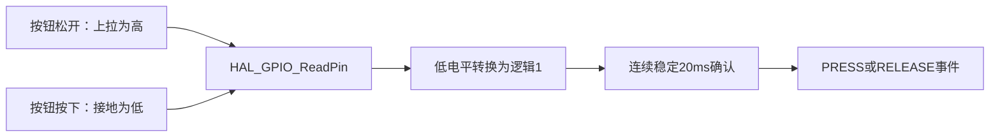
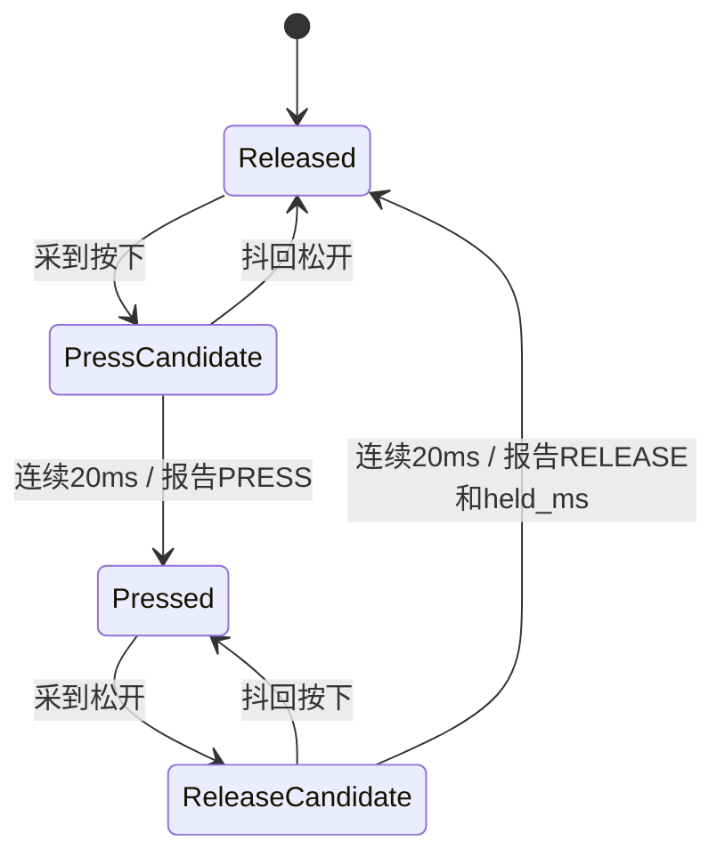

# 13｜按键输入、防抖与松开后长按事件

> **完整工程进度**：本篇按第三阶段讲解；当前第17～22篇和LQB17_Final已完成。文中阶段测试的范围保持不变，最终业务见[第21篇](21-三页面显示、主程序调度与最终工程集成-精讲博客版.md)。

> **平台与版本**：CT117E-M4 V1.1 / STM32G431RBT6；CubeMX 6.17.0、STM32CubeG4 V1.6.3、Keil ARMCC 5.06 update 7，80MHz系统时钟，O0编译。
> **读者与前置知识**：会C语言，已读第08～12篇；新外设机制在使用前解释。
> **本篇效果**：把四个GPIO电平变成可靠的按下/松开事件，能解释Keys扫描中的每个状态为什么存在。
> **需求关联**：P02-06、P05-01～P05-11、P06-05～P06-07，原句见[需求追踪表](07-需求追踪表与工程约定-精讲博客版.md)。
> **当前边界**：第三阶段源码已通过Keil构建和所列主机测试，尚未上板或测量引脚波形。Phase3_SelfTest验证采集与输出，不是最终竞赛程序。

[阅读目录](00-阅读路线与交付状态-精讲博客版.md) · [第三阶段实操与验证记录](../Tests/第三阶段实操与验证记录.md)

## 一、先按题目决定按键驱动该报告什么

题目写“B1切换界面”，并不意味着主循环每次读到B1按下就切一次。如果一直按住300ms，5ms扫描会读到大约60次按下电平，直接切页就可能跳60次。因此必须分清**状态**和**事件**：状态是“现在还按着”，事件是“刚刚确认由松开变成按下”。

设置页加减一次只处理一次按下事件；题目没有要求按住连续增加，本方案不自行加连发功能。MAIN中的B3/B4则要在“保持至少2秒之后松开”时处理，不能在按住满2秒那一刻提前校准或清零。

| 原文带来的问题 | 驱动应给出的信息 | 由谁决定动作 |
|---|---|---|
| 是哪个键 | key=1～4，对应B1～B4 | 应用/后续settings |
| 刚按下还是刚松开 | PRESS或RELEASE事件 | 应用按事件类型处理 |
| 持续是否达到2秒 | RELEASE事件携带held_ms | 应用判断>=2000 |
| 当前在哪一页 | 不属于GPIO电气信息 | 后续settings记住页面和长按资格 |
| 是否要校准/清Q | 不属于通用按键动作 | 应用调用测量/累计模块 |

所以本模块不包含MonitorPage，不读取压力、不操作LCD，也不直接执行校准。你只需先写出一个可靠的“动作报告器”。同一驱动以后可以用于不同页面，而不用把整个Scan函数重写一遍。

**知识小结**：结论：持续电平和一次事件分开，功能由上层决定。 原因：否则按住一个键会重复切换或提前执行长按动作。 关键参数：B1～B4；PRESS/RELEASE；长按由释放时held_ms>=2000判断。 常见误区：把电平为低的每次采样都当作一次按键。

## 二、沿原理图完成GPIO配置

打开V1.1原理图主控页，找到B1～B4。B1接PB0、B2接PB1、B3接PB2、B4接PA0；每路通过10kΩ电阻接VDD，按下后接地。上拉电阻让松开时有确定的高电平，而不是悬空；按下后引脚变为低。

接线是板上已经完成的，本模块不需要外接按键。CubeMX从第二阶段工程继续配置以下四个引脚：

| 位置 | User Label | 模式 | 上下拉 | 原因 |
|---|---|---|---|---|
| PB0 | KEY_B1 | GPIO_Input | Pull-up | B1低有效 |
| PB1 | KEY_B2 | GPIO_Input | Pull-up | B2低有效 |
| PB2 | KEY_B3 | GPIO_Input | Pull-up | B3低有效 |
| PA0 | KEY_B4 | GPIO_Input | Pull-up | B4低有效 |

板上已有外部上拉，内部Pull-up作为同方向的辅助，不是因为缺少那只10kΩ电阻。GPIO输入没有“每秒扫描几次”的硬件选项；5ms是App调度决定的。也不需要开启EXTI外部中断，本题用周期采样即可处理人手按键。

生成后到Core/Src/gpio.c检查GPIOA/B时钟、GPIO_MODE_INPUT、GPIO_PULLUP。到Core/Inc/main.h检查KEY_B1_Pin等宏。**名称必须一致**，因为bsp_keys.c直接引用这些宏；宏的引脚值是位掩码，不是普通编号。

HAL接口是`GPIO_PinState HAL_GPIO_ReadPin(GPIO_TypeDef *GPIOx, uint16_t GPIO_Pin)`。第一个参数选择端口，第二个选择该端口的一位，返回GPIO_PIN_SET或GPIO_PIN_RESET。我们的ReadMask在入口把RESET转换成逻辑1，之后raw=1统一表示按下。



第08篇按键表解决“接到哪里”；这里通过生成文件核对“软件是否真的把它配置为输入”。只看CubeMX引脚图变绿，还不足以定位运行时问题。

**知识小结**：结论：低有效在入口转换一次，后面的算法只看逻辑按下状态。 原因：电气极性与按键业务不是同一层含义。 关键参数：PB0/PB1/PB2/PA0；输入上拉；不启用EXTI。 常见误区：把raw=1理解成GPIO实际读到了高电平。

## 三、为什么要同时记住raw、stable和changed_ms

机械触点刚接触或分离时可能在短时间内来回通断，这叫抖动。程序看到的可能是0→1→0→1，而人只按了一次。防抖不能只“等20ms后继续执行剩余代码”，因为等待期间还需要采样和刷屏。做法是记录变化时刻，每次扫描再计算新状态已经稳定多久。

| 字段 | 它回答的问题 | 为什么不能删掉 |
|---|---|---|
| raw | 上次采样看到什么逻辑电平 | 与本次采样比较，识别有没有再次抖动 |
| stable | 上一次已经确认的状态是什么 | 避免稳定按住期间不断生成按下事件 |
| changed_ms | raw最后一次改变是什么时候 | 判断是否连续20ms没再变化 |
| pressed_ms | 本次按下稳定区间从何时开始 | 松开时计算持续时间 |
| active | 是否在初始化以后确认过这次按下 | 开机时已按住的键，不伪造一段长按历史 |

“本次采样raw”和结构体中的`k->raw`不是一个变量：前者是这轮新读到的值，后者是从上一轮保留下来的值。当二者不相等，保存新值，并把changed_ms改成现在。这次变化之后又抖动一次，就再次改时间。

假设初始松开、每5ms扫描：

| now/ms | 本次raw | changed_ms | stable | 结果 |
|---|---|---|---|---|
| 100 | 1 | 改为100 | 0 | 刚变化，先等 |
| 105 | 0 | 改为105 | 0 | 抖回原状态，不产生事件 |
| 110 | 1 | 改为110 | 0 | 又变化，重新计时 |
| 125 | 1 | 仍110 | 0 | 连续15ms，还不足20ms |
| 130 | 1 | 仍110 | 改为1 | 确认一次PRESS，记录pressed_ms=110 |
| 135 | 1 | 仍110 | 1 | raw等于stable，无新事件 |

5ms决定观察有多频繁，20ms决定新状态必须保持多久。二者不是同一个参数。没有抖动且主循环及时运行时，从实际按下到确认约需20～25ms；这只是扫描加防抖的预算，不包含完整系统其它延迟，不能单凭此宣称实测已满足100ms。

核心判断是两件事：没有新状态就跳过；新状态尚未稳定足够久也跳过。`continue`只是结束当前这个键的处理，for循环会接着检查下一个键，不是结束整个主循环。

```c
        /* 需求P06-05：任何抖动都重启“连续稳定20ms”的计时。 */
        if (raw != k->raw) {
            k->raw = raw;
            k->changed_ms = now_ms;
        }
        if (raw == k->stable ||
            (uint32_t)(now_ms - k->changed_ms) < BSP_KEY_DEBOUNCE_MS) {
            continue;              /* 未出现新动作，或新电平还没有稳定。 */
        }
```

**知识小结**：结论：每次raw变化都重计时，稳定达到20ms才更新stable。 原因：要验证的是连续稳定，而不是距离第一次抖动已过去多久。 关键参数：5ms扫描、20ms防抖；raw与stable分别保存。 常见误区：只记录第一次变化时间，后续仍在抖动也把它判为按下。

## 四、松开时怎样算长按，以及接口为何这样写

确认PRESS时把pressed_ms记为changed_ms，也就是这段最终稳定按下区间的起点，而不是晚20ms的确认时刻。确认RELEASE时同样使用松开稳定区间的起点changed_ms，二者相减得到held_ms。

例如上表pressed_ms=110；用户到2110ms才稳定松开，2130ms确认RELEASE，held_ms=2110-110=2000。这样不会把松开防抖的20ms额外算进按住时间。实际机械抖动和5ms采样仍有测量分辨率限制，不把该时间当成仪器级精度。



图中的候选状态由raw、stable及changed_ms共同表示，代码没有额外定义四个枚举。处在Pressed期间即使超过两秒，也不报告RELEASE，因此上层不会提前校准。

初始化读取当前电平，raw和stable设为同值，active设0。开机时已经按住的键，第一次松开不报告长按；必须重新按下才开始一段有效历史。这是防止误操作的实现选择，并非题目额外规定的启动按键行为。

`BSP_Keys *keys`传入状态对象的地址，Scan才能修改并保留这些状态；按值传结构体只会修改副本。`BSP_KeyEvent events[4]`在函数参数中仍按指针传递，编译器不会替你检查实际数组容量，所以调用者必须提供4个元素。一次扫描每个键最多产生一个事件，四个键同时变化也能全部容纳。

返回的count说明数组中前几个元素有效。`events[count++].held_ms=...`先使用当前下标，再将count加1；不能遍历数组全部四项，否则可能重复处理上一轮残留内容。事件按B1～B4顺序返回，这是确定的处理顺序，不是依赖中断竞争的随机顺序。

第17篇的最终设置模块实现页面资格：MAIN按住B3后切页，应取消这次校准资格，即使后来绕回MAIN也不恢复。该规则必须由知道页面的settings处理，不能把一个MonitorPage字段偷偷塞回底层。当前验证程序只有一个测试页，故只验证事件与释放触发，其跨页取消由第四阶段SETTINGS/APP用例验证。

### 再把位掩码、状态指针和事件下标连起来读

ReadMask返回的不是键号，而是四个键合成的位图：bit0代表B1、bit1代表B2、bit2代表B3、bit3代表B4。只按B3是二进制0100，也就是4；同时按B1和B3是0101，也就是5。`mask |= 4U`只把B3对应位置1，保留已经读到的其它按键。因此不能用`mask == 3`理解成“B3按下”。

for循环中的i是数组下标0～3，面板键号则是1～4。以i=2为例，`mask >> 2`把B3对应位移到最低位，`& 1U`抹掉其它位，最后只留下B3的0或1；`(uint8_t)`明确把结果保存为8位逻辑值。产生事件时`i+1U`才把下标2换成用户能读懂的键号3。

`BSP_KeyState *k = &keys->state[i]`让k指向当前这个键的长期状态。`k->raw`就是`keys->state[i].raw`的简写，修改它会改到原对象；这行没有新建一份独立状态副本。遍历B1时k指向state[0]，接着遍历B2时指向state[1]，每个键都有自己的防抖时间，不会彼此覆盖。

确认状态改变后先执行`k->stable = raw`。如果raw为1，说明新状态是按下：active置1、保存起点、填写一个PRESS事件；如果raw为0且active原来为1，说明这是有按下历史的松开：active清0、填写RELEASE和时长。若初始化时已经按住而active仍为0，第一次松开只更新stable，不生成一段编造的按住时间。

count是这次扫描已经填写的事件个数，初始0，不是按键编号。例如同轮B1与B3确认按下，分别写events[0]和events[1]，返回2；应用随后只处理这两项。`BSP_Keys_PressedMask`则反向把各键stable组合成位图，供测试灯显示“现在按着哪些键”，它不生成或消费事件。

### 最终可复用模块

### bsp_keys.h 完整文件

[打开实际源码](../Firmware/BSP_Drivers/Inc/bsp_keys.h)

```c
#ifndef BSP_KEYS_H
#define BSP_KEYS_H

#include <stdint.h>

#define BSP_KEY_COUNT 4U
#define BSP_KEY_DEBOUNCE_MS 20U

typedef enum {
    BSP_KEY_PRESS = 1,             /* 防抖后确认的一次按下。 */
    BSP_KEY_RELEASE                /* 防抖后确认的一次松开。 */
} BSP_KeyEventType;

typedef struct {
    uint8_t key;                   /* B1~B4，编号1~4。 */
    BSP_KeyEventType type;
    uint32_t held_ms;              /* 松开事件的持续时间；按下事件为0。 */
} BSP_KeyEvent;

typedef struct {
    uint8_t raw;                   /* 最近采样的逻辑状态：1按下，0松开。 */
    uint8_t stable;                /* 连续稳定20ms后确认的状态。 */
    uint8_t active;                /* 是否在初始化以后确认过本次按下。 */
    uint32_t changed_ms;           /* raw最后一次变化的时刻，防抖从此计时。 */
    uint32_t pressed_ms;           /* 本次有效按下的稳定区间起点。 */
} BSP_KeyState;

typedef struct {
    BSP_KeyState state[BSP_KEY_COUNT];
} BSP_Keys;

/* GPIO初始化后调用；开机已按住的键先等松开，不产生伪造长按。
 * keys指针必须有效，状态对象需要跨越多次Scan保存。 */
void BSP_Keys_Init(BSP_Keys *keys, uint32_t now_ms);

/* 建议每5ms调用，最多返回4个事件，按B1~B4排序。
 * events必须指向至少4个元素的数组；返回值是本次有效事件数。
 * 只报告物理动作，不知道页面，也不直接校准或清零。 */
uint8_t BSP_Keys_Scan(BSP_Keys *keys, uint32_t now_ms,
                      BSP_KeyEvent events[BSP_KEY_COUNT]);
uint8_t BSP_Keys_PressedMask(const BSP_Keys *keys);

#endif
```

### bsp_keys.c 完整文件

[打开实际源码](../Firmware/BSP_Drivers/Src/bsp_keys.c)

```c
#include "bsp_keys.h"
#include "main.h"

static uint8_t ReadMask(void)
{
    uint8_t mask = 0U;
    /* 板上按键低有效；在入口转为“1表示按下”，后面只处理逻辑状态。 */
    if (HAL_GPIO_ReadPin(KEY_B1_GPIO_Port, KEY_B1_Pin) == GPIO_PIN_RESET) mask |= 1U;
    if (HAL_GPIO_ReadPin(KEY_B2_GPIO_Port, KEY_B2_Pin) == GPIO_PIN_RESET) mask |= 2U;
    if (HAL_GPIO_ReadPin(KEY_B3_GPIO_Port, KEY_B3_Pin) == GPIO_PIN_RESET) mask |= 4U;
    if (HAL_GPIO_ReadPin(KEY_B4_GPIO_Port, KEY_B4_Pin) == GPIO_PIN_RESET) mask |= 8U;
    return mask;
}

void BSP_Keys_Init(BSP_Keys *keys, uint32_t now_ms)
{
    uint8_t i;
    uint8_t mask = ReadMask();
    for (i = 0U; i < BSP_KEY_COUNT; ++i) {
        BSP_KeyState *k = &keys->state[i];
        k->raw = k->stable = (uint8_t)((mask >> i) & 1U);
        k->active = 0U;             /* 开机已有电平不等于观察到一次按下。 */
        k->changed_ms = k->pressed_ms = now_ms;
    }
}

uint8_t BSP_Keys_Scan(BSP_Keys *keys, uint32_t now_ms,
                      BSP_KeyEvent events[BSP_KEY_COUNT])
{
    uint8_t i, count = 0U;
    uint8_t mask = ReadMask();
    for (i = 0U; i < BSP_KEY_COUNT; ++i) {
        BSP_KeyState *k = &keys->state[i];
        uint8_t raw = (uint8_t)((mask >> i) & 1U);

        /* 需求P06-05：任何抖动都重启“连续稳定20ms”的计时。 */
        if (raw != k->raw) {
            k->raw = raw;
            k->changed_ms = now_ms;
        }
        if (raw == k->stable ||
            (uint32_t)(now_ms - k->changed_ms) < BSP_KEY_DEBOUNCE_MS) {
            continue;              /* 未出现新动作，或新电平还没有稳定。 */
        }

        k->stable = raw;
        if (raw != 0U) {
            k->active = 1U;
            k->pressed_ms = k->changed_ms;
            events[count].key = (uint8_t)(i + 1U);
            events[count].type = BSP_KEY_PRESS;
            events[count++].held_ms = 0U;
        } else if (k->active != 0U) {
            k->active = 0U;
            events[count].key = (uint8_t)(i + 1U);
            events[count].type = BSP_KEY_RELEASE;
            /* 两端都取稳定区间起点，避免把松开防抖额外算成长按。 */
            events[count++].held_ms = (uint32_t)(k->changed_ms - k->pressed_ms);
        }
    }
    return count;
}

uint8_t BSP_Keys_PressedMask(const BSP_Keys *keys)
{
    uint8_t i, mask = 0U;
    for (i = 0U; i < BSP_KEY_COUNT; ++i) {
        if (keys->state[i].stable != 0U) mask |= (uint8_t)(1U << i);
    }
    return mask;
}
```

**知识小结**：结论：按下记录起点，松开确认后报告持续时间，应用再判断长按用途。 原因：电平、事件、页面资格各有不同的信息来源。 关键参数：held_ms使用无符号时间差；事件数组4项；只处理返回count项。 常见误区：满2秒就立刻执行，或在按键驱动中硬编码当前页面。

## 五、接到验证程序并检查正常、边界和异常

实际App_Run每5ms调用Scan，再遍历返回事件。BSP_Keys_PressedMask返回稳定按下的低4位掩码，验证程序用它点亮LD1～LD4；这四盏灯在本目标中用于观察按键，不是竞赛的报警分配。代码完整入口在第16篇及Tests/phase3_selftest.c，不能同时把Phase2和Phase3两个App加入当前构建。

在Keil目标下拉框选择Phase3_SelfTest。上板后看第7行最近事件和第8行N计数：DN表示按下，UP表示松开；held_ms在松开事件中显示。B1/B2在测试中直接加减PWM；B3长按至少2秒松开才请求压力零点校准；B4只观察事件，此阶段测试入口不执行累计清零；Final入口已在第19/21篇接入。

| 操作 | 预期 | 如何定位异常 |
|---|---|---|
| 短按任意键 | 一次DN、一次UP；N累计两次 | N连涨先查stable，完全无变化先看GPIO输入 |
| 按住B3超过2秒但不松 | 对应灯亮，无UP；ZR不因满两秒改变 | 若提前校准，查应用是否在按住期间判断时长 |
| 松开B3 | 防抖后一次UP，held_ms约为保持时间 | 次数重复查active/稳定状态；时间错查pressed_ms |
| 同时按下几个键 | 每个键各有一次事件，灯按稳定掩码组合点亮 | 只看屏幕最后事件可能只见最后一个，应结合N和Watch |
| 按住B3复位，再松开 | 不产生开机长按校准 | 检查Init是否错误把active设为1 |
| 长按同时转R37/R39 | 测量文本仍持续更新 | 查是否有HAL_Delay(2000)或等待松开的while |

主机测试直接编译本模块，用GPIO替身注入抖动、稳定保持、1995/2000/2005ms释放、四键同时变化、开机按住和uint32_t时间回绕，已通过。物理按键的抖动波形与实际响应时间仍待板上观察，不能把注入数值精度当成手工按键精度。

若按下读不到低，先在Keil查看GPIOA/GPIOB的IDR对应位；若IDR正确而无事件，再看state中的raw、stable、changed_ms；若事件正确而功能错，才进入上层事件处理。按这个顺序，可以避免在接线问题上不断改20ms参数。

**知识小结**：结论：先验证电平，再验证事件，最后验证功能。 原因：三者出错的原因不同，分层观察才能定位。 关键参数：测试页DN/UP、N和held_ms；主机覆盖1995/2000/2005ms。 常见误区：屏幕只显示最后一个事件，就误以为同一扫描的其它键被漏掉。


## 一页纸总结

- 从“切一次”“长按后松开”推导状态、事件和持续时间。
- PB0/PB1/PB2/PA0低有效，在入口转换成逻辑按下1。
- 每5ms检查，raw改变则重记时，连续20ms才确认stable。
- PRESS只报告一次；RELEASE携带两端稳定区间起点的时间差。
- 页面、校准、清零由上层处理，驱动只输出动作。
- 初始化已按住不伪造历史；数组容量4，按返回count处理。
- 主机边界已测，真实响应和跨页业务仍待相应阶段验收。

## 关键参数表

| 项目 | 参数与作用 |
|---|---|
| 引脚 | B1 PB0、B2 PB1、B3 PB2、B4 PA0 |
| 电平 | 松开高，按下低；GPIO输入上拉 |
| 时间 | 扫描5ms、防抖20ms；单位ms |
| 长按条件 | 上层在RELEASE时判断held_ms>=2000 |
| 缓冲容量 | BSP_KeyEvent events[4] |
| 事件顺序 | B1→B2→B3→B4 |
| 状态归属 | 按键模块不保存页面 |

## 自测问题

1. 为什么不能每次读到低就切页？
2. raw在105ms抖回0后，为何计时要重来？
3. 为什么held_ms不直接用确认松开时的now减按下起点？
4. Scan传入events[4]会自动检查容量吗？
5. 按住B3切页后还应校准吗，谁判断？
6. 看到GPIO输入变了但灯没亮，下一步查哪里？

<details>
<summary>展开参考答案</summary>

1. 按住期间会多次读到低，只有从稳定松开到稳定按下的转换才应产生一次事件。

2. 原来的连续稳定已经中断，必须从最后一次变化重新计算20ms。

3. 那会把松开防抖额外20ms算入保持时间；本实现两端都用稳定区间起点。

4. 不会，C函数参数退化为指针，调用者必须真的提供足够数组。

5. 本方案取消资格，由后续settings记住页面历史；底层仍可正常报告释放事件。

6. 查raw、stable、changed_ms以及是否按5ms调度，再查稳定掩码到LED的调用。

</details>

[回到阅读目录](00-阅读路线与交付状态-精讲博客版.md)
