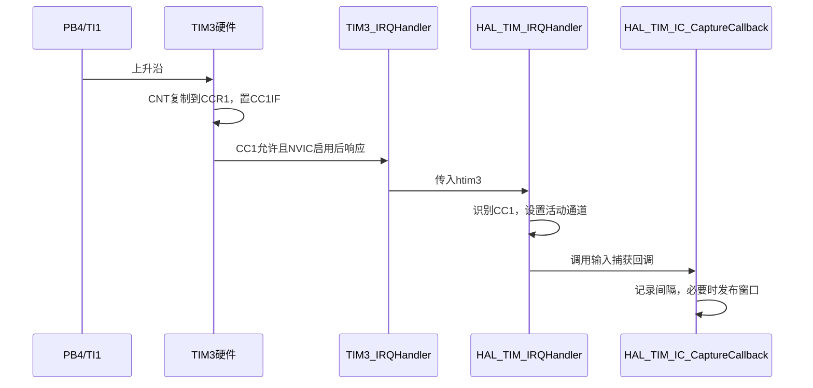

# 15｜输入捕获、频率测量与瞬时流量

> **完整工程进度**：本篇按第三阶段讲解；当前第17～22篇和LQB17_Final已完成。文中阶段测试的范围保持不变，最终业务见[第21篇](21-三页面显示、主程序调度与最终工程集成-精讲博客版.md)。

> **平台与版本**：CT117E-M4 V1.1 / STM32G431RBT6；CubeMX 6.17.0、STM32CubeG4 V1.6.3、Keil ARMCC 5.06 update 7，80MHz系统时钟，O0编译。
> **读者与前置知识**：会C语言，已读第08～12篇；新外设机制在使用前解释。
> **本篇效果**：理解计数器、边沿捕获和中断链，用PB4测R39脉冲，正确处理低频、超频、回绕与断线。
> **需求关联**：P02-12、P02-17～P02-20、P06-09，原句见[需求追踪表](07-需求追踪表与工程约定-精讲博客版.md)。
> **当前边界**：第三阶段源码已通过Keil构建和所列主机测试，尚未上板或测量引脚波形。Phase3_SelfTest验证采集与输出，不是最终竞赛程序。

[阅读目录](00-阅读路线与交付状态-精讲博客版.md) · [第三阶段实操与验证记录](../Tests/第三阶段实操与验证记录.md)

## 一、为什么按键的5ms扫描不能用来测流量脉冲

题目给出F=f/200，f的单位Hz，F的单位L/min；有效范围800～8000Hz。800Hz意味着周期1.25ms，8000Hz意味着周期0.125ms。如果每5ms才读一次GPIO，两次检查之间已经过去许多脉冲，读到的高低电平无法告诉你错过了几次边沿。

输入捕获让定时器硬件在边沿发生时保存计数值。可以类比为“不断走动的秒表，看到边沿就拍下读数”，但实际拍下的是硬件寄存器CCR1，不依赖CPU恰好在那一刻执行读取。CPU稍后在中断中取回这个数字，边沿发生时刻已经由硬件记录。

R39自身是电位器，但它调节U7/XL555电路的振荡频率；MCU应读取脉冲，不是对R39滑动端做ADC。V1.1原理图中U7输出经J9到PB4；数据手册PB4的AF2列为TIM3_CH1。R40/J10则到PA15，不能转错旋钮或接错通路。


输入捕获不是PWM输出，也不是把PB4上的电压值保存到CCR1。CCR1中保存的是计数器的数值，含义是“什么时候”，不是“多少伏”。

**知识小结**：结论：快脉冲交给硬件记录边沿时刻，不靠慢速GPIO轮询猜频率。 原因：8000Hz周期只有125µs，5ms检查会漏掉多个周期。 关键参数：R39→U7→J9→PB4/AF2/TIM3_CH1。 常见误区：看到旋钮就用ADC读取，或把CCR当作输入电压。

## 二、从80MHz推导1µs计数与频率公式

TIM3内部计数器CNT按定时器时钟分频后递增。PSC是预分频寄存器，实际除数为PSC+1；ARR是计数上限，向上计数从0到ARR，共ARR+1个数。

本工程APB1不分频，TIM3时钟80MHz。设置PSC=79，得到80MHz/80=1MHz，一个计数代表1µs；ARR=65535，计满65536次后回到0，因此回绕周期65.536ms。

连续两个上升沿读数分别为C1、C2，若间隔未跨过超过一整圈，差值Δ对应周期：

```text
T = Δ / 1,000,000 秒
f = 1,000,000 / Δ Hz
800 Hz → Δ=1250
8000 Hz → Δ=125
```

注意区分：1MHz是CNT计数速度，800～8000Hz是外部信号频率。二者不需要相等。计数时钟越快，单个周期量化越细，但16位定时器也更快回绕；选1MHz是在分辨率与测量时间范围之间作出的取舍。

### 16个周期为什么需要17个边沿

第1个边沿只能记起点，第2个边沿才得到第1个周期。常规范围累计16个间隔，得到总计数sum与周期数N=16，再计算f=1,000,000×N/sum。800Hz窗口约20ms，8000Hz窗口约2ms，既平滑单周期量化，又为100ms级刷新留出空间。

把多次频率直接平均与“总周期时间求频率”不完全相同；本实现累计时间，不在每个中断里先做浮点除法。实际频率仍有计数误差、时钟误差和输入抖动，不能宣称整数平均消除了全部误差。

### 16位回绕为什么能做减法

比如前一CCR=65500，下一CCR=89，实际跨过0经过125计数。`(uint16_t)(89-65500)`在截断到16位后得到125，等价模65536差值。该办法依赖ARR=65535；若改ARR=9999，回绕模数变了，不能继续只靠uint16_t截断。

本代码同时用50ms边沿超时限制测量，低于65.536ms计数回绕周期。中断中的相邻边沿间隔达到50ms，就重新建立起点，不再用可能跨多圈的CCR差值。这里的50ms来自设计选择，题目没有指定具体超时时间。

**知识小结**：结论：频率由计数时间差求得，所有公式先写清时钟与模数。 原因：CCR差值本身不是Hz，回绕算法也依赖ARR。 关键参数：PSC79、ARR65535、1µs/计数；17边沿得到16周期。 常见误区：用ARR而非ARR+1计算周期，或改ARR后仍照搬16位截断算法。

## 三、CubeMX配置与中断链逐层核对

在Timers→TIM3选择Clock Source=Internal Clock，Channel1=Input Capture direct mode。芯片图确认PB4为TIM3_CH1；有多种可选引脚时，必须选板上J9实际连接的PB4。

| 配置位置 | 设置 | 原因与生成结果 |
|---|---|---|
| TIM3 Parameter Settings | Prescaler=79，Counter Period=65535 | 1MHz、完整16位周期 |
| Counter Mode | Up | 采用递增差值 |
| Clock Division | DIV1 | 此项影响数字滤波等时钟，不代替PSC计数分频 |
| Auto-reload preload | Disable | 本题固定ARR，不在运行中修改周期 |
| CH1 Polarity | Rising Edge | 两个同类边沿构成完整周期 |
| CH1 Selection | Direct TI | 通道1捕获自己的TI1输入 |
| CH1 Prescaler | DIV1 | 每个有效边沿都捕获，不另丢掉若干边沿 |
| CH1 Input Filter | 0 | 板载方波直接捕获；不把按键20ms防抖搬到此处 |
| GPIO PB4 | AF2，Pull-down | 断开J9时有低电平参考，减小悬空乱跳 |
| NVIC | TIM3 global interrupt启用，抢占优先级1、子优先级0 | 边沿到来后进入处理链 |

生成的GPIO模式是GPIO_MODE_AF_PP，但TIM3_CH1已选输入捕获，外设使用的是输入路径；不要看到PP就认为代码会主动向PB4输出方波。GPIO输出速度对这里的输入采样也不是计数频率设置。

IRQ中断请求还需要两层允许：NVIC允许CPU响应TIM3；TIM自身DIER中的CC1中断允许位也要打开。HAL_TIM_IC_Start_IT完成后者并启动捕获/计数。仅配置CubeMX而不调用Start_IT，回调不会自动运行。



`HAL_TIM_IC_CaptureCallback`是库的弱定义回调，应用提供同名函数后，链接到我们的实现。检查Instance==TIM3及Channel==HAL_TIM_ACTIVE_CHANNEL_1，是为避免别的定时器或通道也调用这一入口时误算。`TIM_CHANNEL_1`用于配置/读取通道，`HAL_TIM_ACTIVE_CHANNEL_1`是回调里的活动状态标记，两种常量不应混用。

生成代码有三个入口：Core/Src/tim.c的MX_TIM3_Init和HAL_TIM_Base_MspInit，Core/Src/stm32g4xx_it.c的TIM3_IRQHandler。因为生成顺序先HAL_TIM_Base_Init，相关GPIO/NVIC准备在Base_MspInit中完成；不能只因没找到HAL_TIM_IC_MspInit就说没有初始化。

### 当前TIM3初始化和IRQ入口

```c
void MX_TIM3_Init(void)
{

  /* USER CODE BEGIN TIM3_Init 0 */

  /* USER CODE END TIM3_Init 0 */

  TIM_ClockConfigTypeDef sClockSourceConfig = {0};
  TIM_MasterConfigTypeDef sMasterConfig = {0};
  TIM_IC_InitTypeDef sConfigIC = {0};

  /* USER CODE BEGIN TIM3_Init 1 */

  /* USER CODE END TIM3_Init 1 */
  htim3.Instance = TIM3;
  htim3.Init.Prescaler = 79;
  htim3.Init.CounterMode = TIM_COUNTERMODE_UP;
  htim3.Init.Period = 65535;
  htim3.Init.ClockDivision = TIM_CLOCKDIVISION_DIV1;
  htim3.Init.AutoReloadPreload = TIM_AUTORELOAD_PRELOAD_DISABLE;
  if (HAL_TIM_Base_Init(&htim3) != HAL_OK)
  {
    Error_Handler();
  }
  sClockSourceConfig.ClockSource = TIM_CLOCKSOURCE_INTERNAL;
  if (HAL_TIM_ConfigClockSource(&htim3, &sClockSourceConfig) != HAL_OK)
  {
    Error_Handler();
  }
  if (HAL_TIM_IC_Init(&htim3) != HAL_OK)
  {
    Error_Handler();
  }
  sMasterConfig.MasterOutputTrigger = TIM_TRGO_RESET;
  sMasterConfig.MasterSlaveMode = TIM_MASTERSLAVEMODE_DISABLE;
  if (HAL_TIMEx_MasterConfigSynchronization(&htim3, &sMasterConfig) != HAL_OK)
  {
    Error_Handler();
  }
  sConfigIC.ICPolarity = TIM_INPUTCHANNELPOLARITY_RISING;
  sConfigIC.ICSelection = TIM_ICSELECTION_DIRECTTI;
  sConfigIC.ICPrescaler = TIM_ICPSC_DIV1;
  sConfigIC.ICFilter = 0;
  if (HAL_TIM_IC_ConfigChannel(&htim3, &sConfigIC, TIM_CHANNEL_1) != HAL_OK)
  {
    Error_Handler();
  }
  /* USER CODE BEGIN TIM3_Init 2 */

  /* USER CODE END TIM3_Init 2 */

}
```

```c
void TIM3_IRQHandler(void)
{
  /* USER CODE BEGIN TIM3_IRQn 0 */

  /* USER CODE END TIM3_IRQn 0 */
  HAL_TIM_IRQHandler(&htim3);
  /* USER CODE BEGIN TIM3_IRQn 1 */

  /* USER CODE END TIM3_IRQn 1 */
}
```
完整tim.c同时包含TIM2 PWM配置，在第16篇给出；工程只有这一份生成文件。中断里不调用LCD、LED，也不HAL_Delay；SysTick优先级15低于TIM3的1，若高优先级回调等待一个需要SysTick推进的延时，可能造成死等。

**知识小结**：结论：捕获硬件、TIM中断允许、NVIC和回调是完整的一条链。 原因：少一个环节都可能出现CNT在走、CCR在变、回调却不进。 关键参数：TIM3 CH1 direct、上升沿、Start_IT、TIM3_IRQn优先级1。 常见误区：只勾NVIC就认为已经启动；或在中断中等待低优先级tick。

## 四、断线、低频、覆盖与主循环快照怎样处理

正常时每16个周期发布一组结果，但异常不能一直等。如果新间隔超过1250µs，已知低于800Hz，就立即用一个周期发布低频并清空旧窗口；否则骤降到低频时，可能还要等很久才能清除旧的高流量。低于约20Hz或完全无边沿时，50ms超时会使结果无效、显示流量0。本模块不是保证覆盖所有低频的通用频率计，竞赛有效范围才是主要对象。

一旦最后边沿过去50ms，Read返回valid=0、frequency_hz=0；恢复后的第一个边沿重新建立起点，再形成有效窗口。普通16位CNT回绕不是错误，**CC1OF捕获覆盖**则表示新边沿覆盖了尚未处理的捕获值，不能当作正常周期。

失效时period_ticks和periods可能仍保留最后发布窗口，方便观察历史；它们不代表现在又测到了同样的周期。使用者必须先看valid，不能绕过它自行用旧ticks计算频率。overcaptures也是累计诊断计数，频率恢复后不会自动清零。

| 情况 | 当前实现 | 为什么 |
|---|---|---|
| 第一个边沿 | 只记previous | 尚无完整周期 |
| 间隔为0 | 丢弃当前窗口，标无效 | 避免除0和伪造无穷大频率 |
| 间隔>1250计数 | 用1周期快速发布 | 已知低于800Hz，不慢等16个周期 |
| 常规范围 | 累计16周期发布 | 平滑单周期计数量化 |
| CC1OF置位 | 清标志、计数overcaptures、丢弃窗口并重新起步 | 某些边沿历史已经丢失 |
| 50ms无边沿 | Read标无效，频率0 | 不让旧数值永远保留 |

### volatile为什么还不够

中断发布period_ticks、periods、valid等字段，主循环读取它们。如果主循环刚读到旧ticks，中断发布了新periods，再继续读取，就会拼成不同窗口的组合。给变量加volatile只能要求实际访问内存，不能让多次读取自动成为一个整体。

Read先保存PRIMASK（CPU当前中断屏蔽状态），短暂关闭中断，复制所有字段并读取HAL tick，随后恢复原来的PRIMASK；耗时的浮点除法放在恢复之后。进入时若已经关中断，退出也保持关闭，不能无条件开启。

函数不接收App早先读到的now：假设App的now=100，捕获中断刚更新last_edge=101，旧now减新last的无符号差会变成巨大值，把新信号误判超时。现在在同一临界区读取last与当前tick，避免这类时间快照不一致。临界区只复制少量字段，不在其中绘图或轮询ADC。

### 最终捕获模块完整文件

### bsp_capture.h 完整文件

[打开实际源码](../Firmware/BSP_Drivers/Inc/bsp_capture.h)

```c
#ifndef BSP_CAPTURE_H
#define BSP_CAPTURE_H

#include <stdint.h>

#define BSP_CAPTURE_CLOCK_HZ 1000000U
#define BSP_CAPTURE_PERIODS 16U
#define BSP_CAPTURE_TIMEOUT_MS 50U

typedef struct {
    float frequency_hz;            /* 未按800/8000限幅的原始频率。 */
    uint32_t period_ticks;         /* 本次发布窗口累计的1us计数。 */
    uint32_t overcaptures;         /* 硬件捕获覆盖次数，调试用。 */
    uint16_t periods;              /* 窗口周期数，常规16，低频快速更新时1。 */
    uint8_t valid;                 /* 已有完整测量，且50ms内仍有边沿。 */
} BSP_CaptureSample;

/* MX_TIM3_Init后调用一次；启用CH1捕获中断，成功返回1。 */
uint8_t BSP_Capture_Init(void);
/* 主循环读取一致快照；函数内部读取tick，避免传入已落后的now。
 * 无信号/启动等待/捕获覆盖时valid=0，frequency_hz=0。 */
void BSP_Capture_Read(BSP_CaptureSample *sample);

#endif
```

### bsp_capture.c 完整文件

[打开实际源码](../Firmware/BSP_Drivers/Src/bsp_capture.c)

```c
#include "bsp_capture.h"
#include "tim.h"

static volatile uint32_t last_edge_ms, published_ticks, overcaptures;
static volatile uint16_t published_periods;
static volatile uint8_t published_valid, started;
/* 以下工作区只有捕获回调使用，初始化在开中断以前完成。 */
static uint16_t previous, window_periods;
static uint32_t window_ticks;
static uint8_t have_previous;

static void ResetWindow(void)
{
    window_periods = 0U;
    window_ticks = 0U;
}

uint8_t BSP_Capture_Init(void)
{
    started = published_valid = have_previous = 0U;
    published_ticks = last_edge_ms = overcaptures = 0U;
    published_periods = previous = 0U;
    ResetWindow();
    if (htim3.Init.Prescaler != 79U || htim3.Init.Period != 65535U) return 0U;
    __HAL_TIM_CLEAR_FLAG(&htim3, TIM_FLAG_CC1 | TIM_FLAG_CC1OF);
    started = 1U;
    if (HAL_TIM_IC_Start_IT(&htim3, TIM_CHANNEL_1) != HAL_OK) {
        started = 0U;
    }
    return started;
}

void HAL_TIM_IC_CaptureCallback(TIM_HandleTypeDef *htim)
{
    uint16_t current, delta;
    uint32_t now;
    uint8_t stale;
    if (htim->Instance != TIM3 || htim->Channel != HAL_TIM_ACTIVE_CHANNEL_1 || !started) return;

    current = (uint16_t)HAL_TIM_ReadCapturedValue(htim, TIM_CHANNEL_1);
    now = HAL_GetTick();
    stale = (uint8_t)((uint32_t)(now - last_edge_ms) >= BSP_CAPTURE_TIMEOUT_MS);
    last_edge_ms = now;

    if (__HAL_TIM_GET_FLAG(htim, TIM_FLAG_CC1OF) != RESET) {
        /* CCR被新边沿覆盖，旧周期不可信：丢弃窗口，重新找一对边沿。 */
        __HAL_TIM_CLEAR_FLAG(htim, TIM_FLAG_CC1OF);
        ++overcaptures;
        published_valid = 0U;
        ResetWindow();
        previous = current;
        have_previous = 1U;
        return;
    }
    if (!have_previous || stale) {
        previous = current;
        have_previous = 1U;
        published_valid = 0U;
        ResetWindow();
        return;                    /* 一个边沿只能确定起点，还没有周期。 */
    }

    /* ARR=65535，且两边沿间隔<50ms，最多跨一次16位计数回绕。 */
    delta = (uint16_t)(current - previous);
    previous = current;
    if (delta == 0U) {
        published_valid = 0U;      /* 不对零周期做除法。 */
        ResetWindow();
        return;
    }
    if (delta > 1250U) {
        /* 周期>1250us已低于800Hz，立即发布，避免慢等16个低频周期。 */
        published_ticks = delta;
        published_periods = 1U;
        published_valid = 1U;
        ResetWindow();
        return;
    }

    window_ticks += delta;
    ++window_periods;
    if (window_periods == BSP_CAPTURE_PERIODS) {
        published_ticks = window_ticks;
        published_periods = window_periods;
        published_valid = 1U;
        ResetWindow();
    }
    /* 中断只做整数记录，除法、LCD和LED都留给主循环。 */
}

void BSP_Capture_Read(BSP_CaptureSample *sample)
{
    uint32_t irq_state, now, last;
    uint8_t valid;
    if (sample == 0) return;

    irq_state = __get_PRIMASK();
    __disable_irq();
    /* 多字段必须来自同一次发布；volatile本身不能保证这一点。 */
    sample->period_ticks = published_ticks;
    sample->periods = published_periods;
    sample->overcaptures = overcaptures;
    valid = (uint8_t)(started && published_valid);
    last = last_edge_ms;
    now = HAL_GetTick();           /* 与last在同一临界区读取，避免旧now减新last。 */
    __set_PRIMASK(irq_state);      /* 恢复进入前状态，不能无条件开启中断。 */

    sample->frequency_hz = 0.0f;
    sample->valid = 0U;
    if (valid && (uint32_t)(now - last) < BSP_CAPTURE_TIMEOUT_MS && sample->period_ticks != 0U) {
        sample->frequency_hz = (float)BSP_CAPTURE_CLOCK_HZ * sample->periods / sample->period_ticks;
        sample->valid = 1U;
    }
}
```

**知识小结**：结论：测频值既要有完整周期，也要足够新且没有明确丢边沿证据。 原因：旧数据、零周期和跨窗口字段都可能制造看似合理的错误数值。 关键参数：valid、50ms、CC1OF、16周期；快照后才做浮点除法。 常见误区：把volatile当锁，或拿主循环过期的now减更新后的last_edge。

## 五、把原始频率换成流量，严格处理两个端点

捕获模块输出原始频率，不在内部裁到8000。measurement.c中的函数负责题目单位与范围：

| 原始f | 流量F | 超频标记 |
|---|---|---|
| <800Hz | 0 | 0 |
| =800Hz | 4.0L/min | 0 |
| 800～8000Hz | f/200 | 0 |
| =8000Hz | 40.0L/min | 0 |
| >8000Hz | 40.0L/min | 1 |

如果先把频率裁成8000，再判断是否>8000，超频条件永远不成立。流量40本身也不足以说明超频，因为合法8000Hz同样对应40。

捕获结果无效时，应用应显式按无有效流量处理，并保留valid用于诊断。本阶段显示I=0表示没有新鲜完整捕获；I=1且F=0则可能是测到了低于800Hz的脉冲。这两种状态在计量上都得到0，但排错含义不同。

下面直接摘取第14篇同一份measurement.c；无需另建流量公式文件，也不能把该片段重复粘进第二个.c造成同名函数冲突。

```c
float Measurement_Flow(float frequency_hz)
{
    if (!NonnegativeFinite(frequency_hz) || frequency_hz < 800.0f) return 0.0f;
    if (frequency_hz > 8000.0f) return 40.0f;
    return frequency_hz / 200.0f;
}

uint8_t Measurement_Overrange(float frequency_hz)
{
    /* 保留原始频率判断超频，不能从已经限幅的流量40反推。 */
    return (uint8_t)(NonnegativeFinite(frequency_hz) && frequency_hz > 8000.0f);
}
```
显示f取整而内部保留浮点。内部799.7Hz可能显示为800，但F仍应为0；这不是比较符错了。验收阈值要观察未按显示精度舍入的frequency_hz。累计流量还需每100ms按时间积分，在第19篇实现，不能把本篇的瞬时F直接当累计Q。

**知识小结**：结论：原始频率、限幅后流量和超频标记同时保留各自语义。 原因：一个限幅后的40不能区分8000与9000Hz。 关键参数：800和8000都合法；仅严格大于8000超频；F单位L/min。 常见误区：先裁频率再报警，或把显示取整值当内部精确频率。

## 六、怎样验证以及中断不进时先查哪里

Phase3_SelfTest中转R39，观察第5行f、F及超频时的!；Keil观察phase3_capture.frequency_hz、period_ticks、periods、valid、overcaptures。稳定有效频率时常规periods为16；故意降低到800以下时可能为1；拔掉信号后I应变0。需要改变J9时先断电，恢复原短接后再运行。

主机测试已注入17个边沿窗口、800/8000及超频、16位回绕、HAL tick回绕、低频快速更新、49/50ms超时、恢复首边沿、捕获覆盖、零差和错误通道，检查恢复进入前的中断屏蔽状态。它调用的是实际回调代码，但没有验证真实NVIC、引脚复用和ISR执行耗时。

| 现象 | 先观察 | 再定位 |
|---|---|---|
| f始终0、I=0 | J9、R39是否正确；TIM3 CNT是否在走 | PSC/时钟/CEN、PB4 AF2 |
| CNT走，CCR1不变 | PB4电平或信号源 | 错转R40、J9未接、通道选错 |
| CCR1变，回调不进 | DIER.CC1IE、NVIC TIM3、TIM3_IRQHandler | 是否调用Start_IT，是否误用Start非中断版 |
| 回调进但一直无效 | Channel、CC1OF、delta、have_previous | 是否只有一个边沿、噪声/覆盖、计数间隔超时 |
| 拔线后仍显示旧值 | valid与now-last边沿差 | Read是否仍执行、是否忽略valid |
| 频率大致差80倍 | PSC及公式的计数时钟 | 是否把80MHz直接当1MHz代入 |
| 高频时偶发明显偏低 | overcaptures是否增加、主循环/中断是否长时间关中断 | 不在中断里画LCD或做延时 |

没有示波器仍可用下一篇的可选板内回接，把PA1输出接到PB4测频输入做相对验证；必须先断开J9的555输出，不能让两个输出直接相连。回接不能证明绝对时钟精度，恢复R39接线后再继续竞赛功能验证。

**知识小结**：结论：沿信号、计数、捕获、IRQ、回调、换算逐层排查。 原因：显示为0可能来自真实低频、未启动、超时或捕获失效。 关键参数：Watch CNT/CCR1/DIER及valid/overcaptures；50ms失联边界。 常见误区：只看最终F就反复修改公式，或把PC注入测试当成已测真实信号。


## 一页纸总结

- R39调节555频率，经J9到PB4/AF2/TIM3_CH1。
- TIM3在80MHz下PSC79、ARR65535，1µs一计数。
- 第一个边沿建立起点，17个边沿形成16周期窗口。
- 低于800Hz的长间隔立即发布；无边沿50ms无效。
- CNT正常回绕可取模；CC1OF表示捕获历史丢失，必须重新建立窗口。
- 中断只记录整数，主循环短临界区取一致快照，再算频率。
- 流量与超频独立计算，保留800/8000的严格端点规则。
- 硬件链与真实误差仍待板上验证，软件用例已有通过记录。

## 关键参数表

| 项目 | 参数与作用 |
|---|---|
| 输入 | PB4 / AF2 / TIM3_CH1，J9连接R39电路 |
| 计数 | 80MHz/(79+1)=1MHz |
| ARR / 回绕 | 65535 / 65.536ms |
| 捕获 | 上升沿、Direct TI、DIV1、Filter0 |
| 窗口 | 常规16周期；低频快速发布1周期 |
| 失联 | 最后边沿起>=50ms |
| 有效流量 | 800～8000Hz，F=f/200 L/min |
| 异常 | CC1OF或零差使当前结果无效 |

## 自测问题

1. 为何16个周期需要17个边沿？
2. 65500到89的CCR差为何是125？
3. NVIC已勾选而回调不进，还应查什么？
4. 为什么Read不使用主循环提前读到的now？
5. CNT溢出与CC1OF有何区别？
6. I=1、显示f=800却F=0一定错吗？

<details>
<summary>展开参考答案</summary>

1. 周期是相邻边沿的间隔，第一个边沿只确定起点，之后每来一个才增加一个周期。

2. 计数模65536，截断为uint16_t等价跨回绕取差；前提是间隔不超过一整圈。

3. TIM的CC1中断允许、是否Start_IT、IRQ是否调用HAL_TIM_IRQHandler、引脚及捕获通道。

4. 中断可能已经更新更晚的last_edge，旧now做无符号减法会误报很大超时。

5. CNT回绕是正常计数行为；CC1OF表示捕获值被覆盖，边沿历史不完整。

6. 不一定，原始频率可能799.7而显示取整成800，应看内部未舍入值。

</details>

[回到阅读目录](00-阅读路线与交付状态-精讲博客版.md)
