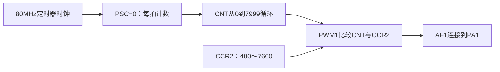
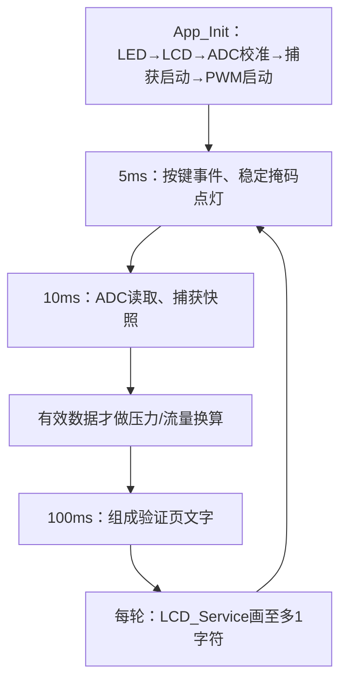

# 16｜PA1的10kHz PWM与第三阶段集成

> **完整工程进度**：本篇按第三阶段讲解；当前第17～22篇和LQB17_Final已完成。文中阶段测试的范围保持不变，最终业务见[第21篇](21-三页面显示、主程序调度与最终工程集成-精讲博客版.md)。

> **平台与版本**：CT117E-M4 V1.1 / STM32G431RBT6；CubeMX 6.17.0、STM32CubeG4 V1.6.3、Keil ARMCC 5.06 update 7，80MHz系统时钟，O0编译。
> **读者与前置知识**：会C语言，已读第08～12篇；新外设机制在使用前解释。
> **本篇效果**：推导TIM2的PSC/ARR/CCR，输出5～95%占空比，连接各采集模块并完成可重复的阶段验证。
> **需求关联**：P02-08、P02-09、P02-13、P03-01～P03-03、P06-20，原句见[需求追踪表](07-需求追踪表与工程约定-精讲博客版.md)。
> **当前边界**：第三阶段源码已通过Keil构建和所列主机测试，尚未上板或测量引脚波形。Phase3_SelfTest验证采集与输出，不是最终竞赛程序。

[阅读目录](00-阅读路线与交付状态-精讲博客版.md) · [第三阶段实操与验证记录](../Tests/第三阶段实操与验证记录.md)

## 一、题目要求的PWM到底是什么

PWM是一种周期性高低电平波形。周期T表示重复一次花多久，频率f=1/T表示每秒重复多少次；占空比D=高电平时间/T，表示一个周期中有多少比例为高。

题目固定10kHz，所以周期100µs；5%意味着高5µs、低95µs，50%意味着各50µs，95%意味着高95µs、低5µs。改变占空比不应同时把频率也改掉。

```text
一个周期T = 100µs
5%：  高5µs    | 低95µs
50%： 高50µs   | 低50µs
95%： 高95µs   | 低5µs
每种情况都每100µs重复一次。
```

PWM输出电平仍在高与低之间切换，并不是引脚真的输出一个固定的“占空比×3.3V”直流电压。执行机构、滤波器或测量仪表可能对平均作用作出反应，但这与GPIO瞬时电平是不同概念。本题只模拟控制脉冲，不能自行把外部电机直接接到MCU脚。

题目指定PA1。数据手册AF表中PA1/AF1对应TIM2_CH2，原理图J3第4脚引出PA1；不是TIM2_CH1，也不是因为某个其它示例用了PA0就可以换脚。

**知识小结**：结论：频率决定重复周期，占空比决定其中高电平比例。 原因：题目同时限制二者，改变占空比时必须保持周期不变。 关键参数：PA1/AF1/TIM2_CH2；10kHz=100µs；5～95%。 常见误区：把PWM理解成恒定模拟电压，或认为占空比变化必须改ARR。

## 二、由时钟推导PSC、ARR、CCR，不靠试数

本工程TIM2时钟80MHz，选择PSC=0，即不分频。向上计数从0到ARR，每周期有ARR+1个时钟。因此：

```text
f_PWM = f_TIM / ((PSC+1) × (ARR+1))
10,000 = 80,000,000 / (1 × 8000)
所以 PSC=0，ARR=7999。
```

使用边沿对齐、向上计数、PWM mode 1、高有效时，CNT小于CCR2期间输出高，达到CCR2后输出低，下一次回到0再变高。这个结论有配置条件；换成PWM2、反极性或中心对齐，不能直接照搬。

| 希望占空比 | 高电平计数CCR2 | 周期计数ARR+1 | 理论高电平时间 |
|---|---|---|---|
| 5% | 400 | 8000 | 5µs |
| 50% | 4000 | 8000 | 50µs |
| 95% | 7600 | 8000 | 95µs |

计数下标容易造成误解：ARR是7999，但周期有8000拍；CCR=400表示CNT=0～399这400拍为高，不再额外加1。把CCR也按ARR那样机械地加1，会让占空比计算错误。



### 为什么参数用0.01个百分点

后续控制计划每10ms变0.01个百分点，累计一秒变1个百分点，因此接口用uint16_t保存占空比的百分之一：500=5.00%、501=5.01%、9500=95.00%。这不是ADC码，也不是0～100之间的整数百分比。

换成CCR用`(8000*d + 5000)/10000`，加5000用于整数除法就近舍入。一个计数占0.0125个百分点，单次量化误差最多0.00625个百分点；在最小5%处相对误差上界约0.125%，只是量化部分，不能把晶振、边沿、输出电气误差也算成已验证。

有时两个相邻请求会量化到同一个CCR，这是硬件有限分辨率的结果；控制层应保存自己的细分调节值，不能每次都用已量化读回值替换控制内部状态而累积舍入偏差。

**知识小结**：结论：先固定PSC和ARR确定周期，再由CCR改变高电平时间。 原因：不同寄存器承担不同作用，且单位不能混用。 关键参数：PSC0、ARR7999；d单位0.01个百分点；CCR=(8000d+5000)/10000。 常见误区：分母使用7999，或把5误传给表示5.00%的接口。

## 三、CubeMX设置与为什么配置后还要Start

Timers→TIM2：Clock Source选Internal Clock，Channel2选PWM Generation CH2，确认映射PA1。然后设置：

| 项目 | 设置 | 作用 |
|---|---|---|
| Prescaler / Counter Period | 0 / 7999 | 10kHz |
| Counter Mode / Clock Division | Up / DIV1 | 使用本文边沿对齐公式；DIV1不额外改变PSC |
| Auto-reload preload | Disable | ARR固定，不做动态频率修改 |
| CH2 Mode | PWM mode 1 | CNT<CCR为有效 |
| CH2 Pulse | 400 | 初始5% |
| CH2 Polarity | High | 有效段为高电平 |
| CH2 Fast Mode | Disable | 不启用快速响应模式 |
| GPIO PA1 | AF1 TIM2_CH2、No pull、Low speed | 由定时器控制输出；该速度不是10kHz设置 |
| TIM2 NVIC | 不启用 | 硬件独立产生连续PWM，无需每周期中断 |

生成代码中的HAL_TIM_PWM_ConfigChannel不仅写模式和Pulse，也为CH2启用CCR预装载OC2PE：运行时写入新CCR先进入预装载，在下一次更新事件进入有效比较值，减少周期中途改变阈值引起的畸形脉冲。ARR的Auto-reload preload与CCR的OC2PE是不同寄存器设置，不能因为前者Disabled就说后者也没启用。

初始化填好寄存器不等于输出已开始。BSP_PWM_Start先核对PSC/ARR，再写初值500，调用HAL_TIM_PWM_Start(&htim2,TIM_CHANNEL_2)，使能通道并启动计数。TIM2是普通定时器，本代码不套用TIM1高级定时器的刹车、互补或死区设置。

若只在调试器里看见CCR2=400却引脚无PWM，应继续查CEN、CC2E以及PA1 AF，而不是认为CCR有值就证明输出已经工作。TIM3捕获中断即使忙碌，TIM2硬件仍可继续产生PWM；关CPU中断并不会自动停止所有定时器。

### 完整tim.c：TIM2与TIM3共用一份生成文件

### tim.c 完整文件

[打开实际源码](../Firmware/Core/Src/tim.c)

```c
/* USER CODE BEGIN Header */
/**
  ******************************************************************************
  * @file    tim.c
  * @brief   This file provides code for the configuration
  *          of the TIM instances.
  ******************************************************************************
  * @attention
  *
  * Copyright (c) 2026 STMicroelectronics.
  * All rights reserved.
  *
  * This software is licensed under terms that can be found in the LICENSE file
  * in the root directory of this software component.
  * If no LICENSE file comes with this software, it is provided AS-IS.
  *
  ******************************************************************************
  */
/* USER CODE END Header */
/* Includes ------------------------------------------------------------------*/
#include "tim.h"

/* USER CODE BEGIN 0 */

/* USER CODE END 0 */

TIM_HandleTypeDef htim2;
TIM_HandleTypeDef htim3;

/* TIM2 init function */
void MX_TIM2_Init(void)
{

  /* USER CODE BEGIN TIM2_Init 0 */

  /* USER CODE END TIM2_Init 0 */

  TIM_ClockConfigTypeDef sClockSourceConfig = {0};
  TIM_MasterConfigTypeDef sMasterConfig = {0};
  TIM_OC_InitTypeDef sConfigOC = {0};

  /* USER CODE BEGIN TIM2_Init 1 */

  /* USER CODE END TIM2_Init 1 */
  htim2.Instance = TIM2;
  htim2.Init.Prescaler = 0;
  htim2.Init.CounterMode = TIM_COUNTERMODE_UP;
  htim2.Init.Period = 7999;
  htim2.Init.ClockDivision = TIM_CLOCKDIVISION_DIV1;
  htim2.Init.AutoReloadPreload = TIM_AUTORELOAD_PRELOAD_DISABLE;
  if (HAL_TIM_Base_Init(&htim2) != HAL_OK)
  {
    Error_Handler();
  }
  sClockSourceConfig.ClockSource = TIM_CLOCKSOURCE_INTERNAL;
  if (HAL_TIM_ConfigClockSource(&htim2, &sClockSourceConfig) != HAL_OK)
  {
    Error_Handler();
  }
  if (HAL_TIM_PWM_Init(&htim2) != HAL_OK)
  {
    Error_Handler();
  }
  sMasterConfig.MasterOutputTrigger = TIM_TRGO_RESET;
  sMasterConfig.MasterSlaveMode = TIM_MASTERSLAVEMODE_DISABLE;
  if (HAL_TIMEx_MasterConfigSynchronization(&htim2, &sMasterConfig) != HAL_OK)
  {
    Error_Handler();
  }
  sConfigOC.OCMode = TIM_OCMODE_PWM1;
  sConfigOC.Pulse = 400;
  sConfigOC.OCPolarity = TIM_OCPOLARITY_HIGH;
  sConfigOC.OCFastMode = TIM_OCFAST_DISABLE;
  if (HAL_TIM_PWM_ConfigChannel(&htim2, &sConfigOC, TIM_CHANNEL_2) != HAL_OK)
  {
    Error_Handler();
  }
  /* USER CODE BEGIN TIM2_Init 2 */

  /* USER CODE END TIM2_Init 2 */
  HAL_TIM_MspPostInit(&htim2);

}
/* TIM3 init function */
void MX_TIM3_Init(void)
{

  /* USER CODE BEGIN TIM3_Init 0 */

  /* USER CODE END TIM3_Init 0 */

  TIM_ClockConfigTypeDef sClockSourceConfig = {0};
  TIM_MasterConfigTypeDef sMasterConfig = {0};
  TIM_IC_InitTypeDef sConfigIC = {0};

  /* USER CODE BEGIN TIM3_Init 1 */

  /* USER CODE END TIM3_Init 1 */
  htim3.Instance = TIM3;
  htim3.Init.Prescaler = 79;
  htim3.Init.CounterMode = TIM_COUNTERMODE_UP;
  htim3.Init.Period = 65535;
  htim3.Init.ClockDivision = TIM_CLOCKDIVISION_DIV1;
  htim3.Init.AutoReloadPreload = TIM_AUTORELOAD_PRELOAD_DISABLE;
  if (HAL_TIM_Base_Init(&htim3) != HAL_OK)
  {
    Error_Handler();
  }
  sClockSourceConfig.ClockSource = TIM_CLOCKSOURCE_INTERNAL;
  if (HAL_TIM_ConfigClockSource(&htim3, &sClockSourceConfig) != HAL_OK)
  {
    Error_Handler();
  }
  if (HAL_TIM_IC_Init(&htim3) != HAL_OK)
  {
    Error_Handler();
  }
  sMasterConfig.MasterOutputTrigger = TIM_TRGO_RESET;
  sMasterConfig.MasterSlaveMode = TIM_MASTERSLAVEMODE_DISABLE;
  if (HAL_TIMEx_MasterConfigSynchronization(&htim3, &sMasterConfig) != HAL_OK)
  {
    Error_Handler();
  }
  sConfigIC.ICPolarity = TIM_INPUTCHANNELPOLARITY_RISING;
  sConfigIC.ICSelection = TIM_ICSELECTION_DIRECTTI;
  sConfigIC.ICPrescaler = TIM_ICPSC_DIV1;
  sConfigIC.ICFilter = 0;
  if (HAL_TIM_IC_ConfigChannel(&htim3, &sConfigIC, TIM_CHANNEL_1) != HAL_OK)
  {
    Error_Handler();
  }
  /* USER CODE BEGIN TIM3_Init 2 */

  /* USER CODE END TIM3_Init 2 */

}

void HAL_TIM_Base_MspInit(TIM_HandleTypeDef* tim_baseHandle)
{

  GPIO_InitTypeDef GPIO_InitStruct = {0};
  if(tim_baseHandle->Instance==TIM2)
  {
  /* USER CODE BEGIN TIM2_MspInit 0 */

  /* USER CODE END TIM2_MspInit 0 */
    /* TIM2 clock enable */
    __HAL_RCC_TIM2_CLK_ENABLE();
  /* USER CODE BEGIN TIM2_MspInit 1 */

  /* USER CODE END TIM2_MspInit 1 */
  }
  else if(tim_baseHandle->Instance==TIM3)
  {
  /* USER CODE BEGIN TIM3_MspInit 0 */

  /* USER CODE END TIM3_MspInit 0 */
    /* TIM3 clock enable */
    __HAL_RCC_TIM3_CLK_ENABLE();

    __HAL_RCC_GPIOB_CLK_ENABLE();
    /**TIM3 GPIO Configuration
    PB4     ------> TIM3_CH1
    */
    GPIO_InitStruct.Pin = GPIO_PIN_4;
    GPIO_InitStruct.Mode = GPIO_MODE_AF_PP;
    GPIO_InitStruct.Pull = GPIO_PULLDOWN;
    GPIO_InitStruct.Speed = GPIO_SPEED_FREQ_LOW;
    GPIO_InitStruct.Alternate = GPIO_AF2_TIM3;
    HAL_GPIO_Init(GPIOB, &GPIO_InitStruct);

    /* TIM3 interrupt Init */
    HAL_NVIC_SetPriority(TIM3_IRQn, 1, 0);
    HAL_NVIC_EnableIRQ(TIM3_IRQn);
  /* USER CODE BEGIN TIM3_MspInit 1 */

  /* USER CODE END TIM3_MspInit 1 */
  }
}
void HAL_TIM_MspPostInit(TIM_HandleTypeDef* timHandle)
{

  GPIO_InitTypeDef GPIO_InitStruct = {0};
  if(timHandle->Instance==TIM2)
  {
  /* USER CODE BEGIN TIM2_MspPostInit 0 */

  /* USER CODE END TIM2_MspPostInit 0 */

    __HAL_RCC_GPIOA_CLK_ENABLE();
    /**TIM2 GPIO Configuration
    PA1     ------> TIM2_CH2
    */
    GPIO_InitStruct.Pin = GPIO_PIN_1;
    GPIO_InitStruct.Mode = GPIO_MODE_AF_PP;
    GPIO_InitStruct.Pull = GPIO_NOPULL;
    GPIO_InitStruct.Speed = GPIO_SPEED_FREQ_LOW;
    GPIO_InitStruct.Alternate = GPIO_AF1_TIM2;
    HAL_GPIO_Init(GPIOA, &GPIO_InitStruct);

  /* USER CODE BEGIN TIM2_MspPostInit 1 */

  /* USER CODE END TIM2_MspPostInit 1 */
  }

}

void HAL_TIM_Base_MspDeInit(TIM_HandleTypeDef* tim_baseHandle)
{

  if(tim_baseHandle->Instance==TIM2)
  {
  /* USER CODE BEGIN TIM2_MspDeInit 0 */

  /* USER CODE END TIM2_MspDeInit 0 */
    /* Peripheral clock disable */
    __HAL_RCC_TIM2_CLK_DISABLE();
  /* USER CODE BEGIN TIM2_MspDeInit 1 */

  /* USER CODE END TIM2_MspDeInit 1 */
  }
  else if(tim_baseHandle->Instance==TIM3)
  {
  /* USER CODE BEGIN TIM3_MspDeInit 0 */

  /* USER CODE END TIM3_MspDeInit 0 */
    /* Peripheral clock disable */
    __HAL_RCC_TIM3_CLK_DISABLE();

    /**TIM3 GPIO Configuration
    PB4     ------> TIM3_CH1
    */
    HAL_GPIO_DeInit(GPIOB, GPIO_PIN_4);

    /* TIM3 interrupt Deinit */
    HAL_NVIC_DisableIRQ(TIM3_IRQn);
  /* USER CODE BEGIN TIM3_MspDeInit 1 */

  /* USER CODE END TIM3_MspDeInit 1 */
  }
}

/* USER CODE BEGIN 1 */

/* USER CODE END 1 */
```

**知识小结**：结论：初始化建立配置，Start使能硬件输出；动态CCR通过预装载更新。 原因：参数存在与引脚正在输出是两种状态。 关键参数：PWM1、高有效、CH2、OC2PE；TIM2无需NVIC。 常见误区：ARR预装载和CCR预装载混淆，或复制TIM1配置给TIM2。

## 四、PWM模块只负责限幅和量化，控制策略留在后面

`BSP_PWM_SetDuty`先把请求限制到500～9500，再乘以周期计数并舍入，防止错误参数写出0%或超过95%。乘法显式使用32位，最大8000×9500+5000=76005000，在uint32_t范围内；不是把16位占空比直接左移就得到CCR。

`BSP_PWM_GetDuty`从CCR2配置值反算并四舍五入到0.01个百分点。预装载意味着它读到的配置可能比引脚有效波形早最多一个100µs周期，且它根本没有测量PA1电平；这个接口用于展示/核对设置，仪器精度验证仍要另做。

本模块不等待一秒、不逐步逼近目标。以后control按照手动TarD或自动压力区间计算下一步d，再调用这里；否则把渐变塞入底层阻塞函数，会影响按键、采样和显示。

### bsp_pwm.h 完整文件

[打开实际源码](../Firmware/BSP_Drivers/Inc/bsp_pwm.h)

```c
#ifndef BSP_PWM_H
#define BSP_PWM_H

#include <stdint.h>

#define BSP_PWM_PERIOD_COUNTS 8000U
#define BSP_PWM_MIN_DUTY 500U
#define BSP_PWM_MAX_DUTY 9500U

/* MX_TIM2_Init后启动PA1/CH2，初始5%，成功返回1。 */
uint8_t BSP_PWM_Start(void);
/* 单位0.01个百分点：500=5.00%，先限到5~95%，再就近量化CCR。
 * 不实现每秒1%的渐变；后续control决定每次传入多少。 */
void BSP_PWM_SetDuty(uint16_t duty_centi_pct);
/* 从CCR配置值反算并四舍五入到0.01%；不是对引脚的实际测量。
 * CCR预装载在下一个更新事件生效，配置与波形最多差一个周期。 */
uint16_t BSP_PWM_GetDuty(void);

#endif
```

### bsp_pwm.c 完整文件

[打开实际源码](../Firmware/BSP_Drivers/Src/bsp_pwm.c)

```c
#include "bsp_pwm.h"
#include "tim.h"

void BSP_PWM_SetDuty(uint16_t duty_centi_pct)
{
    uint32_t compare;
    if (duty_centi_pct < BSP_PWM_MIN_DUTY) duty_centi_pct = BSP_PWM_MIN_DUTY;
    if (duty_centi_pct > BSP_PWM_MAX_DUTY) duty_centi_pct = BSP_PWM_MAX_DUTY;
    compare = (BSP_PWM_PERIOD_COUNTS * (uint32_t)duty_centi_pct + 5000U) / 10000U;
    __HAL_TIM_SET_COMPARE(&htim2, TIM_CHANNEL_2, compare);
}

uint8_t BSP_PWM_Start(void)
{
    if (htim2.Init.Prescaler != 0U || htim2.Init.Period != BSP_PWM_PERIOD_COUNTS - 1U) return 0U;
    BSP_PWM_SetDuty(BSP_PWM_MIN_DUTY);
    return (uint8_t)(HAL_TIM_PWM_Start(&htim2, TIM_CHANNEL_2) == HAL_OK);
}

uint16_t BSP_PWM_GetDuty(void)
{
    uint32_t compare = __HAL_TIM_GET_COMPARE(&htim2, TIM_CHANNEL_2);
    return (uint16_t)((compare * 10000U + BSP_PWM_PERIOD_COUNTS / 2U) / BSP_PWM_PERIOD_COUNTS);
}
```

**知识小结**：结论：驱动负责把请求可靠地变成CCR，策略负责何时改多少。 原因：渐变、页面提交和压力比较属于业务规则，不是PWM硬件机制。 关键参数：输入500～9500；Start初始500；Get是配置读回非实测。 常见误区：在驱动里HAL_Delay逐步加占空比，或把读回值当作外部波形测量。

## 五、把第三阶段模块接成一个可观察的验证目标

本篇使用Phase3_SelfTest，并保留Phase2_SelfTest；完整工程另外提供第21篇的LQB17_Final。二者共享Core和BSP源码，在Stage_Verification组显示两个测试入口，但通过当前目标的“Include in Target Build”设置只编译对应一个。Keil不同目标共享文件树，**仅从某个目标的XML列表里省略另一个.c不够可靠，必须显式排除**。

打开Options for File→Properties，核对Phase3目标下phase3_selftest.c参与构建、phase2_selftest.c不参与；切回Phase2时相反。两者同时参与会出现App_Init/App_Run重复定义。不要通过改函数名或删除旧测试来掩盖目标配置问题。

main现在依次调用MX_GPIO_Init、MX_ADC2_Init、MX_TIM2_Init、MX_TIM3_Init，再进入App。所有句柄只由生成器创建一次。Phase2目标只执行基础验证App，不启动ADC采样、输入捕获或PWM；Phase3 App负责启动这些外设并显示结果。



阶段验证行为是明确的：B1一次按下直接加5个百分点，B2直接减5个百分点，限制5～95%；B3长按至少2秒并松开，重新采样进行零点校准；B4只记录事件。LD1～LD4表示对应按键的稳定按下状态，不作为报警。它们用来验证底层，不能作为最终比赛的按键和灯规则交上去。

第4行V/P，第5行f/F及超频!，第6行D/CCR，第7行最近键与DN/UP/持续时间，第8行事件数N/偏置Z，第9行A/I/E/ZR，第10行TEST ONLY。A表示ADC有效，I表示捕获有效；E为启动错误位：1是ADC硬件校准失败、2捕获启动失败、4PWM启动失败，可组合；ZR为0未请求/1校准成功/2拒绝/3采样失败。

示例格式显示精度用于观察，压力公式和频率阈值计算不使用格式化后的整数。用整数部分和小数部分拼接字符串，避免在验证入口中引入浮点printf库；`line[21]`仍是20字符加结尾0，显示服务负责尾部补空格。

### 第三阶段验证入口完整文件

### phase3_selftest.c 完整文件

[打开实际源码](../Tests/phase3_selftest.c)

```c
/* 第三阶段验证入口，不是竞赛最终app。
 * B1/B2直接加减PWM用于测驱动；竞赛的预设提交和渐变在后续实现。 */
#include "app.h"
#include "main.h"
#include "tim.h"
#include "bsp_led.h"
#include "bsp_lcd.h"
#include "bsp_time.h"
#include "bsp_keys.h"
#include "bsp_adc.h"
#include "bsp_capture.h"
#include "bsp_pwm.h"
#include "measurement.h"
#include <stdio.h>

BSP_ADC_Sample phase3_adc;
BSP_CaptureSample phase3_capture;
volatile float phase3_pressure, phase3_flow, phase3_offset;
volatile uint32_t phase3_event_count, phase3_last_held_ms, phase3_max_loop_gap_ms;
volatile uint8_t phase3_last_key, phase3_last_type, phase3_start_errors;
volatile uint8_t phase3_zero_result; /* 0未请求，1成功，2满量程拒绝，3采样失败。 */
static BSP_Keys keys;
static BSP_Periodic key_timer, sample_timer, screen_timer;
static uint16_t requested_duty;
static uint32_t previous_ms;

static void HandleEvent(const BSP_KeyEvent *event)
{
    float offset;
    ++phase3_event_count;
    phase3_last_key = event->key;
    phase3_last_type = (uint8_t)event->type;
    phase3_last_held_ms = event->held_ms;

    if (event->type == BSP_KEY_PRESS) {
        if (event->key == 1U && requested_duty < 9500U) requested_duty += 500U;
        if (event->key == 2U && requested_duty > 500U) requested_duty -= 500U;
        BSP_PWM_SetDuty(requested_duty);
    } else if (event->key == 3U && event->held_ms >= 2000U) {
        /* 必须松开后触发，并重新取电压；不使用按下时或上一帧的样本。 */
        if (BSP_ADC_Read(&phase3_adc)) {
            offset = phase3_offset;
            phase3_zero_result = Measurement_Calibrate(phase3_adc.voltage_v, &offset) ? 1U : 2U;
            phase3_offset = offset;
        } else {
            phase3_zero_result = 3U;
        }
    }
    /* B4只观察按键事件；本阶段还没有累计流量，不伪装成已经能清Q。 */
}

static void ComposeScreen(void)
{
    char line[21];
    unsigned v = (unsigned)(phase3_adc.voltage_v * 100.0f + 0.5f);
    unsigned p = (unsigned)(phase3_pressure * 10.0f + 0.5f);
    unsigned f = (unsigned)(phase3_flow * 10.0f + 0.5f);
    unsigned z = (unsigned)(phase3_offset * 100.0f + 0.5f);
    unsigned d = BSP_PWM_GetDuty();

    (void)snprintf(line, sizeof(line), "V=%u.%02u P=%u.%u", v/100U, v%100U, p/10U, p%10U);
    BSP_LCD_SetLine(3U, line);
    (void)snprintf(line, sizeof(line), "f=%lu F=%u.%u%c",
                   (unsigned long)(phase3_capture.frequency_hz + 0.5f), f/10U, f%10U,
                   Measurement_Overrange(phase3_capture.frequency_hz) ? '!' : ' ');
    BSP_LCD_SetLine(4U, line);
    (void)snprintf(line, sizeof(line), "D=%u.%02u C=%lu", d/100U, d%100U,
                   (unsigned long)__HAL_TIM_GET_COMPARE(&htim2, TIM_CHANNEL_2));
    BSP_LCD_SetLine(5U, line);
    if (phase3_event_count == 0U) {
        BSP_LCD_SetLine(6U, "KEY=NONE"); /* 尚无事件时不显示不存在的B0松开。 */
    } else {
        (void)snprintf(line, sizeof(line), "B%u %s %lums", (unsigned)phase3_last_key,
                       phase3_last_type == BSP_KEY_PRESS ? "DN" : "UP", (unsigned long)phase3_last_held_ms);
        BSP_LCD_SetLine(6U, line);
    }
    (void)snprintf(line, sizeof(line), "N=%lu Z=%u.%02u", (unsigned long)phase3_event_count, z/100U, z%100U);
    BSP_LCD_SetLine(7U, line);
    (void)snprintf(line, sizeof(line), "A=%u I=%u E=%u ZR=%u", (unsigned)phase3_adc.valid,
                   (unsigned)phase3_capture.valid, (unsigned)phase3_start_errors, (unsigned)phase3_zero_result);
    BSP_LCD_SetLine(8U, line);
}

void App_Init(void)
{
    uint32_t now;
    BSP_LED_Init();
    BSP_LCD_Init();
    BSP_LCD_SetLine(1U, "    PHASE3 CHECK");
    BSP_LCD_SetLine(9U, " TEST ONLY +/- PWM");
    if (SystemCoreClock != 80000000U) Error_Handler();
    phase3_start_errors = 0U;
    if (!BSP_ADC_Init()) phase3_start_errors |= 1U;
    if (!BSP_Capture_Init()) phase3_start_errors |= 2U;
    if (!BSP_PWM_Start()) phase3_start_errors |= 4U;
    requested_duty = 500U;
    phase3_offset = phase3_pressure = phase3_flow = 0.0f;
    phase3_event_count = phase3_last_held_ms = phase3_max_loop_gap_ms = 0U;
    phase3_last_key = phase3_last_type = phase3_zero_result = 0U;
    now = HAL_GetTick();
    previous_ms = now;
    BSP_Keys_Init(&keys, now);
    BSP_Periodic_Init(&key_timer, now);
    BSP_Periodic_Init(&sample_timer, now);
    BSP_Periodic_Init(&screen_timer, now);
}

void App_Run(void)
{
    uint32_t now = HAL_GetTick();
    uint32_t gap = (uint32_t)(now - previous_ms);
    BSP_KeyEvent events[BSP_KEY_COUNT];
    uint8_t i, count;
    previous_ms = now;
    if (gap > phase3_max_loop_gap_ms) phase3_max_loop_gap_ms = gap;

    if (BSP_Periodic_Due(&key_timer, now, 5U)) {
        count = BSP_Keys_Scan(&keys, HAL_GetTick(), events);
        for (i = 0U; i < count; ++i) HandleEvent(&events[i]);
        BSP_LED_Write(BSP_Keys_PressedMask(&keys)); /* 测试：LD1~4对应稳定按下状态。 */
    }
    if (BSP_Periodic_Due(&sample_timer, now, 10U)) {
        (void)BSP_ADC_Read(&phase3_adc);
        BSP_Capture_Read(&phase3_capture);
    }
    phase3_pressure = phase3_adc.valid ? Measurement_Pressure(phase3_adc.voltage_v, phase3_offset) : 0.0f;
    phase3_flow = phase3_capture.valid ? Measurement_Flow(phase3_capture.frequency_hz) : 0.0f;
    if (BSP_Periodic_Due(&screen_timer, now, 100U)) ComposeScreen();
    BSP_LCD_Service();
}
```

**知识小结**：结论：所有生产模块已接到同一个阶段测试入口，测试行为明确标识。 原因：单独函数编译通过之外，还需观察模块共同运行与状态有效性。 关键参数：5/10/100ms调度；两个目标各链接一个App；E和ZR用于定位。 常见误区：把立即加减PWM的测试按键当作已完成竞赛的预设提交与1%/秒渐变。

## 六、没有示波器时怎样验，以及哪些项目仍不能宣称通过

本次Keil第三阶段构建0错误、0警告，生成Phase3_SelfTest.hex；Code=21440、RO-data=5108、RW-data=104、ZI-data=3392。主机测试验证了5/50/95%、越界限幅、全部9001个0.01个百分点请求的就近量化及初始化失败路径；这属于公式和寄存器写入逻辑验证，不是PA1电气波形验证。

### 基本检查：只用Keil与板上显示

1. 下载Phase3目标后复位，观察D=5.00、C=400、E=0。该项预期尚待你实物确认。
2. 按B1九次，从5%到50%，CCR应到4000；再九次到95%，CCR到7600。继续加不能越界；B2下降同理。每次有效按下只变一次。
3. 按住B1不松，D不连续增加；同时转R37/R39，测量仍更新。转R37只改变压力相关数据，不应直接改变当前PWM测试设定。
4. 看TIM2.CR1.CEN、CCER.CC2E、CCMR1.OC2M/OC2PE及GPIOA AF设置。寄存器正确能缩小问题范围，但不能代替测量引脚。

### 可选板内回接：验证相对频率通路

若手边有一根杜邦线，可以在同一开发板上把PWM送给捕获输入。这个接线仅用于本阶段测试，结束后恢复R39通路。

1. **先断电，拔掉J9短路帽。** J9的1脚是PB4/MCU侧，2脚接555输出；以原理图网络名和实物位置确认，不凭左右方向猜。
2. 将PA1（J3第4脚）接J9的PB4侧1脚。不要接555输出侧，也不要在J9仍短接时把PA1接入，避免两个推挽输出相互驱动。
3. 同板共地已经存在，不需另接到外部电源。上电运行Phase3目标，预期捕获f约10000Hz、I=1、F=40.0并出现!。
4. 改变D从5%到95%，理想上升沿频率仍是10kHz，捕获f应大致不变；这能验证频率不随占空比一起被错误修改。
5. 结束后断电，移除杜邦线并恢复J9短路帽，再使用R39。不要带着回接线做最终竞赛验收。

这里TIM2与TIM3共用同一时钟来源。即使实际主频有偏差，二者可能一起偏移而仍显示约10000，因此回接只能证明相对配置和信号链，不证明±2%绝对频率精度。当前捕获只测上升沿周期，也不能证明PWM占空比±1%精度。

### 借到仪器后再补的项目

用示波器或合适逻辑分析仪，参考地接板上GND，探测PA1；分别测5%、50%、95%时周期应约100µs，高电平应约5、50、95µs。按赛事口径核对频率±2%、占空比±1%，记录实测数值与仪器设置；现阶段这些栏保持待执行。

| 异常现象 | 检查路径 |
|---|---|
| D/C变化但PA1没有输出 | PWM_Start返回值→CEN/CC2E→PA1 AF1→实际测点 |
| 频率改变时占空比也不对 | 核对是否误改ARR/PSC、公式是否按8000计数 |
| 正常应5%却显示0.05% | 检查接口单位，5.00%应传500 |
| 回接后I一直0 | J9是否真正隔离555、是否接到PB4侧、TIM3链是否正常 |
| 回接频率正常但不能判断占空比 | 当前捕获只测周期，继续用仪器，不虚构已经测过高电平宽度 |
| App函数重复定义 | 检查当前目标两个测试.c的Include in Target Build |

第17～22篇已经接入页面与参数提交、手动/自动控制、累计流量和报警；这些业务继续使用本阶段接口。

**知识小结**：结论：软件量化、寄存器、板内回接和仪器测量各证明不同部分。 原因：共用时钟回接可能掩盖共同误差，周期捕获也不能测出高电平宽度。 关键参数：5/50/95%对应CCR400/4000/7600；回接先断开J9。 常见误区：把回接显示10kHz当绝对精度证明，或把阶段HEX提交为整题答案。


## 一页纸总结

- PA1固定映射TIM2_CH2/AF1，使用向上计数PWM1高有效。
- 80MHz、PSC0、ARR7999得到10kHz，CCR决定占空比。
- 接口单位0.01个百分点，500～9500限幅并就近量化。
- CCR预装载在更新事件生效；读回配置不等于测量引脚。
- 阶段测试集成按键、ADC、捕获、PWM和LCD，两个目标只选各自App。
- 软件构建和主机边界检查已通过，实板观察尚待执行。
- 可选回接必须隔离J9的555输出，结束后恢复原连接。
- 页面提交、渐变、累计和报警留在下一阶段按同一接口继续。

## 关键参数表

| 项目 | 参数与作用 |
|---|---|
| 输出 | PA1 / AF1 / TIM2_CH2，J3第4脚 |
| 时钟 / PSC / ARR | 80MHz / 0 / 7999 |
| 频率 / 周期 | 10kHz / 100µs |
| 起始 / 范围 | 5% / 5～95% |
| CCR端点 | 400～7600 |
| 接口单位 | 0.01个百分点；500=5.00% |
| 单计数量化 | 0.0125个百分点 |
| 测试目标 | Phase3_SelfTest；保留Phase2_SelfTest |

## 自测问题

1. 为什么ARR=7999而不是8000？
2. CCR=400为什么不再加1？
3. ARR preload关闭，为什么CCR仍可预装载？
4. control每次应从GetDuty读回值继续加0.01吗？
5. 回接到PB4读到10000，能证明绝对误差小于2%吗？
6. 当前B1立即增加5%是否已经满足比赛手动控制？

<details>
<summary>展开参考答案</summary>

1. 从0数到7999共8000拍，80MHz/8000=10kHz。

2. 在PWM1向上计数高有效下，CNT=0～399共400拍满足CNT<CCR。

3. 它们是不同控制位，HAL_TIM_PWM_ConfigChannel为CH2启用OC2PE。

4. 不宜，硬件量化会造成舍入影响；控制内部保存细分请求，再交驱动量化。

5. 不能，两定时器共用时钟，可能共同偏差；需要独立仪器作为参考。

6. 没有，这是驱动验证。比赛还需设置页预设、退出提交和每秒1个百分点渐变。

</details>

[回到阅读目录](00-阅读路线与交付状态-精讲博客版.md)
