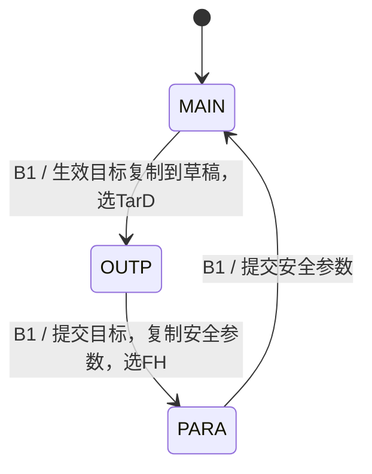
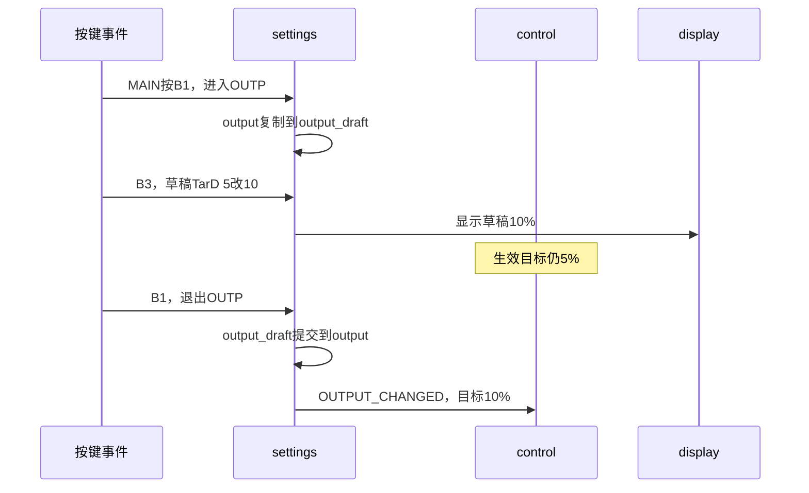

# 17｜页面状态、参数预设与退出后生效

> **适用平台与版本**：CT117E-M4 V1.1、STM32G431RBT6；80MHz；CubeMX 6.17.0、STM32CubeG4 V1.6.3、Keil ARMCC 5.06u7，O0。
> **本篇效果**：用同一份settings实现三页切换、模式、选中项、加减、提交和长按资格。
> **适合读者与前置知识**：会C语言，已经读过第13～16篇；先理解按键模块输出PRESS/RELEASE，页面功能由上层解释。
> **需求来源**：六页原题及[需求追踪表](07-需求追踪表与工程约定-精讲博客版.md)。原文要求、硬件事实、实现选择分别说明。
> **实际验证边界**：生产源码已进入LQB17_Final；软件构建与主机用例的证据见[第四阶段验证记录](../Tests/第四阶段实操与验证记录.md)。开发板与波形尚未实测。

[阅读目录](00-阅读路线与交付状态-精讲博客版.md)

## 一、先把原题中的动词变成状态和事件

第4页规定B1按MAIN→OUTP→PARA→MAIN循环。第5页规定B2在MAIN切换MAN/AUTO，在OUTP切TarD/TarP，在PARA切FH/FL/PL/DH；同一个按键的意思取决于当前页面。因此程序必须记住page，而不是只写一个“B2按下就切模式”的全局if。

“每次进入默认选择TarD/FH”又引出selected。它保存当前编辑哪项，不需要保存屏幕坐标。OUTP用0/1，PARA用0/1/2/3；每次B1切页先归零，按B2才向后循环。

“退出设置界面才生效”是最重要的约束。它意味着你在OUTP把TarD从5改到10，屏幕必须立即显示10，实际控制此时仍追踪5；只有B1退出OUTP才把控制目标更新为10。不能把显示和控制直接绑定到同一个可修改变量。

| 要记住的内容 | 保存位置 | 使用者 |
|---|---|---|
| 当前页面/模式 | Settings.page/mode | 按键解释、显示、控制 |
| 当前选择 | selected | B3/B4编辑哪个字段 |
| 生效目标 | output | control |
| 编辑目标 | output_draft | OUTP显示和加减 |
| 生效安全参数 | safety | alarms |
| 编辑安全参数 | safety_draft | PARA显示和加减 |
| MAIN长按资格 | long_eligible | 释放时判断校准/清零 |



本章继续使用PB0/PB1/PB2/PA0的按键配置，不新增GPIO。CubeMX负责电平输入，bsp_keys负责防抖，settings负责解释动作；三个层次的对象不同。

**知识小结**：结论：页面、选中项、运行模式是三个独立状态。 原因：同一按键在不同页面具有不同意义。 关键参数：MAIN/OUTP/PARA；OUTP两项、PARA四项。 常见误区：进入设置页就停止采样，或让设置页B2也切换工作模式。

## 二、先统一数据类型与单位，再动手写加减

公共头文件monitor_types.h定义枚举与配置结构体。枚举让MONITOR_MAIN比数字0更容易阅读；它仍是C语言整数类型，并不会自动管理页面转换。结构体把属于同一个配置的数据放在一起，后面可以用结构体赋值一次复制。

题目设置项按0.5BAR、1L/min、5%或10%步进，使用整数保存很合适。TarP的50代表5.0BAR，按一次增加5得到55；FH的200代表20.0L/min，按一次增加10得到210。这样编辑值不需要反复做浮点加法，也容易核对上下限。

| 设置项 | 存储单位 | 加/减步长 | 内部范围 | 上电值 |
|---|---|---|---|---|
| TarD | 1个百分点 | 5 | 5～95 | 5 |
| TarP | 0.1BAR | 5 | 10～95 | 50 |
| FH | 0.1L/min | 10 | 40～400 | 200 |
| FL | 0.1L/min | 10 | 40～400 | 100 |
| PL | 0.1BAR | 5 | 10～95 | 10 |
| DH | 1个百分点 | 10 | 5～95 | 65 |

实际PWM却用0.01个百分点，500代表5.00%。因此DH比较实际输出前必须乘100；TarP与压力比较前必须除10.0f。单位转换应在明确的接口处做，不能看到两个uint16_t就认为可以直接比较。

Adjust先把value转换到int32_t再加有符号delta，然后限幅，最后转回uint16_t。若直接让无符号5减10，结果会绕到很大的正数，再做上限判断就可能把一次“减”变成95。数值在下限继续减保持下限，不绕回上限。

题目只给FH、FL各自4～40的范围，没有规定FH必须大于FL。本工程按原文独立限幅，不增加一个隐藏的FH>FL限制。

### monitor_types.h 完整文件

[打开实际源码](../Firmware/BSP_Drivers/Inc/monitor_types.h)

```c
#ifndef MONITOR_TYPES_H
#define MONITOR_TYPES_H
#include <stdint.h>

/* 公共类型先约定单位；目标整数%与实际输出0.01%不能混用。 */
typedef enum { MONITOR_MAIN, MONITOR_OUTP, MONITOR_PARA } MonitorPage;
typedef enum { MONITOR_MAN, MONITOR_AUTO } MonitorMode;
typedef struct {
    uint16_t tar_d_pct;           /* TarD：整数百分比，5~95，默认5。 */
    uint16_t tar_p_deci;          /* TarP：0.1BAR，10~95，默认50。 */
} OutputConfig;
typedef struct {
    uint16_t fh_deci, fl_deci;    /* FH/FL：0.1L/min，40~400。 */
    uint16_t pl_deci;             /* PL：0.1BAR，10~95。 */
    uint16_t dh_pct;              /* DH：整数百分比，5~95。 */
} SafetyConfig;
typedef struct {
    float voltage_v, offset_v, pressure_bar;
    float frequency_hz, flow_lpm;
    uint8_t pressure_valid;       /* ADC失败不能当作真实低压力控制。 */
    uint8_t capture_valid;        /* 无信号/无有效周期时F按0处理。 */
} MonitorMeasurements;
#endif
```


**知识小结**：结论：类型说明存储能力，单位说明数值的物理意义。 原因：同为uint16_t的5、50和500可能分别代表不同量。 关键参数：配置用整数%，0.1BAR和0.1L/min；加减先用int32_t。 常见误区：把TarD直接传给以0.01%为单位的PWM接口。

## 三、草稿怎样进入、修改和提交

可以把草稿理解成正在填写的表格，生效配置是设备当前执行的那份表格。进入OUTP时执行output_draft=output；B3/B4只改草稿；离开OUTP时执行output=output_draft。复制的是各字段的值，不是让两个结构体共用同一地址，所以后续改草稿不会偷偷改到生效值。

NextPage在赋值前逐字段比较，只有内容真的改变才报告SETTINGS_OUTPUT_CHANGED或SETTINGS_PARAMS_CHANGED。这样进入OUTP什么也没改就退出，不会让LD4重新开始一次调节过程。比较字段而不是memcmp整块结构体，也不依赖结构体填充字节是否恰好相同。

返回值使用位标记，因为一次B1既能切页，也能提交目标。例如PAGE_CHANGED与OUTPUT_CHANGED可以同时置位。App通过按位与检查请求，而不是用相等判断整个返回值只可能有一个动作。



最小观察步骤：选择LQB17_Final，MAIN按B1到OUTP，按B3一次。在Keil看output_draft.tar_d_pct=10、output.tar_d_pct=5、app_control.duty_centi_pct仍500。再按B1到PARA，生效目标才变10，控制开始渐变。该步骤调用的就是下方完整文件，没有另一套演示设置代码。

**知识小结**：结论：进入时复制、编辑时只改草稿、退出时提交本页字段。 原因：显示需要即时反馈，控制必须继续使用旧的生效配置。 关键参数：两个配置结构各有active/draft副本；结果可含多个请求位。 常见误区：一边按B3一边直接写CCR，或离开OUTP时把尚未编辑的PARA草稿也提交。

## 四、长按为什么还需要页面资格

底层RELEASE携带held_ms，只说明某个键按了多久。它不知道这段时间用户有没有切页。MAIN按住B3，途中用B1切到OUTP，再绕回MAIN后松开，如果只判断“当前MAIN并且held_ms>=2000”，就会执行一段已经离开有效页面的校准。

long_eligible的bit2记录B3、bit3记录B4是否在MAIN确认按下。每次切页清掉全部资格；释放时先取出对应位，再清掉它，只有当前MAIN、原资格存在且持续>=2000ms，才返回校准或清零请求。清掉资格还能避免相同释放事件误用两次。

在MAIN短按B3/B4，内部允许记录按下历史，但不会改变参数、零点、累计或颜色。在设置页长按B3/B4，只在PRESS时加减一次，RELEASE不产生MAIN动作。B1/B2的RELEASE不做功能；主循环继续运行，不使用等待松开的while。

同一轮多个事件按B1到B4顺序处理，这是bsp_keys的既定顺序。若同时发生B1切页与另一个键事件，上层按这个顺序解释；不要把同轮事件的先后当成测出了人手的真实微秒顺序。

### 本模块完整最终代码

### settings.h 完整文件

[打开实际源码](../Firmware/BSP_Drivers/Inc/settings.h)

```c
#ifndef SETTINGS_H
#define SETTINGS_H
#include "monitor_types.h"
#include "bsp_keys.h"

#define SETTINGS_MODE_CHANGED   0x01U
#define SETTINGS_OUTPUT_CHANGED 0x02U
#define SETTINGS_PARAMS_CHANGED 0x04U
#define SETTINGS_ZERO_REQUEST   0x08U
#define SETTINGS_CLEAR_REQUEST  0x10U
#define SETTINGS_PAGE_CHANGED   0x20U

typedef struct {
    MonitorPage page;
    MonitorMode mode;
    OutputConfig output, output_draft; /* 生效值/编辑副本；控制只读output。 */
    SafetyConfig safety, safety_draft;
    uint8_t selected;             /* OUTP 0~1；PARA 0~3；进入时回到0。 */
    uint8_t long_eligible;        /* bit2/bit3：本次B3/B4是否在MAIN按下。 */
} Settings;

void Settings_Init(Settings *s);
/* 每个防抖事件调用一次，返回操作请求位；不直接访问ADC或PWM。 */
uint8_t Settings_Handle(Settings *s, const BSP_KeyEvent *event);
#endif
```


### settings.c 完整文件

[打开实际源码](../Firmware/BSP_Drivers/Src/settings.c)

```c
#include "settings.h"
#include <string.h>

static uint16_t Adjust(uint16_t value, int delta, uint16_t low, uint16_t high)
{
    /* 先用有符号数计算，避免5-10在无符号类型中绕成很大的数。 */
    int32_t next = (int32_t)value + delta;
    if (next < low) next = low;
    if (next > high) next = high;
    return (uint16_t)next;
}

void Settings_Init(Settings *s)
{
    memset(s, 0, sizeof(*s));
    s->page = MONITOR_MAIN;
    s->mode = MONITOR_MAN;
    s->output.tar_d_pct = 5U;
    s->output.tar_p_deci = 50U;
    s->safety.fh_deci = 200U;
    s->safety.fl_deci = 100U;
    s->safety.pl_deci = 10U;
    s->safety.dh_pct = 65U;
    s->output_draft = s->output;
    s->safety_draft = s->safety;
}

static uint8_t NextPage(Settings *s)
{
    uint8_t result = SETTINGS_PAGE_CHANGED;
    s->long_eligible = 0U;        /* P05-09/10：切过页，原长按资格永久取消。 */
    s->selected = 0U;
    if (s->page == MONITOR_MAIN) {
        s->output_draft = s->output;
        s->page = MONITOR_OUTP;
    } else if (s->page == MONITOR_OUTP) {
        if (s->output.tar_d_pct != s->output_draft.tar_d_pct ||
            s->output.tar_p_deci != s->output_draft.tar_p_deci) {
            result |= SETTINGS_OUTPUT_CHANGED;
        }
        s->output = s->output_draft; /* 退出OUTP才提交这一页的两个目标。 */
        s->safety_draft = s->safety;
        s->page = MONITOR_PARA;
    } else {
        if (s->safety.fh_deci != s->safety_draft.fh_deci ||
            s->safety.fl_deci != s->safety_draft.fl_deci ||
            s->safety.pl_deci != s->safety_draft.pl_deci ||
            s->safety.dh_pct != s->safety_draft.dh_pct) {
            result |= SETTINGS_PARAMS_CHANGED;
        }
        s->safety = s->safety_draft;
        s->page = MONITOR_MAIN;
    }
    return result;
}

static void EditSelected(Settings *s, int direction)
{
    if (s->page == MONITOR_OUTP) {
        if (s->selected == 0U)
            s->output_draft.tar_d_pct = Adjust(s->output_draft.tar_d_pct, direction*5, 5U, 95U);
        else
            s->output_draft.tar_p_deci = Adjust(s->output_draft.tar_p_deci, direction*5, 10U, 95U);
    } else if (s->page == MONITOR_PARA) {
        switch (s->selected) {
        case 0U: s->safety_draft.fh_deci = Adjust(s->safety_draft.fh_deci, direction*10, 40U, 400U); break;
        case 1U: s->safety_draft.fl_deci = Adjust(s->safety_draft.fl_deci, direction*10, 40U, 400U); break;
        case 2U: s->safety_draft.pl_deci = Adjust(s->safety_draft.pl_deci, direction*5, 10U, 95U); break;
        case 3U: s->safety_draft.dh_pct = Adjust(s->safety_draft.dh_pct, direction*10, 5U, 95U); break;
        default: break;
        }
    }
}

uint8_t Settings_Handle(Settings *s, const BSP_KeyEvent *event)
{
    uint8_t bit, eligible;
    if (event->key < 1U || event->key > 4U) return 0U;
    bit = (uint8_t)(1U << (event->key - 1U));
    if (event->type == BSP_KEY_RELEASE) {
        eligible = (uint8_t)(s->long_eligible & bit);
        s->long_eligible &= (uint8_t)~bit;
        if (s->page == MONITOR_MAIN && eligible && event->held_ms >= 2000U) {
            if (event->key == 3U) return SETTINGS_ZERO_REQUEST;
            if (event->key == 4U) return SETTINGS_CLEAR_REQUEST;
        }
        return 0U;
    }
    if (event->type != BSP_KEY_PRESS) return 0U;
    if (event->key == 1U) return NextPage(s);
    if (event->key == 2U) {
        if (s->page == MONITOR_MAIN) {
            s->mode = (s->mode == MONITOR_MAN) ? MONITOR_AUTO : MONITOR_MAN;
            return SETTINGS_MODE_CHANGED;
        }
        s->selected = (uint8_t)((s->selected + 1U) % (s->page == MONITOR_OUTP ? 2U : 4U));
    } else if (s->page == MONITOR_MAIN) {
        s->long_eligible |= bit;  /* 只记录资格；按住达到2秒时不执行功能。 */
    } else {
        EditSelected(s, event->key == 3U ? 1 : -1);
    }
    return 0U;
}
```


**知识小结**：结论：按键持续时间与页面资格分别保存，释放时合并判断。 原因：物理动作驱动无法知道这次动作在哪些页面之间经过。 关键参数：B3/B4的资格位；held_ms>=2000；每次B1清资格。 常见误区：切页后只检查最终页面，导致绕回MAIN的长按仍生效。

## 五、先验状态，再验输出，最后定位错误

主机用例已经检查六项范围、编辑不生效、提交事件、选择循环、1999/2000/2001ms释放，以及按住切页后绕回MAIN的取消行为。它直接调用同一份Settings_Handle；实际GPIO抖动由第三阶段测试覆盖，真实人手时序仍待板上操作。

| 操作 | 观察位置与预期 | 不符合先查 |
|---|---|---|
| 连按B1三次 | MAIN→OUTP→PARA→MAIN | Settings.page和B1 PRESS次数 |
| OUTP按B2两次 | selected 0→1→0，模式不变 | 页面分支和取模基数 |
| PARA按B2四次 | FH→FL→PL→DH→FH | selected是否从0开始 |
| 编辑TarD未退出 | 草稿变化、生效值不变 | EditSelected是否写错对象 |
| 越过最小/最大值 | 保持边界，不回绕 | Adjust的有符号中间量 |
| MAIN长按B3后切页再返回 | 松开不校准 | NextPage是否清long_eligible |
| 进入设置页再离开但未改值 | 不重新启动目标调节 | 提交前是否逐字段比较 |

本方案保持题图名称、位置和白字黑底，不用变色或增加箭头标记选中项。进入时的默认项和B2循环次序是操作依据，调试时可在Watch直接看selected。

**知识小结**：结论：沿电平→事件→页面状态→生效配置→输出逐层验证。 原因：一次输出异常可能来自不同层，先看边界值能缩小范围。 关键参数：Watch page/selected/output_draft/output/long_eligible。 常见误区：屏幕显示10就以为控制也应该马上输出10%。


## 一页纸总结

- page决定按键含义，mode决定运行策略，selected决定编辑项。
- 公共头文件统一整数单位；加减先用有符号中间量再限幅。
- 设置草稿与生效配置分离，B1退出对应页面才提交。
- MAIN长按资格在切页时取消，释放才请求校准/清零。
- settings只返回动作请求，硬件调用由App完成。

## 关键参数表

| 项目 | 参数与含义 |
|---|---|
| 页面 | MAIN→OUTP→PARA→MAIN |
| 选项 | OUTP两项，PARA四项；进入默认0 |
| TarD/TarP步长 | 5个百分点 / 0.5BAR |
| FH/FL/PL/DH步长 | 1L/min / 1L/min / 0.5BAR / 10个百分点 |
| 长按 | MAIN有效PRESS后，RELEASE且>=2000ms |
| 文件 | monitor_types.h、settings.h/c |

## 自测问题

1. 为什么不能只保存一份TarD？
2. TarP=55表示什么，为什么加5而不是加0.5？
3. MAIN按B3后切页再回MAIN，谁负责取消校准？
4. 为什么参数减法先转int32_t？
5. 返回PAGE_CHANGED|OUTPUT_CHANGED应怎样检查？
6. 屏幕TarD已变而PWM还未变，怎样判断是不是错误？

<details>
<summary>展开参考答案</summary>

1. 编辑时屏幕要变，但控制目标必须保持到退出，所以需要草稿和生效两份。

2. 单位0.1BAR，55代表5.5BAR，整数加5就对应0.5BAR。

3. settings的页面转换清除long_eligible，底层按键仍正常报告释放。

4. 避免无符号下溢将一次减操作变成很大的数。

5. 分别用按位与检查各标志，不能只用等于其中某个值。

6. 先看是否仍处于OUTP编辑状态；尚未退出时正是题目要求。

</details>

[回到阅读目录](00-阅读路线与交付状态-精讲博客版.md)
