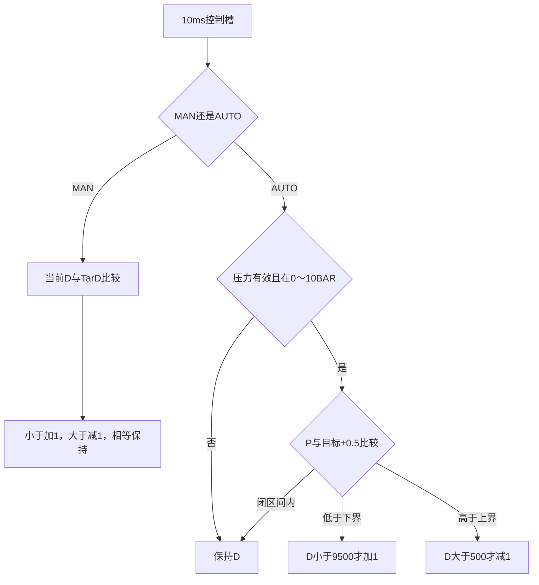
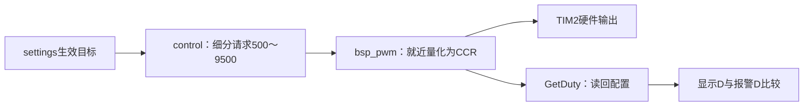

# 18｜手动渐变、自动压力控制与目标跟踪

> **适用平台与版本**：CT117E-M4 V1.1、STM32G431RBT6；80MHz；CubeMX 6.17.0、STM32CubeG4 V1.6.3、Keil ARMCC 5.06u7，O0。
> **本篇效果**：从每秒1个百分点推导10ms控制步长，实现手动逼近、自动死区、限幅和LD4过程状态。
> **适合读者与前置知识**：会C语言，已经读过第13～16篇；区分生效目标、PWM细分请求和CCR读回值。
> **需求来源**：六页原题及[需求追踪表](07-需求追踪表与工程约定-精讲博客版.md)。原文要求、硬件事实、实现选择分别说明。
> **实际验证边界**：生产源码已进入LQB17_Final；软件构建与主机用例的证据见[第四阶段验证记录](../Tests/第四阶段实操与验证记录.md)。开发板与波形尚未实测。

[阅读目录](00-阅读路线与交付状态-精讲博客版.md)

## 一、“每秒1%”应该怎样翻译成程序

第3页要求手动模式的占空比从当前值以±1%/秒过渡到目标。这里用百分点评估：5%到10%相差5个百分点，理论过渡时间5秒；不是每秒把当前5%乘1.01，也不是5%直接加到6%的大台阶必须等整秒才动。

沿前面工程约定，每10ms改变0.01个百分点。每秒有100个这样的槽，100×0.01=1个百分点。实际D内部用整数duty_centi_pct：500=5.00%，每个槽加1或减1即可，避免浮点步进误差。

| 已生效目标 | 当前内部D | 下一个10ms槽 | 输出策略 |
|---|---|---|---|
| TarD=10% | 500 | 501 | 朝目标增加 |
| TarD=5% | 1000 | 999 | 朝目标减少 |
| TarD=5% | 500 | 500 | 已到目标，保持 |

必须比较当前值与目标后再决定方向。用固定方向循环走500步，在用户途中再次改目标时会失效；当前实现每一步重新判断，目标改回5%后可直接转向当前值所需的方向。

control只计算下一次请求，不调用HAL_Delay。PWM硬件独立连续输出，只有比较值在调节；这样长达数十秒的过渡不会挡住按键、压力采样、累计或显示。

**知识小结**：结论：1个百分点/秒可以拆成每10ms一个0.01个百分点的小步。 原因：控制需要平滑持续工作，同时让其它任务获得运行机会。 关键参数：实际D单位0.01%，100步/秒，每步±1内部单位。 常见误区：把1%理解成乘1.01，或写一个带延时的渐变大循环。

## 二、自动模式为什么有三个互斥分支

原题给出三种情况：P<TarP−0.5时增大；P>TarP+0.5时减小；处在闭区间[TarP−0.5,TarP+0.5]时保持。这个允许范围通常称为死区，意思是在这一段误差内不继续调节，而不是输入失效。

目标5.0BAR时，4.49应增加，4.50保持，5.50保持，5.51减少。只有实际未舍入压力参加比较。屏幕显示4.5可能来自4.49，所以“显示4.5但还在微调”不一定有错，应看Watch中的原始计算值。



AUTO压力无效时保持上一次D。这是补充的异常策略：ADC失败清出的0不是可信的低压，不能以此一直增大输出。代码同时检查0～10的范围，NaN与范围比较不能通过。手动调节本身不依赖压力，因此仍能跟随生效TarD。

本板R37是手动模拟的压力传感器，PA1不会自动改变它的电压。测试AUTO时需要手动转R37模拟压力响应；输入始终低压而D最终停在95%，本身可以是正确行为。

自动调节在5%和95%处停止越界，但“到限位”不等于“压力达到目标”。例如P一直0，目标5.0，D到95%后继续保持95%；不能把这个限位当成目标完成并关掉正在跟踪的LD4。

**知识小结**：结论：自动策略按低于、区间内、高于三段判断，区间两端包含在保持范围。 原因：题目要求的是压力容许区间，同时限制输出范围。 关键参数：目标±0.5BAR；D为500～9500；无效压力保持。 常见误区：用>=或<=改变端点，或者到95%就宣布压力已经达标。

## 三、LD4为什么不能简单写成“压力有偏差就亮”

第6页规定用户修改目标且配置生效后，目标达成前LD4亮，到达后灭。这描述了一次调节过程，要记住它有没有开始、有没有完成。control用tracking保存这个历史状态，alarms只把它变成灯位。

Control_Configure在模式或当前模式相关目标改变时重新判断：目标已经满足，tracking=0；尚未满足，tracking=1。MAN只关心TarD的改变，AUTO只关心TarP；非当前模式的目标仍保存，等切模式时再评估。进入设置页或修改未提交草稿，都不会调用这一过程。

Control_Step10ms每次更新后检查是否达成。如果tracking已为1且现在满足，就清0。之后压力被外界扰动移出区间，AUTO控制仍继续调节，但不会无缘无故再开启这一次已结束的提示。这是追踪表A04已明确选择的解释；切模式则重新评估对应目标。

| 场景 | tracking/LD4处理 |
|---|---|
| OUTP只编辑、尚未退出 | 保持原过程，不因草稿重新开始 |
| MAN提交不同TarD，D尚未达到 | 开始跟踪并亮 |
| MAN只改TarP | 保存目标，原跟踪状态不因无关目标重置 |
| AUTO提交新TarP但当前P已在新区间 | 保持灭，不制造闪灯 |
| AUTO已跟踪，D到95%但P未达标 | 继续亮 |
| 达标之后仅出现外界扰动 | 控制继续，LD4不自行重亮 |

返回changed告诉App是否重设控制节拍起点。这样在一次生效目标变化后，新的控制过程从下一个完整10ms槽开始，而不是碰巧接上之前快到期的槽。

**知识小结**：结论：tracking记录从有效目标变化到首次达标的一段过程。 原因：当前误差和用户刚提交过目标是不同信息。 关键参数：MAN完成条件D=TarD；AUTO完成条件有效P在闭区间内。 常见误区：每次循环都把tracking直接赋值成压力不等于目标。

## 四、让控制请求与硬件量化各自保持自己的状态

TIM2周期8000计数，每个CCR计数是0.0125个百分点；control每步请求0.01个百分点，因此相邻两个请求可能映射到同一个CCR。若每步都把BSP_PWM_GetDuty读回的舍入值当成新的内部起点，量化误差可能改变累计速度。

正确的数据流是control保留自己的duty_centi_pct，bsp_pwm把它量化成CCR，显示与报警读取实际CCR配置反算的D。图中“实际”指已经下发到PWM寄存器的配置，仍不等于用仪器测过引脚。



本章不改变CubeMX的PSC、ARR、通道和引脚。继续使用PA1/AF1/TIM2_CH2，80MHz、PSC0、ARR7999。控制变化只交给BSP_PWM_SetDuty，不通过改ARR来调速，因为题目要求频率固定10kHz。

### 本模块完整最终代码

### control.h 完整文件

[打开实际源码](../Firmware/BSP_Drivers/Inc/control.h)

```c
#ifndef CONTROL_H
#define CONTROL_H
#include "monitor_types.h"
typedef struct {
    MonitorMode mode;
    OutputConfig target;
    uint16_t duty_centi_pct;      /* 内部细分请求，500=5.00%，不从CCR反复回算。 */
    uint8_t tracking;             /* 当前目标提交/切模式后，尚未达标的一次过程。 */
} Control;
void Control_Init(Control *c);
/* 返回1：当前模式或相关目标改变，App重设控制节拍起点。 */
uint8_t Control_Configure(Control *c, MonitorMode mode, const OutputConfig *target,
                          float pressure_bar, uint8_t pressure_valid);
/* 每个实际10ms控制槽调用一次；不等待，不操作外设。 */
void Control_Step10ms(Control *c, float pressure_bar, uint8_t pressure_valid);
#endif
```


### control.c 完整文件

[打开实际源码](../Firmware/BSP_Drivers/Src/control.c)

```c
#include "control.h"

static uint8_t ValidPressure(float p, uint8_t valid)
{
    return (uint8_t)(valid && p >= 0.0f && p <= 10.0f);
}
static uint8_t Reached(const Control *c, float pressure, uint8_t valid)
{
    float target;
    if (c->mode == MONITOR_MAN)
        return (uint8_t)(c->duty_centi_pct == c->target.tar_d_pct * 100U);
    target = c->target.tar_p_deci / 10.0f;
    return (uint8_t)(ValidPressure(pressure, valid) &&
                     pressure >= target - 0.5f && pressure <= target + 0.5f);
}
void Control_Init(Control *c)
{
    c->mode = MONITOR_MAN;
    c->target.tar_d_pct = 5U;
    c->target.tar_p_deci = 50U;
    c->duty_centi_pct = 500U;
    c->tracking = 0U;
}
uint8_t Control_Configure(Control *c, MonitorMode mode, const OutputConfig *target,
                          float pressure_bar, uint8_t pressure_valid)
{
    uint8_t changed = (uint8_t)(mode != c->mode ||
        (mode == MONITOR_MAN && target->tar_d_pct != c->target.tar_d_pct) ||
        (mode == MONITOR_AUTO && target->tar_p_deci != c->target.tar_p_deci));
    c->mode = mode;
    c->target = *target;
    if (changed) c->tracking = (uint8_t)!Reached(c, pressure_bar, pressure_valid);
    return changed;
}
void Control_Step10ms(Control *c, float pressure_bar, uint8_t pressure_valid)
{
    uint16_t target_d;
    float target_p;
    if (c->mode == MONITOR_MAN) {
        target_d = (uint16_t)(c->target.tar_d_pct * 100U);
        if (c->duty_centi_pct < target_d) ++c->duty_centi_pct;
        else if (c->duty_centi_pct > target_d) --c->duty_centi_pct;
    } else if (ValidPressure(pressure_bar, pressure_valid)) {
        target_p = c->target.tar_p_deci / 10.0f;
        if (pressure_bar < target_p - 0.5f && c->duty_centi_pct < 9500U) ++c->duty_centi_pct;
        else if (pressure_bar > target_p + 0.5f && c->duty_centi_pct > 500U) --c->duty_centi_pct;
    }
    /* 防御性限幅；正常设置输入本就处于题目范围。 */
    if (c->duty_centi_pct < 500U) c->duty_centi_pct = 500U;
    if (c->duty_centi_pct > 9500U) c->duty_centi_pct = 9500U;
    if (c->tracking && Reached(c, pressure_bar, pressure_valid)) c->tracking = 0U;
    /* 达标后受扰，控制仍工作，但不自动重新点亮一次性调节指示。 */
}
```


**知识小结**：结论：控制保存精细目标轨迹，PWM负责有限计数精度的映射。 原因：硬件读回值已量化，反复拿它积分会引入额外偏差。 关键参数：每10ms±1内部单位；CCR量化步距0.0125个百分点。 常见误区：拿CCR值当百分比，或为改变D同时改了PWM频率。

## 五、按动作链验证速率与异常，再解释时间精度

最小板上实验：复位得到MAN、D5%；进OUTP把TarD调到10，再B1退出生效。约1秒后D应接近6%，约5秒达到10%，LD4在过程中亮，达标灭。按B1回MAIN观察D时，控制过程不会因为切页重启。MAIN中的D只显示整数，观察小步应看app_control.duty_centi_pct或TIM2.CCR2。

主机测试已精确调用100次Step10ms验证增加1个百分点，调用500次验证5%到10%，并检查反向、上下限、4.5/5.5端点、无效压力及LD4生命周期。这证明步进算法和调用约定，不独立证明实际板上每次调用都恰好间隔10ms。

App使用HAL_GetTick调度；正常主循环应及时服务各槽。若长期阻塞导致漏掉多个10ms槽，最终App记录app_missed_slots，只执行当前一次控制而不瞬间补多个台阶。此时实际渐变变慢，属于需要定位的调度异常，不能仍声称满足1%/秒。用断点暂停CPU也会制造这种异常，测速率时必须全速运行。

| 现象 | 观察与修复方向 |
|---|---|
| 编辑时立即变D | 查App是否读取output_draft，或设置函数是否直接写PWM |
| 一秒变100% | 查0.01%单位是否被当作整数% |
| AUTO恰好边界仍改变 | 看未舍入P，再查严格比较符 |
| D到95%而LD4灭 | 是否把限位当成压力达标 |
| 实际调节比预计慢 | 看app_missed_slots、最大循环间隔、调试断点和耗时操作 |
| 压力采样失败却D持续增加 | 检查pressure_valid是否传入控制 |

**知识小结**：结论：把算法步数与实际墙钟时间分开验证。 原因：主机可以精确验证一步改变多少，真正的调度间隔还要靠板上运行证据。 关键参数：100个10ms槽=1秒；Watch duty_centi_pct/tracking/missed_slots。 常见误区：断点单步之后用经过的现实时间评估渐变速率。


## 一页纸总结

- MAN每步朝已生效TarD靠近，AUTO按压力闭区间决定方向。
- 10ms变化0.01个百分点，正常调度下每秒1个百分点。
- 压力失败时AUTO保持输出，5%/95%限位不等于压力达标。
- tracking记录一次目标变化后的过程，达标后结束。
- 内部细分轨迹不被CCR量化值反向覆盖。

## 关键参数表

| 项目 | 参数与含义 |
|---|---|
| 控制周期 | 10ms |
| 每步变化 | 0.01个百分点，内部整数±1 |
| 内部范围 | 500～9500，即5%～95% |
| AUTO死区 | [TarP−0.5，TarP+0.5] BAR |
| MAN完成 | duty_centi_pct=TarD×100 |
| 异常策略 | 压力无效保持；漏槽记录并跳过历史 |

## 自测问题

1. 5%变到10%为什么需要约5秒？
2. 自动目标5.0，P=4.5和5.5时应该做什么？
3. 为何到95%不能直接关LD4？
4. 为什么不从GetDuty读回值继续加1？
5. ADC失败置0后可否继续按低压增大输出？
6. 主机100步测试通过，是否证明板上1%/秒已验收？

<details>
<summary>展开参考答案</summary>

1. 相差5个百分点，速率1个百分点/秒。

2. 都在闭区间内，保持当前占空比。

3. 95%只是输出限位，压力可能仍未达到目标区间。

4. 读回值已被CCR量化与舍入，累加会偏离独立的细分轨迹。

5. 不可以，valid为0时无法确认真实低压，AUTO保持。

6. 没有，还要全速验证实际调度、时钟及输出；漏槽或断点会改变墙钟速率。

</details>

[回到阅读目录](00-阅读路线与交付状态-精讲博客版.md)
