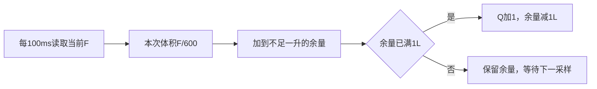

# 19｜100ms累计流量、余量保存与大数计量

> **适用平台与版本**：CT117E-M4 V1.1、STM32G431RBT6；80MHz；CubeMX 6.17.0、STM32CubeG4 V1.6.3、Keil ARMCC 5.06u7，O0。
> **本篇效果**：从L/min和100ms推导每次增量，用整升加有界余量实现可靠累计与清零。
> **适合读者与前置知识**：会C语言，已经读过第13～16篇；已知道瞬时流量F=f/200，计量对象是流量随时间的累积。
> **需求来源**：六页原题及[需求追踪表](07-需求追踪表与工程约定-精讲博客版.md)。原文要求、硬件事实、实现选择分别说明。
> **实际验证边界**：生产源码已进入LQB17_Final；软件构建与主机用例的证据见[第四阶段验证记录](../Tests/第四阶段实操与验证记录.md)。开发板与波形尚未实测。

[阅读目录](00-阅读路线与交付状态-精讲博客版.md)

## 一、先换单位，不能把每次F直接加到Q

第2页规定以100ms为采样周期，累计瞬时流量，增量每满1L更新当前值。F的单位是L/min，Q的单位是L。要得到一次采样对应的体积，需要用流量乘这段时间：

```text
100ms = 0.1s = 1/600 min
每次增量 ΔQ = F × 1/600 = F/600 L
```

若F=40L/min，一次100ms只增加1/15L，15次也就是1.5秒才满1L；若F=4L/min，则150次、15秒满1L。把F直接加给Q会大600倍，把F/60作为一次100ms增量会大10倍。

“每满1L更新”针对整升结果，不是让程序把每次不足1L的增量丢弃。最小观察实验是在稳定流量下看余量连续增加，Q大部分采样不变，满一升时Q加1而余量减一升。



**知识小结**：结论：累计体积等于流量乘时间，先把分钟与毫秒统一。 原因：F是速率，Q是体积，量纲不同不能直接相加。 关键参数：100ms=1/600分钟；ΔQ=F/600L。 常见误区：每次只取增量的整数部分，导致始终加0。

## 二、为什么不能用一个float保存越来越大的Q

题目要求至少累计到9999999L。常见32位float在这个数量级相邻可表示数约相差1L，而一次最大增量只有约0.0667L。把很小增量加到巨大float上，结果可能舍入后完全不变；不是流量变成0，而是浮点表示放不下这点差别。

解决办法是把已经满的整升交给uint32_t，把不足一升的余量单独保留。大数与小数不再反复相加，Q到一千万也不会吞掉下一次0.0667L。

本实现进一步把余量保存为定点整数。先把F量化到百万分之一L/min，即F×1000000；100ms积分仍需要除600，因此一升对应600×1000000=600000000个内部单位。

```text
addition = 四舍五入(F × 1000000)
remainder += addition
若 remainder >= 600000000：
    remainder -= 600000000
    litres += 1
```

例如40L/min每次加40000000个单位，15次恰好600000000，整数比较即可进一升。这里没有把F先舍入成屏幕的一位小数，因此不会把例如20.84L/min强行变成20.8再累计。

固定小单位只是软件表示精度，不表示传感器真的能测到那么细。double只参与本次有界的乘法与舍入，巨大的累计Q仍不进入浮点运算。算法的量化误差远小于当前测频与实际硬件误差，但二者不能混为同一种精度保证。

**知识小结**：结论：大整数Q与小余量分开，用整数进位保持细小增量。 原因：大float的可表示间距可能大于单次增量。 关键参数：一升600000000内部单位；F先保留到百万分之一L/min。 常见误区：以为把float换成更多显示小数位就能改善累计精度。

## 三、写代码前先算中间变量会不会溢出

remainder在一次正常采样前小于600000000，最大addition为40000000，因此相加最多小于640000000，远小于uint32_t最大值4294967295。每次增量最多1/15L，最多只进一升，所以这里一个if足够，不需要可能跑很多轮的while。

litres用uint32_t，可超过题目最低要求9999999。达到UINT32_MAX时选择饱和，之后继续累计保持上限，不绕回0；到达上限时余量归零。这个饱和行为是实现选择，原题没有规定最终存储耗尽后怎么办。

清零必须同时写litres=0和remainder=0。只清整升会留下接近一升的旧余量，用户刚清零后很快又看到1L，容易以为清零按键失效。App还把100ms积分计时起点重设为清零时刻，避免把清零前已过去的半个周期算到新一轮里。

输入按业务约定为0～40L/min。函数对负值、NaN、无穷大忽略，对超过40的有限输入限为40。正常App已经由measurement完成流量范围规则；这里的保护避免别的调用者意外破坏余量范围。

### 本模块完整最终代码

### totalizer.h 完整文件

[打开实际源码](../Firmware/BSP_Drivers/Inc/totalizer.h)

```c
#ifndef TOTALIZER_H
#define TOTALIZER_H
#include <stdint.h>
#define TOTALIZER_UNITS_PER_LITRE 600000000UL

typedef struct {
    uint32_t litres;              /* 整升，不与小增量一起保存在float中。 */
    uint32_t remainder;           /* 余量单位1/600000000 L，始终不足一升。 */
} Totalizer;
void Totalizer_Clear(Totalizer *q);
/* 每100ms一个真实采样槽；输入L/min，>40限幅，负值/NaN忽略。 */
void Totalizer_Sample100ms(Totalizer *q, float flow_lpm);
#endif
```


### totalizer.c 完整文件

[打开实际源码](../Firmware/BSP_Drivers/Src/totalizer.c)

```c
#include "totalizer.h"
#include <float.h>

void Totalizer_Clear(Totalizer *q)
{
    q->litres = 0U;
    q->remainder = 0U;            /* 清零必须同时清掉不足一升的余量。 */
}
void Totalizer_Sample100ms(Totalizer *q, float flow_lpm)
{
    uint32_t addition;
    if (!(flow_lpm >= 0.0f && flow_lpm <= FLT_MAX)) return;
    if (q->litres == UINT32_MAX) { q->remainder = 0U; return; }
    if (flow_lpm > 40.0f) flow_lpm = 40.0f;
    /* ΔQ=F/600 L。F先量化到百万分之一L/min，保留小余量，
     * 因此600000000个内部单位才进1L。double仅用于本次有界换算。 */
    addition = (uint32_t)((double)flow_lpm * 1000000.0 + 0.5);
    q->remainder += addition;    /* <600000000+40000000，不会uint32溢出。 */
    if (q->remainder >= TOTALIZER_UNITS_PER_LITRE) {
        q->remainder -= TOTALIZER_UNITS_PER_LITRE;
        ++q->litres;              /* 单次增量<=1/15L，只需进一升。 */
        if (q->litres == UINT32_MAX) q->remainder = 0U;
    }
}
```


**知识小结**：结论：整数实现也要计算每个中间结果的最大值。 原因：存储类型够大不自动保证加法、进位和清零都正确。 关键参数：remainder+addition<640000000；Q饱和UINT32_MAX。 常见误区：只清Q不清余量，或者任意改采样周期却保留600000000分母。

## 四、100ms采样必须与实际调度相连

Totalizer_Sample100ms每调用一次就代表一个100ms区间。若在while(1)中无限调用，累计速度取决于CPU运行多快；若改成每10ms调用，又没有改分母，结果会大10倍。第21篇App用独立total_timer安排100ms槽。

采样积分使用这个槽处理时最新的流量，是一种离散近似。信号在两次采样间变化得很快时，不可能仅靠两个样本重建全部过程。本题明确规定100ms采样，程序按该周期实现；不用输入捕获脉冲计数擅自替代题目给定的积分规则。

如果CPU停住很久，恢复时不能把当前F连续调用几十次，假装知道过去几十个区间的流量。最终App跳过错过的槽并增加app_missed_slots，累计只处理当前一次。发生这种情况时计量存在漏记，需要排查阻塞；这是一项可观察的异常，不是算法可以凭空修复的历史数据。

| 用例 | 软件预期与已执行结果 | 板上观察方法 |
|---|---|---|
| 40L/min连续14次 | Q0、余量560000000；通过 | 旋钮近似，精确边界用PC注入 |
| 第15次40L/min | Q1、余量0；通过 | 稳定接近40时约1.5秒每升 |
| 4L/min连续150次 | Q1；通过 | 接近下限时约15秒每升 |
| Q=9999999且余量接近一升 | 继续到10000000；通过 | 用主机测试，不等待多年实流 |
| Q到UINT32_MAX | 保持上限不回绕；通过 | Watch/主机边界 |
| B4长按释放清零 | 两个字段归0，重启积分区间；App测试通过 | 全速观察Q与内部余量 |
| 故意模拟漏槽 | 只处理当前样本，missed_slots增加；通过 | 不用断点测正常计量速率 |

若Q不增长，按顺序看F是否有效非零、100ms槽是否到期、remainder是否增长；若余量正确但Q格式不对，再查显示。若速度差600倍或10倍，先检查单位与调用周期，不先扩大变量类型。

**知识小结**：结论：累计函数的一次调用必须对应规定的一个采样区间。 原因：公式的分母已经包含100ms，调用频率是算法的一部分。 关键参数：独立100ms槽；清零重设起点；漏槽记录但不补造样本。 常见误区：让循环次数代替真实时间，或用断点恢复后的大跳时当正常验收。


## 一页纸总结

- 100ms是1/600分钟，每次体积增量F/600L。
- Q保存整升，remainder保存有界余量，大累计量仍能接收小增量。
- 一升600000000内部单位，40L/min每次加40000000。
- 每次最多进一升；Q达到uint32上限饱和。
- B4有效释放清整升与余量，并重启100ms区间。
- 主机覆盖大数和边界，真实计量时序仍需板上验收。

## 关键参数表

| 项目 | 参数与含义 |
|---|---|
| 采样周期 | 100ms |
| 单次增量 | F/600 L |
| 一升阈值 | 600000000内部单位 |
| 最大单次内部增量 | 40000000 |
| Q范围 | 0～4294967295L，达到上限饱和 |
| 40/4L每分钟 | 理论1.5s/15s累计1L |

## 自测问题

1. 为什么一次增量不是F/60？
2. float Q到一千万附近时为什么可能不再增长？
3. 为什么阈值是600000000？
4. 为什么进位用if就够？
5. 清零之后马上出现1L，先查哪里？
6. 为什么阻塞一秒后不能拿当前F补十次？

<details>
<summary>展开参考答案</summary>

1. F/60是一秒的增量，而本题一次只有0.1秒，所以还需乘0.1，即F/600。

2. 浮点可表示间距变大，约0.0667L的单次增量可能被舍入掉。

3. F用百万分之一L/min表示，再乘100ms对应1/600分钟，所以一升需要600×1000000单位。

4. 单次最多40/600L，小于一升，正常余量也不足一升，所以最多进一升。

5. 查remainder是否也清零，以及100ms积分起点是否重置。

6. 没有那十个历史样本，当前F不能证明过去流量相同；应记录漏槽并修复阻塞。

</details>

[回到阅读目录](00-阅读路线与交付状态-精讲博客版.md)
