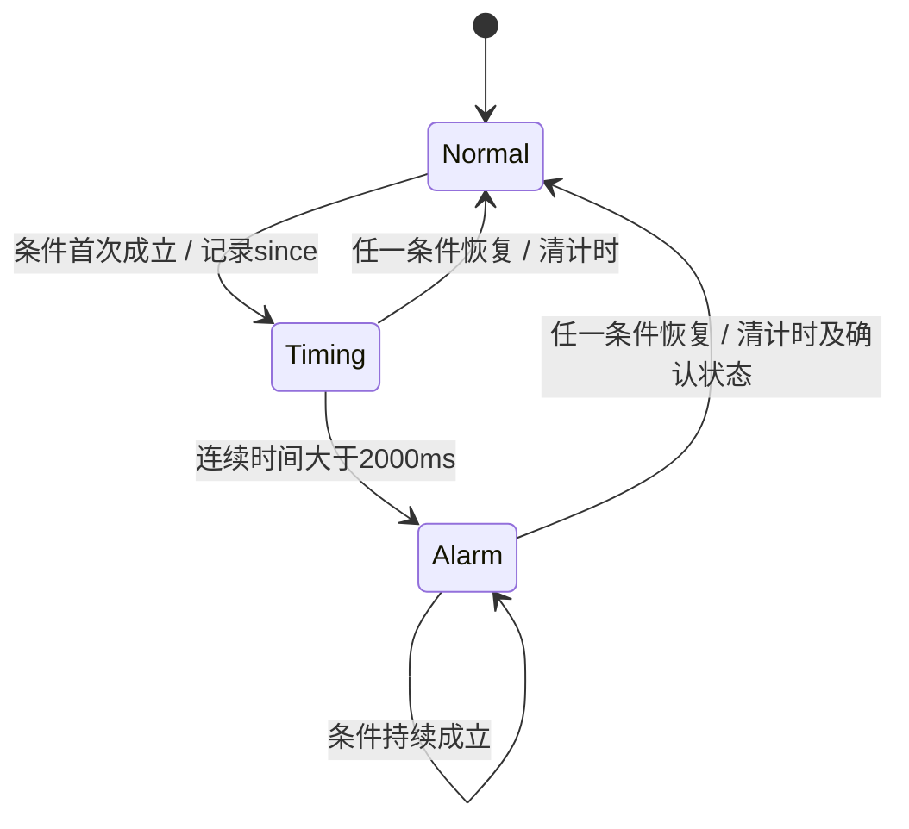
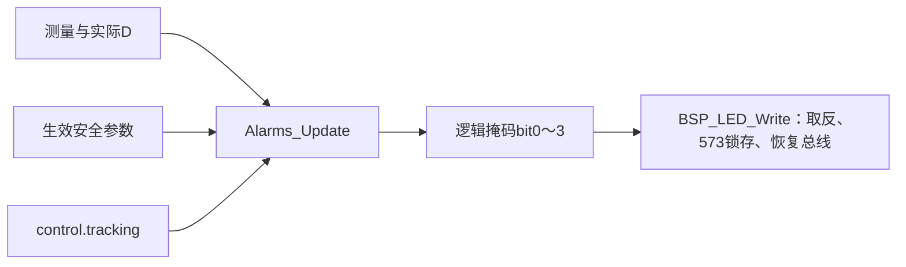

# 20｜连续故障计时、恢复清除与LED报警

> **适用平台与版本**：CT117E-M4 V1.1、STM32G431RBT6；80MHz；CubeMX 6.17.0、STM32CubeG4 V1.6.3、Keil ARMCC 5.06u7，O0。
> **本篇效果**：把四盏灯分别连接到即时超频、持续堵塞、持续泄漏和目标跟踪，处理严格边界及恢复。
> **适合读者与前置知识**：会C语言，已经读过第13～16篇；已理解当前流量、原始频率、实际PWM与生效阈值的区别。
> **需求来源**：六页原题及[需求追踪表](07-需求追踪表与工程约定-精讲博客版.md)。原文要求、硬件事实、实现选择分别说明。
> **实际验证边界**：生产源码已进入LQB17_Final；软件构建与主机用例的证据见[第四阶段验证记录](../Tests/第四阶段实操与验证记录.md)。开发板与波形尚未实测。

[阅读目录](00-阅读路线与交付状态-精讲博客版.md)

## 一、先把每盏灯的条件写完整

第6页给四盏灯的定义。先抄出比较符、逻辑连接和时间要求，再决定代码，不要先写一个“异常就闪灯”的通用函数。LD1没有两秒延时，LD2/LD3有；LD4不是故障阈值，而是上一章的目标调节过程。

| 灯 | 当前条件 | 时间与恢复 |
|---|---|---|
| LD1 | 原始f>8000Hz | 立即按有效测量判断；恢复到8000或以下熄灭 |
| LD2 | F<FL **且** 实际D>DH | 两条件同时连续超过2000ms才亮，任一恢复即灭 |
| LD3 | F>FH **且** P<PL | 同时连续超过2000ms才亮，任一恢复即灭 |
| LD4 | control.tracking为1 | 有效目标变化后尚未达标；由control结束过程 |
| LD5～LD8 | 无 | 始终灭 |

原始f不能替换成已经限幅的F。8000Hz和9000Hz的显示流量都可能是40.0L/min，但前者LD1灭，后者亮。同样，LD2必须读取已下发的实际D，不能读取还在草稿中或尚未渐变到位的TarD。

阈值单位要先统一：FL=100表示10.0L/min，因此和F比较用fl_deci/10.0f；DH=65表示65%，实际D=6500才等于它。`&&`要求两边同时成立，误写`||`会把仅有一个异常迹象也判成堵塞或泄漏。

**知识小结**：结论：四盏灯有四种职责，阈值、单位和延时分别核对。 原因：限幅数据、目标值与实际值承载的信息不同。 关键参数：LD1 f>8000；LD2 F<FL且D>DH；LD3 F>FH且P<PL。 常见误区：用F==40判断超频，或所有灯统一延时两秒。

## 二、连续超过两秒需要保存哪段历史

单次判断只能告诉我们“现在满足”，无法知道已经持续多久。因此每类延迟报警保存active和since_ms：active表示正在观察一段连续成立的区间，since_ms保存这段区间的起点。

第一次条件成立，记录起点；后续仍成立，计算now−since；条件一旦不成立，清除这段历史。下次再成立必须重新从零开始，不能把两段各1.2秒的异常拼成2.4秒。

假设0ms开始满足堵塞条件：2000ms时仍不亮，因为原文是“超过2秒”；2001ms才成立。实际App不是以无限时间精度观察，灯会在下一次执行判断时更新，因此2001ms是软件边界用例，不是声称实物恰在2001.000ms点亮。



不能用since_ms==0表示“尚未计时”：系统运行时间0本身就是合法起点，主机测试正好从0开始验证。active单独保存这个含义，避免把起点0一遍遍重置。

堵塞和泄漏各有自己的AlarmDelay。两种条件可能在不同时刻成立，不能共用一个since字段；即便在某组默认阈值下它们很少同时出现，也不能把实现建立在这个巧合上，因为FH和FL允许独立设置。

**知识小结**：结论：每一种持续条件需要独立的起点和有效标记。 原因：现在成立与已经连续成立多久是两件事。 关键参数：2000ms不亮、2001ms满足；任一恢复立即清历史。 常见误区：累计所有异常时段，或拿时间戳0充当未启动标记。

## 三、回绕、参数生效与测量失败如何处理

HAL tick是uint32_t毫秒，约49.7天回绕一次。短时间差用无符号减法，例如起点接近UINT32_MAX、当前已经回到小数值，模运算仍能得到正确的两秒间隔。

已经确认的报警还需要asserted保存。若只是每轮重新判断now−since>2000，一段故障持续超过整个tick周期后，差值再次变小，灯可能错误熄灭两秒。当前代码一旦确认就保持asserted，直到条件解除；条件恢复同时清active和asserted。

安全参数也可能改变。FL或DH提交新值后，堵塞条件的定义变了，本方案从新值生效时重新观察堵塞持续时间；FH或PL改变则重启泄漏观察。只改FH不重启堵塞计时，未提交草稿也不会影响任何计时。这是追踪表中明确列出的实现选择，不能把过去按旧阈值满足的时间直接当成新阈值的证据。

ADC失败时pressure_valid=0，泄漏条件不成立并清除其计时，AUTO也保持输出。无有效流量周期时App令F=0，符合无信号时的零流量处理；如果D很高，仍允许持续低流量触发堵塞。LD1只使用当前有效的原始频率，失联后的历史超频不会永久留灯。

本方案没有增加第五盏“内部故障灯”，因为题目要求LD5～LD8始终灭。底层启动失败及运行有效性放在Keil Watch诊断；不擅自改变竞赛界面内容。

**知识小结**：结论：短时差用无符号减法，已确认报警用状态保持到条件恢复。 原因：计时回绕、阈值替换和样本失效都可能使旧历史不再适用。 关键参数：active/since_ms/asserted；相关阈值提交后重计。 常见误区：把旧阈值计时沿用到新条件，或长年持续报警在tick回绕后短暂消失。

## 四、把逻辑灯掩码交给底层，不在报警模块操作端口

Alarms_Update返回bit0～3：bit0=1表示希望LD1亮，bit1表示LD2，以此类推。它不关心LED低电平有效，也不碰PC8～PC15或PD2。电平取反、锁存及LCD共用总线的保护仍由第二阶段的BSP_LED_Write负责。

例如返回0x05表示LD1与LD3亮。四项结果按位或组合，互不覆盖；高四位从未置位，因此LD5～LD8保持灭。不要在alarm函数里直接向GPIOC->ODR写数，否则会绕过已经处理好的LCD总线恢复逻辑。



当前App每轮更新报警，LED底层对相同掩码跳过重复写入。报警计算是很短的比较与计时，不需要专门的两秒延时定时器，也不在中断里画屏或写灯。

### 本模块完整最终代码

### alarms.h 完整文件

[打开实际源码](../Firmware/BSP_Drivers/Inc/alarms.h)

```c
#ifndef ALARMS_H
#define ALARMS_H
#include "monitor_types.h"
typedef struct {
    uint32_t since_ms;
    uint8_t active, asserted;     /* active记录起点有效；asserted保持已确认报警。 */
} AlarmDelay;
typedef struct {
    AlarmDelay blockage, leakage;
    SafetyConfig previous;
    uint8_t have_parameters;
} Alarms;
void Alarms_Init(Alarms *a);
/* 返回逻辑灯掩码：bit0~3对应LD1~4；高四位始终0。 */
uint8_t Alarms_Update(Alarms *a, const SafetyConfig *cfg,
                      const MonitorMeasurements *m, uint16_t actual_duty,
                      uint8_t tracking, uint32_t now_ms);
#endif
```


### alarms.c 完整文件

[打开实际源码](../Firmware/BSP_Drivers/Src/alarms.c)

```c
#include "alarms.h"
#include "measurement.h"
#include <string.h>

static uint8_t Delayed(AlarmDelay *d, uint8_t condition, uint32_t now)
{
    if (!condition) { d->active = d->asserted = 0U; return 0U; }
    if (!d->active) { d->active = 1U; d->asserted = 0U; d->since_ms = now; }
    /* 原文是“超过2秒”，恰好2000ms还不亮。无符号差值允许tick回绕。 */
    if ((uint32_t)(now - d->since_ms) > 2000U) d->asserted = 1U;
    return d->asserted;            /* 持续超过一次tick回绕也不重新熄灭。 */
}
void Alarms_Init(Alarms *a)
{
    memset(a, 0, sizeof(*a));
}
uint8_t Alarms_Update(Alarms *a, const SafetyConfig *cfg,
                      const MonitorMeasurements *m, uint16_t actual_duty,
                      uint8_t tracking, uint32_t now_ms)
{
    uint8_t mask = 0U, blocked, leaked;
    /* 新阈值生效后重新观察相关条件；改FH/PL不打断堵塞计时。 */
    if (a->have_parameters) {
        if (cfg->fl_deci != a->previous.fl_deci || cfg->dh_pct != a->previous.dh_pct)
            a->blockage.active = 0U;
        if (cfg->fh_deci != a->previous.fh_deci || cfg->pl_deci != a->previous.pl_deci)
            a->leakage.active = 0U;
    }
    a->previous = *cfg;
    a->have_parameters = 1U;
    if (m->capture_valid && Measurement_Overrange(m->frequency_hz)) mask |= 1U;
    blocked = (uint8_t)(m->flow_lpm < cfg->fl_deci / 10.0f &&
                        actual_duty > cfg->dh_pct * 100U);
    leaked = (uint8_t)(m->pressure_valid && m->flow_lpm > cfg->fh_deci / 10.0f &&
                       m->pressure_bar < cfg->pl_deci / 10.0f);
    if (Delayed(&a->blockage, blocked, now_ms)) mask |= 2U;
    if (Delayed(&a->leakage, leaked, now_ms)) mask |= 4U;
    if (tracking) mask |= 8U;
    return mask;
}
```


**知识小结**：结论：上层返回想亮哪些灯，底层负责怎样输出电平。 原因：逻辑判断和共享总线时序有不同职责。 关键参数：bit0～3对应LD1～4，高四位固定0。 常见误区：把逻辑1当成硬件高电平点灯，或绕过BSP直接破坏LCD端口数据。

## 五、怎样验证报警，而不等到真实管路发生故障

主机测试已覆盖8000/8000.1Hz、F与阈值相等、D与DH相等、2000/2001ms、恢复后重计、tick回绕、持续确认状态和相关参数变更。它还能把起点设为0或接近UINT32_MAX，不需要真的等49天。

板上用旋钮和设置参数模拟条件。例如保持MAN，通过OUTP提高TarD并等待实际D逐步超过DH，再把R39调到F<FL；观察LD2是否在持续条件成立两秒之后亮。计时起点是实际D超过DH和F低于FL同时成立的时刻，不是按下B3修改TarD的时刻。

泄漏实验把FH设置到当前流量以下，把R37调到P<PL，保持超过两秒看LD3；把P调到等于或高于PL，灯应恢复。精确等值边界主要靠主机注入，因为手转旋钮与屏幕一位小数不能保证内部数值恰好等于阈值。

| 异常现象 | 先看什么 | 修复方向 |
|---|---|---|
| LD2一进OUTP就亮 | 使用的是TarD还是GetDuty | 改读实际输出，参数只读生效值 |
| 两段短异常后也亮 | condition为假时active是否清除 | 中断连续性就重计 |
| 满2秒立即亮但等值测试不符 | 比较符是不是>= | 严格使用>2000 |
| 改FH把堵塞灯也延后 | 是否重置了全部计时器 | 只重置相关的阈值对 |
| 灯正常但LCD有噪点 | LED是否越过BSP直写端口 | 回到共享总线封装 |
| LD5～LD8出现亮灯 | 掩码高四位或极性转换 | 查逻辑掩码与底层映射 |

**知识小结**：结论：用可控条件验证逻辑，用板上全速运行验证真实响应。 原因：显示舍入与人工操作不能替代精确的软件边界注入。 关键参数：Watch blockage/leakage、since_ms、active、asserted和app_led_mask。 常见误区：从目标设定时开始计时，忽略实际D尚未达到报警条件。


## 一页纸总结

- LD1即时看原始超频，LD2/LD3各自观察连续条件，LD4读取目标跟踪。
- 延时必须严格超过2000ms，恢复时清掉这一段历史。
- active区分合法起点0，asserted保持已确认报警跨越长时间回绕。
- 参数生效后仅重启相关故障条件的计时。
- 输出逻辑掩码交给BSP，LD5～LD8始终灭。

## 关键参数表

| 项目 | 参数与含义 |
|---|---|
| LD1 | 有效原始f>8000Hz |
| LD2 | F<FL且实际D>DH，连续>2000ms |
| LD3 | 有效P<PL且F>FH，连续>2000ms |
| LD4 | control.tracking |
| 延迟状态 | active、since_ms、asserted，各故障独立 |
| 默认安全参数 | FH20.0、FL10.0L/min；PL1.0BAR；DH65% |

## 自测问题

1. 为什么F=40不能直接决定LD1？
2. 起点为0时为什么需要active？
3. 条件成立1.2秒、恢复、再成立1.2秒，是否报警？
4. asserted解决什么问题？
5. 只改FH为什么不清堵塞时间？
6. LD2应从用户提交TarD时还是实际条件成立时计时？

<details>
<summary>展开参考答案</summary>

1. 8000和超8000的F都可能40，必须保留原始频率。

2. 0是合法时刻，不能同时用它表达没有起点。

3. 不报警，两段不连续，恢复会清历史。

4. 保持已确认报警直到条件恢复，避免完整tick回绕后时间差短暂变小造成熄灭。

5. 堵塞由FL和DH定义，FH改变只影响泄漏条件。

6. 从F<FL且实际D>DH同时成立时开始。

</details>

[回到阅读目录](00-阅读路线与交付状态-精讲博客版.md)
