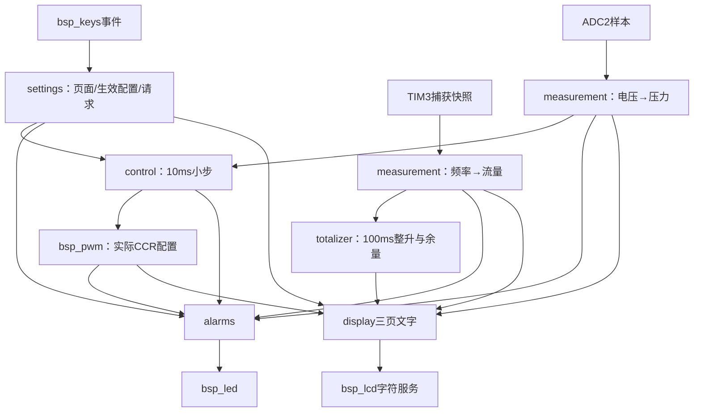

# 21｜三页面显示、主程序调度与最终工程集成

> **适用平台与版本**：CT117E-M4 V1.1、STM32G431RBT6；80MHz；CubeMX 6.17.0、STM32CubeG4 V1.6.3、Keil ARMCC 5.06u7，O0。
> **本篇效果**：让所有模块在一个最终App中协作，按题图生成三页内容并观察完整运行链。
> **适合读者与前置知识**：会C语言，已经读过第13～16篇；已完成settings、control、totalizer和alarms，接下来连接它们的输入输出。
> **需求来源**：六页原题及[需求追踪表](07-需求追踪表与工程约定-精讲博客版.md)。原文要求、硬件事实、实现选择分别说明。
> **实际验证边界**：生产源码已进入LQB17_Final；软件构建与主机用例的证据见[第四阶段验证记录](../Tests/第四阶段实操与验证记录.md)。开发板与波形尚未实测。

[阅读目录](00-阅读路线与交付状态-精讲博客版.md)

## 一、先画数据流，明确只有谁能改什么

最终程序需要让采样、按键、控制、计量、报警和显示持续并行推进。在裸机主循环中，这种“同时工作”是由每轮快速处理到期任务形成的，不是每个功能各写一个永远不返回的while。

App拥有各模块状态，按顺序把输出交给下一个模块。settings只处理事件；measurement做单位换算；control给出细分D；bsp_pwm落实输出；alarms读实际D和测量；display只读状态构造文字。这样能沿变量判断问题发生在哪一层。



main仍使用CubeMX生成的HAL_Init、SystemClock_Config、MX_GPIO_Init、MX_ADC2_Init、MX_TIM2_Init、MX_TIM3_Init，然后调用App_Init；while(1)里持续调用App_Run。业务不塞回生成器的非USER CODE区域，避免重新生成时丢失。

App_Init先让LED锁存关闭并熄灯，再初始化LCD；接着初始化页面、控制、累计和报警对象，清掉测量状态，启动ADC校准、输入捕获和PWM，最后建立时间起点并生成首屏。

默认值来自题目第6页：MAIN、MAN、TarD5%、TarP5.0BAR、FH20.0/FL10.0/PL1.0/DH65、offset0、Q0、实际D5%。它们既要出现在屏幕，也要写入草稿、控制状态、余量和计时器。不能只把首屏字符串写成默认值而内部仍留着别的参数。

**知识小结**：结论：App只连接模块并安排执行，数据规则保留在负责模块内。 原因：重复一份公式或参数规则会使显示、控制和测试逐渐不一致。 关键参数：CubeMX初始化→App_Init→不断App_Run；默认状态按第6页。 常见误区：把示例图中的AUTO/80%当上电值，或把所有功能塞进main。

## 二、从响应要求决定每一轮的任务顺序

输入捕获边沿由硬件与中断记录，不等主循环5ms轮询。主循环按10ms读取测量快照，按5ms扫描键，按10ms推进控制，按100ms计量和组成屏幕文字。每轮更新报警并执行一次LCD字符服务。

| 任务 | 周期/触发 | 本轮动作 |
|---|---|---|
| 测量 | 10ms | ADC采样、捕获快照、换算P/F |
| 按键 | 5ms | 扫描事件，依序交settings，处理提交/校准/清零 |
| 控制 | 10ms | 细分D走一步，写PWM |
| 累计 | 100ms | 用最新F积分一次 |
| 报警/LED | 每轮 | 判断阈值与持续时间，仅变化时实际写灯 |
| 显示数据 | 100ms，按键动作可提前触发 | 构造当前页20列文字缓存 |
| LCD绘制 | 每轮 | 最多画一个变化字符 |

为什么先测量再处理事件？通常让本轮控制拿到较新的数据；但零点校准仍在释放请求时重新读取ADC，保证用当时的电压。为什么处理事件后又读一次HAL_GetTick？因为校准采样可能耗时，清零或目标变化也可能把计时器起点设成较新的时刻；用更早的now减这个新起点会无符号下溢，误以为已经超期很久。

Due包装已有BSP_Periodic_Due：正常只前进一个周期，发现落后多个周期时跳过历史槽并记录app_missed_slots。这个选择避免把现在的F当成过去的多个样本、避免控制恢复时突然补很多步；但漏槽确实会影响计量和调节速率，必须在实物验收时检查并定位。

BSP_LCD_Service一次只画一个字符并不自动保证一整屏在100ms内完成。还需要考虑最多变化字符数、官方LCD驱动耗时、中断占用和实际循环速度。文档记录刷新安排，硬件验收另测实际结果；不能用设置了100ms变量就替代响应测试。

**知识小结**：结论：周期、调用顺序和时间快照共同决定实际行为。 原因：事件可能更新计时起点，显示和ADC也会占用真实时间。 关键参数：5/10/100ms独立槽；事件后重取now；missed_slots可诊断。 常见误区：用旧now减新起点，或让阻塞之后的多次补调用伪造历史样本。

## 三、把题图行列精确变成字符串

题图使用1起算行列：标题第2行第8列，数据从第4行第4列开始。代码数组使用0起算，所以标题写line[1]并先放7个空格，数据写line[3]及之后并先放3个空格。

| 页面 | 标题 | 数据行（题图1起算） | 数据来源 |
|---|---|---|---|
| MAIN | MAIN | 4 M、5 P、6 F、7 Q、8 D、9 V | 模式、实时测量、累计、PWM读回、零点 |
| OUTP | OUTP | 4 TarD、5 TarP | output_draft |
| PARA | PARA | 4 FH、5 FL、6 PL、7 DH | safety_draft |

MAIN的V显示offset，不能误用当前voltage_v；D显示BSP_PWM_GetDuty读回的当前配置，不是TarD。P/F/V保留一位小数，Q是整数，D按题图为整数百分比。本工程选择就近四舍五入显示D；内部控制仍保持0.01个百分点，不用屏幕数字回算。

每行20个可见字符，另加字符串结尾0，所以数组是[10][21]。snprintf限制写入长度；构造完把不足20列的位置补空格。AUTO变MAN时擦掉旧O，10.0变0.0时擦掉变短部分，切到OUTP时也清除原MAIN的Q/D/V旧行。

Display_Build只生成MonitorScreen，方便主机逐行核对；Display_Render把这同一份结果交给BSP_LCD_SetLine。没有维护一份测试专用布局。颜色仍由BSP_LCD_Init设置黑底白字，运行期不会为了选择项变色。

### 显示模块完整最终代码

### display.h 完整文件

[打开实际源码](../Firmware/BSP_Drivers/Inc/display.h)

```c
#ifndef DISPLAY_H
#define DISPLAY_H
#include "settings.h"
#include "bsp_lcd.h"
typedef struct {
    char line[BSP_LCD_ROWS][BSP_LCD_COLS + 1U];
} MonitorScreen;
/* Build只构造文字，可在PC核对行列；Render交给同一份LCD字符服务。 */
void Display_Build(MonitorScreen *screen, const Settings *s,
                   const MonitorMeasurements *m, uint16_t actual_duty, uint32_t litres);
void Display_Render(const Settings *s, const MonitorMeasurements *m,
                    uint16_t actual_duty, uint32_t litres);
#endif
```


### display.c 完整文件

[打开实际源码](../Firmware/BSP_Drivers/Src/display.c)

```c
#include "display.h"
#include <stdio.h>
#include <string.h>

static unsigned Tenth(float value, float maximum)
{
    if (!(value >= 0.0f)) return 0U;
    if (value > maximum) value = maximum;
    return (unsigned)(value * 10.0f + 0.5f); /* 只在显示边界舍入，不改控制原值。 */
}
void Display_Build(MonitorScreen *screen, const Settings *s,
                   const MonitorMeasurements *m, uint16_t actual_duty, uint32_t litres)
{
    unsigned p = Tenth(m->pressure_bar, 10.0f);
    unsigned f = Tenth(m->flow_lpm, 40.0f);
    unsigned v = Tenth(m->offset_v, 3.3f);
    unsigned row, length;
    memset(screen, 0, sizeof(*screen));
    /* 题图1起算标题(2,8)，数据(4,4)；数组下标必须减1。 */
    if (s->page == MONITOR_MAIN) {
        (void)snprintf(screen->line[1], 21U, "       MAIN");
        (void)snprintf(screen->line[3], 21U, "   M=%s", s->mode == MONITOR_AUTO ? "AUTO" : "MAN");
        (void)snprintf(screen->line[4], 21U, "   P=%u.%uBAR", p/10U, p%10U);
        (void)snprintf(screen->line[5], 21U, "   F=%u.%uL/M", f/10U, f%10U);
        (void)snprintf(screen->line[6], 21U, "   Q=%luL", (unsigned long)litres);
        (void)snprintf(screen->line[7], 21U, "   D=%u%%", (unsigned)((actual_duty + 50U)/100U));
        (void)snprintf(screen->line[8], 21U, "   V=%u.%uV", v/10U, v%10U);
    } else if (s->page == MONITOR_OUTP) {
        (void)snprintf(screen->line[1], 21U, "       OUTP");
        (void)snprintf(screen->line[3], 21U, "   TarD=%u%%", (unsigned)s->output_draft.tar_d_pct);
        (void)snprintf(screen->line[4], 21U, "   TarP=%u.%uBAR", (unsigned)(s->output_draft.tar_p_deci/10U), (unsigned)(s->output_draft.tar_p_deci%10U));
    } else {
        (void)snprintf(screen->line[1], 21U, "       PARA");
        (void)snprintf(screen->line[3], 21U, "   FH=%u.%uL/M", (unsigned)(s->safety_draft.fh_deci/10U), (unsigned)(s->safety_draft.fh_deci%10U));
        (void)snprintf(screen->line[4], 21U, "   FL=%u.%uL/M", (unsigned)(s->safety_draft.fl_deci/10U), (unsigned)(s->safety_draft.fl_deci%10U));
        (void)snprintf(screen->line[5], 21U, "   PL=%u.%uBAR", (unsigned)(s->safety_draft.pl_deci/10U), (unsigned)(s->safety_draft.pl_deci%10U));
        (void)snprintf(screen->line[6], 21U, "   DH=%u%%", (unsigned)s->safety_draft.dh_pct);
    }
    for (row = 0U; row < BSP_LCD_ROWS; ++row) {
        length = (unsigned)strlen(screen->line[row]);
        memset(&screen->line[row][length], ' ', BSP_LCD_COLS - length);
        screen->line[row][BSP_LCD_COLS] = '\0'; /* 补空格，切页/数字变短也无残留。 */
    }
}
void Display_Render(const Settings *s, const MonitorMeasurements *m,
                    uint16_t actual_duty, uint32_t litres)
{
    MonitorScreen screen;
    uint8_t row;
    Display_Build(&screen, s, m, actual_duty, litres);
    for (row = 0U; row < BSP_LCD_ROWS; ++row) BSP_LCD_SetLine(row, screen.line[row]);
}
```


**知识小结**：结论：图上的位置、内部下标和数据来源都要明确转换。 原因：行列错一格、值读错副本或尾部未覆盖都会造成看似相近的显示错误。 关键参数：标题数组[1]列7；数据[3]列3；每行21字节。 常见误区：把Line2当题图第2行，或用TarD/实时电压替代MAIN中的D/V。

## 四、最终入口代码与Keil目标怎样对应

打开Firmware/MDK-ARM/LQB17_Tutorial.uvprojx，目标选择LQB17_Final。Phase2_SelfTest与Phase3_SelfTest继续保留用于分层排错，最终目标链接BSP_Drivers/Src/app.c，并明确排除Tests/phase2_selftest.c和phase3_selftest.c。

Keil不同目标共享文件树，所以看到三个入口文件都列在树里是正常的。关键是当前目标的Options for File→Properties→Include in Target Build：Final只启用app.c；Phase2/3分别只启用对应selftest。把文件从显示列表隐藏不等于链接器已排除它。

| 目标 | 唯一App实现 | 用途 |
|---|---|---|
| Phase2_SelfTest | Tests/phase2_selftest.c | 基础LED/LCD/时间 |
| Phase3_SelfTest | Tests/phase3_selftest.c | 按键/采样/捕获/PWM |
| LQB17_Final | BSP_Drivers/Src/app.c | 完整竞赛行为 |

自编.h在Inc，.c在Src；它们统一归入BSP_Drivers组，编译器头文件路径包含../BSP_Drivers/Inc。添加到工程树、磁盘放到哪个目录、编译器去哪搜索头文件，是三个独立操作。

CubeMX重新生成可能改写Keil目标设置。查看IOC无需点Generate；确需生成时先备份工程配置，再核对三个入口的排除设置及Inc搜索路径，按第22篇审计与重建。不要为了消除重复定义把生产函数改名成另一套接口。

### App接口与最终业务入口

### app.h 完整文件

[打开实际源码](../Firmware/BSP_Drivers/Inc/app.h)

```c
#ifndef APP_H
#define APP_H

/* main.c的固定入口。Phase2/3目标各链接一个Tests入口；
 * LQB17_Final链接BSP_Drivers/Src/app.c，三个App不得同时链接。 */
void App_Init(void);
void App_Run(void);

#endif
```


### app.c 完整文件

[打开实际源码](../Firmware/BSP_Drivers/Src/app.c)

```c
/* 最终竞赛入口；Final目标排除Tests中的两个阶段App，避免重复定义。 */
#include "app.h"
#include "main.h"
#include "bsp_led.h"
#include "bsp_lcd.h"
#include "bsp_time.h"
#include "bsp_keys.h"
#include "bsp_adc.h"
#include "bsp_capture.h"
#include "bsp_pwm.h"
#include "measurement.h"
#include "settings.h"
#include "control.h"
#include "totalizer.h"
#include "alarms.h"
#include "display.h"
#include <string.h>

/* 全局对象便于Keil Watch观察；只有App负责调度和跨模块连接。 */
Settings app_settings;
Control app_control;
Totalizer app_total;
Alarms app_alarms;
MonitorMeasurements app_measurements;
BSP_ADC_Sample app_adc;
BSP_CaptureSample app_capture;
volatile uint32_t app_max_loop_gap_ms, app_missed_slots;
volatile uint8_t app_start_errors, app_zero_result, app_led_mask;
static BSP_Keys keys;
static BSP_Periodic key_timer, sample_timer, control_timer, total_timer, screen_timer;
static uint32_t previous_ms;

static uint8_t Due(BSP_Periodic *timer, uint32_t now, uint32_t period)
{
    uint32_t missed;
    if (!BSP_Periodic_Due(timer, now, period)) return 0U;
    missed = (uint32_t)(now - timer->last_ms) / period;
    if (missed) {
        /* 不用当前样本重复“补造”过去的采样。漏槽可在Watch中发现。 */
        timer->last_ms += missed * period;
        if (UINT32_MAX - app_missed_slots < missed) app_missed_slots = UINT32_MAX;
        else app_missed_slots += missed;
    }
    return 1U;
}
static void ReadPressure(void)
{
    (void)BSP_ADC_Read(&app_adc);
    app_measurements.pressure_valid = app_adc.valid;
    app_measurements.voltage_v = app_adc.voltage_v;
    app_measurements.pressure_bar = app_adc.valid ?
        Measurement_Pressure(app_adc.voltage_v, app_measurements.offset_v) : 0.0f;
}
static void ReadFlow(void)
{
    BSP_Capture_Read(&app_capture);
    app_measurements.capture_valid = app_capture.valid;
    app_measurements.frequency_hz = app_capture.frequency_hz;
    app_measurements.flow_lpm = app_capture.valid ? Measurement_Flow(app_capture.frequency_hz) : 0.0f;
}
static uint8_t HandleEvent(const BSP_KeyEvent *event)
{
    uint8_t requests = Settings_Handle(&app_settings, event);
    if (requests & SETTINGS_ZERO_REQUEST) {
        ReadPressure();           /* 校准取松开处理时的新样本，而不是按下时的旧值。 */
        if (app_adc.valid) {
            app_zero_result = Measurement_Calibrate(app_adc.voltage_v, &app_measurements.offset_v) ? 1U : 2U;
            app_measurements.pressure_bar = Measurement_Pressure(app_adc.voltage_v, app_measurements.offset_v);
        } else app_zero_result = 3U;
    }
    if (requests & SETTINGS_CLEAR_REQUEST) {
        Totalizer_Clear(&app_total);
        BSP_Periodic_Init(&total_timer, HAL_GetTick()); /* 清零后重新开始完整100ms积分区间。 */
    }
    if (requests & (SETTINGS_MODE_CHANGED | SETTINGS_OUTPUT_CHANGED)) {
        if (Control_Configure(&app_control, app_settings.mode, &app_settings.output,
                              app_measurements.pressure_bar, app_measurements.pressure_valid)) {
            BSP_Periodic_Init(&control_timer, HAL_GetTick());
        }
    }
    return (uint8_t)(requests != 0U || event->type == BSP_KEY_PRESS);
}
void App_Init(void)
{
    uint32_t now;
    BSP_LED_Init();
    BSP_LCD_Init();
    Settings_Init(&app_settings);
    Control_Init(&app_control);
    Totalizer_Clear(&app_total);
    Alarms_Init(&app_alarms);
    memset(&app_measurements, 0, sizeof(app_measurements));
    memset(&app_adc, 0, sizeof(app_adc));
    memset(&app_capture, 0, sizeof(app_capture));
    app_max_loop_gap_ms = app_missed_slots = 0U;
    app_start_errors = app_zero_result = app_led_mask = 0U;
    if (SystemCoreClock != 80000000U) app_start_errors |= 8U;
    if (!BSP_ADC_Init()) app_start_errors |= 1U;
    if (!BSP_Capture_Init()) app_start_errors |= 2U;
    if (!BSP_PWM_Start()) app_start_errors |= 4U;
    if (app_start_errors) { Error_Handler(); return; }
    now = HAL_GetTick();
    previous_ms = now;
    BSP_Keys_Init(&keys, now);
    BSP_Periodic_Init(&key_timer, now);
    BSP_Periodic_Init(&sample_timer, now);
    BSP_Periodic_Init(&control_timer, now);
    BSP_Periodic_Init(&total_timer, now);
    BSP_Periodic_Init(&screen_timer, now);
    Display_Render(&app_settings, &app_measurements, BSP_PWM_GetDuty(), app_total.litres);
}
void App_Run(void)
{
    uint32_t now = HAL_GetTick(), gap = (uint32_t)(now - previous_ms);
    BSP_KeyEvent events[BSP_KEY_COUNT];
    uint8_t count, i, redraw = 0U;
    if (app_start_errors) return;
    previous_ms = now;
    if (gap > app_max_loop_gap_ms) app_max_loop_gap_ms = gap;
    if (Due(&sample_timer, now, 10U)) { ReadPressure(); ReadFlow(); }
    if (Due(&key_timer, now, 5U)) {
        count = BSP_Keys_Scan(&keys, HAL_GetTick(), events);
        for (i = 0U; i < count; ++i) redraw |= HandleEvent(&events[i]);
    }
    /* 事件处理可能重设控制/积分计时器；重新取now，避免旧now减新起点。 */
    now = HAL_GetTick();
    if (Due(&control_timer, now, 10U)) {
        Control_Step10ms(&app_control, app_measurements.pressure_bar, app_measurements.pressure_valid);
        BSP_PWM_SetDuty(app_control.duty_centi_pct);
    }
    if (Due(&total_timer, now, 100U)) Totalizer_Sample100ms(&app_total, app_measurements.flow_lpm);
    app_led_mask = Alarms_Update(&app_alarms, &app_settings.safety, &app_measurements,
                                 BSP_PWM_GetDuty(), app_control.tracking, now);
    BSP_LED_Write(app_led_mask);
    if (Due(&screen_timer, now, 100U) || redraw)
        Display_Render(&app_settings, &app_measurements, BSP_PWM_GetDuty(), app_total.litres);
    BSP_LCD_Service();            /* 每轮最多一个变化字符；共用总线只在主循环访问。 */
}
```

### 当前main.c完整文件

下面仍是同一份CubeMX主程序，前面章节中的完整代码也会同步核对。自编业务通过USER CODE中的app.h、App_Init与App_Run接入。

### main.c 完整文件

[打开实际源码](../Firmware/Core/Src/main.c)

```c
/* USER CODE BEGIN Header */
/**
  ******************************************************************************
  * @file           : main.c
  * @brief          : Main program body
  ******************************************************************************
  * @attention
  *
  * Copyright (c) 2026 STMicroelectronics.
  * All rights reserved.
  *
  * This software is licensed under terms that can be found in the LICENSE file
  * in the root directory of this software component.
  * If no LICENSE file comes with this software, it is provided AS-IS.
  *
  ******************************************************************************
  */
/* USER CODE END Header */
/* Includes ------------------------------------------------------------------*/
#include "main.h"
#include "adc.h"
#include "tim.h"
#include "gpio.h"

/* Private includes ----------------------------------------------------------*/
/* USER CODE BEGIN Includes */
#include "app.h"
/* USER CODE END Includes */

/* Private typedef -----------------------------------------------------------*/
/* USER CODE BEGIN PTD */

/* USER CODE END PTD */

/* Private define ------------------------------------------------------------*/
/* USER CODE BEGIN PD */

/* USER CODE END PD */

/* Private macro -------------------------------------------------------------*/
/* USER CODE BEGIN PM */

/* USER CODE END PM */

/* Private variables ---------------------------------------------------------*/

/* USER CODE BEGIN PV */

/* USER CODE END PV */

/* Private function prototypes -----------------------------------------------*/
void SystemClock_Config(void);
/* USER CODE BEGIN PFP */

/* USER CODE END PFP */

/* Private user code ---------------------------------------------------------*/
/* USER CODE BEGIN 0 */

/* USER CODE END 0 */

/**
  * @brief  The application entry point.
  * @retval int
  */
int main(void)
{

  /* USER CODE BEGIN 1 */

  /* USER CODE END 1 */

  /* MCU Configuration--------------------------------------------------------*/

  /* Reset of all peripherals, Initializes the Flash interface and the Systick. */
  HAL_Init();

  /* USER CODE BEGIN Init */

  /* USER CODE END Init */

  /* Configure the system clock */
  SystemClock_Config();

  /* USER CODE BEGIN SysInit */

  /* USER CODE END SysInit */

  /* Initialize all configured peripherals */
  MX_GPIO_Init();
  MX_ADC2_Init();
  MX_TIM2_Init();
  MX_TIM3_Init();
  /* USER CODE BEGIN 2 */
  App_Init();
  /* USER CODE END 2 */

  /* Infinite loop */
  /* USER CODE BEGIN WHILE */
  while (1)
  {
    /* USER CODE END WHILE */

    /* USER CODE BEGIN 3 */
    App_Run();
  }
  /* USER CODE END 3 */
}

/**
  * @brief System Clock Configuration
  * @retval None
  */
void SystemClock_Config(void)
{
  RCC_OscInitTypeDef RCC_OscInitStruct = {0};
  RCC_ClkInitTypeDef RCC_ClkInitStruct = {0};

  /** Configure the main internal regulator output voltage
  */
  HAL_PWREx_ControlVoltageScaling(PWR_REGULATOR_VOLTAGE_SCALE1);

  /** Initializes the RCC Oscillators according to the specified parameters
  * in the RCC_OscInitTypeDef structure.
  */
  RCC_OscInitStruct.OscillatorType = RCC_OSCILLATORTYPE_HSE;
  RCC_OscInitStruct.HSEState = RCC_HSE_ON;
  RCC_OscInitStruct.PLL.PLLState = RCC_PLL_ON;
  RCC_OscInitStruct.PLL.PLLSource = RCC_PLLSOURCE_HSE;
  RCC_OscInitStruct.PLL.PLLM = RCC_PLLM_DIV6;
  RCC_OscInitStruct.PLL.PLLN = 40;
  RCC_OscInitStruct.PLL.PLLP = RCC_PLLP_DIV2;
  RCC_OscInitStruct.PLL.PLLQ = RCC_PLLQ_DIV2;
  RCC_OscInitStruct.PLL.PLLR = RCC_PLLR_DIV2;
  if (HAL_RCC_OscConfig(&RCC_OscInitStruct) != HAL_OK)
  {
    Error_Handler();
  }

  /** Initializes the CPU, AHB and APB buses clocks
  */
  RCC_ClkInitStruct.ClockType = RCC_CLOCKTYPE_HCLK|RCC_CLOCKTYPE_SYSCLK
                              |RCC_CLOCKTYPE_PCLK1|RCC_CLOCKTYPE_PCLK2;
  RCC_ClkInitStruct.SYSCLKSource = RCC_SYSCLKSOURCE_PLLCLK;
  RCC_ClkInitStruct.AHBCLKDivider = RCC_SYSCLK_DIV1;
  RCC_ClkInitStruct.APB1CLKDivider = RCC_HCLK_DIV1;
  RCC_ClkInitStruct.APB2CLKDivider = RCC_HCLK_DIV1;

  if (HAL_RCC_ClockConfig(&RCC_ClkInitStruct, FLASH_LATENCY_2) != HAL_OK)
  {
    Error_Handler();
  }
}

/* USER CODE BEGIN 4 */

/* USER CODE END 4 */

/**
  * @brief  This function is executed in case of error occurrence.
  * @retval None
  */
void Error_Handler(void)
{
  /* USER CODE BEGIN Error_Handler_Debug */
  /* User can add his own implementation to report the HAL error return state */
  __disable_irq();
  while (1)
  {
  }
  /* USER CODE END Error_Handler_Debug */
}
#ifdef USE_FULL_ASSERT
/**
  * @brief  Reports the name of the source file and the source line number
  *         where the assert_param error has occurred.
  * @param  file: pointer to the source file name
  * @param  line: assert_param error line source number
  * @retval None
  */
void assert_failed(uint8_t *file, uint32_t line)
{
  /* USER CODE BEGIN 6 */
  /* User can add his own implementation to report the file name and line number,
     ex: printf("Wrong parameters value: file %s on line %d\r\n", file, line) */
  /* USER CODE END 6 */
}
#endif /* USE_FULL_ASSERT */
```


**知识小结**：结论：三个Keil目标共享模块源码，但每个目标只能链接一个App入口。 原因：同名App_Init/App_Run同时参与链接会重复定义。 关键参数：Final启用app.c，两个selftest排除；BSP Inc搜索路径保留。 常见误区：以为工程树里没有显示某文件就等于编译器不会编译。

## 五、用Watch和分层目标定位整机问题

本次Final构建0错误、0警告，Program Size为Code=25056、RO-data=5088、RW-data=100、ZI-data=3484，已生成HEX。RAM静态用量和Flash链接结果在芯片容量内；它不等于已测过运行时最大栈深或硬件时序。

启动失败码app_start_errors按位记录：1 ADC内部校准失败、2捕获启动失败、4 PWM启动失败、8系统时钟值不符。非0进入Error_Handler，停止正常业务。运行期间ADC失败通过pressure_valid表现，AUTO保持，泄漏计时清除；失联流量按0处理。app_zero_result为0未请求、1校准成功、2拒绝、3本次读取失败。

| 想确认什么 | Watch对象或检查位置 |
|---|---|
| 设置是否生效 | app_settings.page、selected、output/output_draft、safety/safety_draft |
| 控制走了多少步 | app_control.duty_centi_pct、tracking、TIM2.CCR2 |
| 测量是不是可信 | app_adc.valid/raw、app_capture.valid/frequency_hz/overcaptures |
| 清零是否完整 | app_total.litres、remainder |
| 为什么报警 | app_alarms.blockage/leakage、app_led_mask |
| 调度是否跟得上 | app_max_loop_gap_ms、app_missed_slots |

最小整机路线是：复位看MAIN/MAN/D5；进OUTP改TarD，未退出前实际D保持；退出后按1个百分点/秒渐变；回MAIN切AUTO，用R37模拟压力变化；长按B3释放校准，长按B4释放清Q；最后配置阈值分别观察报警。

这里R37是手动模拟压力传感器，PA1没有驱动一套会自动改变R37电压的真实管路。AUTO看到低压后不断增加到95%可能完全符合程序；要手动调R37进入目标区间，模拟压力已经跟随执行机构上升。不要因为旋钮自己不会转，就误判自动控制代码失效。

如果Final显示异常，先切Phase2验证LCD基础，再切Phase3看采样和PWM；基础都正常后回Final查状态与调用链。测试目标有自己明确标为TEST ONLY的界面，排错后须切回Final，不能将阶段HEX误当最终程序。

**知识小结**：结论：把编译、模块仿真、完整调用链和实物现象分别记录。 原因：它们证明的范围不同，分层目标有助于找到故障边界。 关键参数：Final 0错误0警告；Watch状态、有效性、漏槽与启动错误。 常见误区：把R37当成会被PWM自动驱动的真实压力闭环，或只看编译通过就结束验收。


## 一页纸总结

- main保留生成器流程，App连接所有生产模块。
- 5ms键、10ms采样/控制、100ms计量/显示，各自计时。
- 释放校准重新采样；清零重启积分区间；事件后重新读now。
- 三页位置严格对应题图，显示读正确的数据副本，补空格清尾。
- Final与两个阶段测试App互斥，所有模块共用一份源码。
- 软件集成已通过，板上时序、颜色和实际波形仍待验收。

## 关键参数表

| 项目 | 参数与含义 |
|---|---|
| 最终目标 | LQB17_Final |
| 最终HEX | Firmware/MDK-ARM/LQB17_Final/LQB17_Final.hex |
| 周期 | 键5ms；测量/控制10ms；累计/显示100ms |
| 显示 | 10行20列，16×24字体，黑底白字 |
| 首屏 | MAIN、MAN、D5%、Q0、V0.0 |
| 构建用量 | Code25056、RO5088、RW100、ZI3484字节 |

## 自测问题

1. 为什么处理校准/清零事件后又读一次now？
2. MAIN的V与验证页实时V有什么区别？
3. 显示函数为什么不顺便修改当前配置？
4. 工程树中三个App都可见是否一定重复链接？
5. AUTO到95%后压力仍不变，先确认什么？
6. app_missed_slots不为0说明什么？

<details>
<summary>展开参考答案</summary>

1. 这些动作可能耗时并重设计时器；旧now减新起点会下溢误判超期。

2. 最终MAIN的V必须是保存的零点offset，实时电压是内部测量输入。

3. 显示应只读数据，否则刷新次数可能改变业务，模块职责会混乱。

4. 不一定，要看当前目标的Include in Target Build，只有一个启用即可。

5. 本板R37需要手动调节，它不是被PWM驱动的真实管路压力反馈。

6. 至少有任务错过周期槽；当前值不能补造历史，应排查阻塞、断点与耗时。

</details>

[回到阅读目录](00-阅读路线与交付状态-精讲博客版.md)
