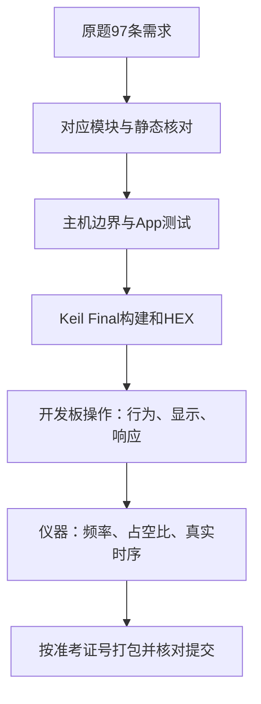
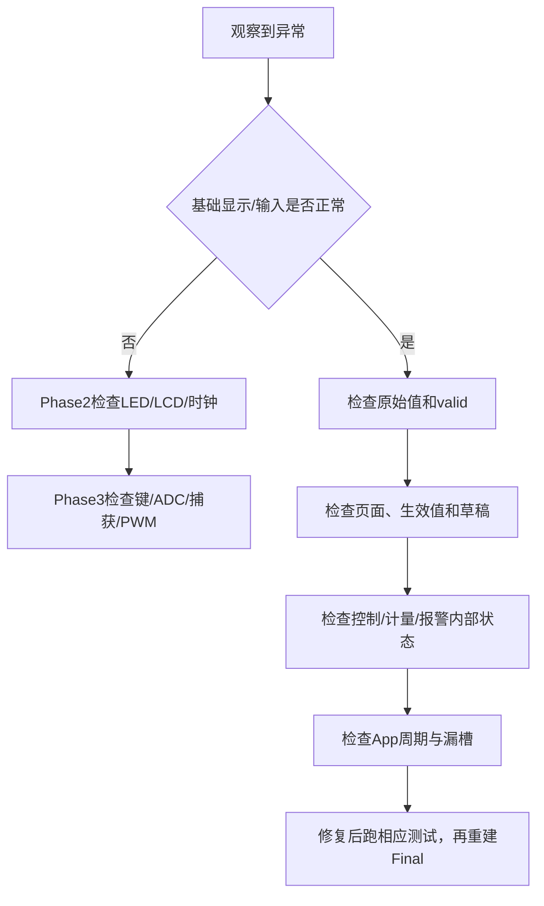

# 22｜整机验收、故障定位与竞赛提交

> **适用平台与版本**：CT117E-M4 V1.1、STM32G431RBT6；80MHz；CubeMX 6.17.0、STM32CubeG4 V1.6.3、Keil ARMCC 5.06u7，O0。
> **本篇效果**：把97条需求映射到证据，运行测试、下载最终目标并准备符合原题规则的源码与HEX压缩包。
> **适合读者与前置知识**：会C语言，已经读过第13～16篇；已经能够解释最终App的数据流；本篇区分软件通过和实物待验。
> **需求来源**：六页原题及[需求追踪表](07-需求追踪表与工程约定-精讲博客版.md)。原文要求、硬件事实、实现选择分别说明。
> **实际验证边界**：生产源码已进入LQB17_Final；软件构建与主机用例的证据见[第四阶段验证记录](../Tests/第四阶段实操与验证记录.md)。开发板与波形尚未实测。

[阅读目录](00-阅读路线与交付状态-精讲博客版.md)

## 一、完成代码之后先区分四类证据

第一类是静态检查：引脚、通道、公式、页面位置、文件路径是否一致。第二类是主机测试：用可控输入验证实际生产函数及App调用链。第三类是Keil构建：确认ARM工具链能够编译链接并产生HEX。第四类是开发板和仪器：确认真实接线、波形、精度、响应和显示效果。

本次前三类已经执行；开发板尚未连接验收。一个PASS不能自动扩展到其它层。例如主机确认8000.0不报警，不代表板上频率读数绝对精度已测准；CCR=400也不能替代PA1高电平宽度测量。

[需求追踪表](07-需求追踪表与工程约定-精讲博客版.md)保留97个原句编号。新增实现状态表给出当前代码与软件证据，原来的最终验收行继续用于板上逐项记录。涉及参考资料和提交规则的句子在打包时检查，不为它们伪造运行函数或主机测试。



当前文件都在E:/STM32Project/LQB17_Tutorial。Docs是文章，Firmware是独立工程，Tests是测试和证据。原来的LQB_17工程没有被当成最终固件链接依赖。

**知识小结**：结论：不同检查只证明它实际观察到的部分。 原因：模拟函数、编译器与真实硬件之间存在明确边界。 关键参数：97条需求；静态、主机、构建、实物四类证据。 常见误区：用零编译错误宣称整题已经上板验收通过。

## 二、用同一份生产源码重复软件验证

PowerShell工作目录设为本教程根目录，执行以下脚本。它们会重新编译对应主机测试，或者重建指定Keil目标，不下载或擦写开发板。

```powershell
Set-Location 'E:\STM32Project\LQB17_Tutorial'
.\Tests\run_host_tests.ps1
.\Tests\run_phase3_tests.ps1
.\Tests\run_phase4_tests.ps1
.\Tests\build_final.ps1
```

前三个脚本默认GCC在D:/Downloads/mingw64/bin/gcc.exe，可用-GccPath指定；构建脚本默认Keil在D:/Tools/Keil/UV4/UV4.exe，可用-UV4Path指定。build_final在编译后调用Python记录输入哈希，若你的Python路径不同，用-PythonPath指定Python3.9及以上的可执行文件。

| 用例组 | 精确注入的边界与实际检查内容 |
|---|---|
| 基础BSP | LED极性/总线恢复、LCD补空格/字符预算、周期回绕 |
| 按键/ADC/捕获/PWM | 抖动、1995/2000/2005ms释放、ADC失败、800/8000、50ms断线、计数回绕、CCR量化 |
| 设置 | 六参数步长与限幅、草稿不生效、退出提交、选择复位、跨页取消 |
| 控制 | 100步增加1个百分点、正反向、闭区间端点、无效压力、限位与LD4生命周期 |
| 累计 | 14/15个40L/min样本、150个4L/min样本、千万升、余量、uint32饱和 |
| 报警 | 等值不触发、连续2000/2001ms、恢复重计、阈值修改、tick回绕与保持 |
| 显示与App | 三页行列、短字段覆盖、大Q、校准新样本、清零区间、事件后新时间、漏槽 |

第四阶段test_phase4.c链接真实settings/control/totalizer/alarms/display/app/measurement/bsp_time，只用替身代替硬件BSP。第三阶段另测真实底层驱动，组合起来覆盖不同层；没有宣称PC真正执行了ARM中断或ADC硬件。

检查日志末尾应分别有ALL PHASE2/3/4 HOST TESTS PASSED；Keil应有0 Error(s), 0 Warning(s)。失败时先看第一条失败断言或编译错误，不应把测试里的预期值改成当前错误输出让它变绿。

一致性检查使用[check_phase4_artifacts.py](../Tests/check_phase4_artifacts.py)。它核对文档完整代码、链接、97条编号、三个目标的唯一入口、源文件/库、构建和测试证据。运行命令：

```powershell
python .\Tests\check_phase4_artifacts.py
```

**知识小结**：结论：测试直接编译生产模块，硬件替身的边界写清楚。 原因：复制一份简化算法来测试可能只证明那份副本正确。 关键参数：三组主机PASS；Final构建0错误0警告；一致性审计PASS。 常见误区：修改断言掩盖实现错误，或把硬件替身当成实际外设。

## 三、没有示波器时怎样完成可观察的整机操作

Keil打开独立工程，选择LQB17_Final，执行Project→Rebuild all target files。核对Debug使用此前配置的CMSIS-DAP/SWD与STM32G4 Flash算法，然后使用Flash→Download，复位并全速运行。需要观察时间时不设置会频繁命中的断点。

| 次序 | 操作 | 预期现象与观察点 |
|---|---|---|
| 1 | 复位 | MAIN、MAN、D5%、Q0、V0.0，LD5～LD8灭 |
| 2 | B1循环三页 | 名称、行列、黑底白字符合题图；旧行擦除 |
| 3 | OUTP改TarD，暂不退出 | 草稿变化，实际D继续旧目标 |
| 4 | 退出OUTP | 新目标生效，1个百分点/秒渐变，LD4过程亮达标灭 |
| 5 | MAIN按B2 | MAN/AUTO切换；在设置页按B2只换选中项 |
| 6 | AUTO调R37跨目标±0.5 | 低于区间增、高于减、区间内保持，5/95限位 |
| 7 | B3保持超过2秒但不松 | 仍采样刷新，offset不因为到时自动改变 |
| 8 | B3松开 | 取新的电压校准；低于offset压力0，满量程仍对应10BAR |
| 9 | 按住B3切页再回MAIN松开 | 这次校准取消 |
| 10 | 稳定F观察累计，再B4长按释放 | Q每满1L更新；清整升与余量，重启区间 |
| 11 | 分别制造超频/堵塞/泄漏条件 | LD1即时；LD2/3连续超2秒亮，恢复即灭 |
| 12 | 同时操作旋钮、按键与页面 | 后台控制、累计、报警仍工作，无明显闪屏/噪点 |

默认DH65%，实际D从5%渐变过去需要时间。为了快速观察堵塞可以先在PARA把DH调整到较低值并退出，再设置TarD；不能因为目标已经高于DH就提前开始给LD2计时。

零点校准的满量程拒绝是已记录的实现选择；观察app_zero_result。原始有效压力与显示舍入有差异，精确等值用主机测试，旋钮只做近似观察。

没有信号源时，可参考[第16篇](<16-PA1的10kHz PWM与第三阶段集成-精讲博客版.md>)的PA1→PB4板内回接；先断电并隔离J9的555输出，结束后恢复。该回接可检查10kHz信号链和超频指示，不能证明独立频率精度或占空比精度。

借到仪器后，测PA1周期约100µs，高电平在5/50/95%时约5/50/95µs；按原题核对频率±2%和占空比±1%。按键/LED≤100ms与LCD刷新100ms也需要真实时序记录，不能仅凭“看起来很快”填写合格。

**知识小结**：结论：板上操作按默认、页面、提交、控制、校准、累计、报警顺序推进。 原因：先确认基础状态，再验证有前置条件的动作，容易定位失败来源。 关键参数：全速运行；Watch有效性、实际D、漏槽；仪器补绝对精度。 常见误区：用TarD代替实际D判断报警时机，或用同源时钟回接证明绝对精度。

## 四、把故障按层排查，不一次改多个模块



| 现象 | 可能原因 | 怎样确认 | 修复方向 |
|---|---|---|---|
| Keil提示重复App_Init | 多个入口参与构建 | 当前目标逐文件看Include in Target Build | Final只留app.c |
| 编译找不到settings.h | 搜索路径或文件缺失 | 看BSP_Drivers/Inc及C/C++ Include Paths | 补正确路径，不复制头文件到多处 |
| 运行仍是PHASE3 CHECK | 下载错目标或旧HEX | 看目标名、输出路径和构建时间 | 选择Final重建下载 |
| P总为0 | 接线、ADC失败、V低于offset | 看raw/valid/voltage/offset | 沿J11/J17→ADC2→公式查 |
| F总为0 | 无边沿、低频或超时 | 看CCR1、capture.valid、原始f | 沿J9→PB4→IRQ→窗口查 |
| 设置退出仍不影响D | 未提交/非当前模式目标 | 看output与mode、Configure结果 | 按模式解释目标 |
| 清零后快速跳1L | 余量或计时器未清 | 看litres/remainder/积分起点 | 同时清并重启100ms |
| 时长和累计忽快忽慢 | 断点或任务阻塞 | 看max_loop_gap_ms/missed_slots | 全速复现并缩短耗时 |
| LCD只在LED变化时乱 | 共用端口被越层写 | 搜索GPIOC->ODR与PD2调用 | 统一经过BSP_LED_Write |

保留一次复现的页面、模式、目标、输入、操作顺序和Watch值，比单独写“灯不对”更有用。修复后更新同一份源码和对应完整代码块，重新跑受影响用例；不要留下一个文章版本和一个工程版本。

**知识小结**：结论：排错从硬件输入到业务状态，再到时间与输出逐层缩小范围。 原因：同时改公式、参数和引脚会掩盖真正原因。 关键参数：记录目标名、复位条件、页面、有效性和关键状态。 常见误区：看到最终值异常就直接改显示字符串掩盖底层错误。

## 五、最终提交哪些文件，以及怎样避免把旧HEX打包

第1页要求压缩包包含自己编写或修改的最终.c/.h，以及MDK生成的.hex；未修改库文件不需要提交。HEX是评测依据，按准考证号命名；压缩格式允许.zip/.rar/.7z，总大小控制在30MB以内。本工程选择ZIP。

当前[提交清单](../Tests/build/submission_manifest.json)列出41个C/H文件：自编BSP模块与本项目Core配置/中断文件。原样lcd.c/lcd.h/fonts.h、原样system_stm32g4xx.c及HAL/CMSIS库被排除；Tests、文章、Keil界面文件、obj/axf/map等也不进入竞赛包。Core配置文件一并纳入是为了保留本项目引脚、时钟和中断配置，最终仍按现场提交细则核对。

最终HEX在[这里](../Firmware/MDK-ARM/LQB17_Final/LQB17_Final.hex)。不要使用Phase2/Phase3镜像，也不要从原LQB_17工程输出目录随便找一个同名文件。build_final.ps1构建后会记录输入哈希；[package_submission.py](../Tests/package_submission.py)打包前检查当前源码、最终目标配置与HEX是否仍与这次构建一致，防止改了代码却忘记重编译。

在教程根目录先准备清单：

```powershell
python .\Tests\package_submission.py
```

拿到准考证号后，将下面引号内文字替换为真实号码再运行：

```powershell
python .\Tests\package_submission.py --candidate-id '你的准考证号'
```

脚本会在Tests/Submission生成“号码.zip”，包内HEX名为“号码.hex”，C/H按Core、BSP_Drivers目录保留。号码参数只接受字母数字及下划线/短横线，示例中文字本身不会被当成真实号码通过检查。已有同名ZIP时停止，避免覆盖上一次结果；先保留或移走旧包再重新生成。

打包后脚本重新打开ZIP，检查CRC、每个文件哈希和30MB限制。本次用SELFTEST_NOT_FOR_SUBMISSION测试名验证过打包流程；它位于Tests/build/package_selftest，仅是脚本测试，不是你的正式提交文件。真实准考证号尚未提供，因此没有生成你的正式命名压缩包，也没有向考试系统上传任何文件。

提交前逐项确认：Final已实板验收；再次重建；包内HEX哈希与当前输出一致；号码和扩展名正确；没有漏掉自编模块；压缩包能正常解开且小于30MB。文档和构建脚本留在学习工程中，不把整个教程文件夹当成竞赛源码包上传。

**知识小结**：结论：提交包由当前生效的最终构建和明确的源码清单产生。 原因：旧HEX、错误目标和遗漏自编头文件都可能让正确源码无法形成正确提交。 关键参数：41个C/H加按准考证号命名的HEX；ZIP<30MB；构建输入哈希核对。 常见误区：把整套教程或阶段测试HEX上传，或只重命名快捷方式而没有生成真实HEX。


## 一页纸总结

- 97条需求继续保留，可从编号追到模块、测试和实物操作。
- 三组主机测试与三个Keil目标已通过软件检查。
- 下载LQB17_Final，按完整动作链验收，真实波形仍需仪器补测。
- 故障从输入、有效性、状态、调度到输出逐层定位。
- 提交范围为41个C/H与最终HEX，原样库和测试文档不打包。
- 提供真实准考证号后运行脚本生成正式ZIP；本次未代上传。

## 关键参数表

| 项目 | 参数与含义 |
|---|---|
| 工作目录 | E:/STM32Project/LQB17_Tutorial |
| 最终目标 | LQB17_Final |
| 源文件清单 | Tests/build/submission_manifest.json，41个C/H |
| 正式输出 | Tests/Submission/准考证号.zip |
| HEX名称 | 准考证号.hex |
| 大小/格式 | 小于30MB，ZIP |
| 实物状态 | 尚待下载、完整行为及仪器验收 |

## 自测问题

1. 为什么Final构建通过仍不能填写波形精度合格？
2. 看到PHASE3 CHECK应先改业务代码吗？
3. 为什么打包脚本检查输入哈希？
4. 原样LCD字库和HAL库是否进入当前竞赛包？
5. 没有示波器能验证什么？
6. 最终压缩包还缺什么人工信息与动作？

<details>
<summary>展开参考答案</summary>

1. 编译器没有观察引脚电平和外部时钟误差，必须实际测量。

2. 先核对下载目标和HEX，通常是仍在运行阶段验证程序。

3. 避免源码或配置已经修改，包里却仍是上一次构建的旧HEX。

4. 不进入，按原题未修改库文件无需提交；若后来修改库源码，要重新核对清单。

5. 可操作页面、按键、校准、计量和报警，观察寄存器/变量及相对信号链；绝对波形精度不能据此确认。

6. 真实准考证号，以及开发板和必要仪器验收；核对无误后由选手提交考试系统。

</details>

[回到阅读目录](00-阅读路线与交付状态-精讲博客版.md)
