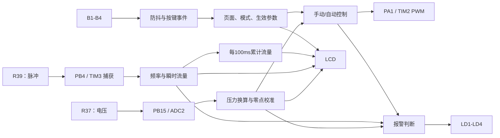
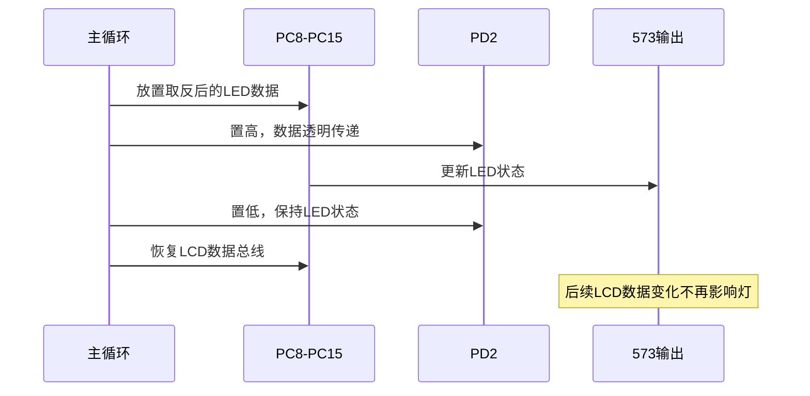
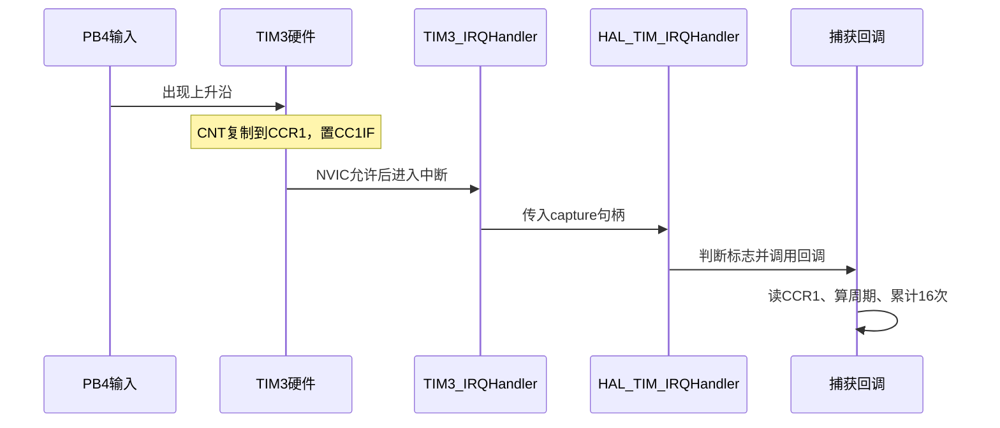
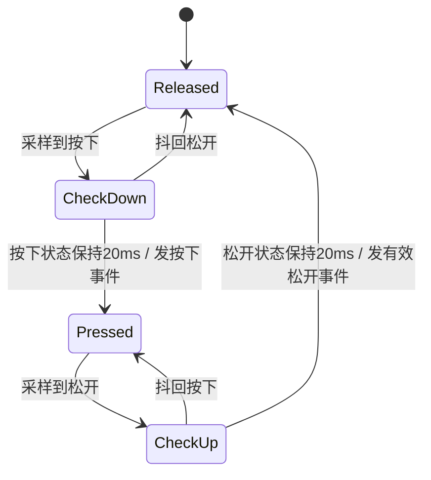
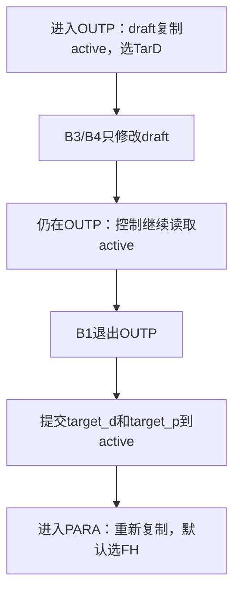
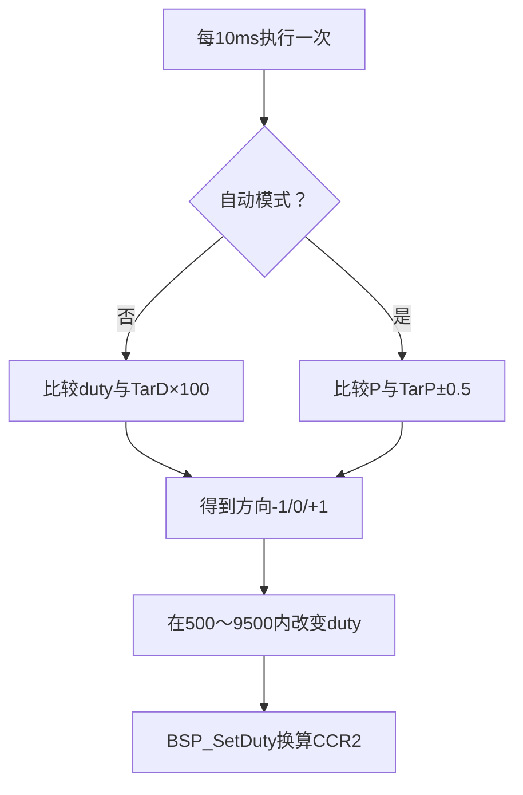
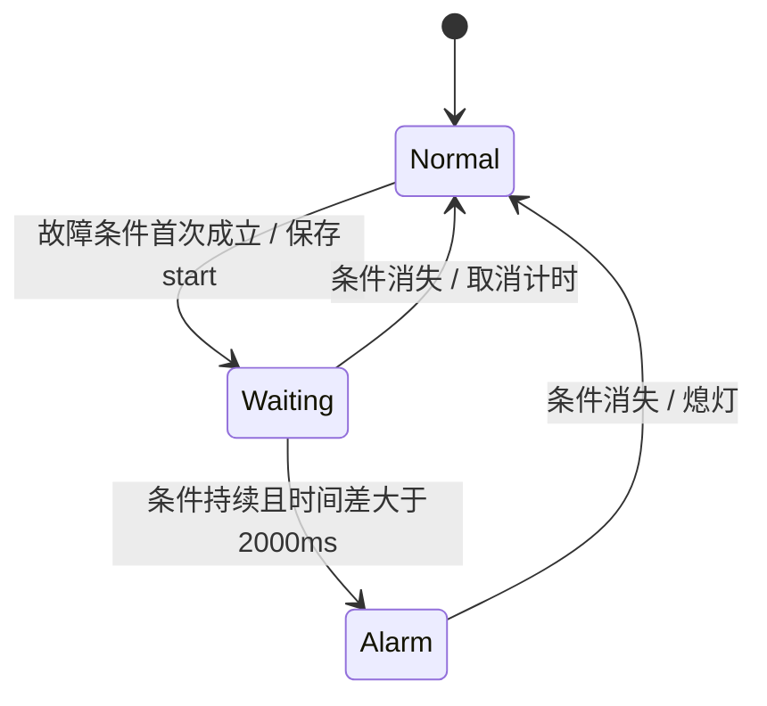
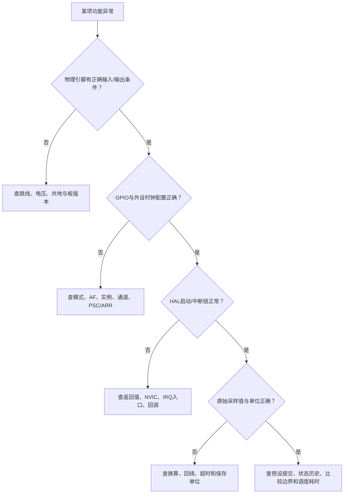

# 第十七届蓝桥杯 STM32 管路监控：从需求、引脚配置到模块化代码

> **适用平台/版本**：CT117E-M4 竞赛平台，STM32G431RBT6，STM32Cube FW_G4 V1.6.3；现有工程由 STM32CubeMX 6.17.0 生成，使用 Keil ARM Compiler 5.06 update 7 编译。
>
> **外设与技术点**：80 MHz 时钟、GPIO、ADC2、TIM3 输入捕获、TIM2 PWM、SysTick、LCD、LED 锁存器、按键状态机、参数提交与软件调度。
>
> **最终效果**：采集 R37 压力电压、R39 流量脉冲，输出 PA1 的 10 kHz PWM，实现三页面、手自动控制、累计计量、零点校准及四种指示。
>
> **适合读者**：知道变量、函数和基本外设概念，但尚不能独立把竞赛题目转成完整工程的初学者。结构体、指针、位运算和回调均在使用前解释。
>
> **阅读与验证边界**：本文重新讲清当前工程如何从零构建，不修改现有固件。软件编译和业务测试与板上测量分开记录；未执行的接线、烧录和测量均写成操作步骤与预期现象。

本文只围绕六个核心知识点展开：①从硬件与时钟建立工程；②从电压、周期得到压力和流量；③把机械按键变成可靠事件；④用数据结构表达页面和预设提交；⑤完成控制、计量与报警；⑥把采集、显示和控制放到可持续运行的主循环中。先看每个阶段的小代码，再看文末完整工程代码，能够更容易理解每个变量为什么存在。

## 0. 开写前：把六页要求变成可以检查的行为

### 0.1 先区分“输入”“输出”和“记忆”

本题是一台管路监控仪的模拟实现。电位器模拟压力传感器，板上脉冲电路模拟流量传感器。MCU 读取两个输入，根据按键设定控制 PWM，同时显示数据并判断异常。



箭头代表数据或控制关系，不代表电位器会被 PWM 自动驱动。板上 R37 与 PA1 没有构成真实的压力闭环；测试自动模式时，需要手动改变 R37，观察输出变化。

除了当前采样值，程序还必须“记住事情”：上次按键状态、按下时刻、上次调度时刻、待生效参数、累计不足 1 L 的余量、故障起始时刻。这些记忆正是结构体成员的来源。

### 0.2 六页题目的逐项提取

| 题目页 | 必须提取的要求 | 转换成的代码责任 |
| --- | --- | --- |
| 第1页 | STM32G431RBT6、80 MHz；压力、流量、PWM、LCD、按键、LED | 确定芯片和外设资源，建立模块边界 |
| 第2页 | 输入电压到0～10.0 BAR；校准更新斜率；F=f/200；800～8000 Hz；100 ms积分；响应和误差要求 | ADC、测频、换算、计量、时间预算 |
| 第3页 | PWM固定10 kHz、5%～95%；手动渐变；自动±0.5 BAR死区；MAIN的名称、单位、位置 | PWM配置、目标跟踪、监控显示 |
| 第4页 | OUTP、PARA布局；白字黑底；名称大小写；B1切页 | 显示行列、页面状态机 |
| 第5页 | B2选择项；B3/B4步长；长按2秒后松开；退出设置页才生效 | 按键事件、选择项、预设与生效参数 |
| 第6页 | 参数范围；防抖；LD1～LD4逻辑；上电默认值 | 限幅、持续条件计时、初始化 |

题图中的 `P=1.2BAR`、`Q=2089L`、`TarD=80%` 等用于说明布局，**不是上电默认值**。默认值必须读第6页。

### 0.3 先把默认值、范围和步长写下来

| 参数 | 物理含义 | 默认值 | 允许范围 | B3/B4步长 |
| --- | --- | --- | --- | --- |
| TarD | 手动占空比目标 | 5% | 5%～95% | ±5个百分点 |
| TarP | 自动压力目标 | 5.0 BAR | 1.0～9.5 BAR | ±0.5 BAR |
| FH | 泄漏判断的流量阈值 | 20.0 L/min | 4～40 L/min | ±1 L/min |
| FL | 堵塞判断的流量阈值 | 10.0 L/min | 4～40 L/min | ±1 L/min |
| PL | 泄漏判断的压力阈值 | 1.0 BAR | 1.0～9.5 BAR | ±0.5 BAR |
| DH | 堵塞判断的占空比阈值 | 65% | 5%～95% | ±10个百分点 |
| Voffset | 压力零点电压 | 0.0 V | 由当前采样校准 | MAIN长按B3后松开 |
| Q | 完整累计升数 | 0 L | 至少支持9999999 L | MAIN长按B4后松开归零 |

其他初始状态：页面 MAIN、模式 MAN、实际 PWM 占空比 5%。题目没有明确要求断电保存，因此当前方案使用 RAM，复位后恢复默认值；不额外引入 EEPROM/Flash 写入功能。

### 0.4 哪些是题目规定，哪些是本方案选择

| 项目 | 性质 | 本文采用的实现 |
| --- | --- | --- |
| 系统主频80 MHz | 明确要求 | HSI 16 MHz经PLL得到80 MHz |
| 100 ms积分与显示数据更新 | 明确要求 | 使用毫秒计数调度 |
| 按键/指示灯响应≤100 ms | 明确要求 | 主循环持续运行，避免长时间阻塞 |
| 5 ms按键扫描、20 ms防抖 | 实现选择 | 对机械按键定期采样并等待稳态 |
| 10 ms控制步长 | 实现选择 | 每次改变0.01个百分点 |
| 测频16周期平均、50 ms失联超时 | 实现选择 | 降低量化波动，并清除断线后的旧测量 |
| 满量程零点校准如何处理 | 题目未定义边界 | 若电压等于3.3 V，保留旧零点，避免除零 |
| LD4切模式是否启动跟踪 | 题目未逐项规定 | 当前工程在切模式时也启动当前目标跟踪 |

不要把实现选择背成芯片规定。换一种周期或数据表示，只要满足题目并经过验证，也可以成立。

## 1. 核心知识点一：先把芯片、引脚和时钟对应起来

### 1.1 为什么必须先看原理图

题目告诉你使用 R37、R39 和 PA1，但只有原理图能告诉你：R37 接哪个 ADC、R39 的输出经过哪个跳线、LED 是否直接接在 MCU 上。

查图采用两步：

1. 沿板上元件追踪网络名，找到 MCU 引脚。
2. 查 STM32G431 数据手册，确认该引脚支持的 ADC 通道或定时器复用功能。

不要根据别的 STM32 工程猜引脚。已经核对本地 `STM32G431RB数据手册.pdf`：PB15 的附加模拟功能为 ADC2_IN15（第55页）；PA1 的 AF1 为 TIM2_CH2（第61页）；PB4 的 AF2 为 TIM3_CH1（第62页）。

### 1.2 本题完整引脚表

| 功能 | MCU引脚 | 软件模式 | 额外配置/原因 |
| --- | --- | --- | --- |
| B1 | PB0 | GPIO输入，上拉 | 未按为高、按下接地 |
| B2 | PB1 | GPIO输入，上拉 | 同上 |
| B3 | PB2 | GPIO输入，上拉 | 同上 |
| B4 | PA0 | GPIO输入，上拉 | 同上 |
| R37压力输入 | PB15 | 模拟，无上下拉 | ADC2_IN15，单端采样 |
| R39流量输入 | PB4 | 复用，AF2 | TIM3_CH1，上升沿捕获；本方案下拉 |
| PWM | PA1 | 复用推挽，AF1 | TIM2_CH2，高电平有效 |
| LCD数据D0～D15 | PC0～PC15 | 输出推挽，读LCD时临时输入 | 资源包驱动负责切换总线方向 |
| LCD写使能 | PB5 | 输出推挽 | 官方驱动控制 |
| LCD寄存器/数据选择 | PB8 | 输出推挽 | 官方驱动控制 |
| LCD片选 | PB9 | 输出推挽 | 官方驱动控制 |
| LCD读使能 | PA8 | 输出推挽 | 官方驱动控制 |
| LD1～LD8数据 | PC8～PC15 | 与LCD数据线共用 | 低电平点亮，经573锁存器保持 |
| LED锁存使能 | PD2 | 输出推挽，初始低 | 高时透明，回到低后保持数据 |
| SWDIO/SWCLK | PA13/PA14 | Serial Wire调试 | 保留下载调试连接 |

GPIO“上拉”是给输入提供默认高电平，不是让按下时仍为高。按键闭合后直接连接地，读取结果为低。

PB4用于定时器输入仍配置 `GPIO_MODE_AF_PP`，是因为它需要连接内部复用通路；`PP` 不意味着输入捕获会主动把外部信号推高或拉低。信号方向由所选外设功能决定。

### 1.3 跳线怎么接，版本差异怎么处理

**V1.1原理图**：R37为10 kΩ电位器，经J11连接PB15；R39经555电路产生脉冲，再经J9连接PB4。图中R39标10 kΩ、R31标100 Ω；实际信号范围用测量确认，不由元件阻值直接代替输入频率。

**V1.2原理图**：R37仍为10 kΩ，滑动端网络AO2，经三针J11选到PB15。J11应连接1—2，使AO2接PB15，不能选到Flash的SPI_MOSI侧。R39标100 kΩ，R31标2 kΩ，输出仍经J9接PB4。R40对应PA15，不是本题要求的R39。

原理图还有以下共同条件：

- J9应短接，才能把板上流量模拟脉冲送入PB4。
- J17把VREF+接到VDDA，ADC参考电压才能按板上供电工作；若读数异常先检查它。
- PA1可从J3的第4脚引出，接示波器时与开发板GND共地。
- B1～B4各有10 kΩ板上上拉。软件再次配置上拉是明确默认状态，不是必须依靠内部电阻才能工作。
- 两份主控图的外部晶振均标24 MHz。V1.1 PDF还有下载器电路页，其中的8 MHz晶振属于下载器，不要拿来配置主控HSE。

资源包ReadMe说明两版硬件接口兼容；新增Flash选择跳线不改变本题使用的MCU外设映射。`._SCH_CT117E_M4_V1.2.pdf` 是伴随元数据文件，不作为原理图正文使用。

### 1.4 先建立最小CubeMX工程，不急着加入所有外设

从零练习时，建议新建独立练习工程，避免覆盖当前可工作的工程。

1. 在MCU选择器查找并选择 `STM32G431RBT6`，封装LQFP64。
2. `System Core → SYS → Debug` 选择 `Serial Wire`，保留PA13、PA14。
3. 保持HAL默认SysTick时基。
4. 时钟选择HSI并经PLL输出80 MHz。关键值见下一节。
5. `Project Manager` 选择MDK-ARM、设置工程名称，保留用户代码选项。
6. 生成后先直接编译一次，确认原始工程能构建。

**本文与当前工程采用“CubeMX生成基础工程，BSP手写业务外设初始化”的方式。** ADC、TIM和按键的具体配置写在 `BSP_BoardInit()`，不再让 `MX_ADC2_Init()`、`MX_TIM2_Init()` 等重复配置同一外设。

若你选择由CubeMX生成这些外设，就应改为使用它生成的句柄与初始化函数，再调整BSP；不能两条路线同时原封不动叠加。当前 `.ioc` 只描述基础配置，不是全部BSP外设的配置清单。

### 1.5 80 MHz是怎么计算出来的

需求是80 MHz，当前代码选择内部HSI 16 MHz：

```text
HSI 16 MHz → PLL输入除以M=1 → 乘以N=10 → PLLR除以R=2 → 80 MHz
```

关键语句：

```c
RCC_OscInitStruct.PLL.PLLSource = RCC_PLLSOURCE_HSI;
RCC_OscInitStruct.PLL.PLLM = RCC_PLLM_DIV1;
RCC_OscInitStruct.PLL.PLLN = 10;
RCC_OscInitStruct.PLL.PLLR = RCC_PLLR_DIV2;
```

AHB、APB1、APB2都不再分频，因此当前配置下HCLK、PCLK1、TIM2/TIM3时钟均为80 MHz。不能把“系统80 MHz”套用到所有工程：更改APB分频后，定时器时钟可能按时钟树规则倍频，必须重新查时钟树。

HSI倍频不会自动消除HSI本身的频率误差。题目要求输出频率偏差±2%，最终仍需实测；如果改用板上24 MHz HSE，PLL参数也必须随之改变，不能只切换时钟源。

`HAL_RCC_OscConfig()`、`HAL_RCC_ClockConfig()` 失败应进入错误处理，不可忽略；80 MHz配置中还设置电压档位和Flash等待周期，详见文末完整 `SystemClock_Config()`。

### 1.6 为什么GPIO要先开时钟，再设置模式

GPIO也是片上外设，寄存器配置需要相应时钟。可以把它理解为先给设备供上工作时钟，再让配置生效。

```c
GPIO_InitTypeDef g = {0};       // 清零配置，避免局部未初始化字段带入随机值
__HAL_RCC_GPIOB_CLK_ENABLE();   // PB0、PB1、PB2都属于GPIOB

g.Pin = GPIO_PIN_0 | GPIO_PIN_1 | GPIO_PIN_2;
g.Mode = GPIO_MODE_INPUT;
g.Pull = GPIO_PULLUP;
HAL_GPIO_Init(GPIOB, &g);
```

`|`把多个引脚掩码组合起来，不是把引脚编号相加。`GPIO_PIN_2`表示第2位掩码 `0x0004`，不是整数2。

| 配置字段 | 决定什么 | 本题需要特别区分的点 |
| --- | --- | --- |
| Pin | 配哪些引脚 | 位掩码，可按位或组合 |
| Mode | 输入/输出/模拟/复用 | 采ADC用模拟，TIM信号走复用 |
| Pull | 上拉/下拉/无 | ADC不添加数字上下拉 |
| Speed | 输出转换速度等级 | 不决定PWM频率；输入模式下不决定采样周期 |
| Alternate | 连接哪个复用功能 | PA1选AF1，PB4选AF2 |

`g`被反复用于不同引脚时，要注意之前字段会保留。当前PWM配置沿用了前面捕获配置的 `Mode=GPIO_MODE_AF_PP`，阅读时要追溯赋值。自己练习时可以每组配置重新 `{0}`，并显式填写所有有关字段，减少理解负担。

PB4还具有UCPD相关功能，不能只按普通GPIO默认状态理解。当前Cube生成的 `HAL_MspInit()` 已调用 `HAL_PWREx_DisableUCPDDeadBattery()`关闭有关引脚的Dead Battery内部上拉。重建基础工程时应保留对应配置，避免内部特殊功能影响PB4输入条件；不要把F1系列的JTAG重映射宏直接搬到G4上。

### 1.7 最小实操：先独立点亮LD1

需求只要求指示灯亮灭，但硬件并非“GPIO直接控制灯”。LED阳极接VDD，经电阻接锁存器输出，因此输出低才能点亮。

首次练习可在初始化时把PC8～PC15和PD2配置为推挽输出，然后调用：

```c
BSP_SetLEDs(0x01U); // bit0=1表示LD1亮；其余灭
```

底层核心代码为：

```c
uint32_t saved = GPIOC->ODR; // 记住LCD总线上原来的值

// mask的1表示“希望亮”，硬件却要求低电平，所以先取反再放到PC8~PC15
GPIOC->ODR = (saved & 0x00ffU) | ((uint32_t)(uint8_t)~mask << 8);
HAL_GPIO_WritePin(GPIOD, GPIO_PIN_2, GPIO_PIN_SET);   // 打开透明锁存
__NOP(); __NOP(); __NOP();
HAL_GPIO_WritePin(GPIOD, GPIO_PIN_2, GPIO_PIN_RESET); // 锁住LED数据
GPIOC->ODR = saved; // 恢复LCD总线，后续LCD操作不会改变已锁存的灯
```

573在使能高时透明，回到低时保持数据；不要误解为只在上升沿采样的触发器。原理图U1标注与资源包573手册的系列标识不同，本文只使用共同的透明锁存功能，不混用具体型号的电气时序数值。三个NOP也不是经过板上测量证明的延时指标。



**本阶段验收**：只开LD1、只开LD2、全部灭依次验证；加入LCD静态显示后再检查LED是否仍稳定。若LCD刷新时灯乱闪，优先检查PD2是否被保持为高、是否把LED更新放入了会抢占LCD的中断。

### 知识小结一

**结论**：先按原理图找到网络，再按芯片手册确定外设映射，最后配置时钟与GPIO。**原因**：元件名、MCU引脚、复用功能和板上跳线是四个不同层次，漏掉一个都可能没有信号。**关键参数**：PB15/ADC2_IN15、PB4/AF2/TIM3_CH1、PA1/AF1/TIM2_CH2，系统及本配置的定时器时钟80 MHz。**常见误区**：混用下载器晶振、把GPIO速度当PWM频率、遗漏J9/J11/J17、忽视LED与LCD共享总线。

## 2. 核心知识点二：先读到真实输入，再做压力与流量换算

### 2.1 压力需求如何推导出ADC配置

需求是读取R37的连续电压，因此需要ADC；PB15对应ADC2_IN15，所以选择ADC2而不是随意选择ADC1。

本题只有一路慢变电位器，不要求DMA搬运大批量高速数据，单次软件触发、短时间轮询已足够作为入门方案。

| 配置 | 取值 | 为什么 |
| --- | --- | --- |
| GPIO | PB15，模拟，无上下拉 | 送入模拟采样通路，避免数字上下拉改变输入 |
| ADC实例/通道 | ADC2 / Channel15 | 来自芯片引脚映射 |
| 时钟 | 同步HCLK/4，20 MHz | 在当前80 MHz HCLK下给出明确采样时钟 |
| 分辨率/对齐 | 12 bit、右对齐 | 结果码0～4095，便于换算 |
| 扫描/连续 | 关闭/关闭 | 只采一个通道，由主循环决定何时采样 |
| 触发 | 软件启动，无外部触发边沿 | 使用HAL_ADC_Start主动开始 |
| 通道顺序 | Regular Rank1 | 本次规则序列只有一次转换 |
| 采样时间 | 247.5 ADC周期 | 电位器信号慢，给采样电容较充足的建立时间 |
| 单端/硬件偏移 | 单端/关闭硬件Offset | 零点校准属于业务映射，不借硬件Offset实现 |

### 2.2 HAL句柄到底是什么

```c
static ADC_HandleTypeDef adc;
```

`adc`是HAL管理这一路ADC的结构体，其中：

- `Instance`指向ADC2寄存器组。
- `Init`保存初始化参数。
- `State`、`ErrorCode`等供HAL记录运行状态。

```c
adc.Instance = ADC2;
adc.Init.Resolution = ADC_RESOLUTION_12B;
HAL_ADC_Init(&adc);
```

`&adc`表示把结构体地址交给函数，HAL既能读取配置，也能更新结构体状态。它不是把ADC硬件复制一份。

当前句柄是文件级 `static`，生命周期覆盖整个程序，且只在 `bsp_board.c` 内可见。业务模块通过 `BSP_ReadVoltage()` 获取结果，减少对HAL细节的依赖。

### 2.3 初始化顺序不能颠倒

```text
使能GPIOB与ADC12时钟
→ PB15模拟模式
→ 填写ADC句柄
→ HAL_ADC_Init
→ HAL_ADC_ConfigChannel
→ HAL_ADCEx_Calibration_Start
→ 开始正常采样
```

核心代码：

```c
ADC_ChannelConfTypeDef channel = {0};
adc.Instance = ADC2;
adc.Init.ClockPrescaler = ADC_CLOCK_SYNC_PCLK_DIV4;
adc.Init.Resolution = ADC_RESOLUTION_12B;
adc.Init.DataAlign = ADC_DATAALIGN_RIGHT;
adc.Init.ScanConvMode = ADC_SCAN_DISABLE;
adc.Init.EOCSelection = ADC_EOC_SINGLE_CONV;
adc.Init.NbrOfConversion = 1;
adc.Init.ExternalTrigConv = ADC_SOFTWARE_START;
adc.Init.ExternalTrigConvEdge = ADC_EXTERNALTRIGCONVEDGE_NONE;
adc.Init.Overrun = ADC_OVR_DATA_OVERWRITTEN;
Check(HAL_ADC_Init(&adc));

channel.Channel = ADC_CHANNEL_15;
channel.Rank = ADC_REGULAR_RANK_1;
channel.SamplingTime = ADC_SAMPLETIME_247CYCLES_5;
channel.SingleDiff = ADC_SINGLE_ENDED;
channel.OffsetNumber = ADC_OFFSET_NONE;
Check(HAL_ADC_ConfigChannel(&adc, &channel));
Check(HAL_ADCEx_Calibration_Start(&adc, ADC_SINGLE_ENDED));
```

这里其余Init字段依靠文件级静态对象初始为0而处于关闭状态；若改成未初始化的局部句柄，则不能照搬这一假设。

`Check()`是工程内的小封装：返回值不是 `HAL_OK` 就进入 `Error_Handler()`。先让错误可见，再考虑产品级恢复策略。

**ADC内部校准与压力零点校准是两件事**：前者修正ADC自身模拟转换误差，后者定义传感器哪一个输入电压代表0 BAR；执行前者不会替你更新 `Voffset`。

### 2.4 最小示例：先采一次，暂时不显示压力

在ADC初始化完成、LCD可用后，先做一次核心采样：

```c
uint32_t code;
float voltage;
if (HAL_ADC_Start(&adc) == HAL_OK) {
    if (HAL_ADC_PollForConversion(&adc, 1U) == HAL_OK) {
        code = HAL_ADC_GetValue(&adc);
        voltage = (float)code * 3.3f / 4095.0f;
        // 调试器观察code和voltage，先确认转动R37时读数随之改变
    }
    HAL_ADC_Stop(&adc);
}
```

此片段放在能访问 `adc` 的同一源文件内；它是单次采样核心，不是额外增加一套ADC实例。完成后用正式的 `BSP_ReadVoltage()` 替换临时实验代码。

| 接口 | 输入/返回 | 本题中干什么 |
| --- | --- | --- |
| HAL_ADC_Start | ADC句柄地址；返回HAL状态 | 启动转换 |
| HAL_ADC_PollForConversion | 句柄、超时时间ms；返回HAL状态 | 等转换完成，避免无限等 |
| HAL_ADC_GetValue | 句柄；返回uint32_t结果码 | 读取ADC数据寄存器结果 |
| HAL_ADC_Stop | 句柄；返回HAL状态 | 停止本次转换/使能流程 |

`1U`是超时参数，不是“每隔1 ms采样一次”。正常转换完成即可返回；轮询存在短暂阻塞，不能说它完全没有等待。按当前20 MHz、12位、247.5周期配置，一次采样转换的理想核心耗时约 `(247.5+12.5)/20MHz=13us`，不包含HAL开销，也不是板上实测值。

当前工程采用4095做端点线性标定，使码值4095对应3.3 V。12位量化共有4096级，LSB大小常用Vref/4096讨论；两者是在不同语境下使用的端点映射与量化步长，不要因为网上示例除以4096就直接更改整套压力标定约定。

### 2.5 正式采样为什么用指针返回电压

正式接口：

```c
uint8_t BSP_ReadVoltage(float *voltage);
```

它需要返回两类信息：成功/失败、采到的电压。

```c
float voltage = monitor.voltage; // 预先保留上次有效值
uint8_t ok = BSP_ReadVoltage(&voltage);
```

函数返回 `1/0`表示成功/失败，通过 `*voltage`写入采样结果。若采样失败且未写结果，调用者仍保留旧值，避免把未初始化浮点数交给控制算法。

当前实现采4次求和，再统一换算：

```c
*voltage = (float)sum * (3.3f / (4095.0f * 4.0f));
```

4次平均可以减轻一部分随机波动，不保证消除所有干扰，也不会提高ADC硬件的真实分辨率。没有必要为了本题盲目增加到几百次平均，拖慢响应。

### 2.6 压力公式必须先从两个端点推出来

题目定义两个点：

```text
V = Voffset → P = 0
V = 3.3 V   → P = 10 BAR
```

斜率是：

```text
k = (10-0)/(3.3-Voffset)
P = k×(V-Voffset)
```

先写易读形式：

```c
if (voltage <= offset) {
    pressure = 0.0f; // 低于零点不产生负压力
} else {
    pressure = (voltage-offset) * 10.0f / (3.3f-offset);
}
if (pressure > 10.0f) pressure = 10.0f;
```

当前 `Monitor_Measure()` 用三目运算表达同样逻辑。先掌握这个展开版本，再读紧凑写法。

当Voffset=1.0 V时：1.0 V对应0 BAR，2.15 V对应5 BAR，3.3 V对应10 BAR。校准以后不能仍使用 `V×10/3.3`，也不能只减零点而不更新斜率。

满量程3.3 V不能同时代表0 BAR和10 BAR，因此题目在这个端点上缺少有效的线性映射定义。当前拒绝此时的校准并保留旧值；这是边界约定，需要在验收时单独确认，不包装成题目原话。

### 2.7 流量为什么使用输入捕获，而不是主循环读高低电平

输入最高8000 Hz，一个周期只有125 us。若主循环5 ms才读一次电平，期间已经过去40个周期，无法靠两次高低电平读取算出频率。

输入捕获相当于硬件秒表：定时器持续计数，每次出现上升沿，硬件立即把CNT复制到CCR1。CPU稍后进入中断读取已经锁定的计数，时间测量精度主要由计数时钟决定，而不是主循环轮询时刻。



### 2.8 测频时钟、ARR和捕获参数为什么这样选

| 参数 | 当前取值 | 作用 |
| --- | --- | --- |
| TIM3时钟 | 80 MHz | 来自当前APB时钟树 |
| PSC | 79 | 80MHz/(79+1)=1MHz，每计数1us |
| ARR | 65535 | 使用16位完整计数范围，65.536ms回绕 |
| 捕获通道 | CH1、DirectTI | PB4的TI1直接送到捕获通道1 |
| 边沿 | Rising | 相邻上升沿之间代表一个周期 |
| IC预分频 | DIV1 | 每个有效上升沿都捕获 |
| ICFilter | 4 | 芯片定义的数字滤波编码，不是4ms |
| NVIC | TIM3_IRQn，优先级1 | 允许捕获事件进入中断 |

`ICFilter=4`即编码0100，按本地参考手册TIMx_CCMR1的IC1F表，对应 `fSAMPLING=fDTS/2，N=6`。当前CKD不分频，fDTS为80 MHz，滤波采样为40 MHz，需连续6个一致样本才认可变化，时间量级约150 ns，实际还受采样相位和同步影响。它不是“4次周期平均”，更不是软件防抖20 ms；这里的滤波时钟也不是PSC之后的1 MHz计数时钟。若改参数需重新查输入滤波表。

关键启动代码：

```c
HAL_NVIC_SetPriority(TIM3_IRQn, 1, 0);
HAL_NVIC_EnableIRQ(TIM3_IRQn);
Check(HAL_TIM_IC_Start_IT(&capture, TIM_CHANNEL_1));
```

只调用初始化不会自动开始测量；只开NVIC却没开通道捕获中断，也不会出现完整事件链。

### 2.9 先理解一个周期，再理解16周期平均

计数时钟1 MHz时：

```text
频率 = 1000000 / 相邻捕获值差
```

假设两次CCR1是1000和1250：差250，周期250 us，所以频率4000 Hz，瞬时流量20 L/min。

计数器会回绕，使用：

```c
delta = (uint16_t)(current - previous);
```

例如前值65500、后值100，转为16位无符号数得到差136，对应136 us。这个技巧要求相邻有效测量之间没有跨越无法区分的额外整圈；当前用50 ms超时限制有效连续边沿间隔，小于65.536 ms。

第一条边沿没有“前一次”可以比较，只能保存起点。因此16个周期需要17条边沿，不是16条。

正式代码每得到一个差值就加入 `accumulator`，累计16个周期后发布到 `period_sum`：

```c
accumulator += delta;
if (++samples == 16U) {
    period_sum = accumulator; // 发布完整的一批测量
    samples = 0;
    accumulator = 0;
}
```

于是：

```text
f = 16×1000000 / period_sum
```

800 Hz下16周期约20 ms，8000 Hz下约2 ms。它能减小相邻单周期125/126计数等量化波动；不代表绝对精度已通过测量。

### 2.10 为什么中断变量有volatile，还要短暂关中断

```c
static volatile uint32_t period_sum, edge_tick;
```

这两个变量由捕获中断更新，由主循环读取。`volatile`告诉编译器每次按实际内存访问，不能认为它们在主循环之外不会改变。

但 `volatile`不能保证多个变量一定属于同一次更新。例如主循环读完周期，发生中断，又读到新时间戳，就可能混用不同批次。

因此读取时做很短的快照：

```c
uint32_t primask = __get_PRIMASK();
__disable_irq();
sum = period_sum;
tick = edge_tick;
now = HAL_GetTick();
__set_PRIMASK(primask);
```

恢复原先的PRIMASK，而不是无条件开中断，是为了不破坏调用前已有的屏蔽状态。这里只复制少数变量，不能把浮点换算、LCD显示或等待操作放进关中断区。

当前 `BSP_ReadFrequency(uint32_t now)` 内部重新读取now，使时间和快照一致，因此形参now在实现中被覆盖；这是可清理的接口冗余，不是要求额外传两个不同时间。

### 2.11 为什么要清掉断线后的旧频率

如果最后测到4000 Hz，然后拔掉J9，后面不再有中断。若只返回 `period_sum`，屏幕会永远显示20.0 L/min。

因此：

```c
if (!sum || (uint32_t)(now-tick) >= 50U) return 0.0f;
```

超过50 ms没有边沿，报告0 Hz。对于本题800～8000 Hz的有效输入，周期最大1.25 ms，50 ms足以判断明显失联。此方案不是用来精确测量任意低频信号的通用频率计。

最后再做题目规定的流量限幅：

```c
if (frequency < 800.0f) flow = 0.0f;
else if (frequency > 8000.0f) flow = 40.0f;
else flow = frequency / 200.0f;
```

保留原始 `frequency` 用于LD1报警，不能把频率先压成8000再存起来。

### 知识小结二

**结论**：硬件层负责可靠得到电压和频率，业务层再换算压力与流量。**原因**：这样能分别验证引脚、外设和公式，避免所有问题混在一起。**关键参数**：ADC2_IN15、12 bit、20 MHz ADC时钟；TIM3计数1 MHz、16周期平均、50 ms失联超时；P按两个端点映射，F=f/200。**常见误区**：把ADC内部校准当压力零点、漏掉输入捕获中断链、使用显示限幅值判断传感器超频、误认为volatile等于多变量同步。

## 3. 核心知识点三：按键代码是怎样被需求一步步“逼出来”的

### 3.1 第一版只读取电平，先确认接线

需求：程序知道B1有没有被按下。

```c
uint8_t pressed;
pressed = HAL_GPIO_ReadPin(GPIOB, GPIO_PIN_0) == GPIO_PIN_RESET;
```

硬件低电平按下，所以转换以后 `pressed=1`表示按下。可以暂时让LD1跟随这个值，先确认按键对应正确。

然后读四个键，统一组合为bit0～bit3：

```c
uint8_t BSP_ReadKeys(void)
{
    return (uint8_t)((~GPIOB->IDR & 7U)
                  | ((~GPIOA->IDR & 1U) << 3));
}
```

把紧凑表达式展开理解：

```c
uint8_t b123 = (uint8_t)(~GPIOB->IDR & 0x07U); // PB0~PB2，取反后1=按下
uint8_t b4   = (uint8_t)(~GPIOA->IDR & 0x01U); // PA0
uint8_t bits = b123 | (uint8_t)(b4 << 3);      // B4放到bit3
```

`IDR`是输入数据寄存器，`~`是按位取反，`&`用于保留对应位，`<<3`把B4移动到bit3，`|`合并结果。不要把按位与 `&` 和逻辑与 `&&` 混淆。

四个按键分别读取后也能实现功能；按位打包只是接口选择，方便循环处理，不是题目要求你必须会写的一行技巧。

### 3.2 第二版：按住不连发，所以要保存上次认可的状态

题目要求一次按B1切一次页面。如果每5 ms看到低电平就切页，按住1秒会切约200次。

因此要记住 `stable`，只处理状态变化：

```text
松开→按下：发送一次按下事件
按下→按下：不发送
按下→松开：发送一次松开事件
```

这叫按状态变化产生事件，不需要先掌握复杂框架。它只是“记住过去，和现在比较”。

### 3.3 第三版：机械抖动不能算多次操作，所以要等20 ms稳态

假设电平序列是0、1、0、1、1、1。只识别边沿仍会把抖动当成多次操作。

因此增加两个记录：

- `raw`：最近一次采样值。
- `changed`：这个采样值最近改变的时间。

只要本次采样与旧采样不同，就更新采样记录并重新计时；以后至少20 ms没再采到变化，才把它更新到 `stable`。

### 3.4 第四版：长按后松手，所以要保存按下时刻

题目明确“长按2秒后松开”。这要求在松开时才能计算：

```text
按住时间 = 松开开始时刻 - 按下开始时刻
```

因此增加 `pressed`。按住过程中不循环等待，也不每5 ms执行一次校准。达到2秒但没有松手，仍然继续采集与控制。

### 3.5 第五版：功能和页面有关，所以要记录页面与有效性

MAIN才允许B3校准、B4清零。记录 `origin` 表示按下时的页面；若按住过程中离开原页，将 `valid` 设为0，取消这次松开动作。

这是处理边界的约定：即使后来又回到MAIN，也不恢复valid，必须重新按一次，避免意外清零。多键同时操作不是题目完整定义的组合键协议；当前代码逐键顺序处理，不承诺所有同时按下组合都有额外语义。

最终结构体才变成：

```c
typedef struct {
    uint8_t raw;       // 最近保存的采样状态，1按下、0松开
    uint8_t stable;    // 防抖认可的状态
    uint8_t valid;     // 本次松开事件是否仍允许处理
    uint32_t changed; // 最近一次采样变化时刻，ms
    uint32_t pressed; // 本次稳定按下开始时刻，ms
    MonitorPage origin; // 确认按下时的页面
} KeyState;

typedef struct {
    KeyState key[4]; // 四个按键各自保存状态，互不共用计时变量
} Keys;
```

先有需求才有变量，不能反过来死记六个成员。

### 3.6 C语言语法先讲清：为什么用指针、箭头和sizeof

```c
static Keys keys;
Keys_Init(&keys);
```

`keys`是实际结构体，`&keys`是它的地址。

```c
void Keys_Init(Keys *keys)
{
    memset(keys, 0, sizeof(*keys));
}
```

函数形参 `keys`是指针，通过它才能修改调用者那份结构体。`sizeof(*keys)`是整个Keys对象的大小；若写 `sizeof(keys)`，得到的只是指针大小，无法清完全部成员。

`memset`把每个字节写成0，作为本工程数值/状态对象的初始化。若直接传结构体值，函数拿到副本，清零副本不会改变调用者记录。

```c
KeyState *k = &keys->key[i];
```

`keys->key[i]`等于 `(*keys).key[i]`，取得第i个元素；再取地址交给k。之后 `k->stable` 就是这个元素的stable，不会创建一个新的按键对象。

本工程 `unsigned`等于 `unsigned int`，在此Keil目标为32 bit；`uint8_t`固定8 bit，`uint32_t`固定32 bit。循环下标只取0～3，二者都能容纳，不是用了32位就有32个键。

`5U`、`20U`、`1U`中的U表示无符号整数，不表示微秒。`0.5f`中的f表示float常量，不表示频率。

### 3.7 逐段写出完整扫描逻辑

先准备参数和循环：

```c
void Keys_Scan(Keys *keys, Monitor *m, uint8_t bits, uint32_t now)
{
    unsigned i;
    for (i=0; i<4; ++i) {
        KeyState *k = &keys->key[i];
        uint8_t raw = (bits >> i) & 1U;
        // 后续代码放在这里
    }
}
```

`bits >> i`把当前键移到最低位，`&1U`只保留这一位。例如bits=0x04，i=2时得到1。

接着发现变化就记录：

```c
if (raw != k->raw) {
    k->raw = raw;      // 本次值保存下来，供下一轮比较
    k->changed = now;  // 本次采样变化发生的时刻
}
```

**局部raw是本次值，结构体k->raw是保存值，它们不是同一个变量。** 初始化时保存值为0。若100 ms采到1，记录changed=100；105 ms仍为1，就不进入if，changed仍为100。这样时间差才会增长。

防抖条件：

```c
if (raw != k->stable && (uint32_t)(now-k->changed) >= 20U) {
    k->stable = raw;
    // 发送按下或松开事件
}
```

第一个条件说明“有变化待确认”；第二个条件说明“已经观察足够久”。确认后更新stable，下一轮即使继续按住，raw和stable相等，就不会再次触发。

| 时刻ms | 本次raw | 保存raw（本轮结束） | changed | stable | 是否发事件 |
| ---: | ---: | ---: | ---: | ---: | --- |
| 初始 | 0 | 0 | 0 | 0 | 无 |
| 100 | 1 | 1 | 100 | 0 | 变化刚出现，等待 |
| 105 | 0 | 0 | 105 | 0 | 抖回松开，重计时 |
| 110 | 1 | 1 | 110 | 0 | 再变化，重计时 |
| 115 | 1 | 1 | 110 | 0 | 只有5ms |
| 125 | 1 | 1 | 110 | 0 | 只有15ms |
| 130 | 1 | 1 | 110 | 1 | 发送一次按下 |
| 135 | 1 | 1 | 110 | 1 | 状态相同，不重复 |

这张表描述扫描到的样本，不保证5 ms间隔内所有极短电气毛刺都能被观测。对于机械键防抖是合理的简化，不等于对任意输入进行连续硬件监测。

确认按下后：

```c
k->pressed = k->changed; // 取稳定段开始时间，避免少算按下侧防抖时间
k->origin = m->page;
k->valid = 1;
Monitor_Key(m, (uint8_t)(i+1), 1, 0, k->origin);
```

第三个参数1表示按下，时长先传0。i+1把0～3下标转成1～4按键编号。

确认松开后：

```c
if (k->valid) {
    Monitor_Key(m, (uint8_t)(i+1), 0,
                k->changed-k->pressed, k->origin);
}
k->valid = 0;
```

changed此时已经被更新为松开的采样变化时刻。两者相减得到按住时长，不包含末端确认松开的20 ms。第三个参数0表示松开，业务层检查时长是否≥2000 ms。

最后处理跨页取消：

```c
for (i=0; i<4; ++i) {
    if (keys->key[i].stable && keys->key[i].origin != m->page) {
        keys->key[i].valid = 0;
    }
}
```

它放在事件处理之后，才能检查B1刚刚改变的当前页面。valid只决定松开动作，不阻止已经执行过的B1按下切页。

### 3.8 now为什么增长，为什么每5 ms调用

主循环读取：

```c
uint32_t now = HAL_GetTick();
```

默认SysTick每1 ms中断，项目的 `SysTick_Handler()` 调用 `HAL_IncTick()`。`HAL_GetTick()`返回HAL内部计数；`now`只是读取那一刻的副本，不会自己变化，下一次调用App_Run才重新读。

```c
if ((uint32_t)(now-key_tick) >= 5U) {
    key_tick = now;
    Keys_Scan(&keys, &monitor, BSP_ReadKeys(), now);
}
```

这表示“距离上次扫描至少5 ms就扫描”，不是让整个程序停5 ms。20 ms防抖加上采样相位等延迟，在主循环运行顺畅时通常可落在约20～25 ms量级；实际响应仍要测，不由公式自动保证≤100 ms。

uint32_t毫秒时间约49.7天回绕。使用无符号差值比较，只要间隔在可区分范围内，就能跨一次回绕正确工作；不要改成 `now >= start+period`，后者加法回绕容易误判。



代码没有显式写四个状态枚举，而是用raw、stable及changed共同表达这些过程。

### 知识小结三

**结论**：扫描模块负责识别动作，Monitor_Key负责决定业务功能。**原因**：电平抖动、按住重复和长按松手是三个不同问题，需要不同历史记录。**关键参数**：约5 ms采样、至少20 ms稳态、MAIN长按≥2000 ms后松开；raw为采样记录、stable为认可状态。**常见误区**：把两处raw当同一变量、每轮重置结构体、按住即反复触发、用延时等待2秒、误认为valid表示“已满2秒”。

## 4. 核心知识点四：先明确单位和状态，再写页面与参数逻辑

### 4.1 为什么把业务数据集中放进Monitor

题目需要多个模块共同使用压力、流量、模式和参数。如果每个.c都随意定义一个同名变量，容易出现显示用一份、控制用另一份的问题。

因此由app持有唯一的系统状态对象：

```c
static Monitor monitor;
```

把其地址传给测量换算、按键业务和报警函数。所有函数围绕同一份状态工作。它是单片机RAM里的普通结构体，不是数据库，也不要求使用动态内存分配。

### 4.2 有小数的参数为什么用整数保存

TarP只能按0.5 BAR调整，显示一位小数。用0.1 BAR作为单位，5.0 BAR就保存50，增加0.5就是加5。

| 字段 | 保存单位 | 默认保存值 | 使用时怎样还原 |
| --- | --- | ---: | --- |
| target_d | 整数百分数 | 5 | 表示5%，转控制单位时乘100 |
| target_p | 0.1 BAR | 50 | 除以10.0f得到5.0 BAR |
| fh/fl | 0.1 L/min | 200/100 | 除以10.0f得到20.0/10.0 |
| pl | 0.1 BAR | 10 | 除以10.0f得到1.0 BAR |
| dh | 整数百分数 | 65 | 与实际duty比较时乘100 |
| duty | 0.01个百分点 | 500 | 表示5.00%，显示时再转整数% |
| voltage/offset | V | 0 | ADC换算得到float |
| pressure | BAR | 由采样决定 | 直接用于压力判断 |
| frequency | Hz | 由捕获决定 | 保留超频信息 |
| flow | L/min | 由频率决定 | 积分使用原始计算值 |
| litres | L | 0 | 完整升数，uint32_t |
| fraction | 1/600 L计量单位 | 0 | 累计到600进1 L，不直接当升数 |

`target_d=5`和 `duty=500`都表示5%，但保存单位不同，所以不能直接比较。写代码前先给每个字段标单位，比后来追查“为什么差100倍”有效得多。

### 4.3 页面、模式、选择项分别表示什么

```c
typedef enum { PAGE_MAIN, PAGE_OUTP, PAGE_PARA } MonitorPage;
```

没有显式赋值时枚举依次为0、1、2。它表达当前看哪个页面。

```c
uint8_t automatic; // 0=MAN，1=AUTO
uint8_t selection; // 设置页当前选择哪项
```

页面不等于模式：你可以在PARA页面查看/编辑参数，同时系统继续在AUTO模式控制；不能因为切换页面就停止采集或停止PWM。

### 4.4 为什么必须有active和draft

需求：“调整只是预设，仅退出对应设置页面后生效”。因此：

```c
MonitorConfig active; // 控制和报警读取这里
MonitorConfig draft;  // 设置页面修改和显示这里
```

它很像填写设置表单：你在表单中改数值，系统暂时保留旧配置；退出时才提交。



提交OUTP时只提交两个输出参数，提交PARA时只提交四个运行参数。不能在退出任意页面时盲目覆盖所有参数，尤其当代码以后扩展多个独立编辑入口时。

### 4.5 初始化按默认值逐一写，不照抄题图示例

```c
memset(m, 0, sizeof(*m));
m->active.target_d = 5;
m->active.target_p = 50;
m->active.fh = 200;
m->active.fl = 100;
m->active.pl = 10;
m->active.dh = 65;
m->draft = m->active;
m->duty = 500;
```

清零后page=0即MAIN，automatic=0即MAN，offset与Q为0。随后显式赋非零默认值。结构体赋值 `draft=active`复制的是内容，不是让两者指向同一片内存；以后修改draft不会自动改变active。

### 4.6 B1为什么先提交，再切页

此时 `m->page`仍然代表“要退出的页面”，因此先根据旧页面提交：

```c
if (m->page == PAGE_OUTP) {
    m->active.target_d = m->draft.target_d;
    m->active.target_p = m->draft.target_p;
} else if (m->page == PAGE_PARA) {
    m->active.fh = m->draft.fh;
    m->active.fl = m->draft.fl;
    m->active.pl = m->draft.pl;
    m->active.dh = m->draft.dh;
}
```

再切页与准备新预设：

```c
m->page = (MonitorPage)((m->page+1) % 3);
m->selection = 0;
m->draft = m->active;
```

`%3`让0→1→2→0循环；selection=0满足进入OUTP默认TarD、进入PARA默认FH的要求。先切页再提交却仍按旧逻辑判断，会把该提交的页面弄错。

### 4.7 B2为什么在不同页面执行不同操作

题目给B2定义的是上下文功能：

```c
if (m->page == PAGE_MAIN) {
    m->automatic ^= 1U; // 0与1切换
} else {
    unsigned count = m->page == PAGE_OUTP ? 2U : 4U;
    m->selection = (uint8_t)((m->selection+1U) % count);
}
```

OUTP两项，PARA四项。B2切换选中项本身不提交参数，也不修改压力、流量测量值。

### 4.8 加减为什么先转成有符号数，再限幅

```c
static uint16_t Adjust(uint16_t value, int step, uint16_t low, uint16_t high)
{
    int result = (int)value + step;
    if (result < low) result = low;
    if (result > high) result = high;
    return (uint16_t)result;
}
```

需求是数值保持合理范围，减到下限后继续减应保持下限。使用有符号中间值便于处理负步长，不让结果先存入无符号变量后绕成很大的正数。

例如TarD=5%，减5个百分点先得到0，再限制回5。DH=85%，加10到95%；DH=5%，再减也保持5%。到边界是饱和，不是自动循环。

FH和FL题目只给了各自4～40 L/min的范围，未规定必须FH>FL。本方案不擅自添加这条耦合限制。

### 4.9 长按校准与清零为什么放在松开分支

```c
if (!down) {
    if (origin_page != PAGE_MAIN || m->page != PAGE_MAIN || held_ms < 2000U)
        return;
    // B3更新offset；B4同时清零litres和fraction
    return;
}
```

`down=0`代表松开。提前return使未定义的松开动作不会落入普通加减逻辑。B3校准后重新调用测量换算，使当前压力立刻按新零点重算，而不是只更新屏幕上的V。

### 知识小结四

**结论**：用Monitor表达一份系统状态，用active/draft实现退出页面提交。**原因**：同一个参数可能有“正在编辑”和“实际使用”两个值，页面、模式和选中项也各有职责。**关键参数**：压力/流量阈值用十分之一单位，目标占空比用整数%，实际控制用0.01个百分点。**常见误区**：直接修改active、把结构体赋值当指针绑定、混用保存单位、先切页导致提交对象错误、清零只清整数不清余量。

## 5. 核心知识点五：控制、计量和报警各自保存什么历史

### 5.1 先固定输出10 kHz、5%，不要一开始就写自动控制

需求：PA1输出10 kHz PWM。查引脚表得到AF1/TIM2_CH2，先独立配置硬件，确认示波器看到波形，再接入业务算法。

当前为边沿对齐、向上计数、PWM1、高电平有效，公式适用于这些条件：

```text
fPWM = fTIM / [(PSC+1)×(ARR+1)]
高电平占空比 = CCR2/(ARR+1)
```

选择：

```text
PSC=0，ARR=7999 → 80MHz/8000=10kHz，周期100us
CCR2=400       → 400/8000=5%，高电平5us
CCR2=4000      → 50%，高电平50us
CCR2=7600      → 95%，高电平95us
```

**PSC是除数减1，ARR也是周期计数减1，CCR是高电平计数值，不需要机械地再减1。** 本题更新占空比只改CCR，不能连ARR一起改，否则频率也变了。

核心配置：

```c
g.Pin = GPIO_PIN_1;
g.Mode = GPIO_MODE_AF_PP;
g.Pull = GPIO_NOPULL;
g.Speed = GPIO_SPEED_FREQ_HIGH;
g.Alternate = GPIO_AF1_TIM2;
HAL_GPIO_Init(GPIOA, &g);

pwm.Instance = TIM2;
pwm.Init.Prescaler = 0;
pwm.Init.CounterMode = TIM_COUNTERMODE_UP;
pwm.Init.Period = 7999;
pwm.Init.ClockDivision = TIM_CLOCKDIVISION_DIV1;
pwm.Init.AutoReloadPreload = TIM_AUTORELOAD_PRELOAD_ENABLE;
Check(HAL_TIM_PWM_Init(&pwm));

oc.OCMode = TIM_OCMODE_PWM1;
oc.Pulse = 400;
oc.OCPolarity = TIM_OCPOLARITY_HIGH;
oc.OCFastMode = TIM_OCFAST_DISABLE;
Check(HAL_TIM_PWM_ConfigChannel(&pwm, &oc, TIM_CHANNEL_2));
Check(HAL_TIM_PWM_Start(&pwm, TIM_CHANNEL_2));
```

此处g、oc、pwm及GPIO/TIM时钟须事先准备，完整顺序见文末BSP_BoardInit。`ClockDivision`是定时器内部采样时钟等的分频设置，不替代PSC来决定CNT计数频率。

`HAL_TIM_PWM_ConfigChannel()`本地源码会设置CH2的OC2PE，使CCR具有预装载；配合更新事件在周期边界更新，减少运行中直接改比较值造成的周期内异常。它与ARR预装载不是同一个位。

### 5.2 软件占空比怎样换成CCR

本方案 `duty=500`表示5.00%，即0～10000对应0%～100%。因此：

```c
CCR2 = (duty * 8000 + 5000) / 10000;
```

`+5000`是在整数除法前加半个分母，做四舍五入。先转uint32_t再乘，清楚表明使用较宽类型计算。

```c
void BSP_SetDuty(uint16_t duty)
{
    if (duty < 500) duty = 500;
    if (duty > 9500) duty = 9500;
    __HAL_TIM_SET_COMPARE(&pwm, TIM_CHANNEL_2,
                         ((uint32_t)duty*8000U+5000U)/10000U);
}
```

先限幅是最后一道输出保护。即使上层误传，硬件仍保持5%～95%。一个CCR计数对应0.0125个百分点，因此软件每次0.01个百分点变化，不一定每次都对应一个CCR变化；长期平均速率仍按软件步长设计，实际波形按硬件分辨率量化。

### 5.3 手动模式：目标值与当前值必须分开

需求：参数提交后，以每秒1个百分点渐变，不能立即跳变。

```text
active.target_d=10 → 目标10%
duty=500          → 当前5.00%
```

每10 ms靠近目标一个控制单位：

```c
uint16_t target = m->active.target_d * 100U;
if (m->duty < target) ++m->duty;
else if (m->duty > target) --m->duty;
```

每次改0.01个百分点，每秒100次，就是每秒1个百分点。5%到10%约5秒。这里“+1%/秒”解释为增加一个百分点/秒，不是每秒乘以1.01。

B3修改目标每次+5个百分点，控制渐变每次+0.01个百分点，**按键步长和输出变化速率是不同概念**。

### 5.4 自动模式：把压力误差分成三个区域

需求：P低于目标−0.5时增加，P高于目标+0.5时减少，闭区间内保持。

```c
float target = (float)m->active.target_p / 10.0f;
if (m->pressure < target-0.5f) direction = 1;
else if (m->pressure > target+0.5f) direction = -1;
else direction = 0;
```

目标5.0 BAR时：

| 当前压力 | 动作 |
| --- | --- |
| 4.49 BAR | 增加占空比 |
| 4.50 BAR | 保持 |
| 5.00 BAR | 保持 |
| 5.50 BAR | 保持 |
| 5.51 BAR | 减少占空比 |

注意使用严格小于/大于，两个边界都属于保持区。自动模式也按每10 ms小步调整，实现规定的平均变化速率；这是把“每秒增减1个百分点”细分执行的方案，不是题目要求一定每10 ms更新。

本题不要求PID，不能为了显得复杂自行更换控制规律。即使占空比已经95%而压力仍低，输出也只能保持95%，这不等于压力目标已经达成。



### 5.5 LD4为什么需要adjusting，而不只是判断两个数不相等

题目将LD4定义为目标配置生效后的动态调节指示。用 `adjusting`记录“当前这次目标跟踪是否尚未结束”。

当前代码处理为：

1. 退出OUTP时，若当前模式所使用的目标发生变化，置adjusting=1。
2. MAN实际duty到达TarD，清零。
3. AUTO压力进入目标±0.5 BAR，清零。
4. 自动模式只碰到5%/95%限位，不视为压力达到。

工程还在切模式时置1，表示跟踪新模式已有的目标；题目没有把这个边界逐项展开，这是当前实现约定。AUTO首次达到后若压力再次偏离，当前控制仍继续调节，但adjusting不会仅因偏离自行置1；它表达本次配置跟踪状态，不是“只要在改CCR就亮”的通用活动灯。

练习时应先明确自己采用哪一种LD4解释，再写条件，不把不同语义混在一个变量里。

### 5.6 累计流量：先推单位，再决定数据结构

题目规定F为L/min，采样周期100 ms。换算：

```text
100ms=0.1s=1/600min
每次体积增量ΔQ=F/600 L
```

最容易想到但有问题的写法：

```c
litres += (uint32_t)(flow/600.0f); // 每次都丢掉不足1L的小数
```

40/600约0.0667，转整数为0，永远无法累计。

改为整数与余量分开保存。当前进一步把余量放在“1/600 L”为单位的坐标中：每次加F，满600进1 L。

```c
m->fraction += (double)m->flow;
whole = (uint32_t)(m->fraction/600.0);
if (whole) {
    m->fraction -= (double)whole*600.0;
    // 把完整升数加到litres，并检查uint32_t上限
}
```

比如F=40：第1次余量40，第14次560，第15次600；进位1 L，余量回到0。整数边界避免反复加0.066666…使整升更新受舍入影响。

`double`用来保存较高精度的小余量；STM32G431的FPU主要支持单精度，double运算可能使用软件支持，本题100 ms一次，代价可控。不要因为用了double就认为模拟采样误差消失。

完整升数用uint32_t能超过9999999 L。若把总升数全存在float中，累计变大后较小增量可能无法改变它，容易出现“数字越大越不走”的问题。

清零必须同时：

```c
m->litres = 0;
m->fraction = 0;
```

### 5.7 报警条件先翻译成布尔表达式

| 灯 | 原始条件 | 是否持续计时 | 恢复行为 |
| --- | --- | --- | --- |
| LD1 | frequency>8000 Hz | 不需要2秒 | 条件不成立即灭 |
| LD2 | flow<FL 且实际duty>DH | 连续超过2秒 | 任一条件恢复，取消计时并灭 |
| LD3 | flow>FH 且pressure<PL | 连续超过2秒 | 任一条件恢复，取消计时并灭 |
| LD4 | 目标跟踪尚未达成 | 由目标跟踪状态决定 | 目标达成后灭 |
| LD5～LD8 | 无 | 无 | 始终灭 |

DH与实际输出比较，不是与TarD比较；参数用active，不是draft。所有严格不等号都按题目，不擅自改成≤或≥。

### 5.8 “持续超过2秒”为什么要记开始时间和计时标志

设条件在1000 ms首次成立：记录start=1000；到3000 ms只是恰好2秒，题目说超过，所以3001 ms才满足。

```c
static uint8_t Persistent(uint8_t condition, uint8_t *timing,
                          uint32_t *start, uint32_t now)
{
    if (!condition) {
        *timing = 0; // 中途恢复就取消，不保留已等的时长
        return 0;
    }
    if (!*timing) {
        *timing = 1;
        *start = now; // 只在首次成立时记录，不能每轮刷新
    }
    return (uint32_t)(now-*start) > 2000U;
}
```

`timing`与`start`传指针，是因为函数要修改并保留调用者的记录。堵塞用block_timing/block_start，泄漏用leak_timing/leak_start，两个故障互不共用秒表。

不能只判断 `start==0`是否开始，因为程序启动的0 ms本身就是合法时刻。单独的标志也使逻辑更直观。



超过2秒才报警，与“灯动作响应≤100 ms”不矛盾：前者是故障资格确认时间，后者是资格成立以后实际灯输出的响应预算。

### 5.9 LED掩码为什么这样组合

```c
uint8_t mask = m->frequency > 8000.0f ? 1U : 0U;
// 堵塞成立：mask |= 2U;
// 泄漏成立：mask |= 4U;
// 调节未达：mask |= 8U;
m->leds = mask;
```

1、2、4、8分别为bit0～bit3。每次从新mask重新计算，只设置这四位，所以高四位恒0，LD5～LD8不会保留上一次残留状态。

### 知识小结五

**结论**：目标、当前输出、累计余量和持续故障时间必须分别保存。**原因**：渐变、积分、报警都依赖历史，无法只根据一帧输入完成。**关键参数**：TIM2的PSC=0、ARR=7999、初始CCR2=400；duty每10 ms改1单位即每秒1个百分点；Q每100 ms加F/600 L；故障严格持续>2000 ms。**常见误区**：调占空比时改ARR、把+1%当乘1.01、用目标占空比判断堵塞、每次积分先取整、故障消失后不重置计时。

## 6. 核心知识点六：显示和主循环如何配合，才不拖慢控制

### 6.1 先用官方驱动显示固定文字

题目要求使用资源包提供的驱动和字库，因此复制：

```text
ES/BSP/LCD_Driver/MDK5_LCD_HAL/Src/lcd.c → BSP_Drivers/Src/lcd.c
ES/BSP/LCD_Driver/MDK5_LCD_HAL/Inc/lcd.h → BSP_Drivers/Inc/lcd.h
ES/BSP/LCD_Driver/MDK5_LCD_HAL/Inc/fonts.h → BSP_Drivers/Inc/fonts.h
```

不要把示例里的另一个main.c、整个旧HAL库覆盖进当前工程，只取需要的LCD驱动和字库。

最小实验：

```c
LCD_Init();
LCD_SetBackColor(Black);
LCD_SetTextColor(White);
LCD_Clear(Black);
LCD_DisplayStringLine(Line1, (uint8_t *)"       MAIN         ");
```

`Line1`等于24，即从第2个字符行开始；LCD初始化中包含上电延时，可以发生在启动阶段，不能因此在运行主循环里反复初始化LCD。

官方驱动用PC0～PC15数据总线，PB5/PB8/PB9和PA8控制。它在读取控制器寄存器时临时改变PC口方向，之后切回输出；业务采集没有使用PC口，因此不冲突。

### 6.2 为什么题图有20列、10行

字库字符宽16像素、高24像素，显示区域可排列20×10个字符。题图行列编号从1开始，C数组从0开始：

```text
题图第2行 → row=1 → 垂直像素24
题图第4列 → col=3
```

该资源包显示接口的横坐标按其扫描方向从319递减，因此：

```c
LCD_DisplayChar(row*24, 319-col*16, ascii);
```

这是这个驱动的坐标约定，不能换成别的LCD库后还无条件照用。

| 页面 | 题图行号 | 起始列号 | 内容 |
| --- | ---: | ---: | --- |
| MAIN | 2 | 8 | MAIN |
| MAIN | 4～9 | 4 | M、P、F、Q、D、V |
| OUTP | 2 | 8 | OUTP |
| OUTP | 4、5 | 4 | TarD、TarP |
| PARA | 2 | 8 | PARA |
| PARA | 4～7 | 4 | FH、FL、PL、DH |

字符串开头3个空格，使名称从第4列开始。白字黑底、名称大小写、等号和单位按图实现；题目不要求增加反色选中提示，因此不为了显示选中项而改变颜色。

### 6.3 显示保留一位小数，计算却不应先取一位小数

压力、流量内部保留计算值，用于比较和积分；只有显示时转一位小数：

```c
unsigned p = (unsigned)(m->pressure*10.0f+0.5f);
// 例如1.26→p=13，再显示1.3
Row(4, "   P=%u.%uBAR", p/10, p%10);
```

因为本题这些数值非负，加0.5再取整可以做常见四舍五入。`p/10`得整数部分，`p%10`得小数部分。

占空比显示整数：`(duty+50)/100`；Q使用 `%lu`并显式转换成unsigned long；百分号自身写 `%%`。当前方案不依赖printf浮点格式化，减少对浮点格式库配置的依赖。

如果先把flow四舍五入再用于积分，会额外引入量化误差；显示值是给人看的，不能反过来替代算法输入。

### 6.4 为什么要补空格

原来显示 `Q=100L`，清零后只画 `Q=0L`，后面的旧字符可能残留。因此整行按固定20字符组织，未使用的位置补空格，空格也会把旧字符覆盖掉。

```c
memset(wanted, ' ', sizeof(wanted));
```

这里填的是字符空格，不是字符串结束符。wanted是10×20的字符画面，不是每行都以 `\0`结束的C字符串，不能直接对整行调用strlen。

`Row()`先用48字节临时字符串和 `vsnprintf`格式化，再最多复制20个可见字符到目标行。可变参数 `...`允许同一函数接受不同格式的数字；`va_list/va_start/va_end`负责把这些参数交给vsnprintf。它属于显示格式工具，与外设采样无关。

### 6.5 为什么分成Compose和Service

```c
Display_Compose(&monitor); // 生成“希望屏幕显示什么”
Display_Service();        // 实际绘制一个发生变化的字符
```

两份缓冲区：

```c
static char wanted[10][20]; // 想显示的内容
static char shown[10][20];  // 已经送到LCD的内容
```

如果wanted和shown对应位置相同，就不用重画。不同才画一个字符，并更新shown。每次主循环最多画一个变化字符，随后返回，让按键和控制继续获得执行机会。

```c
if (shown[row][col] != wanted[row][col]) {
    LCD_DisplayChar(row*24, 319-col*16, wanted[row][col]);
    shown[row][col] = wanted[row][col];
    return;
}
```

这避免运行期间反复 `LCD_Clear()`，减轻闪屏。但100 ms生成一次显示内容，不等于已证明所有字符在100 ms内完成物理绘制；字符绘制时间、切页时变化字符数量仍需板上检查。

### 6.6 App_Init为什么按这个顺序初始化

```c
BSP_BoardInit();          // 硬件准备好：GPIO、ADC、捕获、PWM
Monitor_Init(&monitor);   // 业务默认状态
Keys_Init(&keys);         // 清空按键历史
Display_Init();          // LCD初始化与上电清屏
BSP_SetLEDs(0);           // 明确所有灯熄灭
key_tick = control_tick = sample_tick = HAL_GetTick();
Display_Compose(&monitor);
```

LCD启动会耗时，所以调度起点放在启动完成后，避免一进入主循环就补执行整个LCD初始化期间的任务。PWM初始化已输出5%，显示启动期间也保持初始输出。第一帧测量值在进入主循环采样后更新。

### 6.7 App_Run中每一个任务的责任

| 执行条件 | 操作顺序 | 原因 |
| --- | --- | --- |
| 距控制起点≥10 ms | 读电压和频率→换算→计算duty→更新CCR | 先得到新测量再控制 |
| 距按键扫描≥5 ms | 读四键→防抖事件→必要时重组页面 | 保持操作响应 |
| 距采样起点≥100 ms | 积分一次→生成显示内容 | 符合计量与显示周期 |
| 每轮主循环 | 判断报警→锁存LED→绘制一个变化字符 | 及时反馈，分散显示开销 |

`Monitor_Alarms()`每轮运行不表示硬件压力每轮都有新值，压力/流量仍由约10 ms任务更新。中断只负责捕获原始计数，不在中断里画屏或执行参数编辑。

### 6.8 为什么有的tick赋now，有的加周期

按键：

```c
key_tick = now;
```

从实际扫描时刻重新安排，不需要为漏掉的一次扫描“补读过去的电平”，因为过去的真实电平已经无法重新采到。

控制和计量：

```c
control_tick += 10U;
sample_tick += 100U;
```

保留计划时间相位，减少每次执行稍晚产生的长期漂移。当前每轮if只执行一次；若大幅延迟，会在后续循环逐次追赶。

**追赶不是恢复丢失的真实历史**：阻塞1秒后连续积分10次最新流量，无法还原那1秒内的变化；PWM也可能在追赶时短暂快速变化。因此当前方案依赖主循环开销远小于任务周期，是软实时调度，不应宣称无论加入多长阻塞都能保持速率。升级时应明确采用丢期、实际dt积分或定时采样缓存中的哪一种策略。

这也是为什么按键不能 `HAL_Delay(2000)`，LCD不能每轮整屏清空，ADC超时不能无限长。

### 6.9 main.c只保留入口职责

```c
int main(void)
{
    HAL_Init();           // 初始化HAL和默认毫秒时基
    SystemClock_Config(); // 配到80MHz
    MX_GPIO_Init();       // CubeMX基础配置
    App_Init();           // 初始化本题模块
    while (1) {
        App_Run();        // 快速返回，反复执行
    }
}
```

`App_Run()`不是新线程，每次由主循环同步调用。函数内遇到时间未到只是跳过某段代码，不会停止芯片；定时器PWM在硬件中持续运行，捕获中断也可打断主循环执行。

### 知识小结六

**结论**：把“计算要显示什么”和“向LCD发送像素”分开，主循环按时间差安排多个短任务。**原因**：题目同时要求采集、控制、按键和显示响应，某个任务长时间独占CPU会拖慢其余任务。**关键参数**：显示20列×10行、字符16×24、100 ms生成数据、约5 ms扫描、约10 ms控制；HAL默认1 ms时基。**常见误区**：把App_Run当线程、把单个now当自动增长变量、在中断显示LCD、用阻塞延时完成长按、把调度追赶当成补回真实历史采样。

## 7. 真正动手的顺序：每完成一步就留下可检查的结果

前面按六个知识点解释了原理。实际编写时按下表逐项推进，不需要一次写完全部模块。

| 步骤 | 先满足的需求 | 本步写什么 | 暂时如何验证 |
| ---: | --- | --- | --- |
| 1 | 芯片与80 MHz | CubeMX基础工程、时钟 | 原始工程编译，调试器查看时钟变量和寄存器 |
| 2 | 指示灯可控 | PD2、PC8～PC15、BSP_SetLEDs | 指定灯亮灭，其余灭 |
| 3 | 可以看见输出数据 | 官方LCD初始化、固定文字 | 黑底白字显示MAIN |
| 4 | 固定10 kHz输出 | PA1 AF1、TIM2_CH2、5% PWM | 示波器测频率与高电平时间 |
| 5 | 能识别四个键 | 输入GPIO、BSP_ReadKeys | 调试器看bits=1/2/4/8 |
| 6 | 一次操作一次响应 | 单键稳态防抖，再扩展四键 | 按住B1只计一次，松开再按才再计 |
| 7 | 压力采样 | ADC2_IN15、单次转换、平均 | code/voltage随R37改变 |
| 8 | 流量采样 | TIM3捕获、中断、周期差 | 已知频率与frequency对照 |
| 9 | 正确单位与默认值 | MonitorConfig、Monitor_Init、换算 | 默认字段、P/F公式检查 |
| 10 | 三页面与选择项 | B1/B2状态变化、静态布局 | MAIN→OUTP→PARA循环正确 |
| 11 | 预设不立即生效 | active/draft、退出提交、限幅 | 设置页停留时实际输出不变 |
| 12 | 平滑控制 | Monitor_Control10ms | 5%到10%约5秒，方向与限位正确 |
| 13 | 自动控制 | 压力三分区、模式切换 | 手动转R37测试增/减/保持 |
| 14 | 长按松手功能 | pressed、松开事件、origin/valid | ≥2秒松手才校准/清零 |
| 15 | 累计计量 | 100 ms积分、整数升与余量 | 40 L/min约1.5秒增加1 L |
| 16 | 四灯指示 | 直接条件与持续故障计时 | 断续故障不累计、恢复即灭 |
| 17 | 不闪屏且响应及时 | 差异字符刷新、完整App_Run | 切页/长按时输入和PWM仍更新 |
| 18 | 可提交 | 全量构建、HEX、源文件清单 | 核对最终构建日志和输出路径 |

在步骤4之前不需要完整Monitor；在步骤6之前不需要长按跨页逻辑。可以先写只有几个变量的实验，验证后再迁入正式模块。**模块化是对已经明确职责的整理，不是要求新手第一天就设计全部抽象。**

### 7.1 目录和模块怎样建立

相对于工程根目录 `E:/STM32Project/LQB_17`：

```text
LQB_17/
├─ Core/
│  ├─ Inc/main.h、stm32g4xx_hal_conf.h……
│  └─ Src/main.c、stm32g4xx_it.c、stm32g4xx_hal_msp.c……
├─ BSP_Drivers/
│  ├─ Inc/app.h、bsp_board.h、bsp_keys.h、monitor.h、bsp_display.h
│  │       lcd.h、fonts.h
│  └─ Src/app.c、bsp_board.c、bsp_keys.c、monitor.c、bsp_display.c、lcd.c
├─ Drivers/   ← Cube生成的HAL/CMSIS
└─ MDK-ARM/
   ├─ LQB_17.uvprojx
   └─ LQB_17/LQB_17.hex
```

新建.h写类型、函数声明和保护宏；新建.c包含对应头文件、写函数实现。头文件不定义多份普通全局变量，模块内部状态优先 `static`。

```c
#ifndef BSP_KEYS_H
#define BSP_KEYS_H
// 类型和函数声明
#endif
```

保护宏前后同名即可，不需要双下划线；双下划线开头属于实现保留标识符范围，自定义头文件不采用这种命名。

### 7.2 Keil添加文件和头文件路径

1. 右键工程目标创建 `BSP_Drivers` 分组。
2. 右键分组，`Add Existing Files to Group`，添加五个自写.c与官方lcd.c。
3. 若希望左侧显示.h，同样添加Inc中的头文件，文件类型选Header Files或All Files。
4. `Options for Target → C/C++ → Include Paths` 添加 `..\BSP_Drivers\Inc`，并保留Core、HAL、CMSIS已有路径。
5. 检查Device仍是STM32G431RBTx，编译器选当前可用ARM Compiler 5版本；不能把文档里路径当成另一台电脑也必然存在。

**把头文件加入分组，只是让它在工程树显示；Include Paths才决定预处理器搜索目录。** 两者不是同一设置。

### 7.3 HAL模块开关与源文件必须成对加入

`Core/Inc/stm32g4xx_hal_conf.h`启用：

```c
#define HAL_ADC_MODULE_ENABLED
#define HAL_TIM_MODULE_ENABLED
```

并在Keil的HAL分组加入：

```text
../Drivers/STM32G4xx_HAL_Driver/Src/stm32g4xx_hal_adc.c
../Drivers/STM32G4xx_HAL_Driver/Src/stm32g4xx_hal_adc_ex.c
../Drivers/STM32G4xx_HAL_Driver/Src/stm32g4xx_hal_tim.c
../Drivers/STM32G4xx_HAL_Driver/Src/stm32g4xx_hal_tim_ex.c
```

只开宏而没有.c可能编译通过头文件阶段却链接报Undefined symbol；只加.c而不开模块宏，相关类型和实现可能被条件编译排除。

### 7.4 中断函数只能有一个实现

当前 `TIM3_IRQHandler()`放在bsp_board.c中，启动文件的向量表按符号名连接到它：

```c
void TIM3_IRQHandler(void)
{
    HAL_TIM_IRQHandler(&capture);
}
```

若CubeMX后来也在stm32g4xx_it.c生成同名函数，就会出现重复定义。要选择一个实际入口，不要把两份都保留。

HAL捕获回调也是同一规则：当前关闭回调注册机制，由用户实现的同名函数覆盖HAL的弱定义。以后增加别的定时器，应在同一个回调里按 `htim->Instance`分派，而不是新建第二个同名全局函数。

### 7.5 main.c把代码放在哪些USER CODE区域

```c
/* USER CODE BEGIN Includes */
#include "app.h"
/* USER CODE END Includes */
```

在Cube生成的GPIO基础初始化后：

```c
/* USER CODE BEGIN 2 */
App_Init();
/* USER CODE END 2 */
```

在while循环内部：

```c
/* USER CODE BEGIN 3 */
App_Run();
/* USER CODE END 3 */
```

保留USER CODE注释对，便于再生成时保留内容。重新生成仍可能覆盖HAL模块开关和工程源文件清单，生成后必须复查，不能仅凭USER CODE保留就认定整个工程不会变化。

### 7.6 生成HEX、下载与调试的操作

1. `Options for Target → Output → Create HEX File`勾选。
2. 点击Rebuild，先看最后是否0错误，再检查警告与输出文件时间。
3. `Debug`选择实际连接的板载下载器或外部调试器；使用板载DAP时通常选择CMSIS-DAP，进入Settings确认能识别SWD目标。
4. `Utilities/Flash Download`检查算法与STM32G431的Flash容量匹配，当前芯片为128 KB Flash、32 KB SRAM；实际Keil界面的算法名称以安装的设备包为准。
5. 下载后复位运行；单步/断点会改变时间行为，测量PWM渐变、故障2秒计时和响应时间时应连续运行。
6. 若需命令行构建，可使用本机已安装路径：

```powershell
& 'D:\Tools\Keil\UV4\UV4.exe' -b 'E:\STM32Project\LQB_17\MDK-ARM\LQB_17.uvprojx' -o 'E:\STM32Project\LQB_17\MDK-ARM\build.log'
```

命令行启动GUI程序可能很快返回，等待日志完成后再读取最终状态。此前工程读取问题与写入格式兼容有关，最终文件沿用Keil原始无BOM编码与结构；不要手工让XML出现无效节点或漏闭合标签。

### 7.7 先跑通最小硬件通路，再接入完整App

如果一次接入全部模块感觉太快，可以在独立练习工程先运行下面这个最小main。它使用本文的bsp_board与官方LCD，只验证“输入能读、PWM能出、按键和LED对应”。需要Cube基础工程已经提供SystemClock_Config与MX_GPIO_Init；这些函数保持在同一个main.c，声明也保留。

```c
#include "main.h"
#include "bsp_board.h"
#include "lcd.h"
#include <stdio.h>

// 保留CubeMX生成的时钟与GPIO函数声明和定义
void SystemClock_Config(void);
static void MX_GPIO_Init(void);

int main(void)
{
    uint32_t last = 0;
    float voltage = 0.0f;
    char line[32];

    HAL_Init();
    SystemClock_Config();
    MX_GPIO_Init();
    BSP_BoardInit();       // 此时PA1已固定输出10kHz、5%
    LCD_Init();
    LCD_SetBackColor(Black);
    LCD_SetTextColor(White);
    LCD_Clear(Black);
    last = HAL_GetTick();

    while (1) {
        uint32_t now = HAL_GetTick();
        // 这里只验证电气连接，灯直接跟随原始按键，尚未加入业务防抖
        BSP_SetLEDs(BSP_ReadKeys());
        if ((uint32_t)(now-last) >= 100U) {
            unsigned mv, hz;
            last = now;
            if (BSP_ReadVoltage(&voltage)) {
                mv = (unsigned)(voltage*1000.0f+0.5f);
                snprintf(line, sizeof(line), "V=%u.%03uV          ", mv/1000U, mv%1000U);
            } else {
                snprintf(line, sizeof(line), "ADC ERROR           ");
            }
            LCD_DisplayStringLine(Line3, (uint8_t *)line);
            hz = (unsigned)(BSP_ReadFrequency(now)+0.5f);
            snprintf(line, sizeof(line), "f=%uHz             ", hz);
            LCD_DisplayStringLine(Line4, (uint8_t *)line);
        }
    }
}
```

该示例应替换原main函数，不是把第二个main追加到文件里；SystemClock_Config、MX_GPIO_Init、Error_Handler和SysTick保留生成的实现。需加入bsp_board.c、lcd.c及ADC/TIM依赖，并设置Inc路径。它的显示内容不是最终竞赛页面，只作为硬件连通性检查；尚未专门构建或上板验证此教学组合。

预期：R37转动时V变化，R39转动时f变化，B1～B4分别使LD1～LD4跟随，示波器看到PA1固定5%。完成后移除临时while逻辑，换回App_Init/App_Run，不保留两套主循环控制。

## 8. 完整业务工程代码：按文件对照阅读

前面的小示例用于理解单项功能，本节把当前可编译工程的业务文件完整放在一起，便于对照。它们依赖CubeMX生成的基础main.h、启动文件、HAL/CMSIS以及指定资源包的LCD驱动和字库，不是脱离这些依赖的单文件程序。

以下代码取自当前工程，保留行为；必要处额外加入解释性注释。Core生成的完整main.c也附在末尾。学习时按“头文件定义接口→对应.c实现→app接入”的顺序，不要一次把所有文件复制进main.c。

五个自写模块的分工：

| 文件 | 你应该能回答的问题 |
| --- | --- |
| bsp_board.h/.c | 硬件信号怎样读进来、控制量怎样送出去？ |
| monitor.h/.c | 数据是什么单位，题目规则怎样转成计算和状态？ |
| bsp_keys.h/.c | 怎样从不稳定的电平得到一次可靠操作？ |
| bsp_display.h/.c | 怎样按固定行列显示，并避免不必要重画？ |
| app.h/.c | 谁调用谁，多久调用一次？ |

<!-- SOURCE_SNAPSHOT_START -->

### 8.1 `BSP_Drivers/Inc/bsp_board.h`

先读接口的单位约定。业务代码不直接操作硬件句柄，只调用这几个函数。电压接口通过指针输出结果，用返回值报告成功或失败。

```c
#ifndef BSP_BOARD_H
#define BSP_BOARD_H
#include <stdint.h>
void BSP_BoardInit(void);
uint8_t BSP_ReadKeys(void); /* bit0..3 对应 B1..B4，1 为按下 */
uint8_t BSP_ReadVoltage(float *voltage);
float BSP_ReadFrequency(uint32_t now);
void BSP_SetDuty(uint16_t duty); /* 单位 0.01%，范围 500..9500 */
void BSP_SetLEDs(uint8_t mask); /* bit0..7 对应 LD1..LD8，1 为亮 */
#endif
```

### 8.2 `BSP_Drivers/Src/bsp_board.c`

初始化中的GPIO配置、ADC、TIM3、TIM2顺序与前文一致。TIM3中断入口与回调都在这个文件；不要在it.c重复定义。读取频率使用快照，LED与LCD在主循环串行访问总线。

```c
#include "bsp_board.h"
#include "main.h"

static ADC_HandleTypeDef adc;
static TIM_HandleTypeDef capture;
static TIM_HandleTypeDef pwm;
static volatile uint32_t period_sum, edge_tick;
static uint32_t accumulator;
static uint16_t previous;
static uint8_t samples, have_edge;

/* 统一检查HAL状态；HAL_OK以外的结果进入可定位的错误入口。 */
static void Check(HAL_StatusTypeDef result)
{
    if (result != HAL_OK) Error_Handler();
}

/* mask的1表示亮，与LED低有效硬件相反；保存并恢复LCD共用数据总线。 */
void BSP_SetLEDs(uint8_t mask)
{
    uint32_t saved = GPIOC->ODR;
    /* LCD 与 LED 共用数据总线：只在更新 LED 时打开锁存器。
       本函数与 LCD 都在主循环执行，采集中断不触碰总线。 */
    GPIOC->ODR = (saved & 0x00ffU) | ((uint32_t)(uint8_t)~mask << 8);
    HAL_GPIO_WritePin(GPIOD, GPIO_PIN_2, GPIO_PIN_SET);
    __NOP(); __NOP(); __NOP();
    HAL_GPIO_WritePin(GPIOD, GPIO_PIN_2, GPIO_PIN_RESET);
    GPIOC->ODR = saved;
}

/* 先开时钟和配引脚，再初始化外设参数，最后启动捕获与PWM。 */
void BSP_BoardInit(void)
{
    GPIO_InitTypeDef g = {0};
    ADC_ChannelConfTypeDef channel = {0};
    TIM_IC_InitTypeDef ic = {0};
    TIM_OC_InitTypeDef oc = {0};
    __HAL_RCC_GPIOA_CLK_ENABLE();
    __HAL_RCC_GPIOB_CLK_ENABLE();
    __HAL_RCC_GPIOC_CLK_ENABLE();
    __HAL_RCC_GPIOD_CLK_ENABLE();
    HAL_GPIO_WritePin(GPIOD, GPIO_PIN_2, GPIO_PIN_RESET);
    g.Pin = GPIO_PIN_2; g.Mode = GPIO_MODE_OUTPUT_PP;
    g.Speed = GPIO_SPEED_FREQ_HIGH;
    HAL_GPIO_Init(GPIOD, &g);
    g.Pin = 0xff00U;
    HAL_GPIO_Init(GPIOC, &g);
    BSP_SetLEDs(0);

    g.Pin = GPIO_PIN_0 | GPIO_PIN_1 | GPIO_PIN_2;
    g.Mode = GPIO_MODE_INPUT; g.Pull = GPIO_PULLUP;
    HAL_GPIO_Init(GPIOB, &g);
    g.Pin = GPIO_PIN_0; HAL_GPIO_Init(GPIOA, &g);

    /* R37 -> PB15 -> ADC2_IN15；80 MHz / 4 = 20 MHz ADC 时钟。 */
    __HAL_RCC_ADC12_CLK_ENABLE();
    g.Pin = GPIO_PIN_15; g.Mode = GPIO_MODE_ANALOG; g.Pull = GPIO_NOPULL;
    HAL_GPIO_Init(GPIOB, &g);
    adc.Instance = ADC2;
    adc.Init.ClockPrescaler = ADC_CLOCK_SYNC_PCLK_DIV4;
    adc.Init.Resolution = ADC_RESOLUTION_12B;
    adc.Init.DataAlign = ADC_DATAALIGN_RIGHT;
    adc.Init.ScanConvMode = ADC_SCAN_DISABLE;
    adc.Init.EOCSelection = ADC_EOC_SINGLE_CONV;
    adc.Init.NbrOfConversion = 1;
    adc.Init.ExternalTrigConv = ADC_SOFTWARE_START;
    adc.Init.ExternalTrigConvEdge = ADC_EXTERNALTRIGCONVEDGE_NONE;
    adc.Init.Overrun = ADC_OVR_DATA_OVERWRITTEN;
    Check(HAL_ADC_Init(&adc));
    channel.Channel = ADC_CHANNEL_15;
    channel.Rank = ADC_REGULAR_RANK_1;
    channel.SamplingTime = ADC_SAMPLETIME_247CYCLES_5;
    channel.SingleDiff = ADC_SINGLE_ENDED;
    channel.OffsetNumber = ADC_OFFSET_NONE;
    Check(HAL_ADC_ConfigChannel(&adc, &channel));
    Check(HAL_ADCEx_Calibration_Start(&adc, ADC_SINGLE_ENDED));

    /* R39 -> J9 -> PB4/TIM3_CH1。1 MHz 计数、16 周期平均，
       保留 8000 Hz 以上的测量结果供 LD1 判断，不能在这里限幅。 */
    __HAL_RCC_TIM3_CLK_ENABLE();
    g.Pin = GPIO_PIN_4; g.Mode = GPIO_MODE_AF_PP;
    g.Pull = GPIO_PULLDOWN; g.Alternate = GPIO_AF2_TIM3;
    HAL_GPIO_Init(GPIOB, &g);
    capture.Instance = TIM3;
    capture.Init.Prescaler = 79;
    capture.Init.CounterMode = TIM_COUNTERMODE_UP;
    capture.Init.Period = 65535;
    capture.Init.ClockDivision = TIM_CLOCKDIVISION_DIV1;
    Check(HAL_TIM_IC_Init(&capture));
    ic.ICPolarity = TIM_INPUTCHANNELPOLARITY_RISING;
    ic.ICSelection = TIM_ICSELECTION_DIRECTTI;
    ic.ICPrescaler = TIM_ICPSC_DIV1;
    ic.ICFilter = 4;
    Check(HAL_TIM_IC_ConfigChannel(&capture, &ic, TIM_CHANNEL_1));
    HAL_NVIC_SetPriority(TIM3_IRQn, 1, 0);
    HAL_NVIC_EnableIRQ(TIM3_IRQn);
    Check(HAL_TIM_IC_Start_IT(&capture, TIM_CHANNEL_1));

    /* PA1/TIM2_CH2：80 MHz / (7999+1) = 10 kHz。
       CCR 为高电平计数，PWM 初始 5%，以后只更新 CCR。 */
    __HAL_RCC_TIM2_CLK_ENABLE();
    g.Pin = GPIO_PIN_1; g.Pull = GPIO_NOPULL;
    g.Alternate = GPIO_AF1_TIM2;
    HAL_GPIO_Init(GPIOA, &g);
    pwm.Instance = TIM2;
    pwm.Init.Prescaler = 0;
    pwm.Init.CounterMode = TIM_COUNTERMODE_UP;
    pwm.Init.Period = 7999;
    pwm.Init.ClockDivision = TIM_CLOCKDIVISION_DIV1;
    pwm.Init.AutoReloadPreload = TIM_AUTORELOAD_PRELOAD_ENABLE;
    Check(HAL_TIM_PWM_Init(&pwm));
    oc.OCMode = TIM_OCMODE_PWM1;
    oc.Pulse = 400;
    oc.OCPolarity = TIM_OCPOLARITY_HIGH;
    oc.OCFastMode = TIM_OCFAST_DISABLE;
    Check(HAL_TIM_PWM_ConfigChannel(&pwm, &oc, TIM_CHANNEL_2));
    Check(HAL_TIM_PWM_Start(&pwm, TIM_CHANNEL_2));
}

/* 向量表调用的真实中断入口，交给HAL解析TIM3事件标志。 */
void TIM3_IRQHandler(void)
{
    HAL_TIM_IRQHandler(&capture);
}

/* HAL调用的捕获业务回调；短小处理，只保存计数，不刷新LCD。 */
void HAL_TIM_IC_CaptureCallback(TIM_HandleTypeDef *htim)
{
    uint16_t current, delta;
    uint32_t now;
    if (htim->Instance != TIM3 || htim->Channel != HAL_TIM_ACTIVE_CHANNEL_1) return;
    current = (uint16_t)HAL_TIM_ReadCapturedValue(htim, TIM_CHANNEL_1);
    now = HAL_GetTick();
    if (!have_edge || (uint32_t)(now - edge_tick) >= 50U) {
        have_edge = 1; samples = 0; accumulator = 0; period_sum = 0;
    } else {
        /* 无符号减法处理 16 位计数器回绕；超过 50 ms 的周期直接失效，
           因其频率已经远低于题目规定的 800 Hz 下限。 */
        delta = (uint16_t)(current - previous);
        if (delta != 0U) {
            accumulator += delta;
            if (++samples == 16U) {
                period_sum = accumulator;
                samples = 0; accumulator = 0;
            }
        }
    }
    previous = current; edge_tick = now;
}

/* 复制中断发布的数据并检查失联超时，主循环里才做浮点除法。 */
float BSP_ReadFrequency(uint32_t now)
{
    uint32_t sum, tick, primask = __get_PRIMASK();
    __disable_irq();
    sum = period_sum; tick = edge_tick; now = HAL_GetTick();
    __set_PRIMASK(primask);
    if (!sum || (uint32_t)(now - tick) >= 50U) return 0.0f;
    return 16000000.0f / (float)sum;
}

/* 成功返回1并写入*voltage；失败返回0，不用无效值覆盖调用者记录。 */
uint8_t BSP_ReadVoltage(float *voltage)
{
    uint32_t sum = 0, i;
    /* 4 次采样降低电位器噪声；只等待 ADC 转换，不延时等待按键。 */
    for (i = 0; i < 4; ++i) {
        if (HAL_ADC_Start(&adc) != HAL_OK) return 0;
        if (HAL_ADC_PollForConversion(&adc, 1) != HAL_OK) {
            HAL_ADC_Stop(&adc); return 0;
        }
        sum += HAL_ADC_GetValue(&adc);
        HAL_ADC_Stop(&adc);
    }
    *voltage = (float)sum * (3.3f / (4095.0f * 4.0f));
    return 1;
}

/* 把低电平按下统一转换成1，并把B1~B4打包到低四位。 */
uint8_t BSP_ReadKeys(void)
{
    return (uint8_t)((~GPIOB->IDR & 7U) | ((~GPIOA->IDR & 1U) << 3));
}

/* duty单位0.01个百分点；先限幅，再按8000计数周期换算CCR2。 */
void BSP_SetDuty(uint16_t duty)
{
    if (duty < 500) duty = 500;
    if (duty > 9500) duty = 9500;
    __HAL_TIM_SET_COMPARE(&pwm, TIM_CHANNEL_2, ((uint32_t)duty * 8000U + 5000U) / 10000U);
}
```

### 8.3 `BSP_Drivers/Inc/monitor.h`

这是所有业务变量的单位与含义约定。fraction在实际积分实现中的单位是1/600 L；target_d与duty的单位不同。阅读函数时先回这里查字段，不靠变量名字猜单位。

```c
#ifndef MONITOR_H
#define MONITOR_H
#include <stdint.h>
typedef enum { PAGE_MAIN, PAGE_OUTP, PAGE_PARA } MonitorPage;
typedef struct {
    uint16_t target_d; /* % */
    uint16_t target_p; /* 0.1 BAR */
    uint16_t fh, fl;   /* 0.1 L/MIN */
    uint16_t pl;       /* 0.1 BAR */
    uint16_t dh;       /* % */
} MonitorConfig;
typedef struct {
    MonitorConfig active, draft;
    MonitorPage page;
    uint8_t selection, automatic;
    uint16_t duty; /* 0.01%，用于平滑调节，显示取整 */
    float voltage, offset, pressure, frequency, flow;
    uint32_t litres;
    double fraction; /* 未进位余量，单位1/600 L；600进1升 */
    uint8_t leds, adjusting;
    uint8_t block_timing, leak_timing;
    uint32_t block_start, leak_start;
} Monitor;
void Monitor_Init(Monitor *m);
void Monitor_Measure(Monitor *m, float voltage, float frequency);
void Monitor_Integrate100ms(Monitor *m);
void Monitor_Control10ms(Monitor *m);
void Monitor_Alarms(Monitor *m, uint32_t now);
/* key=1..4；down=1 为防抖后的按下；down=0 为松开。
   origin_page 是按下时的页面，防止跨页面长按误触发。 */
void Monitor_Key(Monitor *m, uint8_t key, uint8_t down,
                 uint32_t held_ms, MonitorPage origin_page);
#endif
```

### 8.4 `BSP_Drivers/Src/monitor.c`

按初始化→换算→积分→控制→报警→按键业务阅读。每个函数都通过m访问同一份系统状态。Persistent是内部辅助函数，static使其他.c不能直接调用它。

```c
#include "monitor.h"
#include <string.h>

/* 清空业务状态，再按题目第6页填写非零默认值。 */
void Monitor_Init(Monitor *m)
{
    memset(m, 0, sizeof(*m));
    m->active.target_d = 5; m->active.target_p = 50;
    m->active.fh = 200; m->active.fl = 100;
    m->active.pl = 10; m->active.dh = 65;
    m->draft = m->active; m->duty = 500;
}

/* 硬件层传入V与Hz，此处完成压力映射与瞬时流量限幅。 */
void Monitor_Measure(Monitor *m, float voltage, float frequency)
{
    m->voltage = voltage;
    m->frequency = frequency;
    m->pressure = voltage <= m->offset ? 0.0f :
                  (voltage - m->offset) * 10.0f / (3.3f - m->offset);
    if (m->pressure > 10.0f) m->pressure = 10.0f;
    m->flow = frequency < 800.0f ? 0.0f :
              (frequency > 8000.0f ? 40.0f : frequency / 200.0f);
}

/* 每100 ms只调用一次；fraction以1/600 L为单位保存未进位余量。 */
void Monitor_Integrate100ms(Monitor *m)
{
    uint32_t whole;
    /* F 单位 L/min，每 100 ms 的增量为 F/600 L。
       整数升与小数余量分别保存，避免累计量大时 float 吞掉小增量。 */
    /* 余量以 1/600 L 为单位累加，40 L/min 连续 15 次恰好 1 L，
       避免反复除以 600 的舍入误差使整升更新晚一个采样周期。 */
    m->fraction += (double)m->flow;
    whole = (uint32_t)(m->fraction / 600.0);
    if (whole) {
        m->fraction -= (double)whole * 600.0;
        if (UINT32_MAX - m->litres >= whole) m->litres += whole;
        else { m->litres = UINT32_MAX; m->fraction = 0; }
    }
}

/* 每10 ms只走一小步；MAN跟踪占空比目标，AUTO根据压力死区选择方向。 */
void Monitor_Control10ms(Monitor *m)
{
    int direction = 0;
    if (m->automatic) {
        float target = (float)m->active.target_p / 10.0f;
        if (m->pressure < target - 0.5f) direction = 1;
        else if (m->pressure > target + 0.5f) direction = -1;
        else m->adjusting = 0;
    } else {
        uint16_t target = m->active.target_d * 100U;
        if (m->duty < target) direction = 1;
        else if (m->duty > target) direction = -1;
        else m->adjusting = 0;
    }
    /* 每 10 ms 改变 0.01 个百分点，即每秒 1 个百分点。
       上下限只限制输出；自动模式在限位但压力未到目标时仍未达标。 */
    if (direction > 0 && m->duty < 9500) ++m->duty;
    if (direction < 0 && m->duty > 500) --m->duty;
    if (!m->automatic && m->duty == m->active.target_d * 100U) m->adjusting = 0;
}

/* condition连续成立超过2秒才返回1；两个故障传入各自的计时记录。 */
static uint8_t Persistent(uint8_t condition, uint8_t *timing,
                          uint32_t *start, uint32_t now)
{
    if (!condition) { *timing = 0; return 0; }
    if (!*timing) { *timing = 1; *start = now; }
    /* 题目为“超过 2 秒”，不是达到 2 秒。无符号差值允许 tick 回绕。 */
    return (uint32_t)(now - *start) > 2000U;
}

/* 读取active阈值与当前测量，重新构造LD1~LD4掩码，高四位保持0。 */
void Monitor_Alarms(Monitor *m, uint32_t now)
{
    uint8_t mask = m->frequency > 8000.0f ? 1U : 0U;
    if (Persistent(m->flow < (float)m->active.fl / 10.0f &&
                   m->duty > m->active.dh * 100U,
                   &m->block_timing, &m->block_start, now)) mask |= 2U;
    if (Persistent(m->flow > (float)m->active.fh / 10.0f &&
                   m->pressure < (float)m->active.pl / 10.0f,
                   &m->leak_timing, &m->leak_start, now)) mask |= 4U;
    if (m->adjusting) mask |= 8U;
    m->leds = mask; /* LD5..LD8 始终为零 */
}

/* 先在有符号整数中加减，再夹在上下限内，防止无符号减法绕回。 */
static uint16_t Adjust(uint16_t value, int step, uint16_t low, uint16_t high)
{
    int result = (int)value + step;
    if (result < low) result = low;
    if (result > high) result = high;
    return (uint16_t)result;
}

/* down=1处理普通按下，down=0处理MAIN长按松手；切页时先提交旧页参数。 */
void Monitor_Key(Monitor *m, uint8_t key, uint8_t down,
                 uint32_t held_ms, MonitorPage origin_page)
{
    int sign;
    if (!down) {
        if (origin_page != PAGE_MAIN || m->page != PAGE_MAIN || held_ms < 2000U) return;
        if (key == 3) {
            /* 满量程时无法构造有限斜率，保留原零点；其余电压即时校准。 */
            if (m->voltage < 3.3f) {
                m->offset = m->voltage;
                Monitor_Measure(m, m->voltage, m->frequency);
            }
        } else if (key == 4) {
            m->litres = 0; m->fraction = 0;
        }
        return;
    }
    if (key == 1) {
        /* 只提交正在退出的设置页，确保另一个设置页的数据不会被覆盖。 */
        if (m->page == PAGE_OUTP) {
            if ((!m->automatic && m->active.target_d != m->draft.target_d) ||
                (m->automatic && m->active.target_p != m->draft.target_p)) m->adjusting = 1;
            m->active.target_d = m->draft.target_d;
            m->active.target_p = m->draft.target_p;
        } else if (m->page == PAGE_PARA) {
            m->active.fh = m->draft.fh; m->active.fl = m->draft.fl;
            m->active.pl = m->draft.pl; m->active.dh = m->draft.dh;
        }
        m->page = (MonitorPage)((m->page + 1) % 3);
        m->selection = 0; m->draft = m->active;
    } else if (key == 2) {
        if (m->page == PAGE_MAIN) {
            m->automatic ^= 1U;
            m->adjusting = 1; /* 新模式开始跟踪其当前生效目标 */
        } else m->selection = (uint8_t)((m->selection + 1) % (m->page == PAGE_OUTP ? 2 : 4));
    } else if ((key == 3 || key == 4) && m->page != PAGE_MAIN) {
        sign = key == 3 ? 1 : -1;
        if (m->page == PAGE_OUTP) {
            if (m->selection == 0) m->draft.target_d = Adjust(m->draft.target_d, sign*5, 5, 95);
            else m->draft.target_p = Adjust(m->draft.target_p, sign*5, 10, 95);
        } else {
            switch (m->selection) {
            case 0: m->draft.fh = Adjust(m->draft.fh, sign*10, 40, 400); break;
            case 1: m->draft.fl = Adjust(m->draft.fl, sign*10, 40, 400); break;
            case 2: m->draft.pl = Adjust(m->draft.pl, sign*5, 10, 95); break;
            default: m->draft.dh = Adjust(m->draft.dh, sign*10, 5, 95); break;
            }
        }
    }
}
```

### 8.5 `BSP_Drivers/Inc/bsp_keys.h`

四个键各有一份KeyState。结构体不是硬件寄存器，而是软件在RAM里保存的历史记录。

```c
#ifndef BSP_KEYS_H
#define BSP_KEYS_H
#include "monitor.h"
typedef struct {
    uint8_t raw;         /* 最近一次采样状态：1=按下，0=松开，尚未经过防抖确认 */
    uint8_t stable;      /* 防抖确认后的状态：1=按下，0=松开；状态变化时触发事件 */
    uint8_t valid;       /* 本次按键是否允许发送松开事件：1=允许；按住期间离开原页面后置0 */
    uint32_t changed;   /* 最近一次采样状态变化的时刻，单位ms；用于判断状态是否已保持20ms */
    uint32_t pressed;   /* 本次有效按下的起始时刻，单位ms；确认按下时保存changed，用于计算按住时长 */
    MonitorPage origin; /* 本次确认按下时所在的页面；用于防止跨页面松手误触发功能 */
} KeyState;
typedef struct { KeyState key[4]; } Keys;
void Keys_Init(Keys *keys);
void Keys_Scan(Keys *keys, Monitor *m, uint8_t bits, uint32_t now);
#endif
```

### 8.6 `BSP_Drivers/Src/bsp_keys.c`

先比较采样变化并重新计时，再确认20 ms稳态。确认按下时记录起点；确认松开时计算时长；最后取消跨页松开动作。

```c
#include "bsp_keys.h"
#include <string.h>
void Keys_Init(Keys *keys) { memset(keys, 0, sizeof(*keys)); }
/*
 * 扫描四个按键：识别防抖后的按下/松开，并交给 Monitor_Key 处理具体功能。
 * keys：保存四个按键各自的历史状态和计时信息，不能每次扫描都清零。
 * m   ：系统状态，包含当前页面；Monitor_Key 会根据它决定执行什么操作。
 * bits：bit0~bit3 对应 B1~B4；1=按下，0=松开。
 *       BSP_ReadKeys 已把硬件的低电平按下转换成这里的 1，不必再次取反。
 * now ：本次扫描的系统时间，单位 ms，来自 HAL_GetTick()。
 *
 * 本函数由 app.c 按约 5 ms 间隔调用；不使用延时等待，因此按住按键时，
 * 主循环仍能继续采集数据、控制 PWM 和刷新显示。
 */
void Keys_Scan(Keys *keys, Monitor *m, uint8_t bits, uint32_t now)
{
    unsigned i;

    /* 四个按键逐个处理，每个按键使用自己的 KeyState。 */
    for (i = 0; i < 4; ++i) {
        /* k 指向第 i 个按键的状态；修改 k->成员，就是修改 keys->key[i]。 */
        KeyState *k = &keys->key[i];

        /* 将第 i 位右移到最低位，再用 &1 保留这一位。
         * 例如 bits=0x04（二进制0100）、i=2 时，raw=1，表示 B3 按下。
         * 局部变量 raw 是本次采样值，k->raw 是之前保存的采样值。
         */
        uint8_t raw = (bits >> i) & 1U;

        /* 第一步：发现采样状态变化，更新记录，并从此刻重新开始防抖计时。
         * 按键抖动会使 0/1 反复变化，每次变化都会重置 changed。
         */
        if (raw != k->raw) {
            k->raw = raw;
            k->changed = now;
        }

        /* 第二步：只有同时满足以下两点，才确认一次有效的状态变化：
         * 1. raw != stable：采样值与已确认状态不同，存在待确认的变化。
         * 2. 距离最后一次采样变化至少20ms：这段时间未再采到反向变化。
         *
         * 确认后 stable=raw，持续按住时二者相等，不会重复产生按下事件。
         * now、changed 都是无符号时间，使用差值可处理系统毫秒计数回绕。
         */
        if (raw != k->stable && (uint32_t)(now - k->changed) >= 20U) {
            k->stable = raw;

            if (raw) {
                /* 确认按下：记录稳定按下开始的时刻，而非防抖结束时刻。
                 * 使用 changed，可以避免计算按住时长时扣掉按下侧的防抖时间。
                 */
                k->pressed = k->changed;
                k->origin = m->page; /* 记录确认按下时所在的页面 */
                k->valid = 1;        /* 允许本次按键随后发送松开事件 */

                /* i=0~3 对应按键编号1~4；第三个参数1表示“按下”。
                 * 此时还未松开，按住时长传0。
                 * B1切页、B2切换、设置页B3/B4加减，在 Monitor_Key 中执行。
                 */
                Monitor_Key(m, (uint8_t)(i+1), 1, 0, k->origin);
            } else {
                /* 确认松开：仅在本次按键仍有效时发送松开事件。
                 * 第三个参数0表示“松开”；此时 changed 是稳定松开开始时刻，
                 * changed-pressed 就是这次按住的时长，单位ms。
                 *
                 * 本函数只提供时长；Monitor_Key 再判断是否在 MAIN 页面、
                 * 是否按住至少2000ms，并执行B3校准或B4清零。
                 * 因此按住满2秒不会立即执行，必须松手且通过松开防抖。
                 */
                if (k->valid) {
                    Monitor_Key(m, (uint8_t)(i+1), 0,
                                k->changed - k->pressed, k->origin);
                }
                k->valid = 0; /* 本次按键结束，等待下一次有效按下 */
            }
        }
    }

    /* 防止跨页面长按误操作：检查所有仍处于按下状态的按键。
     * 若当前页面与按下时页面不同，就取消这次按键的松开事件。
     * 例如在 MAIN 按住B4，再用B1离开页面，之后即使回到 MAIN，
     * 松开B4也不会清零；需要重新按下才会把 valid 置1。
     * 放在上面的事件处理之后检查，才能看到B1等操作引起的页面变化。
     */
    for (i = 0; i < 4; ++i) {
        if (keys->key[i].stable && keys->key[i].origin != m->page) {
            keys->key[i].valid = 0;
        }
    }
}
```

### 8.7 `BSP_Drivers/Inc/bsp_display.h`

const Monitor *表示显示函数读取状态，不通过这个指针修改业务状态。Compose只组内容，Service负责逐字符绘制。

```c
#ifndef BSP_DISPLAY_H
#define BSP_DISPLAY_H
#include "monitor.h"
void Display_Init(void);
void Display_Compose(const Monitor *m);
void Display_Service(void);
#endif
```

### 8.8 `BSP_Drivers/Src/bsp_display.c`

wanted与shown是固定宽度字符画面，不是十条带结束符的字符串。Row用临时字符串格式化后再复制；Service的cursor循环扫描200个格子。

```c
#include "bsp_display.h"
#include "lcd.h"
#include <stdio.h>
#include <string.h>
#include <stdarg.h>

static char wanted[10][20], shown[10][20];
static unsigned cursor;
/* 把可变参数格式化为临时字符串，最多复制20字符；未用区域由空格填充。 */
static void Row(unsigned row, const char *format, ...)
{
    char buffer[48];
    size_t length;
    va_list args;
    va_start(args, format);
    vsnprintf(buffer, sizeof(buffer), format, args);
    va_end(args);
    length = strlen(buffer);
    if (length > 20) length = 20;
    memcpy(wanted[row], buffer, length);
}

/* 只有启动时初始化并清屏一次；运行中不反复整屏擦除。 */
void Display_Init(void)
{
    LCD_Init();
    LCD_SetBackColor(Black);
    LCD_SetTextColor(White);
    LCD_Clear(Black);
    memset(wanted, ' ', sizeof(wanted));
    memset(shown, ' ', sizeof(shown));
    cursor = 0;
}

/* 将当前业务数据转换成10行20列的目标画面，不直接输出像素。 */
void Display_Compose(const Monitor *m)
{
    unsigned p = (unsigned)(m->pressure * 10.0f + 0.5f);
    unsigned f = (unsigned)(m->flow * 10.0f + 0.5f);
    unsigned v = (unsigned)(m->offset * 10.0f + 0.5f);
    const MonitorConfig *c = &m->draft;
    /* 每行固定 20 字符，补空格清除旧数字；行列对应试题示意图。
       不通过反色/闪烁提示选择，遵守前景白、背景黑且按键不改颜色。 */
    memset(wanted, ' ', sizeof(wanted));
    if (m->page == PAGE_MAIN) {
        Row(1, "       MAIN");
        Row(3, "   M=%s", m->automatic ? "AUTO" : "MAN");
        Row(4, "   P=%u.%uBAR", p/10, p%10);
        Row(5, "   F=%u.%uL/M", f/10, f%10);
        Row(6, "   Q=%luL", (unsigned long)m->litres);
        Row(7, "   D=%u%%", (unsigned)((m->duty+50U)/100U));
        Row(8, "   V=%u.%uV", v/10, v%10);
    } else if (m->page == PAGE_OUTP) {
        Row(1, "       OUTP");
        Row(3, "   TarD=%u%%", (unsigned)c->target_d);
        Row(4, "   TarP=%u.%uBAR", c->target_p/10, c->target_p%10);
    } else {
        Row(1, "       PARA");
        Row(3, "   FH=%u.%uL/M", c->fh/10, c->fh%10);
        Row(4, "   FL=%u.%uL/M", c->fl/10, c->fl%10);
        Row(5, "   PL=%u.%uBAR", c->pl/10, c->pl%10);
        Row(6, "   DH=%u%%", (unsigned)c->dh);
    }
}

/* 每次最多绘制一个变化字符，留出CPU时间处理采集与按键。 */
void Display_Service(void)
{
    unsigned n, row, col;
    /* 每次主循环最多画一个变化的字符，避免整屏刷写阻塞按键和采样。
       不在运行期间 LCD_Clear，因此不会周期性闪屏。 */
    for (n = 0; n < 200; ++n) {
        row = cursor / 20; col = cursor % 20;
        cursor = (cursor + 1) % 200;
        if (shown[row][col] != wanted[row][col]) {
            LCD_DisplayChar((uint8_t)(row*24), (uint16_t)(319-col*16), (uint8_t)wanted[row][col]);
            shown[row][col] = wanted[row][col];
            return;
        }
    }
}
```

### 8.9 `BSP_Drivers/Inc/app.h`

main.c只需要知道初始化和持续运行这两个入口。其余模块由app内部组织。

```c
#ifndef APP_H
#define APP_H
void App_Init(void);
void App_Run(void);
#endif
```

### 8.10 `BSP_Drivers/Src/app.c`

文件级static对象持续保留；每次App_Run都会重新读now。采集失败保留旧电压，10/100 ms任务按计划相位推进，按键从实际扫描时刻重新安排。

```c
#include "app.h"
#include "bsp_board.h"
#include "bsp_display.h"
#include "bsp_keys.h"
#include "main.h"

static Monitor monitor;
static Keys keys;
static uint32_t key_tick, control_tick, sample_tick;

/* 启动阶段完成硬件、业务、按键和显示准备，再记录调度起点。 */
void App_Init(void)
{
    BSP_BoardInit();
    Monitor_Init(&monitor);
    Keys_Init(&keys);
    Display_Init();
    BSP_SetLEDs(0);
    key_tick = control_tick = sample_tick = HAL_GetTick();
    Display_Compose(&monitor);
}

/* while主循环反复调用；时间未到就跳过任务，不延时等待。 */
void App_Run(void)
{
    uint32_t now = HAL_GetTick();
    float voltage;
    if ((uint32_t)(now - control_tick) >= 10U) {
        control_tick += 10U;
        voltage = monitor.voltage;
        /* 采样失败保留上次有效电压；输入无脉冲则由驱动超时返回 0 Hz。 */
        BSP_ReadVoltage(&voltage);
        Monitor_Measure(&monitor, voltage, BSP_ReadFrequency(now));
        Monitor_Control10ms(&monitor);
        BSP_SetDuty(monitor.duty);
    }
    if ((uint32_t)(now - key_tick) >= 5U) {
        MonitorPage old_page = monitor.page;
        uint8_t old_mode = monitor.automatic;
        key_tick = now;
        Keys_Scan(&keys, &monitor, BSP_ReadKeys(), now);
        /* 切页/切模式立即更新目标画面；数值按 100 ms 周期更新。 */
        if (old_page != monitor.page || old_mode != monitor.automatic) Display_Compose(&monitor);
        else if (monitor.page != PAGE_MAIN) Display_Compose(&monitor);
    }
    if ((uint32_t)(now - sample_tick) >= 100U) {
        sample_tick += 100U;
        Monitor_Integrate100ms(&monitor);
        Display_Compose(&monitor);
    }
    Monitor_Alarms(&monitor, now);
    BSP_SetLEDs(monitor.leds);
    Display_Service();
}
```

### 8.11 `Core/Src/main.c`

此文件由CubeMX骨架加App接入组成。完整保留当前时钟配置和错误处理，只有USER CODE区域接入app。基础MX_GPIO_Init只使能部分端口，其余端口由BSP和LCD各自初始化。

```c
/* USER CODE BEGIN Header */
/**
  ******************************************************************************
  * @file           : main.c
  * @brief          : Main program body
  ******************************************************************************
  * @attention
  *
  * Copyright (c) 2026 STMicroelectronics.
  * All rights reserved.
  *
  * This software is licensed under terms that can be found in the LICENSE file
  * in the root directory of this software component.
  * If no LICENSE file comes with this software, it is provided AS-IS.
  *
  ******************************************************************************
  */
/* USER CODE END Header */
/* Includes ------------------------------------------------------------------*/
#include "main.h"

/* Private includes ----------------------------------------------------------*/
/* USER CODE BEGIN Includes */
#include "app.h"

/* USER CODE END Includes */

/* Private typedef -----------------------------------------------------------*/
/* USER CODE BEGIN PTD */

/* USER CODE END PTD */

/* Private define ------------------------------------------------------------*/
/* USER CODE BEGIN PD */

/* USER CODE END PD */

/* Private macro -------------------------------------------------------------*/
/* USER CODE BEGIN PM */

/* USER CODE END PM */

/* Private variables ---------------------------------------------------------*/

/* USER CODE BEGIN PV */

/* USER CODE END PV */

/* Private function prototypes -----------------------------------------------*/
void SystemClock_Config(void);
static void MX_GPIO_Init(void);
/* USER CODE BEGIN PFP */

/* USER CODE END PFP */

/* Private user code ---------------------------------------------------------*/
/* USER CODE BEGIN 0 */

/* USER CODE END 0 */

/**
  * @brief  The application entry point.
  * @retval int
  */
int main(void)
{

  /* USER CODE BEGIN 1 */

  /* USER CODE END 1 */

  /* MCU Configuration--------------------------------------------------------*/

  /* Reset of all peripherals, Initializes the Flash interface and the Systick. */
  HAL_Init();

  /* USER CODE BEGIN Init */

  /* USER CODE END Init */

  /* Configure the system clock */
  SystemClock_Config();

  /* USER CODE BEGIN SysInit */

  /* USER CODE END SysInit */

  /* Initialize all configured peripherals */
  MX_GPIO_Init();
  /* USER CODE BEGIN 2 */
  App_Init();

  /* USER CODE END 2 */

  /* Infinite loop */
  /* USER CODE BEGIN WHILE */
  while (1)
  {
    /* USER CODE END WHILE */

    /* USER CODE BEGIN 3 */
    App_Run();
  }
  /* USER CODE END 3 */
}

/**
  * @brief System Clock Configuration
  * @retval None
  */
void SystemClock_Config(void)
{
  RCC_OscInitTypeDef RCC_OscInitStruct = {0};
  RCC_ClkInitTypeDef RCC_ClkInitStruct = {0};

  /** Configure the main internal regulator output voltage
  */
  HAL_PWREx_ControlVoltageScaling(PWR_REGULATOR_VOLTAGE_SCALE1);

  /** Initializes the RCC Oscillators according to the specified parameters
  * in the RCC_OscInitTypeDef structure.
  */
  RCC_OscInitStruct.OscillatorType = RCC_OSCILLATORTYPE_HSI;
  RCC_OscInitStruct.HSIState = RCC_HSI_ON;
  RCC_OscInitStruct.HSICalibrationValue = RCC_HSICALIBRATION_DEFAULT;
  RCC_OscInitStruct.PLL.PLLState = RCC_PLL_ON;
  RCC_OscInitStruct.PLL.PLLSource = RCC_PLLSOURCE_HSI;
  RCC_OscInitStruct.PLL.PLLM = RCC_PLLM_DIV1;
  RCC_OscInitStruct.PLL.PLLN = 10;
  RCC_OscInitStruct.PLL.PLLP = RCC_PLLP_DIV2;
  RCC_OscInitStruct.PLL.PLLQ = RCC_PLLQ_DIV2;
  RCC_OscInitStruct.PLL.PLLR = RCC_PLLR_DIV2;
  if (HAL_RCC_OscConfig(&RCC_OscInitStruct) != HAL_OK)
  {
    Error_Handler();
  }

  /** Initializes the CPU, AHB and APB buses clocks
  */
  RCC_ClkInitStruct.ClockType = RCC_CLOCKTYPE_HCLK|RCC_CLOCKTYPE_SYSCLK
                              |RCC_CLOCKTYPE_PCLK1|RCC_CLOCKTYPE_PCLK2;
  RCC_ClkInitStruct.SYSCLKSource = RCC_SYSCLKSOURCE_PLLCLK;
  RCC_ClkInitStruct.AHBCLKDivider = RCC_SYSCLK_DIV1;
  RCC_ClkInitStruct.APB1CLKDivider = RCC_HCLK_DIV1;
  RCC_ClkInitStruct.APB2CLKDivider = RCC_HCLK_DIV1;

  if (HAL_RCC_ClockConfig(&RCC_ClkInitStruct, FLASH_LATENCY_2) != HAL_OK)
  {
    Error_Handler();
  }
}

/**
  * @brief GPIO Initialization Function
  * @param None
  * @retval None
  */
static void MX_GPIO_Init(void)
{
  /* USER CODE BEGIN MX_GPIO_Init_1 */

  /* USER CODE END MX_GPIO_Init_1 */

  /* GPIO Ports Clock Enable */
  __HAL_RCC_GPIOF_CLK_ENABLE();
  __HAL_RCC_GPIOA_CLK_ENABLE();

  /* USER CODE BEGIN MX_GPIO_Init_2 */

  /* USER CODE END MX_GPIO_Init_2 */
}

/* USER CODE BEGIN 4 */

/* USER CODE END 4 */

/**
  * @brief  This function is executed in case of error occurrence.
  * @retval None
  */
void Error_Handler(void)
{
  /* USER CODE BEGIN Error_Handler_Debug */
  /* User can add his own implementation to report the HAL error return state */
  __disable_irq();
  while (1)
  {
  }
  /* USER CODE END Error_Handler_Debug */
}
#ifdef USE_FULL_ASSERT
/**
  * @brief  Reports the name of the source file and the source line number
  *         where the assert_param error has occurred.
  * @param  file: pointer to the source file name
  * @param  line: assert_param error line source number
  * @retval None
  */
void assert_failed(uint8_t *file, uint32_t line)
{
  /* USER CODE BEGIN 6 */
  /* User can add his own implementation to report the file name and line number,
     ex: printf("Wrong parameters value: file %s on line %d\r\n", file, line) */
  /* USER CODE END 6 */
}
#endif /* USE_FULL_ASSERT */
```

<!-- SOURCE_SNAPSHOT_END -->

## 9. 验证：每项都写清操作、预期和判定依据

### 9.1 先区分已经执行与尚待执行

| 验证 | 当前证据 | 可以说明什么 |
| --- | --- | --- |
| Keil完整业务工程构建 | 现有build.log记录0 Error(s)、0 Warning(s)，已生成HEX/AXF | 源文件、依赖和链接在该环境下通过；本次文档任务未修改固件，也未重新构建固件 |
| 业务与按键主机测试 | 本次重新运行tests/run_tests.cmd，输出PASS | 实际monitor.c和bsp_keys.c在覆盖的输入序列下结果正确 |
| 本文最小教学main | 尚未单独构建/运行 | 是按已讲接口组合的教学示例，不能当作单独实测记录 |
| 开发板下载与波形测量 | 未执行 | 不能据此声称误差、响应时间、LCD实物效果已达标 |

现有完整构建记录：

```text
Program Size: Code=18044 RO-data=5080 RW-data=56 ZI-data=1832
FromELF: creating hex file...
"LQB_17\LQB_17.axf" - 0 Error(s), 0 Warning(s).
```

Code是代码区大小，RO-data含只读数据如字库，RW-data是有初值可写数据，ZI-data是零初始化数据；这些值是该次构建结果，修改优化级别或代码后会变化。

主机测试运行：

```powershell
Set-Location 'E:\STM32Project\LQB_17\MDK-ARM'
cmd /c tests\run_tests.cmd
```

预期输出：

```text
PASS: defaults, pressure/calibration, frequency limits, staged settings, PWM rate, automatic deadband/limits, volume precision, alarm timing/wrap, debounce/long press
```

脚本使用本机 `D:/Downloads/mingw64/bin/gcc.exe`，加 `-Wall -Wextra -Werror`编译实际业务源码。它没有模拟真实ADC、GPIO、电气抖动或LCD像素时序，不能替代上板验收。

### 9.2 上电与硬件连通验收

1. 断电检查J9、J11、J17及LCD连接，确认输入不接到不适当外部电压。
2. 下载最新HEX，复位后不打断点连续运行。
3. 预期MAIN、MAN，Q=0、V=0.0、D=5%。P和F取决于真实R37/R39输入，不能强行要求它们一直为0。
4. 初始配置在OUTP应为TarD=5%、TarP=5.0BAR；PARA为FH=20.0、FL=10.0、PL=1.0、DH=65%。
5. 对PA1用示波器测量：周期约100 us，5%时高电平约5 us。选择合适触发与时基，并记录仪器频率、占空比读数。

验收结果应记录实际读数，而不是复制文中的理论值。

### 9.3 压力与校准验收表

以下电压用万用表测PB15对GND确认，不能只按电位器旋转角度推测：

| 前置条件 | 输入电压 | 预期压力/行为 |
| --- | ---: | --- |
| Voffset=0 | 0 V | 0 BAR |
| Voffset=0 | 1.65 V | 约5.0 BAR |
| Voffset=0 | 3.3 V | 约10.0 BAR |
| 输入约1.0 V，MAIN按B3不足2秒松手 | 约1.0 V | 零点不变 |
| 输入约1.0 V，MAIN按B3满2秒仍不松手 | 约1.0 V | 尚不执行校准 |
| 上项之后松手并通过防抖 | 约1.0 V | offset更新为当前实际电压，压力约0 |
| Voffset约1.0 V | 2.15 V | 约5.0 BAR |
| Voffset约1.0 V | 低于1.0 V | 0 BAR |
| 尝试在满量程校准 | 3.3 V | 当前约定为保留旧零点 |

显示一位小数不代表电压恰好达到1.000 V；公式按实际采样值计算。若整段压力比例不对，先查真实VREF+/VDDA，再查公式，不要先改显示格式掩盖问题。

### 9.4 流量、断线与累计验收

用示波器在PB4测实际频率，或在断开板上输出连接后按允许的测试条件输入已知脉冲；不要把两个推挽输出直接互接。

| 实际频率 | 预期F | LD1 |
| ---: | ---: | --- |
| 799 Hz | 0.0 L/min | 灭 |
| 800 Hz | 4.0 L/min | 灭 |
| 4000 Hz | 20.0 L/min | 灭 |
| 8000 Hz | 40.0 L/min | 灭 |
| 8100 Hz | 40.0 L/min | 亮 |
| 拔开J9后无边沿 | 约50 ms超时后0 | 灭 |

严格阈值附近受到时钟误差、测量量化和输入抖动影响，实际8100与799更适合先检查分支方向；800和8000边界需在确认输入与测量误差后细测，不能把阈值附近一次跳变直接归因于if写错。

计量：F=40 L/min时，1 L约需1.5秒；F=20 L/min时，1 L约需3秒。允许启动捕获平均和100 ms采样相位带来的开始时刻差异，但长期平均应符合积分公式。软件测试已覆盖大累计量跨9999999 L，不需要在真实板上等待累计到该值才验证数值类型。

### 9.5 按键、参数预设与控制验收

完整操作顺序：

1. 在MAIN按住B1一段时间，应只进入OUTP一次；松开再按才进入PARA。
2. OUTP默认选择TarD，按B3一次从5%改为10%，此时PA1仍保持原5%。
3. 按B1退出OUTP后提交目标，PA1才开始从5%渐变到10%，约5秒；LD4在跟踪期间亮，到达后灭。
4. 在PARA改变阈值，停留页内报警仍使用原阈值；退出后新阈值生效。
5. 回MAIN，B2切AUTO；目标5.0 BAR时，手动调R37使压力分别低于4.5、等于/落在4.5～5.5、高于5.5，检查增、保持、减。
6. 让AUTO持续要求增加，输出达到95%后保持；持续要求减少，达到5%后保持。
7. MAIN按住B4满2秒仍不松手，Q不应立即清零；松手后清零且余量同时清掉。
8. 在MAIN按住B4，再通过B1离开并返回MAIN后松手，验证不会意外清零。

参数上下限逐项检查：TarD 5～95，TarP/PL 1.0～9.5，FH/FL 4～40，DH 5～95。每项按题目步长变动，到边界继续操作应保持边界。

### 9.6 报警和响应时间验收

堵塞示例：让F<10.0、实际D>65%，观察条件持续超过2秒后LD2亮；D恰好65%不满足严格大于。

泄漏示例：让F>20.0且P<1.0，超过2秒后LD3亮；F恰好20.0或P恰好1.0均不满足。

分别测试“条件成立1.5秒→恢复→再成立1秒”：不应报警。恢复后灯应尽快灭，LD5～LD8始终不亮。验证LD2不应以TarD>DH替代实际D>DH，尤其在渐变尚未完成时。

按键响应可用示波器同时观察按键引脚与对应LED或用于测试的状态输出，记录从稳定操作到动作的延迟；LCD切页可通过连续拍摄与时间基准评估。临时测试输出只能占用题目允许且不冲突的资源，并在最终版本中移除。时间响应未实测前，不写“已满足100 ms”。

## 10. 排错：按输入路径向后查，避免一次修改所有代码

| 现象 | 可能原因 | 怎么确认 | 修复方向 |
| --- | --- | --- | --- |
| Keil找不到app.h | Inc路径未添加 | 看报错的include和Include Paths | 添加相对路径，确认文件实际存在 |
| ADC/TIM类型未定义 | HAL模块宏没打开 | 查hal_conf.h条件编译 | 启用相应模块，避免被Cube再生成覆盖 |
| Undefined symbol HAL_ADC… | HAL源文件未加入 | 查Keil分组、链接日志 | 加adc/adc_ex等源文件 |
| TIM3_IRQHandler重复定义 | BSP与it.c各一份 | 全工程搜符号 | 只保留一个真实中断入口 |
| 电压一直0或不随R37变化 | J11/J17、PB15、ADC实例/通道错误 | 万用表测PB15和VREF+，断点看ADC原始码 | 修接线与ADC2_IN15配置 |
| ADC轮询超时 | 时钟、触发、通道或HAL状态错误 | 看HAL返回值、ErrorCode、RCC/ADC寄存器 | 先修初始化，不把超时改无限长 |
| 流量一直0 | J9断、PB4无波形、没开中断或没启动捕获 | 先测PB4，再在IRQ入口断一次点 | 修接线、AF2、NVIC和Start_IT |
| 有IRQ却没有有效频率 | 只收到少量边沿、回调通道判断错误 | 看have_edge/samples/period_sum | 确认CH1与17条边沿起始平均过程 |
| 断线后仍显示旧流量 | 只读最后周期，没有检查时间 | 看edge_tick是否停住 | 保留失联超时与重建起点 |
| PA1无波形 | AF/通道错、TIM2未开时钟或未Start | 看PA1复用、CNT、CCR2、CCER | 按初始化→通道→启动逐项修 |
| PWM频率差一倍或更多 | APB定时器时钟计算错误 | 查时钟树、PSC、ARR | 用实际fTIM重算，不只看SYSCLK |
| 改占空比时频率变化 | 同时改了ARR/PSC | 对比寄存器 | 频率固定时只更新CCR |
| LED随LCD乱变 | PD2未锁住、总线被中断并发改写 | 示波器看PD2，搜所有PC口写入 | LE只短暂打开，LCD/LED串行执行 |
| 按住B1连续切页 | 用电平直接执行业务 | 观察stable是否每轮被清零 | 保留历史、只在状态改变发事件 |
| 短按误当长按 | pressed或changed记录时刻错误 | 用时间表对照按下/松开 | 在确认按下保存起点，松开才算差值 |
| 长按导致画面停住 | Delay或while等松手 | 搜HAL_Delay和阻塞循环 | 改为记录时间、下次扫描继续判断 |
| 页内调值立刻影响输出 | 修改active或控制读取draft | 看两份配置在按键前后变化 | 加减改draft、退出才提交 |
| Q一直不涨 | 每次增量先转整数 | 看fraction是否保存余量 | 小数余量持续累计，满整升进位 |
| Q清零后很快又进1升 | 清了litres没清fraction | 看清零分支两个字段 | 两者同时归零 |
| 报警永远等不到2秒 | 每轮把start改成now | 观察start是否不断变化 | 只在首次成立时记录 |
| 断续故障凑够2秒也报警 | 条件恢复没取消计时 | 做1.5秒+恢复+1秒测试 | 条件假时清timing |
| AUTO一直加到95% | R37未模拟压力恢复，或目标/单位错 | 看P、TarP和duty单位 | 先手调R37验证死区，勿误认存在真实闭环 |
| LCD数值变短后残留字符 | 没覆盖旧末尾 | 从100切到0观察 | 固定宽度补空格/差异覆盖 |
| 显示卡顿或控制追赶 | 单次LCD/其他任务耗时过长 | 用计时记录主循环最长耗时 | 缩短任务、逐字符绘制；必要时重构调度 |



## 11. 怎样把这套方法练成你自己的能力

第一次只做LED+单键；第二次加入20 ms防抖；第三次加入长按松手；第四次才把按键操作从LED替换成页面切换。每次能自己解释“这个变量解决哪个问题”，再进入下一步。

对每个函数写四行记录：

```text
输入：它需要什么数据？
输出：返回值或修改了什么？
历史：哪些值必须跨调用保存？
时机：谁调用它、多久一次、是否在中断？
```

以 `Monitor_Integrate100ms()`为例：输入是当前flow；输出是litres和fraction；历史是余量和完整升数；时机是主循环100 ms一次。能写清这四行，就更容易发现“余量被局部变量每次清掉”“主循环每轮都积分”等错误。

当前项目只需要少量模块，BSP_BoardInit集中硬件配置便于顺序阅读。以后引脚和外设更多时，可以再分bsp_adc、bsp_pwm、bsp_capture；不要仅为文件数量把一个函数拆散。

## 12. 资料与接口核对来源

硬件和题目行为以用户提供的六张题图、ES资源包原理图/手册及当前工程源码为依据。本次通过用户指定的Context7检索ST官方库 `/stmicroelectronics/stm32g4xx-hal-driver`，辅助核对初始化、捕获/PWM接口和HAL毫秒时基；检索示例中的通道、时钟和板级引脚没有直接照抄。

| 来源 | 本文核对内容 |
| --- | --- |
| 1_6.png～6_6.png | 需求、默认值、布局、阈值与时序行为 |
| ES/ReadMe.txt | V1.1/V1.2接口兼容说明 |
| SCH_CT117E_M4_V1.1.pdf主控页 | 旧版跳线、按键、LED、LCD与模拟输入网络 |
| SCH_CT117E_M4_V1.2.pdf主控页 | J11选路、R37/R39、PB4、PA1、PD2与共用数据线 |
| STM32G431RB数据手册.pdf第55、61、62页 | ADC2_IN15与AF映射 |
| STM32G4系列微控制器参考手册.pdf的TIMx_CCMR1/IC1F表 | 数字输入滤波编码与采样规则 |
| 74HC_HCT573.pdf第5～6页 | LE透明锁存、OE低有效的逻辑功能 |
| 本地stm32g4xx_hal_adc.c/adc_ex.c | 初始化、采样、校准接口与返回值 |
| 本地stm32g4xx_hal_tim.c | IRQ分派、捕获回调、PWM的CCR预装载 |
| 本地stm32g4xx_hal.c与stm32g4xx_it.c | HAL_GetTick、HAL_IncTick、SysTick调用链 |
| 官方lcd.c/lcd.h/fonts.h | 控制线、行列坐标、16×24字库及显示接口 |

需要进一步读HAL源码时，可对照ST官方的[ADC驱动](https://github.com/STMicroelectronics/stm32g4xx-hal-driver/blob/master/Src/stm32g4xx_hal_adc.c)、[ADC扩展驱动](https://github.com/STMicroelectronics/stm32g4xx-hal-driver/blob/master/Src/stm32g4xx_hal_adc_ex.c)、[TIM驱动](https://github.com/STMicroelectronics/stm32g4xx-hal-driver/blob/master/Src/stm32g4xx_hal_tim.c)与[HAL时基实现](https://github.com/STMicroelectronics/stm32g4xx-hal-driver/blob/master/Src/stm32g4xx_hal.c)。在线master可能变化，复现当前工程时以本地FW_G4 V1.6.3内容为准。

### 12.1 按题目提交哪些文件

题目要求压缩包中包含自行编写或修改的最终.c/.h和HEX，不包含未修改的资源包库文件。当前自行编写的文件是app、bsp_board、bsp_keys、monitor、bsp_display的.c/.h，另有修改的main.c和stm32g4xx_hal_conf.h。官方原样复制的lcd.c/lcd.h/fonts.h不属于自写修改文件。

HEX生成于MDK-ARM/LQB_17/LQB_17.hex，正式提交前按题目要求重命名为准考证号.hex。压缩包格式.zip/.rar/.7z，≤30 MB；测试文件、本学习文档、Keil中间文件和未修改库不放入题目要求的源码包。改动固件后重新构建，保证HEX对应最终源码。

## 13. 一页纸总结

1. **先追信号路径**：R37→J11→PB15/ADC2_IN15；R39→J9→PB4/TIM3_CH1；PA1/AF1/TIM2_CH2输出PWM。
2. **再确认时钟**：当前HSI16 MHz经M=1、N=10、R=2到80 MHz，APB不分频；参数公式使用真实外设时钟。
3. **硬件先单独验证**：灯能点、字能显、固定PWM能测、电压能读、频率能捕获，再组合业务。
4. **按键变量来自需求**：raw记录采样，stable防重复，changed防抖计时，pressed计长按，origin/valid防跨页松开误触发。
5. **设置需要两份值**：draft用于编辑，active用于控制/报警，退出对应设置页才提交。
6. **单位写在字段旁**：阈值多用0.1单位，target_d用整数%，duty用0.01个百分点；使用前正确换算。
7. **控制从目标走向当前**：每10 ms改0.01个百分点，AUTO比较目标±0.5 BAR，输出限5%～95%，只更新CCR。
8. **积分保存余量**：每100 ms加F/600 L，完整升数与余量分离，清零时两者都清。
9. **持续故障单独计时**：首次成立记start，恢复就取消，连续>2000 ms才亮；LD1保留原始频率判断。
10. **让主循环持续运转**：不等待按键松手，不在中断画屏，LCD只画变化字符；软件测试与实际电气/响应测量分开验收。

## 14. 关键参数表

| 项目 | 关键值 | 单位/适用条件 |
| --- | --- | --- |
| MCU | STM32G431RBT6 | LQFP64，128 KB Flash、32 KB SRAM |
| SYSCLK/HCLK/PCLK1/PCLK2 | 80/80/80/80 | MHz，当前时钟树 |
| ADC2时钟 | HCLK/4=20 | MHz，同步时钟 |
| ADC输入 | PB15，ADC2_IN15 | 模拟无上下拉，单端，12bit |
| ADC采样时间/平均 | 247.5周期/4次 | 软件轮询，结果成功后发布 |
| 压力范围 | 0～10.0 | BAR，Voffset～3.3V线性映射 |
| TIM3输入 | PB4，AF2，CH1 | 上升沿，DirectTI |
| TIM3 PSC/ARR | 79/65535 | 当前80 MHz时钟下计数1 MHz |
| 捕获滤波 | ICFilter=4 | fDTS/2、N=6，非4ms |
| 测频发布/失联 | 16周期/50ms | 1 MHz计数，多周期平均 |
| 有效流量输入 | 800～8000 | Hz，F=f/200 L/min |
| TIM2输出 | PA1，AF1，CH2 | PWM1，高有效，边沿对齐 |
| PWM PSC/ARR/初始CCR2 | 0/7999/400 | 10kHz、5% |
| 占空比范围/速率 | 5～95 / 1 | % / 个百分点每秒 |
| 自动压力死区 | 目标±0.5 | BAR，边界包含在保持区 |
| 调度 | 约5/约10/100 | ms，按键/采集控制/积分与显示数据 |
| 按键稳态/长按 | ≥20 / ≥2000后松开 | ms |
| 堵塞与泄漏资格 | 条件连续>2000 | ms，恢复取消计时 |
| LCD字库/画面 | 16×24 / 20×10 | 像素每字符 / 列×行 |
| Q整数保存 | uint32_t | L，至少支持9999999，超上限饱和 |
| Q余量保存 | double，600进1升 | 保存单位为1/600 L |

## 15. 六个自测问题

### 问题1：从题目只写“R37模拟压力”，你怎样确定ADC实例、通道和跳线？

<details>
<summary>展开答案</summary>

先沿原理图从R37滑动端查到AO2、J11、PB15，再查STM32G431引脚表确认PB15的模拟功能是ADC2_IN15。V1.2的J11选1—2连接AO2与PB15，J17保证参考电压连接；然后配置模拟模式、ADC2规则通道15。不能因为其他例程使用ADC1就照用，也不能忽略三针跳线的Flash侧。

</details>

### 问题2：raw、stable和changed分别解决什么问题？为什么changed不能每次扫描都更新？

<details>
<summary>展开答案</summary>

raw保存最近采样供比较，stable保存防抖认可状态供一次性事件识别，changed记录最近采样变化时刻供20 ms稳态判断。若每次都把changed改成now，时间差永远接近0，防抖永远不会通过；只在采样变化时重置，状态保持后时间差才增长。稳定按住时raw等于stable，因此不会重复触发。

</details>

### 问题3：TarD在页面里显示从5改成10，PA1却仍是5%，这一定是错误吗？

<details>
<summary>展开答案</summary>

不一定。题目要求预设不立即生效，OUTP中只修改draft.target_d，active.target_d仍为5。B1退出OUTP才提交为10，之后duty从500逐步增加到1000，约5秒。排错时分别查看draft、active、duty和CCR2，确定停在哪一层，不能一看到显示与输出不同就改成直接赋值。

</details>

### 问题4：8000 Hz显示40 L/min，8100 Hz也显示40 L/min，为什么只有后一种应点亮LD1？

<details>
<summary>展开答案</summary>

流量按照题目在超频时限为40，但LD1判断原始frequency严格大于8000。必须同时保存原始频率和业务流量，不能用flow等于40判异常，也不能在驱动层先把frequency夹到8000。边界实测还需考虑测频量化、输入稳定性和时钟误差。

</details>

### 问题5：堵塞条件成立1.5秒、恢复0.2秒、再成立1秒，LD2应不应该亮？清零Q时为什么清两个变量？

<details>
<summary>展开答案</summary>

不应亮。题目要求连续超过2秒，恢复时清block_timing，第二次故障重新记录start，不能累计不连续时长。Q由完整升数和不足整升的余量共同组成，清零只改litres会让旧余量继续进位，因此fraction也必须归零。

</details>

### 问题6：主循环加入HAL_Delay(2000)等待长按后，为什么即使PWM硬件仍输出，系统也不满足题目？

<details>
<summary>展开答案</summary>

硬件定时器可以保持最后PWM，但主循环的压力采集更新、控制渐变、流量积分、按键处理、报警更新和LCD服务被阻塞。后续按计划tick追赶只能重复使用较新的数据，无法恢复丢失的真实历史，还可能使渐变节奏异常。应把按下时间保存起来，在后续扫描中处理状态和松开事件，让每次函数及时返回。

</details>
